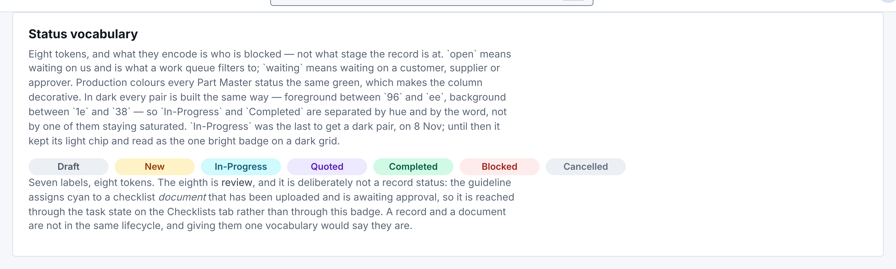

# Status badge

> **Status: stable** · `src/ui/Badge.tsx` · specimen at `/design-system`
> Written to the template set by [`button.md`](button.md).

---

<!-- ds:specimen badge -->

## When to use

To show **what state a record is in** — on a record header, in a status
column, in an activity row. One word and one colour, together.

## When not to use

| Instead of a status badge | Use | Why |
|---|---|---|
| A count, a tag or a label that is not a lifecycle state | `.vy-pill` | 17 hand-written call sites already do this. A badge carries the status vocabulary; a pill carries anything else |
| A mode the screen is in, rather than a state the record is in | `data-token="editing"` by hand | See *The eighth token* below |
| Something the user can click or change | A chip, a select, a button | A badge is output. Nothing about it is operable |
| Priority | `Priority` | A dot and a word, on its own scale ([B5.3](../design-system.md#b53-column-roles--a-width-is-chosen-once-by-role) gives it 104px) |

---

## Anatomy

A single `<span>`. The **word is the content** — there is no icon, no dot, and
nothing hidden from a screen reader, because a status that is only a colour is
not a status ([E1](../design-system.md#e1--accessibility)).

| Part | Rule |
|---|---|
| **Container** | `--vy-status-slot-w` = **104px fixed**, `--vy-shape-full`. The fixed width is the point: a status column scans as a straight edge instead of a ragged one. This was GAP-01 against the old library; with our own component it is one token |
| **Label** | `--vy-text-xs` at `--vy-weight-semibold`, never wraps |

---

## The vocabulary



Seven tokens, and what they encode is **who is blocked** — not what stage the
record has reached.

| Token | Means | Live words that map to it |
|---|---|---|
| `draft` | nothing has happened yet | Draft, Pending |
| `open` | waiting on **us** — this is what a work queue filters to | New, Open |
| `progress` | actively being worked by us | In-Progress, Partial |
| `waiting` | waiting on **someone else** — a customer, a supplier, an approver | Quoted, Submitted, Awaiting Approval |
| `done` | closed successfully | Active, Released, Completed, Paid |
| `blocked` | stopped, needs intervention | Obsolete, Blocked, Overdue |
| `cancelled` | closed without completing | Inactive, Cancelled, Closed |

> **Seven, not six.** `waiting` was added after the Quotations screen showed
> why six is one short: an RFQ that is *New* (nobody has picked it up) and one
> that is *Quoted* (sent, awaiting the customer) are opposite states — one
> needs you today, one does not — and both collapsed onto `open` and rendered
> the same amber. Two distinct states sharing a colour is the defect the
> production Part Master has, where every status is green.

**An unknown word falls back to `draft`.** `STATUS_TOKEN[value] ?? 'draft'` —
so a lifecycle word nobody has mapped renders grey rather than throwing. That
is the right failure, and it is also silent: a new status word will look
deliberately neutral instead of looking wrong.

### The eighth token, and a ninth that cannot be reached

- **`editing` is a mode, not a status.** Blue, because blue means *changed*,
  which is what the record is while it shows. It is written by hand —
  `QuotationDetail.tsx:476` — and is deliberately **not** in `STATUS_TOKEN`,
  so `StatusBadge` can never produce it.
- **`review` has colours and no way to render them.** `--vy-status-review-fg`
  and `-bg` exist in `tokens.css` and are documented in
  [B1.6](../design-system.md#b16-status-vocabulary), but there is no
  `STATUS_TOKEN` entry and no `.vy-badge[data-token="review"]` rule. The
  specimen page explains why — cyan belongs to a checklist *document* awaiting
  approval, reached through the task state on the Checklists tab, not through
  this badge — but a reader of `tokens.css` alone cannot tell that the pair is
  intentionally unreachable from here.

---

## Contrast

Every pair is measured on every push by `contrast:check`. Light theme, each
foreground on its own background:

| | draft | open | progress | waiting | done | blocked | cancelled |
|---|---|---|---|---|---|---|---|
| | 6.34 | 6.37 | 6.49 | 7.57 | 6.78 | 6.78 | **4.54** |

`cancelled` is the tightest in the set and still clears 4.5. In dark every
pair sits between 6.16 and 9.30.

> `progress` only got a dark pair on **8 Nov 2026**. Before that it kept its
> light colours and showed as one bright cyan chip on a dark grid.

---

## Behaviour

Nothing. The badge has no states: no hover, no focus, no disabled. It is not
focusable and not operable. If a status needs to be changed, the control that
changes it is a separate thing beside it.

## Accessibility

| | |
|---|---|
| Name | The visible word **is** the accessible name. No `aria-label`, no `title` |
| Colour | Never carries meaning alone — the word is always present. This is the rule [E1](../design-system.md#e1--accessibility) lists first |
| Role | None. A `<span>` of text is what a status is |
| Contrast | Measured per pair, above |

## API

```tsx
<StatusBadge value={q.status} />
```

| Prop | Type | Default | Notes |
|---|---|---|---|
| `value` | `string` | — | A live lifecycle word. Unknown values render as `draft` |

The `status` column role renders this automatically — `renderCell.tsx` maps
`data-role="status"` to it, so a grid never writes the badge by hand.

---

## One thing worth fixing

**`.vy-pill` has 17 hand-written call sites and no component.** `Pill` lived
in `Badge.tsx` and nothing ever rendered it, so it was removed with a note
rather than silently. The callers to convert, if it comes back, are in
`PartDetail`, `ChecklistsTab`, `ConversationsTab` and `StepSummary`. Until
then a pill is a class, which means nothing stops two screens drawing it
differently.

## Related

[B1.6 · Status vocabulary](../design-system.md#b16-status-vocabulary) ·
[B5.3 · Column roles](../design-system.md#b53-column-roles--a-width-is-chosen-once-by-role) ·
[E1 · Accessibility](../design-system.md#e1--accessibility) ·
[Chip](chip.md)

## Recent changes

| Date | Change |
|---|---|
| 8 Nov 2026 | This page. The file comment said "six-token vocabulary" and had done since `waiting` was added — corrected to seven |
| 8 Nov 2026 | `progress` given a dark pair — it was the one status still rendering its light colours on a dark grid |
