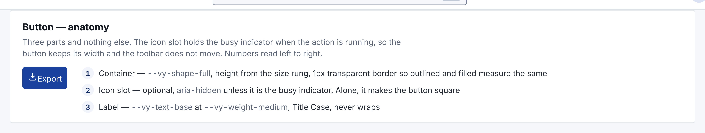
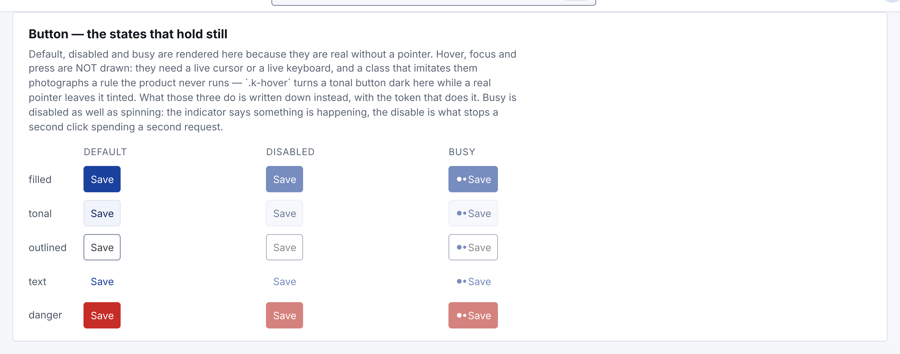

# Button

> `src/ui/Button.tsx` · specimen at `/design-system`

---

<!-- ds:tab examples -->

<!-- ds:specimen button -->

<!-- ds:tab usage -->

<!-- ds:specimen button-usage -->

> The five cards above are the rules on this page that are about
> **appearance**, drawn rather than described — asked for on 20 Nov. They are
> the real components, in the real stylesheet, so a "Don't" card cannot quietly
> stop being wrong.

> **Model page.** This is the template every other component page should
> follow. The order of the sections is the order a reader needs them in, and
> it is the order Carbon, Atlassian and GOV.UK all arrive at: what it is for,
> when *not* to use it, what it is made of, how it behaves, what it costs a
> screen reader, and only then the API.

## When to use

A button performs an **action on this screen**: save, export, confirm, add a
line, run the quotation.

## When not to use

| Instead of a button | Use | Why |
|---|---|---|
| Navigating to another screen | A link, or `Button asChild` wrapping a router `Link` | A destination must be a real anchor: middle-click, copy-link and the browser's own back behaviour all depend on it |
| More than four actions in one toolbar | Four buttons and `More ▾` | [D1](../design-system.md#d1--buttons). The limit is what keeps the primary action findable |
| A destructive action in the open | `More ▾`, then a confirm dialog | Delete, deactivate and reverse sit behind the menu; the dialog is where `danger` appears |
| A choice between options | Radio, select, or a segmented control | A row of buttons that set a value reads as five actions, not one question |
| Toggling something on and off | A checkbox or switch | A button does not carry state a user can read |

---

<!-- ds:tab examples -->

## Anatomy



| | Part | Rule |
|---|---|---|
| 1 | **Container** | `--vy-radius-md`, 6px — her Shape section's figure for a button, and what Kendo's `rounded="medium"` already drew. Height comes from the size rung, never from padding. A 1px transparent border so `outlined` and `filled` measure the same |
| 2 | **Icon slot** | Optional. `aria-hidden` — except while busy, when it holds the indicator and carries the only machine-readable statement that the action is running |
| 3 | **Label** | `--vy-text-base` at `--vy-weight-medium`, Title Case ([B2](../design-system.md#b2--typography)), `white-space: nowrap` |

An icon with no label makes the button **square**: `k-icon-button` gives the
box equal padding on both axes and floors the glyph at one line box, so width
and height arrive at the same number out of the size scale.

---

## Variants

The ladder is Material 3's, and it encodes **emphasis, not colour**.

| Variant | When | In the build |
|---|---|---|
| `filled` | **One per view.** The most likely next step | 46 call sites |
| `outlined` | The default for everything else — and the value you get if you pass no variant | 10 explicit, 41 implicit |
| `text` | Tertiary, inside dense rows | 18 |
| `tonal` | A secondary action that still needs weight | 7 |
| `danger` | Destructive — and it goes behind `More ▾` | 6 |

**`danger` draws itself two ways, and the component picks.** The BA's Buttons
section, 16 Nov: *"Danger in a toolbar: outlined, 1px danger border and danger
text. Danger in a confirm popup: filled, white text."* Her rule is about
**place**, so the component reads the place — `useInDialog()`, out of
`ui/dialogDepth.ts` — instead of asking each call site which one it is in. A
second variant name would have put the same decision in 6 call sites and every
future one, where it can be got wrong without anyone noticing.

| Where | Fill | Why |
|---|---|---|
| A toolbar, a record bar, a panel | **outlined** | It sits beside Save and Export and must not out-shout them |
| Inside a `Dialog` | **filled** | The question has already been asked; the red button *is* the answer |

> **The outlined half does not use Kendo's `outline-error`,** and the reason is
> dark mode. `--kendo-color-error` is `--vy-danger` (red-600), which measures
> **5.52:1** on white — fine — and **3.10:1** on the dark surface, which clears
> 1.4.11's 3 for the border and fails 1.4.3's 4.5 for the label. The fill has no
> such problem, because white on red-600 *is* 5.52, which is exactly why that
> token is a fill and why text has its own. So the outlined danger takes
> `--vy-danger-text` (7.74 light, 7.16 dark) and `--vy-danger-boundary` (4.30 /
> 5.04). Nothing else about Kendo's button is touched.



> `tonal` is the one rung Kendo does not have. MD3's tonal is a filled button
> at low emphasis — a tinted surface with dark text — and Kendo's ladder goes
> straight from `solid` to transparent `flat`. It takes Kendo's **solid
> structure** and our tint. `flat` was tried first and could not work:
> `.k-button-flat` sets `background: initial !important`, which no specificity
> beats. This is the one place the component paints over Kendo, and it is
> deliberate.

---

## Sizes

| Size | Height | Kendo rung | Where |
|---|---|---|---|
| `md` *(default)* | 34px | `medium` | Forms, dialogs, page actions |
| `sm` | 32px | `small` | Toolbars, dense rows — 28 call sites, the most used |
| `xs` | 26px | `xs` | An icon button **inside a grid row** |

> **`xs` has zero call sites.** It is defined in the component, in
> `--vy-control-row`, and in `kendo-subset.scss`, and nothing uses it. Either
> the grid-row icon buttons should be on it, or the rung should go.

---

## States

Three of these cannot be photographed. A specimen that fakes them photographs
a rule the product never runs — putting `.k-hover` on a tonal button turns it
solid primary, while a real pointer leaves it tinted — so the specimen above
draws the three that hold still and the rest are written down here, with the
token that drives them.

| State | What happens | Token |
|---|---|---|
| **Default** | — | — |
| **Hover** | A translucent layer over the base colour, via `::before`. `tonal` additionally deepens its tint | `--vy-state-hover: .08`, and `--vy-brand-subtle-strong` for tonal |
| **Focus** | Keyboard only — `:focus-visible`, so a mouse click leaves no ring. 2px outline, offset 2px | `--vy-brand-boundary` |
| **Press** | The same layer, heavier | `--vy-state-press: .12` |
| **Disabled** | Dimmed, `cursor: not-allowed`, no state layer | `--vy-state-disabled: .6` — deliberately **not** MD3's `.38`, which is past legible at 13px |
| **Busy** | Indicator in the icon slot, and the button is **disabled** | — |
| **Unavailable** | The disabled *look*, but not `disabled`: hoverable, focusable, and the reason is in the tooltip | `--vy-disabled-bg` / `--vy-disabled-text` |

**`busy` is two things, and the disable is the load-bearing half.** The
indicator says something is happening; the disable is what stops a second
click spending a second marketplace request. The loader replaces the icon
rather than sitting beside the label, so the button keeps its width and
nothing in the toolbar moves when the action starts. It pulses rather than
spins: the dots hold still, so the control does not appear to rotate.

**The indicator takes the `on-` colour of the fill it sits on.** Found while
writing this page: it used to take Kendo's `base` theme colour, `#3d3d3d`, on
the two solid variants — **1.19:1** against `--vy-brand` and **1.97:1**
against `--vy-danger`, where WCAG 1.4.11 asks 3:1 of an indicator that carries
meaning. The two it failed on were the primary action and the destructive one.

`themeColor` could not fix it: Kendo's Loader accepts only
`base | primary | secondary | tertiary`, and none of them is light. So the
colour comes from the token that already exists for the job — the `on-` half
of the fill's own pair.

| | Fill | Indicator | Before | After |
|---|---|---|---|---|
| `filled`, light | `--vy-brand` | `--vy-brand-on` | 1.19:1 | **9.16:1** |
| `filled`, dark | `#7f9ce1` | `#0f131a` | — | **6.86:1** |
| `danger` | `--vy-danger` | `--vy-danger-on` | 1.97:1 | **5.52:1** |
| `tonal` / `outlined` / `text` | — | `--vy-brand-text` | 8.31–9.16:1 | unchanged |

---

### Unavailable, and why it is not `disabled`

The BA specifies a **No permission** state: *"looks like Disabled, tooltip:
You don't have permission to {action}. Ask your admin."* It is worth having —
a user who cannot tell *not yet* from *not allowed* asks support about the
wrong thing — and it cannot be built out of `disabled`.

**A disabled button has no hover target.** Kendo disables with `.k-disabled`,
which sets `pointer-events: none`, so a `title` on it never opens. This
codebase had already written two of these reasons and shipped them unread:
ViewSetting's *"A new view needs a name"* and *"Built-in views cannot be
deleted"* had been on screen since they were typed and had never once appeared.
Measured on 20 Nov, which is when they were moved to `unavailable`.

So the state keeps the button **in** the page:

| | |
|---|---|
| `aria-disabled="true"` | says it cannot be used, without removing it — also the ARIA practices' own advice where the user needs to find out *why* |
| Stays in the tab order | a keyboard user who cannot reach the control cannot read the reason either |
| The press is swallowed in the component | `onClickCapture` and `onKeyDownCapture`, so a handler on an ancestor row does not fire either |
| `cursor: not-allowed` | the pointer is the only thing that tells a mouse user to stop and hover |

`noPermission('delete this view')` returns her sentence, so the wording is in
one place rather than four slightly different places. `disabled` is still the
right prop for a control that is merely **not ready** — a Save with nothing
changed — where there is nothing to explain.

> **No permission is not wired to anything in the product**, because this
> prototype has no permission model to read. The state exists, is documented
> and is on the usage cards; the first screen that knows a user's role passes
> the prop.

---

> Both of those pairs are **already in `contrast:check`** as *label on the
> brand fill* and *label on the danger fill*. Using the paired token instead
> of a loose colour did not just fix the ratio — it put the indicator inside
> a check that already runs on every push. That is the argument for pairing
> every surface with its `on-`.

---

<!-- ds:tab usage -->

## Content

- Title Case, and the label **names the outcome**: `Publish`, not `OK`.
  `Publish` then produces a toast reading `Published` ([D6](../design-system.md#d6--words)).
- **Never "Cancel" outside a dialog.** In edit mode the word is
  **Discard Changes**. In a confirm dialog the safe button names what the user
  keeps — `Keep Order`, `Keep Editing` — so `Cancel · Cancel Order` can never
  read as two cancels.
- Labels do not wrap and do not truncate; if a label needs more room, the
  label is too long.

---

## Behaviour

- **Placement**: all buttons on the **left** of a toolbar; a smart-button
  group or step indicator on the right. At most four visible, the rest behind
  `More ▾` — and the label is always the word *More* with a chevron, never `⋯`.
- **Keyboard**: `Enter` and `Space` activate, as for any `<button>`. Focus
  order follows the DOM; the toolbar is before the record.
- **`asChild`** renders the styling onto a child element — a router `Link` —
  so navigation stays a real anchor. It is the one path that does not go
  through Kendo, which is why `a.vy-btn` has to cancel the underline by hand:
  without it a line runs through the middle of a filled pill.

---

## Accessibility

| | |
|---|---|
| Icon-only | **Needs `aria-label`.** The glyph is `aria-hidden`, so without one the button has no accessible name. 97 `aria-label` call sites in the build |
| Busy | `aria-busy="true"` on the button; the loader carries `role="status"` and `aria-label="Working"`, so it is announced without interrupting |
| Disabled | A disabled button leaves the tab order. Where the user needs to know *why*, the reason belongs in a tooltip or beside the control, not in the button |
| Focus | `:focus-visible` only — a ring for the keyboard, nothing on a mouse click |
| Target size | `sm` carries `min-height` to clear the 24px minimum (WCAG 2.5.8); padding alone left the pager one pixel short. `xs` clears it at 26px unaided |

---

<!-- ds:tab code -->

## API

```tsx
<Button variant="filled" size="sm" icon={<Icon name="download" />} busy={running}>
  Export
</Button>
```

| Prop | Type | Default | Notes |
|---|---|---|---|
| `variant` | `filled \| tonal \| outlined \| text \| danger` | `outlined` | |
| `size` | `xs \| sm \| md` | `md` | |
| `icon` | `ReactNode` | — | Arbitrary node, not a Kendo icon name. Alone, makes the button square |
| `busy` | `boolean` | `false` | Sets `disabled` and `aria-busy`, swaps the icon for the indicator |
| `disabled` | `boolean` | `false` | For *not ready yet*. Leaves the tab order, and a tooltip on it will not open |
| `unavailable` | `string` | — | For *you can't, and here is why*. The disabled look, `aria-disabled`, press swallowed, sentence in the tooltip. `noPermission(action)` builds the BA's permission wording |
| `asChild` | `boolean` | `false` | Render the styling onto the child instead |
| `ref` | `Ref<HTMLButtonElement>` | — | Hands back the **DOM node**, not Kendo's handle |
| …rest | `ButtonHTMLAttributes` | — | Minus `ref` |

**Kendo mapping**

| Variant | `themeColor` | `fillMode` |
|---|---|---|
| `filled` | primary | solid |
| `danger` (in a dialog) | error | solid |
| `danger` (anywhere else) | error | **outline** + `.vy-btn--danger-outline` |
| `outlined` | base | outline |
| `text` | primary | flat |
| `tonal` | primary | **solid** + `.vy-btn--tonal` |

> **`ref` is destructured out of the spread on purpose.** In React 19 `ref` is
> an ordinary prop, so `Popover.Trigger asChild` injects its ref and the
> spread handed it to Kendo — whose `useImperativeHandle` exposes
> `{ element, selected }`, not a node. Radix measured that object and
> re-measured it forever: every page rendered nothing, with "Maximum update
> depth exceeded". The fix is to unwrap Kendo's handle to the node underneath,
> because a DOM node is what this component's contract promises.
>
> **`disabled` is destructured out for the same kind of reason.** Written
> above the spread, `{...rest}` put its own `disabled={false}` back on top and
> the busy button stayed clickable — measured on Get Prices, the one button in
> this product where a second click costs money.

---

<!-- ds:tab usage -->

## Gotcha worth knowing

**The two paths have to be kept in step, and on 21 Nov they were not.** The
`asChild` path takes its geometry from `.vy-btn` in `components.css`; every
other button takes Kendo's. `.vy-btn` carried `--vy-radius-pill` and Kendo's
`rounded="medium"` draws 6px, so on the [error state](error-state.md) *Try
again* and *Back to Home* sat in one row at 6px and 999px — same height, same
ink, different shape. Three links in the whole build reach that rule, which is
why it survived the radius pass that repointed its token without asking
whether the value was still right.

**Nothing automated catches this.** `css-consistency` reads the stylesheets
and sees two legitimate tokens; `contrast:check` reads colour. It is a
computed value on two elements that are supposed to be the same object, and it
was found by a person looking at a screenshot.

`.vy-btn--filled`, `--outlined`, `--text` and `--danger` in `components.css`
apply **only on the `asChild` path**. A normal button goes through Kendo and
carries Kendo's classes alone, so those rules never match it. Only
`.vy-btn--tonal` is passed through to the Kendo element. Styling a variant by
editing `.vy-btn--outlined` and seeing nothing change is this, not a
specificity problem.

---

## Related

[D1 · Buttons](../design-system.md#d1--buttons) ·
[B5.1 Control heights](../design-system.md#b51-control-heights) ·
[D4 · Dialogs](../design-system.md#d4--dialogs) ·
[D6 · Words](../design-system.md#d6--words) ·
[E1 · Accessibility](../design-system.md#e1--accessibility)

<!-- ds:tab changelog -->

## Recent changes

| Date | Change |
|---|---|
| 21 Nov 2026 | **The `asChild` path was drawing a pill.** `.vy-btn` carried `--vy-radius-pill` while every real button takes Kendo's `k-rounded-md` at 6px, so *Try again* and *Back to Home* sat side by side on the error state at 6px and 999px. A leftover from MD3's `shape-full`: the radius pass of 18 Nov repointed the token and never asked whether the value was right, because only three links reach this rule |
| 20 Nov 2026 | **Usage tab drawn.** Five Do/Don't card pairs, from the rules already on this page — live components, not exported images, so a card cannot go stale against a token change. The mechanism is `compare` on a specimen `Example`, so any component page can do the same |
| 20 Nov 2026 | **`danger` resolves its fill from where it is** — outlined on a toolbar, filled in a dialog, per the BA's Buttons section. Via `useInDialog()`, not a second variant name. The outlined half takes `--vy-danger-text` / `--vy-danger-boundary` rather than Kendo's `outline-error`, which measured **3.10:1** for its label on the dark surface |
| 20 Nov 2026 | **`unavailable` added** — the BA's No-permission state, generalised to every "you can't, because". Found while building it: `.k-disabled` sets `pointer-events: none`, so the two reasons already written on ViewSetting's Save and Delete had never been readable. Both moved over |
| 8 Nov 2026 | `.vy-btn--outlined` moved to `--vy-border-control`. It reaches the DOM only through `asChild` — a router Link wearing a button's clothes, such as *Back to Home* on the [error state](error-state.md) — so the bridge's `.k-button-outline` correction never touched it and it kept the structure token at **1.64:1**. Its hover, which went to `--vy-border-mid` at **2.58:1**, no longer moves the border at all: `data-state-layer` already carries the state |
| 8 Nov 2026 | Busy indicator moved to the fill's `on-` token — 1.19:1 → 9.16:1 on `filled`, 1.97:1 → 5.52:1 on `danger` |
| 8 Nov 2026 | This page, and two specimens on `/design-system`. The first state specimen drew hover and press with Kendo's `.k-hover` / `.k-active` classes and was wrong: Kendo never sets them, and `.k-hover` turned a tonal button solid primary. Replaced with the three states that hold still |
| 7 Nov 2026 | `--vy-font-mono` removed; labels were never mono, but `kbd` and `code` inside buttons were |
| 22 Oct 2026 | 12px floor; `sm` label went 11px → 12px |
