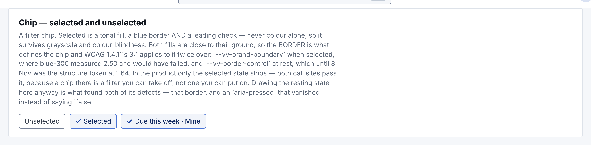

# Chip

> **Status: trial** — two call sites, both selected, one screen. The
> unselected state is correct now but has still never shipped, so it has not
> been in front of a real user. Written to the template set by
> [`button.md`](button.md). `src/ui/Chip.tsx` · specimen at `/design-system`

---

<!-- ds:specimen chip -->

## When to use

To show **a filter that is currently on**, and to let the user take it off in
one click. Today that is the queue filter and the customer filter on
Quotations — you arrive with the filter already applied, and the chip is how
you get rid of it.

## When not to use

| Instead of a chip | Use | Why |
|---|---|---|
| Showing a state the user cannot change | [Status badge](badge.md) or `.vy-pill` | A chip is a button. Anything that is not operable must not look operable |
| Choosing one of several options | Radio, or a select | A row of chips reads as several independent on/off filters, not one choice |
| An action | [Button](button.md) | A chip toggles a value; a button does something |
| More than about six filters at once | `FilterToolbar` | Past that the chips wrap and the row stops being scannable |

---

## Anatomy



| Part | Rule |
|---|---|
| **Container** | `<button type="button">`, `--vy-shape-sm`, 1px border. Not a `<div>` with a click handler — it has to be reachable and operable from the keyboard |
| **Check** | 13px, leading, `aria-hidden`. Present **only** when selected |
| **Label** | `--vy-text-base`. `--vy-weight-medium` when selected, regular when not |

**Selected is three things at once**: a tonal fill, a blue border, and the
check. Never colour alone, so the state survives greyscale and
colour-blindness — the same rule the status vocabulary follows.

---

## States

| State | What happens | Token |
|---|---|---|
| **Unselected** | White fill, grey border | `--vy-border-control` |
| **Selected** | Tonal fill, blue border, leading check, medium weight | `--vy-brand-subtle`, `--vy-brand-boundary`, `--vy-brand-text-deep` |
| **Hover** | State layer over the base colour, via `data-state-layer` | `--vy-state-hover: .08` |
| **Press** | The same layer, heavier | `--vy-state-press: .12` |
| **Focus** | Keyboard only. 2px outline, offset 2px | `--vy-brand-boundary` |

### Why the border carries the contrast requirement

The selected fill is `--vy-brand-subtle`, which measures **1.11:1** against
the page — effectively white. So the fill is not what tells you the chip is
there; the **border** is, and WCAG 1.4.11's 3:1 applies to it. blue-300
measured 2.50 and would have failed. blue-400 clears it, so this needed no
new token — unlike the grey scale, the blue scale had a conforming step
already.

> That was found while verifying the border token, not by the contrast sweep:
> the chip renders on one screen, conditionally, so it was on neither page
> the sweep walked.

---

## Two defects the resting state was hiding — fixed 8 Nov

Neither could bite, because **the unselected state never rendered** — both
call sites pass `selected`. Both would have bitten the first time somebody
rendered a chip the user can switch on. Drawing that state on the specimen
page is what found them.

**1 · The resting border was 1.64:1.** It used `--vy-border-strong`, which
[B1.4](../design-system.md#b14-lines) defines as **structure** — panel edges,
table rules — explicitly the category WCAG 1.4.11 does *not* cover. A chip is
something you operate, so its boundary is the category that *is* covered, and
`--vy-border-control` is the token measured for that job.

| | Before | After |
|---|---|---|
| Resting border, light | 1.64:1 | **3.06:1** |
| Resting border, dark | — | **3.83:1** |
| Selected border, light / dark | 4.48 / 3.82 | unchanged |

> The comment above that rule reasons carefully about the **selected** border
> — why blue-400 and not blue-300 — and says nothing about the resting one.
> That is how it survived: the question had been asked once, about the other
> half of the control.

> **The chip was not the only one.** A sweep of every focusable control on
> 12 routes found six more using a structure token as a control boundary.
> `.vy-rt-swatch` was fixed the same day — a 20px button whose whole content
> is a colour fill, one of them `transparent`, so the border was the only
> thing showing there was a button there at all. The rest, including the
> Kendo `outlined` button, are listed in
> [`vien-control-08nov.md`](../vien-control-08nov.md).

**2 · `aria-pressed` disappeared when unselected.** `aria-pressed={selected}`
with `selected` undefined renders **no attribute at all**, so the chip was
announced as a plain button: a screen-reader user was told there is a filter
and not told it is off. `false` is a different statement from absent. Now
`aria-pressed={!!selected}`, which renders `"false"`.

---

## Content

- The label is the **filter**, not an instruction: `Due this week · Mine`, not
  `Filter by due date`.
- Two facts in one chip are joined with ` · `, as in the queue chip, which
  carries the queue name and the scope.
- No count inside the chip. A count belongs to the thing being filtered.

## Behaviour

- `onClick` **removes** the filter at both call sites. The chip is a filter
  you take off, not one you put on.
- Keyboard: `Enter` and `Space`, as for any `<button>`.
- Hover and press come from `data-state-layer`, the same one rule every
  control in the system uses — nothing invents its own hover.

## Accessibility

| | |
|---|---|
| Name | The visible label |
| State | `aria-pressed` — but see defect 2 |
| Check icon | `aria-hidden`; the pressed state is what carries the meaning to a screen reader |
| Focus | `:focus-visible` only |
| Colour | Selected is fill **and** border **and** check — never colour alone |

## API

```tsx
<Chip label={`${queue.label} · ${scope === 'team' ? 'Team' : 'Mine'}`}
      selected onClick={clearQueue} />
```

| Prop | Type | Default | Notes |
|---|---|---|---|
| `label` | `string` | — | Text only. No node, no icon |
| `selected` | `boolean` | `undefined` | Drives the fill, the border, the check and `aria-pressed` |
| `onClick` | `() => void` | — | At both call sites, clears the filter |

---

## A naming mismatch worth settling

The comment in `Chip.tsx` calls this an MD3 **input chip**. In MD3 an input
chip is the one with a trailing remove ✕; the leading check is a **filter
chip**. This component is drawn as a filter chip and behaves as an input chip
— clicking it removes the thing. Both readings are defensible, but the name
should match one of them, because the next person will build the other kind
from this file.

## Related

[Button](button.md) · [Status badge](badge.md) ·
[B1.4 · Lines](../design-system.md#b14-lines) ·
[E1 · Accessibility](../design-system.md#e1--accessibility)

## Recent changes

| Date | Change |
|---|---|
| 8 Nov 2026 | Resting border moved from `--vy-border-strong` to `--vy-border-control` — 1.64:1 → 3.06:1; `aria-pressed` now renders `"false"` instead of vanishing |
| 8 Nov 2026 | This page. Unselected state added to the specimen, which is what surfaced both defects |
