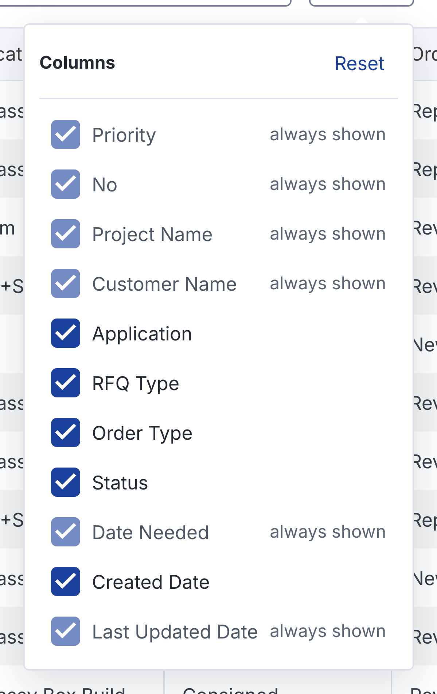

# Column chooser

> `src/ui/ColumnChooser.tsx` · 5 call sites.

---

<!-- ds:tab usage -->

## When to use

On **every grid with three or more columns** ([D3](../design-system.md#d3--grids)),
to let a user turn columns on and off for themselves.

## When not to use

| Instead of the column chooser | Use | Why |
|---|---|---|
| Changing what every user sees | **View Setting** | The chooser is one person's view of one grid. A View is a shared, saved definition |
| A grid with one or two columns | Nothing | There is nothing to choose between |
| Hiding a column nobody should ever see | Leave it out of the grid | A column in the list says it exists; if it must not exist, it must not be listed |
| Reordering columns | Not supported | Order comes from the grid definition |

---

## What it replaced, and why

A **"Show 2 more columns"** button, which the 25 August review flagged as a
confusing label and asked to become a checklist. Three problems, only one of
them the wording:

1. It **named its effect on one particular state**, so it read as a different
   control depending on what was already on.
2. It had **two states only** — the shipped set, or the shipped set plus
   everything. Wanting one extra column meant taking all of them, and a column
   you never use could not be turned off.
3. It **hid the existence** of the extra columns behind a count.

A checklist has none of those, and it shows what is available.

---

<!-- ds:tab examples -->

<!-- ds:specimen column-chooser -->

## Anatomy

| Part | Rule |
|---|---|
| **Trigger** | A `sm` [Button](button.md). `outlined` normally; **`tonal` once any column is hidden**, so a grid that is not showing everything says so from the toolbar |
| **Label** | `Columns`, and `Columns (5/11)` when some are off — shown over total |
| **Popover** | `align="end"`, 6px offset, with an arrow |
| **Head** | `Columns` and a `text` Button reading *Reset* |
| **Row** | A `k-checkbox-lg`, the column title, and — where it applies — *always shown* and a note |

**A required column shows as ticked and disabled, not absent.** Otherwise its
row is missing from a list that claims to be every column, and the user
wonders where it went.

> Measured on Project Requirements: **11 columns, 6 of them required**. Every
> required row is both ticked and disabled — verified, not assumed. It is
> worth knowing that more than half this particular list cannot be changed;
> a chooser where most rows are fixed is closer to an inventory than a choice,
> and if that ratio grows the control is the wrong one.

---

## States

| State | What happens |
|---|---|
| **All columns on** | Trigger is `outlined`, label reads `Columns` |
| **Some hidden** | Trigger is `tonal`, label reads `Columns (n/total)` |
| **Required row** | Ticked, disabled, *always shown* beside it |
| **Disabled checkbox** | Dimmed by `--vy-state-disabled`, **not** greyed by a fill — a grey wash took the white tick with it, on exactly the control whose job is to say "this column is always shown" |

<!-- ds:tab usage -->

## Content

- *Reset*, not *Restore defaults* — it is one word for one action, inside a
  popover that is already titled.
- A column that ships hidden carries a **note saying why**, so a reviewer does
  not have to ask.
- *always shown* is lower case and quiet; it is a fact about the row, not a
  second label.

## Behaviour

- Toggling applies immediately; there is no OK button.
- The popover closes on `Esc` and on a click outside — and `Esc` closes **the
  innermost thing first** ([D4](../design-system.md#d4--dialogs)).
- The trigger carries `.vy-columns-btn` purely as a **layout hook**: below
  820px the toolbar moves it onto the search row so the view picker is not
  squeezed to `Def…`. There was nothing else to select it by.

## Accessibility

| | |
|---|---|
| Checkbox | A real `<input type="checkbox">`. Kendo styles it; the bridge gives the unchecked box its `--vy-border-control` edge, because Kendo's default was 1.30:1 |
| Disabled | Kendo styles disabled **by class**, so a plain `disabled` attribute renders identically to an enabled box. The bridge keys off `:disabled` for exactly this control |
| Indeterminate | The select-all header box is white with a blue dash; the dash carries the state at 5.9:1, and the bridge gives the box the same visible edge as an empty one |
| Popover | Focus moves into it; `Esc` returns focus to the trigger |

<!-- ds:tab code -->

## API

| Prop | Type | Notes |
|---|---|---|
| `columns` | `{ field, title, on, note?, required? }[]` | `required` renders ticked and disabled |
| `hiddenCount` | `number` | Drives both the variant and the label |
| `onToggle` | `(field) => void` | |
| `onReset` | `() => void` | |

---

<!-- ds:tab usage -->

## Related

[Button](button.md) · [Filter toolbar](filter-toolbar.md) ·
[View picker](view-picker.md) ·
[D3 · Grids](../design-system.md#d3--grids) ·
[E2 · KendoReact](../design-system.md#e2--kendoreact)

<!-- ds:tab changelog -->

## Recent changes

| Date | Change |
|---|---|
| 17 Nov 2026 | Live examples — it had a page and a photograph, but nothing that could be pressed |
| 8 Nov 2026 | This page |
