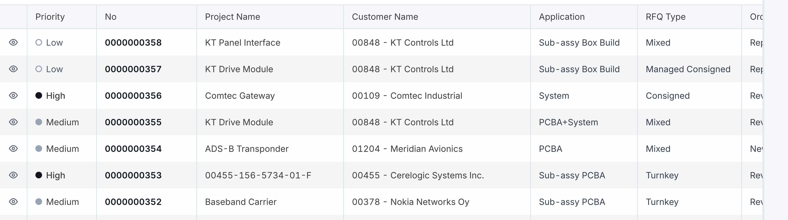

# Data grid

> `src/ui/DataGrid.tsx` · the whole list screen in one component.

---

<!-- ds:tab usage -->

## When to use

A module's main list: Project Requirements, Part Master, BoM List, Packing
List. One per screen.

## When not to use

| Instead of DataGrid | Use | Why |
|---|---|---|
| A short list inside a record | [MiniTable](mini-table.md) | Tens of rows, not tens of thousands — and it carries per-column filter cells the main grid does not need |
| A handful of key-value facts | A field group | A two-column table of labels and values is a form wearing a grid's clothes |
| Something the user reads once and never sorts | A list | Sorting, paging and a column chooser are furniture if nobody moves them |

---

<!-- ds:tab examples -->

## Anatomy

The component is the **whole screen**, not the table:

| Ours | Kendo's |
|---|---|
| Title, subtitle, KPIs, actions | The table — header, rows, cells, sort controls |
| Search, filter panel, [view picker](view-picker.md), [column chooser](column-chooser.md) | |
| Empty state, loading skeleton, [pager](pager.md) | |

**Kendo's own pager, filter row and column menu are all switched off**, because
each already exists here answering a written requirement — and two of a thing
is worse than either.

---

<!-- ds:tab usage -->

## Rules that are ours, not Kendo's

Twenty-one props, each one a requirement somebody signed off. None of them
changed when the table underneath did:

1. **Column width follows from [column role](../design-system.md#b53-column-roles--a-width-is-chosen-once-by-role)**, never a pixel guess.
2. **A sparse column hides with a stated reason**, carried in the column
   chooser.
3. **Density is a user preference**, not a screen's decision.
4. **The identifier is the affordance** — the part number is the link, not a
   separate *Open* button.
5. **Zebra is by record, not by row**, so a record spanning two AML rows reads
   as one band.

---

## Selection is ours, and select-all means *this page*

Kendo has its own selection model. The guideline's is specific, and the
difference matters:

> Select-all covers **this page**. Across 2,000 rows a bare *all* selects
> records the user has never seen and is about to export.

It is a normal column here, with our checkbox in it.

---

## Two columns whose width is a number, not a role

The checkbox track and the View column hold one control each, whose size never
changes — so a role width would only make them wider than their content.

**That is true of a cursor and false of a finger.** The control is the same
20px box either way, but its *target* is not: on touch the label fills the
cell and has to be 44px to be worth tapping. At 40 it was the last thing in
the app still under the floor.

| | Mouse | Touch |
|---|---|---|
| Checkbox track | 40px | **44px** |
| View column | 40px | **44px** |

> **It has to be a number, which is why it is not in CSS.** Kendo writes
> column widths into a `colgroup` from this prop; a media query cannot reach
> them. The first attempt raised the *cell* from CSS instead, and the cell
> simply overflowed the column it could not resize — four overlapping targets,
> with the checkbox sitting on top of the next cell's link.

---

## Virtualisation is gone, and that is not a loss

It existed to make 21,941 rows one scroll. Then the 25 Aug review replaced
infinite scroll with a [pager](pager.md), and the pager offers 20, 50 or 100.

> Virtualising 100 rows is machinery with nothing to do, and it cost a
> `useEffect` to re-measure on every density change. The page slice goes
> straight to the Grid.

<!-- ds:tab examples -->

## States

Covered by [D5](../design-system.md#d5--the-four-screen-states) and the
[list screen pattern](../patterns/list-screen.md): skeleton on first load,
dimmed-with-overlay on a recalculation, a real empty state, an error screen.

<!-- ds:tab usage -->

## Accessibility

| | |
|---|---|
| Sort | Three states — asc → desc → **none** — the third being the guideline's *Clear* |
| Row link | The identifier is a real link: middle-click and copy-link work |
| Selection | A real checkbox per row, plus a header one scoped to the page |
| Density | A user preference, so a reader who needs taller rows gets them everywhere |

---

## Related

[MiniTable](mini-table.md) · [Pager](pager.md) ·
[Column chooser](column-chooser.md) · [Filter toolbar](filter-toolbar.md) ·
[List screen](../patterns/list-screen.md) ·
[D3 · Grids](../design-system.md#d3--grids)

<!-- ds:tab changelog -->

## Recent changes

| Date | Change |
|---|---|
| 8 Nov 2026 | This page |
| 9 Nov 2026 | The inline cell editor's focus edge is fixed in dark — `--vy-brand-boundary-strong` blue-400 → blue-200, 2.88 → 7.22 on its worst ground. Its *hover* edge was already right, and is now swept: `border:check` measures hover and focus as well as rest |
