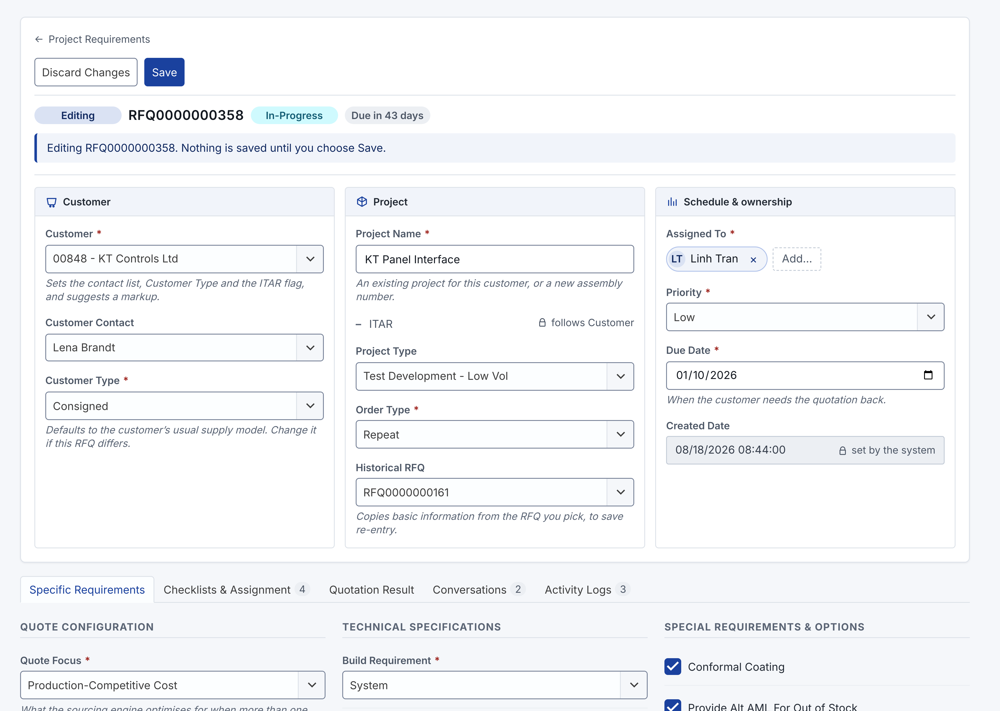

# Field row

> `src/ui/FieldRow.tsx` · **one labelled row — every label-and-value pair in
> the app is this.**

---

<!-- ds:tab examples -->

<!-- ds:specimen field-row -->

<!-- ds:tab usage -->

## When to use

Wherever a label sits above a value: a record field, a dialog form, a computed
read-out, a radio pair.

## When not to use

| Instead of FieldRow | Use | Why |
|---|---|---|
| A field that has a declaration | `RecordField` | It maps a `FieldDef` to the right control — **and renders through this row** |
| A grid cell | [MiniTable](mini-table.md) / [Data grid](data-grid.md) | A column header is not a label |
| A control that labels itself | The control, with `label` omitted | A checkbox carries its own words |

---

## Why it exists

The same **fourteen-line block** was written out **fourteen times**: ten
inside `RecordField`'s own switch, and once each in `CreateBomDialog`,
`MpnMapping`, `PartDetail` and `StepConfigBom`. Two of those files
independently defined a helper called `ReadValue`, with different props.

> **Nothing was visibly broken. That is the problem with this kind of drift.**
> Each copy is defensible on its own, and the cost only shows up as a hint
> that sits a little differently on one screen, a required marker missing on
> another, a locked note saying *"set by the record"* where the value is
> actually computed.
>
> **The most repeated element in the product is the last one that should be
> rendered four ways.**

---

<!-- ds:tab examples -->

## Anatomy

| Part | Rule |
|---|---|
| **Label** | Above the value. Omit where the control carries its own |
| **Required** | A red asterisk after the label, in **both** modes |
| **Control** | Whatever the caller passes |
| **Note** | Why this value cannot be edited |
| **Hint** | Guidance, under the control |
| **Error** | A validation message, **instead of** the hint — never both |

---

<!-- ds:tab usage -->

## The note is what marks a row locked

Not a flag, not a prop called `locked` — **the presence of the reason**.

> A locked row with no reason reads as broken, or as a missing permission.

So the three real notes in the product each say something different:
*set by the system* · *follows Customer* · *computed, not stored*. A row that
cannot produce one of those has no business being locked.

---

## `labelId` versus `htmlFor`

Two different jobs, and getting them the wrong way round is silent:

| | Use | For |
|---|---|---|
| `htmlFor` | Points a `<label>` at **one control** | An input, a select |
| `labelId` | Puts the id **on the heading itself** | A group of controls with no single element to point at |

**A radio group is labelled *by* its heading**, not by a label pointing into
it. A `<label for>` aimed at a group of three radios labels whichever one it
happens to hit.

## What it deliberately does not do

**It does not choose a control.** `RecordField` maps a field *declaration* to
an input, and is still the right thing wherever a `FieldDef` exists — it now
renders through this row.

This row is for the cases a declaration cannot describe: a button, a radio
pair, a computed read-out. Which is exactly what the four local copies were
for.

## Accessibility

| | |
|---|---|
| Label | `htmlFor` for a single control, `labelId` for a group |
| Required | Visible asterisk, and the control carries `required` |
| Error | Replaces the hint, so a screen reader is never read two instructions |
| Locked | The note is real text beside the padlock, which is `aria-hidden` |
| Empty | `empty` renders the value as **absent** rather than as a value — a blank box and *"nothing here"* are different facts |

<!-- ds:tab code -->

## API

| Prop | Type | Notes |
|---|---|---|
| `label` | `ReactNode` *(optional)* | Omit where the control labels itself |
| `htmlFor` / `labelId` | `string` | One or the other, never both |
| `required`, `invalid`, `editing`, `empty` | `boolean` | |
| `hint` / `error` | `ReactNode` | `error` wins; they never both render |
| `note` | `ReactNode` | Its presence marks the row locked |
| `variant` | `'radio' \| 'wide'` | Layout only |

---

<!-- ds:tab usage -->

## Related

[Field](field.md) · [Select](select.md) · [Radio group](radio-group.md) ·
[D2 · Fields](../design-system.md#d2--fields) ·
[Record form](../patterns/record-form.md)

<!-- ds:tab changelog -->

## Recent changes

| Date | Change |
|---|---|
| 8 Nov 2026 | This page |
