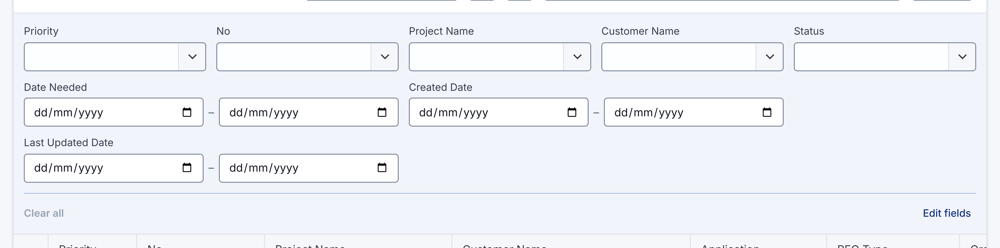

# Filter toolbar

> `src/ui/FilterToolbar.tsx` · 7 call sites, the most used component in
> `src/ui` after Button.

---

<!-- ds:tab usage -->

## When to use

On a list screen, behind the funnel, to narrow what the grid shows by the
fields the **saved View** declares.

## When not to use

| Instead of the filter toolbar | Use | Why |
|---|---|---|
| Finding one record you can name | The search box | Search is for a value you already know; filters are for a set you are describing |
| A filter the user switches on and off constantly | A [chip](chip.md) above the grid | A chip shows the filter is on without opening a panel |
| Choosing which fields can be filtered | **View Setting → Filter tab** | That is a property of the View, not of this session. The *Edit fields* link goes there |
| Narrowing by a column the View does not carry | Add the field to the View first | The toolbar cannot invent a field |

---

## Two things it deliberately does not do

Both were got wrong in an earlier prototype and are worth stating, because
both look like omissions until you know the live system.

**1 · There are no operators.** A field takes a value; a date takes an
explicit *From* and *To*. No *contains*, no *is not*, no *between*. The
condition builder that was here before was **invented outright** — the live
screen has no operators at all.

**2 · Every field is visible at once.** There is no add-a-condition flow.
Which fields appear is a property of the saved View, chosen in View Setting.

---

<!-- ds:tab examples -->

## Anatomy

Measured on Project Requirements, 1024px: **8 fields, 3 of them date ranges**,
laid out on a 4-column grid.

| Part | Rule |
|---|---|
| **Panel** | Not rendered at all when collapsed — **not hidden with CSS**. Checked: `.vy-filter-toolbar` is absent from the DOM until the funnel is pressed |
| **Field** | A small label above the control. One per View field |
| **Date range** | **One label, two inputs**, spanning two grid columns. The range is one idea — labelling it *Date Needed From* and *Date Needed To*, as the live screen does, doubles the label count and makes the pair read as two unrelated filters |
| **Foot** | *Clear all*, then the applied count, then *Edit fields* |

**A blank option is how a single filter is cleared.** Without it the only way
back to *any* is *Clear all*, which throws away every other field too.

---

## States

| State | What happens |
|---|---|
| **Collapsed** *(default)* | The panel is not in the DOM. A permanently open filter panel costs vertical space on every visit to serve the minority of visits that filter |
| **Open, nothing applied** | *Clear all* is **disabled**; no count is shown |
| **Open, n applied** | *Clear all* enabled; "**n filters applied**", singular at 1 |

> *Clear all* is disabled rather than hidden when there is nothing to clear.
> An enabled button that does nothing is worse than an absent one, because
> pressing it looks like a failure.

---

<!-- ds:tab usage -->

## Content

- The field label is the **View's** label, unchanged. The toolbar does not
  rename anything.
- The count reads *1 filter applied* / *2 filters applied* — the singular is
  handled, not fudged with "(s)".
- *Edit fields* says what it opens; its tooltip says why you would.

## Behaviour

- The funnel toggles it: *"clicking the button again collapses the filter
  area"*, as the live screen has it.
- Changing a field applies immediately. There is no Apply button, because
  there is nothing to batch — one field, one value.
- **The *Edit fields* link exists because two screens are both called
  "Filter".** A user who wants a field that is not here has no way to guess
  the answer lives behind a button called *Setup View Template* at the other
  end of the toolbar. The link goes from where the problem is noticed to
  where it is fixed. It is omitted inside the View Setting preview, which is
  already there.

## Accessibility

| | |
|---|---|
| Date range | Each input carries its own `aria-label` — *"Date Needed from"*, *"Date Needed to"* — because the two share one visible label |
| Clear all | Disabled, so it leaves the tab order when there is nothing to clear |
| Count | Plain text beside the button, read in order |
| Panel | Absent rather than hidden, so nothing focusable is left behind it |

<!-- ds:tab code -->

## API

| Prop | Type | Notes |
|---|---|---|
| `fields` | `ViewField[]` | From the saved View. `kind: 'date-range'` gets the paired control |
| `values` | `FilterValues` | A flat map; a range writes `fieldFrom` and `fieldTo` |
| `onChange` | `(next) => void` | Whole-object replace, not a patch |
| `onClear` | `() => void` | |
| `activeCount` | `number` | Drives both the disabled state and the count |
| `onEditFields` | `() => void` *(optional)* | Omit inside View Setting |

---

<!-- ds:tab usage -->

## Related

[Chip](chip.md) · [Button](button.md) ·
[D3 · Grids](../design-system.md#d3--grids) ·
[B5.3 · Column roles](../design-system.md#b53-column-roles--a-width-is-chosen-once-by-role)

<!-- ds:tab changelog -->

## Recent changes

| Date | Change |
|---|---|
| 8 Nov 2026 | This page |
