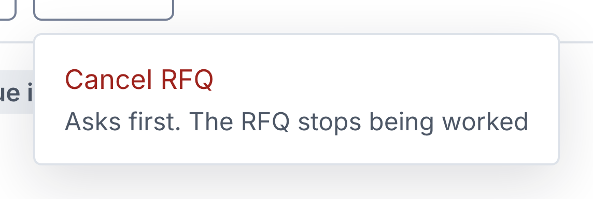

# More menu

> **Status: stable** · `src/ui/MoreMenu.tsx` · the control that makes
> [D1](../design-system.md#d1--buttons)'s "at most four visible" rule
> possible. Written to the template set by [`button.md`](button.md).

---

## When to use

On a record's action bar, to hold the actions that are **rare, heavy or
destructive** — so the four that are none of those stay on the bar.

## When not to use

| Instead of More ▾ | Use | Why |
|---|---|---|
| An action used every day | A [Button](button.md) on the bar | A menu is a second press, and the work of the day should not cost one |
| A choice that changes a value | A select or [chip](chip.md) | A menu item does something; it does not set something |
| Hiding a crowded bar | Fix the bar | If five actions are all frequent, the screen has a different problem |
| A confirm | A dialog | The menu opens the dialog; it is not the dialog |

---

## What goes in it

On an RFQ: **Confirm RFQ** and **Cancel RFQ**.
On the bar: **Run Quotation**, **Edit**, **BoM Comparison**.

The dividing line is frequency and consequence, not category.

---

## Why it exists — asked for, and already measured

**Asked for**, 8 October 2026 design review, slide 3: *"Some 'danger' or less
use actions such as Deactivate, Cancel, Reprint … should be kept under a More
button"*, and *"always place 'unexpected' action button at the end of the
button's list (not from 1st place)"*.

**And measured from the other side first.** Cancel RFQ sat **69px** from Run
Quotation. Nielsen Norman's work on consequential options placed next to
benign ones says that is where accidental clicks come from. Moving those
actions behind one more press is a stronger version of the same fix than the
spacing chosen in September.

> Two sources, one answer, reached independently. That is the strongest kind
> of decision this system has, and it is why the rule is not negotiable at
> four items.

---

## Anatomy

| Part | Rule |
|---|---|
| **Trigger** | Kendo's own button classes — `k-button-outline k-button-base` — so it is **the same object** as the buttons beside it. A menu trigger that looks like a different species is how a user learns to skip it |
| **Label** | Always the word **More**, with a chevron. **Never `⋯`** |
| **Panel** | `align="start"`, 6px offset, 15–20rem wide |
| **Item** | A full-width button; optional note underneath |
| **Danger item** | `--vy-danger-text-deep`, and `--vy-danger-subtle` on hover |

A note under a label is *"the sentence a rare action needs and a frequent one
does not"* — on the bar there is no room for it, which is another reason the
rare ones belong here.

---

## States

| State | What happens |
|---|---|
| **Closed** | Just the trigger |
| **Open** | Panel below, focus inside |
| **Item hover** | `--vy-surface-app` fill; a danger item fills `--vy-danger-subtle` instead |
| **Item disabled** | `--vy-on-surface-subtle`, `cursor: not-allowed`, and a `title` saying **why** |
| **No items** | The component renders **nothing** — not an empty menu, not a disabled trigger |

## Content

- The item is a verb phrase naming the outcome: *Cancel RFQ*, not *Cancel*.
  The object matters, because *Cancel* alone in a menu beside a dialog that
  also says *Cancel* is two different cancels.
- A disabled item carries its reason in `title`. A disabled thing with no
  reason is a dead end.

## Behaviour

- Selecting an item **closes the menu first**, then runs the action — so a
  dialog does not open behind an open popover.
- `Esc` closes the menu; with a dropdown open inside it, the first `Esc`
  closes only the dropdown ([D4](../design-system.md#d4--dialogs)).
- Destructive items open a confirm; the menu itself destroys nothing.

## Accessibility

| | |
|---|---|
| Trigger | `aria-label="More actions"`, so the accessible name is not the bare word *More* |
| Items | Real `<button>`s in a list |
| Danger | Colour **and** position — danger items sit apart, so the distinction is not carried by hue alone |
| Disabled | A disabled item leaves the tab order; its reason is in `title` |

## API

| Prop | Type | Notes |
|---|---|---|
| `items` | `MoreItem[]` | Empty ⇒ renders nothing |
| `label` | `string` | Defaults to `More` — change it only with a reason |

`MoreItem`: `{ label, onSelect, danger?, disabled?, title?, note? }`

---

## Related

[Button](button.md) ·
[D1 · Buttons](../design-system.md#d1--buttons) ·
[D4 · Dialogs](../design-system.md#d4--dialogs) ·
[D6 · Words](../design-system.md#d6--words)

## Recent changes

| Date | Change |
|---|---|
| 8 Nov 2026 | This page |
