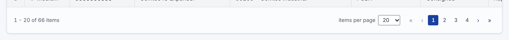

# Pager

> **Status: stable** · `src/ui/Pager.tsx` · at the foot of every grid.
> Written to the template set by [`button.md`](button.md).

---

## When to use

At the foot of a grid, always. It carries both the **position** and the
**record count**.

## When not to use

| Instead of the pager | Use | Why |
|---|---|---|
| A list that is always short | Nothing | A pager over one page is furniture |
| A feed read from newest down | Infinite scroll | A feed has no "page 7" anyone wants |
| Showing the total somewhere else | The pager | The 25 Aug review moved the count **out of the page title** and into here, on purpose |

---

## Anatomy

| Part | Rule |
|---|---|
| **Count** | `1 - 20 of 66 items`, worded as the live pager words it. `No items` when empty |
| **Page size** | `20 · 50 · 100` — exactly what the live pager offers. It was 25/50/100 here and was wrong |
| **Nav** | `«` `‹` · numbers · `›` `»`, in a `<nav aria-label="Pagination">` |

**Page size lives in the pager, not the toolbar**, because it is a property of
the pager and means nothing without it.

**First and last are not optional.** The guideline requires *"the user can
navigate to the first, previous, next, and last page"*, each disabled at its
own end. Without them, reaching the end of 17 pages is 17 clicks.

---

## The number window

Up to 7 pages, every number is shown. Past that: **first, a window of three
around the current page, last**, with `…` for the gaps.

> 330 records at 25 a page is 14 buttons, which is a row of numbers nobody
> reads. Keeping first and last visible means *jump to the end* stays one
> click, which is the only long-distance move people actually make.

Measured on Project Requirements: 66 items at 20 a page = 4 pages, so all four
numbers show and there are **zero** gaps — the window only appears when it
earns its place.

---

## What it replaced, and what that cost

It replaces **infinite scroll over a virtualised list**, and it is worth being
straight that the old one was faster: the previous grid rendered about **40
DOM nodes for 21,941 records** and never paged.

The trade is deliberate. **A pager gives a position.** Scrolling tells you
there is more; a pager tells you where you are, lets you come back to where
you were, and is how everyone on this system already reads a long list.

Virtualisation stays underneath, so a 200-row page is still cheap.

---

## States

| State | What happens |
|---|---|
| **First page** | `«` and `‹` disabled |
| **Last page** | `›` and `»` disabled |
| **Current page** | `aria-current="page"` on that number |
| **Empty** | Count reads `No items`; nav still renders at one page |
| **Page size changed** | Jumps back to **page 0** — staying on page 7 of a list that now has 3 pages is a blank screen |

## Content

- `1 - 20 of 66 items`, with thousands separators from `toLocaleString()`.
- `items per page`, lower case, beside the select — a label, not a heading.

## Accessibility

| | |
|---|---|
| Landmark | `<nav aria-label="Pagination">` |
| Arrows | Each carries `aria-label` — *First page*, *Previous page*, *Next page*, *Last page*. The glyphs `«‹›»` are not names |
| Current | `aria-current="page"`, not colour alone |
| Gap | `…` is `aria-hidden` — it is not a destination |
| Target size | The arrows are `sm` Buttons, which carry a `min-height` floor for the 24px minimum; padding alone left them at 23px |

## API

| Prop | Type | Notes |
|---|---|---|
| `page` | `number` | Zero-based |
| `pageSize` | `number` | One of 20 / 50 / 100 |
| `total` | `number` | |
| `onPage` | `(p: number) => void` | |
| `onPageSize` | `(n: number) => void` | The component resets the page itself |

---

## Related

[Button](button.md) · [Column chooser](column-chooser.md) ·
[Filter toolbar](filter-toolbar.md) ·
[D3 · Grids](../design-system.md#d3--grids)

## Recent changes

| Date | Change |
|---|---|
| 8 Nov 2026 | This page. The page-size `<select>` moved to `--vy-border-control`; it was on the structure token at 1.27:1 |
