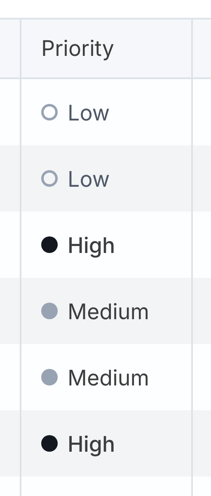

# Priority

> **Status: stable** · `src/ui/Priority.tsx` · 29 lines, the smallest
> component here. Written to the template set by [`button.md`](button.md).

---

## When to use

Wherever a record's priority is shown — a grid column, a record header, a
queue card.

## When not to use

| Instead of Priority | Use | Why |
|---|---|---|
| A workflow state | [Status badge](badge.md) | Priority is how urgent; status is where it is |
| Letting the user set it | A select | This renders a value. It is output |
| A severity that came from the system, not a person | A row tone or `danger` | Priority is somebody's judgement about a record |

---

## Anatomy



A dot and a word. The column is **104px** ([B5.3](../design-system.md#b53-column-roles--a-width-is-chosen-once-by-role))
— a dot, a gap and six characters, which is the widest word, *Medium*.

| Level | Dot | Text |
|---|---|---|
| **High** | Filled, `--vy-on-surface-strong` | `--vy-weight-medium` |
| **Medium** | Filled, `--vy-on-surface-faint` | default |
| **Low** | **Hollow** — a 1.5px inset ring in `--vy-border-mid` | `--vy-on-surface-muted` |

**Low is a hollow dot, not a pale one.** On a grid a light fill and an empty
cell look the same, and *no priority set* is a different fact from *low
priority*. The ring says there is a value here.

---

## It was three stars, and the change is the point

The 25 August review asked for a dot plus a word. The reasoning holds and is
worth keeping where someone will find it:

- **A star rating is an input idiom.** It says *rate this*. On a read-only row
  it invites a click that does nothing.
- **It makes the reader count.** Two filled stars out of three is a fraction
  the eye has to resolve before it means anything — and it means nothing at
  all unless you already know the scale runs to three.
- ***Medium* needs no scale and no counting.**

The dot keeps the colour, so a row can still be scanned without reading the
words.

> **It encodes by ink, not by hue.** High is near-black, Medium is mid-grey,
> Low is an outline. Printed, photocopied or seen by someone who cannot
> separate hues, the three levels still rank themselves — which is more than
> the status vocabulary can claim, and it is why priority does not borrow the
> accent colours.

---

## Content

Three words only: **High · Medium · Low**. The live record stores 1–3, and
**3 is most urgent** — the mapping is in `priorityLevel()` and nowhere else,
so a screen cannot invent a fourth level or flip the direction.

## Behaviour

None. It is not focusable and not operable.

## Accessibility

| | |
|---|---|
| Name | The visible word. The dot is `aria-hidden` |
| Colour | Never alone — the word is always present |
| Greyscale | The three levels differ by fill **and** by shape, not only by tone |

## API

```tsx
<Priority value={rfq.priority} />
```

| Export | Type | Notes |
|---|---|---|
| `Priority` | `{ value: number }` | 1–3 from the record |
| `priorityLevel` | `(n: number) => PriorityLevel` | The one place the mapping lives |
| `PRIORITY_LEVELS` | `PriorityLevel[]` | For filter options, so the list cannot drift from the renderer |

---

## Related

[Status badge](badge.md) ·
[B5.3 · Column roles](../design-system.md#b53-column-roles--a-width-is-chosen-once-by-role) ·
[E1 · Accessibility](../design-system.md#e1--accessibility)

## Recent changes

| Date | Change |
|---|---|
| 8 Nov 2026 | This page |
