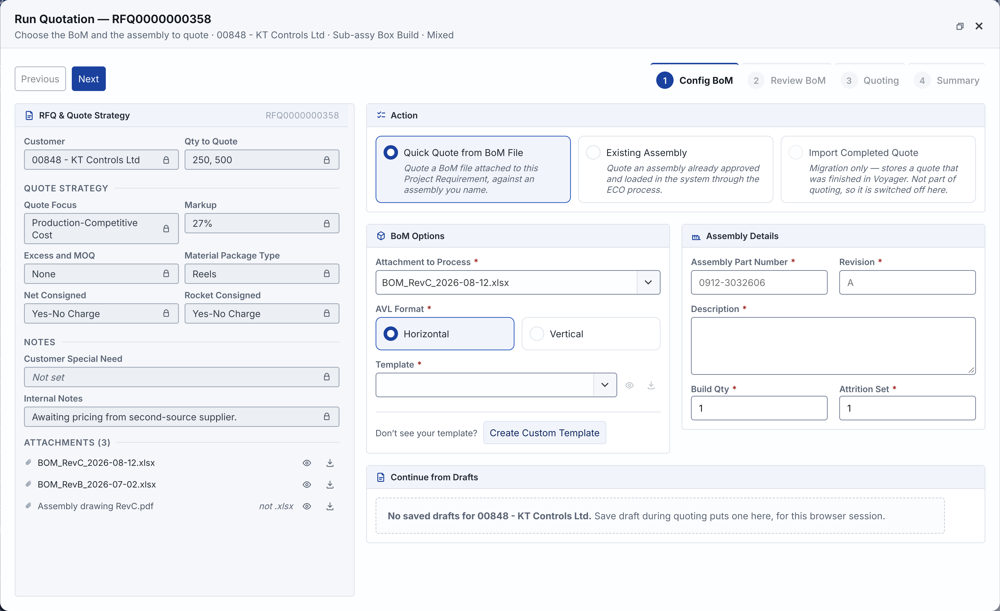

# Radio group

> **Status: stable** · `src/ui/Overlays.tsx` · two shapes, one component.
> Written to the template set by [`button.md`](button.md).

---

<!-- ds:tab examples -->

<!-- ds:specimen radio-group -->

<!-- ds:tab usage -->

## When to use

One choice from **two to four options the user should see at once**.

## When not to use

| Instead of a radio group | Use | Why |
|---|---|---|
| More than about four options | [Select](select.md) | Past that the group is a wall, not a choice |
| On/off | Checkbox | A two-option radio reading Yes / No is a checkbox with extra words |
| An action | [Button](button.md) | A radio sets a value; it does not do anything |
| A choice that reveals nothing | A select | If seeing the options does not help, hiding them costs nothing |

---

## Two shapes

| | List | **Tiles** |
|---|---|---|
| Looks like | One option per line | One card per option, side by side |
| For | An ordinary choice inside a form | **The screen's first question** |

**Tiles are for a group that decides what everything below it means.** Run
Quotation's *Action* is the case: three options, each carrying a sentence,
and the answer changes the meaning of the whole step. That is a lot of page
to spend on a list.

---

## A hint per option, not one per group

Each option carries its own sentence, and **the shape of the group asked for
it, not taste**:

> Run Quotation step 1 offers an Action that **cannot be chosen**, and a hint
> that follows the selection can never explain the one option nobody can
> select.

The customer's own 16 Oct mockup writes a `help` string on each of her three
Actions, for the same reason.

---

## A disabled option stays on screen

*Import Completed Quote* is shown and not selectable — a flow the system has
but this moment does not.

> **Leaving it out answers a different question.** Absence reads as *"the
> system cannot do this"*; a disabled option with its reason beside it reads
> as *"not from here"*.

**The reason is not optional for one of these.** A control that refuses
without saying why is the exact thing being avoided.

---

## Two details that were measured, not guessed

**The dot.** An earlier version had `box-sizing: border-box` leaving **4px of
content width for an 8px dot**, so the dot sat 8px from the left edge and 4px
from the right. It looked almost right, which is why it survived.

**The group name.** `useId` names each group, because radios are exclusive by
**shared `name`** — two groups on one screen sharing a name would silently
become one group, and choosing in the second would clear the first.

## Content

- An option label is the **thing**, not an instruction: *Existing Assembly*,
  not *Use an existing assembly*.
- The hint is one sentence and says what the option **does**, or why it is
  unavailable.

## Accessibility

| | |
|---|---|
| Grouping | Labelled by its heading via `labelId` on the [field row](field-row.md) — never a `<label for>` pointing into the group |
| Name | Unique per group, from `useId` |
| Hint | Associated with its own option, so it is read with that option |
| Disabled | Announced as disabled, with its reason as real text |
| Keyboard | Arrows move within the group; the group is one tab stop |

<!-- ds:tab code -->

## API

| Prop | Type | Notes |
|---|---|---|
| `options` | `readonly RadioOption[]` | `{ value, label, hint?, disabled? }` |
| `value` / `onChange` | `string` / `(v: string) => void` | |
| `label` | `string` | The group's heading |
| `tiles` | `boolean` | Cards instead of a list |

---

<!-- ds:tab usage -->

## Related

[Field row](field-row.md) · [Select](select.md) ·
[Wizard](../patterns/wizard.md) ·
[D2 · Fields](../design-system.md#d2--fields)

<!-- ds:tab changelog -->

## Recent changes

| Date | Change |
|---|---|
| 8 Nov 2026 | This page |
