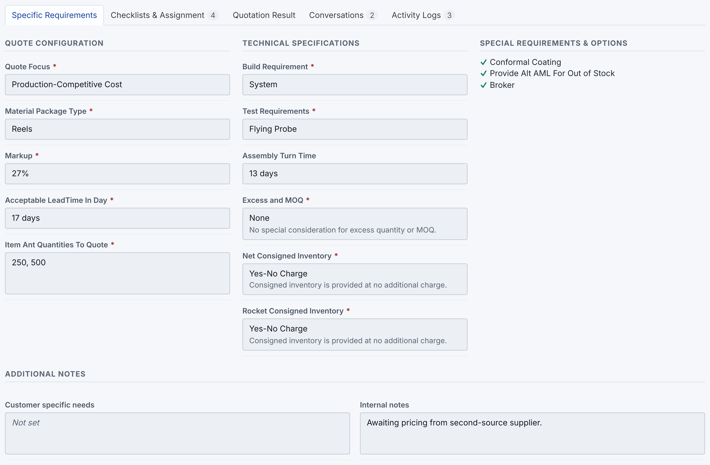

# Tabs

> **Status: stable** · `src/ui/Overlays.tsx` · 6 call sites, every one of
> them a record. Written to the template set by [`button.md`](button.md).

---

## When to use

To divide **one record** into sections the user switches between without
leaving it: Specific Requirements, Checklists, Quotation Result,
Conversations, Activity Logs.

## When not to use

| Instead of tabs | Use | Why |
|---|---|---|
| Steps in a job with an order | [Wizard](../patterns/wizard.md) | Tabs say *these are peers*; a stepper says *this comes first* |
| Two sections, both short | Both, stacked | A tab that hides four lines costs a click to save nothing |
| Separate records | Routes | A tab you cannot link to is a page you cannot come back to |
| A filter | [Chip](chip.md) or the [filter toolbar](filter-toolbar.md) | |

---

## Anatomy



| Part | Rule |
|---|---|
| **Strip** | Directly under the record identity, **inside the same panel** |
| **Tab** | Label, plus a count badge where there is something to count |
| **Count** | Only when **greater than zero** — a badge reading `0` is noise with a border |
| **Panel** | Same surface as the record. Not a card inside a card |

**The strip sits under the identity, not above it.** Switching tab must not
cost you the record number — see [Record form](../patterns/record-form.md).

---

## Why this one is wrapped at all

It was chosen as the first Kendo migration because it had **the strongest
evidence and the smallest surface**:

> `k-tabstrip` is the **second-most-common marker in the live bundle (×12)**.
> These are tabs the customer already looks at every day.

All six call sites go through this wrapper, and **the API did not change**, so
none of them were touched.

---

## Keyed by value, not by index

Ours is keyed by **value** — `'general'`, `'quantity'`. Kendo's is keyed by
**index**.

Translating here rather than at the call sites keeps tab identity in the
caller's own vocabulary:

> A reordered tab array would silently change which tab an index selects.
> A string cannot drift that way.

### The unknown-value case is a real difference

Radix showed **no panel** when `value` matched no tab. `findIndex` returns
`-1`, which Kendo treats as *none selected* and renders an empty strip.

This clamps to the first tab instead, because that is the better failure:

> A mistyped value shows the wrong tab, which someone notices — rather than
> an empty box, which reads as a broken screen.

No current caller can reach it; every one initialises from its own tab list.
**It is a guard, not a behaviour anyone relies on**, and it is written down so
the next person does not remove it as dead code.

---

## Content

- The label is a **noun phrase**, Title Case: *Checklists & Assignment*, not
  *View checklists*.
- A count is a number alone — no "items", no parentheses.
- Tab labels do not wrap. If one needs to, it is too long.

## Accessibility

| | |
|---|---|
| Roles | Kendo's TabStrip carries `tablist` / `tab` / `tabpanel` |
| Keyboard | Arrows move between tabs, `Tab` moves into the panel |
| Count | Inside the tab's label, so it is part of the accessible name — *"Checklists & Assignment 4"* |
| Identity | The record number is **outside** the tablist, so it is not re-announced on every switch |

## API

```tsx
<Tabs value={tab} onValueChange={setTab} tabs={[
  { value: 'spec', label: 'Specific Requirements', content: … },
  { value: 'checklists', label: 'Checklists & Assignment', count: 4, content: … },
]} />
```

| Prop | Type | Notes |
|---|---|---|
| `tabs` | `{ value, label, count?, content }[]` | `count` renders only when above zero |
| `value` / `onValueChange` | `string` / `(v: string) => void` | The **value**, never an index |

---

## Related

[Record form](../patterns/record-form.md) · [Dialog](dialog.md) ·
[Wizard](../patterns/wizard.md) ·
[E2 · KendoReact](../design-system.md#e2--kendoreact)

## Recent changes

| Date | Change |
|---|---|
| 8 Nov 2026 | This page |
