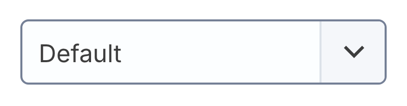

# View picker

> `src/ui/ViewPicker.tsx` · 6 call sites, 44 lines — the smallest component
> with a page, and it has one for a reason.

---

<!-- ds:tab usage -->

## When to use

In a grid toolbar, to switch between the **saved Views** of that list.

## When not to use

| Instead of the view picker | Use | Why |
|---|---|---|
| Narrowing the current list | [Filter toolbar](filter-toolbar.md) | A filter is this session; a View is saved and shared |
| Turning columns on and off for yourself | [Column chooser](column-chooser.md) | The chooser is personal and temporary; a View's columns are part of its definition |
| Creating or editing a View | **View Setting** | The picker only chooses |

---

## Why a 44-line component exists at all

Two reasons, and the second is the one worth keeping.

**1 · It was the same fifteen lines of JSX** copied into Part Master and
Project Requirements.

**2 · It was the last plain `<select>` on either screen** — sitting a few
centimetres from the Kendo ComboBoxes in the filter row beneath it, in a
visibly different design. That is the inconsistency the Kendo phase existed to
remove, and it survived because that phase looked at **form fields** and this
one lives in a **toolbar**.

---

## The part that is easy to get wrong

**It is keyed by `id`, not by `name`.**

A view is chosen by `id` and shown by `name`. Names are typed by the user and
`useViews` enforces **no uniqueness**, so two views may both read *My view*.
Keying on the label would leave one of them unreachable.

> The plain `<select value={v.id}>` this replaced did **not** have that bug.
> It was introduced by the migration and caught before it shipped — which is
> why `Select` had to learn about `{ value, label }` pairs rather than plain
> strings. **A migration that makes a control prettier and quietly less
> correct is not worth doing**, and that sentence is in the component file
> because it is the thing a future rewrite will be tempted to undo.

---

<!-- ds:tab examples -->

<!-- ds:specimen view-picker -->

## Anatomy

| Part | Rule |
|---|---|
| **Container** | `max-width: --vy-view-picker-w` = **180px**. Wide enough for a typed view name, narrow enough that the toolbar keeps room for search and Columns |
| **Select** | `size="small"` — dense, like everything else on a grid toolbar |
| **Label** | `Select View`, visually hidden on the control itself |
| **Option** | `name`, plus **` (default)`** appended for the default view |

`(default)` is **part of the label**, not a separate badge: the list is a
native popup of plain rows, and the fact matters most at the moment of
choosing — which is when the badge would not be rendered.

<!-- ds:tab usage -->

## Behaviour

Choosing a view replaces the grid's columns, filters and sort in one step.
There is no confirm: a View is a saved definition, so switching away from one
loses nothing.

## Accessibility

| | |
|---|---|
| Name | `Select View`, on the control |
| Options | Plain text, including `(default)` — a screen reader reads the fact, it is not carried by styling |
| Height | `small` resolves through `kendo-bridge.css`, not a number written here |

<!-- ds:tab code -->

## API

| Prop | Type | Notes |
|---|---|---|
| `views` | `readonly SavedView[]` | |
| `activeId` | `string` | The **id**, never the name |
| `onChange` | `(id: string) => void` | |

---

<!-- ds:tab usage -->

## Related

[Filter toolbar](filter-toolbar.md) · [Column chooser](column-chooser.md) ·
[D3 · Grids](../design-system.md#d3--grids)

<!-- ds:tab changelog -->

## Recent changes

| Date | Change |
|---|---|
| 17 Nov 2026 | Live examples — it had a page and a photograph, but nothing that could be pressed |
| 8 Nov 2026 | This page |
