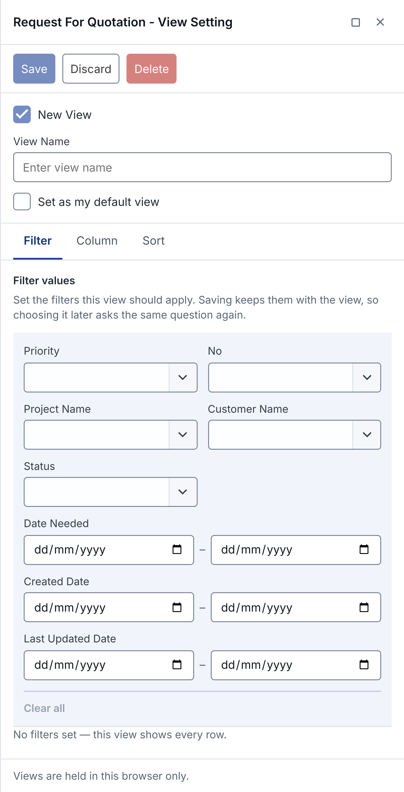

# View setting

> **Status: stable** · `src/ui/ViewSetting.tsx` · the panel behind the gear,
> and the place two other components point at.
> Written to the template set by [`button.md`](button.md).

---

## When to use

To change **the saved View** — which filter fields appear, which columns, in
what order, sorted how. It is the only place those are edited.

## When not to use

| Instead of View setting | Use | Why |
|---|---|---|
| Narrowing this visit's list | [Filter toolbar](filter-toolbar.md) | A filter is a value; a View is a definition |
| Hiding a column for yourself | [Column chooser](column-chooser.md) | The chooser is personal and temporary; this is saved and shared |
| Switching between Views | [View picker](view-picker.md) | This edits one; the picker chooses among them |

---

## A right sidebar, not a modal

The customer's Testing Guideline says it plainly: *display the "Request For
Quotation — View Setting" **right sidebar**"*.

> An earlier note in this file recorded it as a modal — read from a
> screenshot of it **maximised**. A screenshot of a thing at its largest is
> not a description of the thing.

---

## Three tabs, with the live headings and the live button labels

| Tab | Heading | Add button | Also |
|---|---|---|---|
| **Filter** | `FILTER OPTIONS` | *Add more filter(s)* | |
| **Column** | `COLUMN OPTIONS` | *Add a column* | drag to reorder · editable name · width |
| **Sort** | `SORTING OPTIONS` | *Add a column* | drag to reorder · Sort Descending |

---

## Two copy defects, corrected rather than copied

The live build's **Sort** tab reuses the Column tab's hint **verbatim** — it
says *"Add or remove columns"* on a sorting panel — and its add button reads
*"Add a column"*.

Both are logged as **D5** and **D6**, and both are corrected here.

> **A wrong instruction is not a convention worth preserving.** The rule in
> [precedence](../precedence.md) is that the live system governs
> content and purpose — *same fields, same words, same options* — and a
> sentence that describes the wrong panel is none of those. It is a defect
> that happens to be in production.

This is the one place in the system where "match the live screen" is
deliberately not followed, so it is written down twice: here and in the gap
register.

---

## The screen name is a prop, and it had to become one

It was hardcoded to `"Request For Quotation"`.

> Invisible while this component had exactly one caller, and **wrong the
> moment it had two**: Part Master opened a panel announcing itself as
> *Request For Quotation*, to sighted users and screen readers alike.

A heading that names the wrong screen is worse than no heading, because it is
confidently wrong.

---

## Where it is reached from

Two routes, on purpose:

1. **The gear** in the toolbar — the deliberate way in.
2. **"Edit fields"** in the [filter toolbar](filter-toolbar.md) — the way in
   from the place the problem is noticed. A user who wants a filter field that
   is not there has no way to guess the answer lives behind a button called
   *Setup View Template* at the other end of the toolbar.

That second link is omitted **inside** the View Setting preview, which is
already there.

## Accessibility

| | |
|---|---|
| Heading | Names the screen it belongs to, from the prop |
| Tabs | A real tablist |
| Reorder | Drag **and** a keyboard path — a drag-only reorder is a feature half the users cannot reach |
| Dismiss | `Save` · `Discard`, and the panel's own close |

## API

| Prop | Type | Notes |
|---|---|---|
| `view` | `SavedView` | The one being edited |
| `screen` | `string` | For the heading — never hardcoded again |
| `allColumns` / `allFields` | | What may be added |
| `canDelete` | `boolean` | A default view cannot be deleted |
| `onSave` / `onDiscard` / `onDelete` / `onClose` | | |

---

## Related

[View picker](view-picker.md) · [Filter toolbar](filter-toolbar.md) ·
[Column chooser](column-chooser.md) ·
[List screen](../patterns/list-screen.md)

## Recent changes

| Date | Change |
|---|---|
| 8 Nov 2026 | This page |
| 9 Nov 2026 | The density radio's **checked** border was `--vy-brand-boundary-soft` — 1.37:1 in light, 1.89 in dark. The control is transparent at rest, so that border is its whole boundary, and `brand-subtle` on a panel is 1.14 in dark, so the fill does not rescue it. Now `--vy-brand-boundary` (3.44 / 4.76) |
| 9 Nov 2026 | The sort-direction pill drew its resting edge with `--vy-border` at 1.30:1 and its pressed edge with `boundary-light` at 2.08 — pressing it made the boundary fainter. Now `border-control` and `brand-boundary`. `border:check` never swept either: it does not open this panel |
