# Voyager IQ — Hệ thống thiết kế

> **Phiên bản 1.2 · 8/11/2026**
> Linh Long Engineering / Rocket EMS · repository `ll-poc`
> **Nguồn chuẩn:** `src/theme/` · **Trang mẫu sống:** `/design-system`

Mọi thứ trong tài liệu này đều đọc ra từ một bản build đang chạy. Mọi con số
lấy từ source; mọi hình chụp từ ứng dụng thật ở 2×. Chỗ nào con số đến từ việc
**đo màn hình** chứ không phải từ một quy tắc, tài liệu nói rõ.

> **1.2 đổi những gì.** Bốn chỗ trong bản 1.1 kiểm chứng được và không đứng
> vững. Số route ở [C2.3](#c23-building--còn-trên-bệ-phóng) giờ ghi rõ nguồn.
> [B7](#b7--responsive) ghi ba breakpoint trong khi stylesheet có mười một.
> Dòng tương phản ở [E1](#e1--khả-năng-tiếp-cận) dựa trên một bản quét duy
> nhất ngày 5/9; `contrast:check` giờ đo lại 114 cặp token mỗi lần push, và
> bắt được một lỗ hổng trong light theme ngay hôm đó — `subtle` giờ là một
> giá trị đo được, xem [B1.3](#b13-màu-chữ--sáu-bậc). Và `progress` là status
> duy nhất chưa ai làm tối, nên một lưới dark hiện đúng một chip cyan sáng
> giữa bảy chip tối ([B1.6](#b16-bộ-từ-vựng-status)).
>
> Bản 1.2 cũng nói rõ file này **chưa** bao gồm những gì.
> [A1](#a1--tài-liệu-này-là-gì) ghi phạm vi — nền móng đã đủ, component mới
> đủ 29 trang component tính đến 8/11 — và [F4](#f4--một-bộ-bàn-giao-cần-có-gì) liệt kê những chỗ
> thiếu so với các hệ thống đã công bố, đối chiếu lại trực tiếp trên trang
> của họ thay vì qua blog viết về họ.
>
> **1.1 đổi những gì.** Thang chữ in trong bản 1.0 là khối
> `@media (pointer: coarse)` chứ không phải giá trị mặc định — sáu giá trị,
> đều ở [B2](#b2--chữ), in lớn hơn thực tế hai bậc. Đã sửa theo `tokens.css`.
> B2 cũng vẫn mô tả bộ chữ thứ hai; mono đã bỏ cho mã định danh từ 13/10 theo
> yêu cầu khách, xong hẳn 22/10, và token cùng webfont gỡ ngày 7/11. Bậc duy
> nhất còn dưới sàn 12px là `--vy-text-2xs` (10px) đã được nâng. Ngoài ra không
> gì đổi: 156 giá trị token còn lại vốn đã khớp chính xác.

> Đây là bản tiếng Việt của `design-system.md`. Tên token, đường dẫn file, tên
> component và **chữ hiển thị trên giao diện** giữ nguyên tiếng Anh — vì đó là
> chuỗi thật trong sản phẩm, dịch ra là mất khả năng tra cứu.

---

## Mục lục

**Phần A — Bắt đầu từ đây**
[A1 Tài liệu này là gì](#a1--tài-liệu-này-là-gì) ·
[A2 Ba lớp](#a2--ba-lớp) ·
[A3 Năm luật trước khi dựng](#a3--năm-luật-trước-khi-dựng)

**Phần B — Nền tảng**
[B1 Màu](#b1--màu) ·
[B2 Chữ](#b2--chữ) ·
[B3 Khoảng cách](#b3--khoảng-cách) ·
[B4 Hình khối và độ nổi](#b4--hình-khối-và-độ-nổi) ·
[B5 Kích thước](#b5--kích-thước) ·
[B6 Chuyển động](#b6--chuyển-động) ·
[B7 Responsive](#b7--responsive) ·
[B8 Lưới layout](#b8--lưới-layout)

**Phần C — Tài nguyên**
[C1 Icon](#c1--icon) ·
[C2 Hình minh hoạ](#c2--hình-minh-hoạ)

**Phần D — Component và mẫu dựng**
[D1 Nút](#d1--nút) ·
[D2 Trường nhập](#d2--trường-nhập) ·
[D3 Lưới](#d3--lưới) ·
[D4 Hộp thoại](#d4--hộp-thoại) ·
[D5 Bốn trạng thái màn hình](#d5--bốn-trạng-thái-màn-hình) ·
[D6 Chữ nghĩa](#d6--chữ-nghĩa)

**Phần E — Chất lượng**
[E1 Khả năng tiếp cận](#e1--khả-năng-tiếp-cận) ·
[E2 KendoReact](#e2--kendoreact)

**Phần F — Bàn giao**
[F1 Bản đồ file](#f1--bản-đồ-file) ·
[F2 Muốn sửa một thứ thì làm gì](#f2--muốn-sửa-một-thứ-thì-làm-gì) ·
[F3 Quản trị](#f3--quản-trị) ·
[F4 Một bộ bàn giao cần có gì](#f4--một-bộ-bàn-giao-cần-có-gì) ·
[F5 Chỉ mục nguồn](#f5--chỉ-mục-nguồn)

---
---

# Phần A — Bắt đầu từ đây

## A1 · Tài liệu này là gì

Là file mà một người cần để **dựng** một màn Voyager IQ mới mà không phải hỏi
ai, và là file mà người review cần để **phân biệt một màn đúng với một màn
nhìn có vẻ đúng**.

Nó không phải style guide cho công cụ vẽ. Nó mô tả một hệ thống **đang chạy**:
token là CSS custom property, component là React, và trang mẫu render đúng
hàng thật.

> **Nói rõ hiện tại nó đi được tới đâu, thay vì để người đọc tự đoán.** Phần
> nền móng — [Phần B](#phần-b--nền-tảng) — đã đầy đủ: mọi token trong
> `src/theme/` đều có mặt ở đây kèm giá trị đo được, và sáu phép kiểm chứng
> minh lại chúng mỗi lần push. **Phần component thì chưa.**
> [Phần D](#phần-d--component-và-mẫu-dựng) mô tả bốn họ — button, field, grid,
> dialog — trên tổng số **29 component trong `src/ui`**, và mô tả bằng văn
> xuôi chứ chưa theo dạng spec mà một hệ thống tra cứu dành cho từng
> component: dùng khi nào, **không** dùng khi nào, cấu tạo, ma trận biến thể ×
> trạng thái, và một cặp nên/không nên. Chỉ một component — Button — có trang
> mẫu sống.
>
> Tức là: file này đủ để lấy đúng màu, chữ, khoảng cách, mật độ và hành vi
> cho một màn mới, và đủ để review một màn. Nó **chưa** đủ để chọn đúng
> control mà không cần đọc `src/ui`. Thiếu gì và nên lấp theo thứ tự nào thì
> ở [F4](#f4--một-bộ-bàn-giao-cần-có-gì).

## A2 · Ba lớp

| Lớp | Là gì | Ở đâu | Màn hình được dùng không? |
|---|---|---|---|
| **1 · Ramp** | Bảng màu thô. 10 xanh, 12 xám, 4 đỏ | `tokens.css` | **Không** |
| **2 · Vai trò ngữ nghĩa** | `surface`, `on-surface`, `brand`, `danger`… đặt tên theo **việc** | `tokens.css` | **Có — chỉ lớp này** |
| **3 · Component** | Button, Field, Grid, Dialog… | `src/ui`, `src/components` | Có |

Một stylesheet viết `background: var(--vy-grey-0)` là đã đóng cứng **màu
trắng**, không theme nào dời được. Viết `var(--vy-surface)` là đóng cứng
**"màu của một panel"** — và một theme được phép trả lời khác đi.

**Lớp 1 tồn tại để lớp 2 nhất quán. Nó không dùng trong component.**

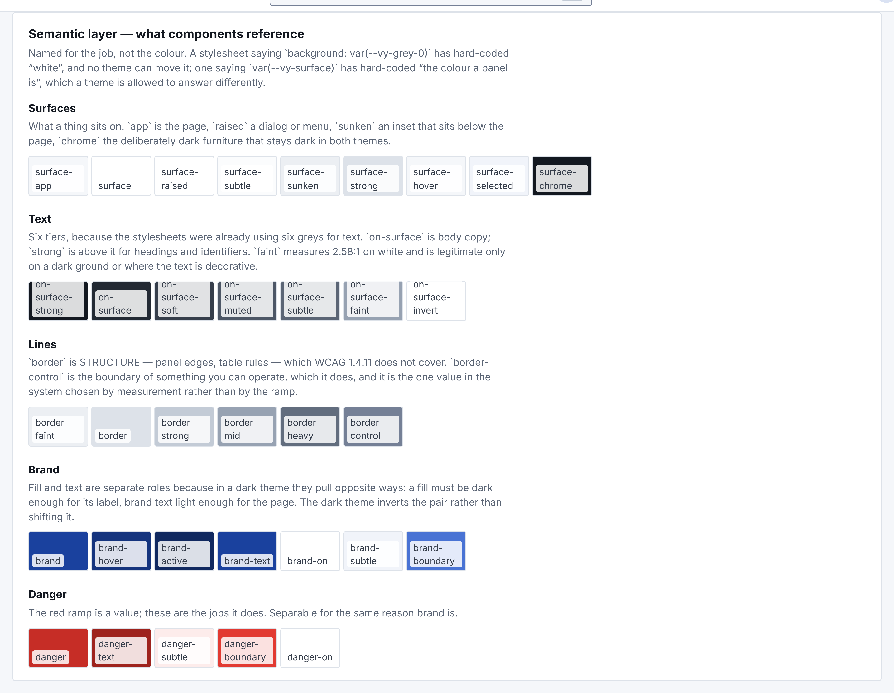

## A3 · Năm luật trước khi dựng

1. **Có token cho thứ này chưa?** Có thì dùng. Chưa thì thêm — và ghi trong
   code vì sao thang hiện tại không có nó.
2. **Không bịa nội dung.** Tên trường, danh sách lựa chọn, từ ngữ status và
   hành vi là **sự thật về nghiệp vụ**, không phải quyết định thiết kế. Tra
   cho ra trước khi vẽ.
3. **Cả hai theme, cả hai mật độ, và 820px.** Một màn chỉ mới được xem ở chế
   độ sáng trên màn 1920px là một màn mới được xem **một lần**.
4. **Số ma thuật phải có ghi chú.** Một bề rộng lệch khỏi role của nó cần
   `widthNote` nói rõ đã đo cái gì.
5. **Cái gì không thật thì phải nói ra.** Một con số suy ra, một hành động
   chưa dựng, một lần gửi giả — mỗi cái đều phải ghi ngay tại chỗ nó xuất
   hiện, không phải chỉ trong commit message.

---
---

# Phần B — Nền tảng

## B1 · Màu

### B1.1 Ramp *(lớp 1 — không dùng trong component)*

Ba ramp, không hơn. Màu thứ tư trên một màn hình là một lỗi, trừ khi đó là
status — và status nằm ở [B1.6](#b16-bộ-từ-vựng-status).

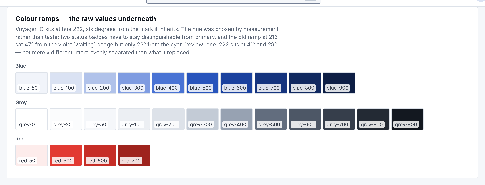


| Token | Giá trị |
|---|---|
| `--vy-blue-50` | `#f1f4fa` |
| `--vy-blue-100` | `#dae2f3` |
| `--vy-blue-200` | `#b0c2ea` |
| `--vy-blue-300` | `#7f9ce1` |
| `--vy-blue-400` | `#4973d4` |
| `--vy-blue-500` | `#2754bc` |
| `--vy-blue-600` | `#1a419e` |
| `--vy-blue-700` | `#15347e` |
| `--vy-blue-800` | `#112960` |
| `--vy-blue-900` | `#0d1e44` |
| `--vy-red-50` | `#fdeceb` |
| `--vy-red-500` | `#e23a32` |
| `--vy-red-600` | `#c62d26` |
| `--vy-red-700` | `#9e231d` |
| `--vy-grey-0` | `#ffffff` |
| `--vy-grey-25` | `#fbfcfd` |
| `--vy-grey-50` | `#f5f7fa` |
| `--vy-grey-100` | `#eceff3` |
| `--vy-grey-200` | `#dde2e9` |
| `--vy-grey-300` | `#c3cbd6` |
| `--vy-grey-400` | `#97a2b2` |
| `--vy-grey-500` | `#626d7e` |
| `--vy-grey-600` | `#4d5766` |
| `--vy-grey-700` | `#363e4b` |
| `--vy-grey-800` | `#232a34` |
| `--vy-grey-900` | `#131820` |


### B1.2 Surface — thứ mà một vật đặt lên

`app` là trang · `raised` là hộp thoại hoặc menu · `sunken` là phần lõm xuống
dưới mặt trang · `chrome` là phần khung tối **cố ý giữ tối ở cả hai theme**.


| Token | Giá trị | Phân giải ra | Dark |
|---|---|---|---|
| `--vy-surface-app` | `var(--vy-grey-50)` | `#f5f7fa` | `#0f131a` |
| `--vy-surface` | `var(--vy-grey-0)` | `#ffffff` | `#161c25` |
| `--vy-surface-raised` | `var(--vy-grey-0)` | `#ffffff` | `#1e2531` |
| `--vy-surface-subtle` | `var(--vy-grey-25)` | `#fbfcfd` | `#131922` |
| `--vy-surface-sunken` | `var(--vy-grey-100)` | `#eceff3` | `#0b0e14` |
| `--vy-surface-strong` | `var(--vy-grey-200)` | `#dde2e9` | `#2a323f` |
| `--vy-surface-hover` | `var(--vy-grey-50)` | `#f5f7fa` | `#1e2531` |
| `--vy-surface-selected` | `var(--vy-blue-50)` | `#f1f4fa` | `#1b2a4a` |
| `--vy-surface-chrome` | `var(--vy-grey-900)` | `#131820` | `#1e2531` |
| `--vy-surface-chrome-soft` | `var(--vy-grey-700)` | `#363e4b` | `#2a323f` |


### B1.3 Màu chữ — sáu bậc

`on-surface` là chữ thân bài; `strong` nằm trên nó, cho tiêu đề và mã định
danh.

**Một bậc được đặt theo nền xấu nhất của nó, không phải theo panel.** `subtle`
là giá trị thứ hai trong hệ thống được chọn bằng **đo đạc** thay vì lấy từ
ramp — sau [`--vy-border-control`](#b14-đường-kẻ), và vì cùng một lý do: không
bậc nào đạt. grey-500 `#626d7e` đạt 4.5 trên nền trắng, nền page và panel chìm
nhưng chỉ tới **4.02** trên `surface-strong`; grey-600 thì vọt lên 5.62, tới
mức không phân biệt được với `muted` nữa và bậc này thôi còn là một bậc.
`#5b6575` nằm trên đúng hue và saturation của grey-500, tối hơn một nấc, và
đạt trên mọi nền — chặt nhất là `surface-strong` ở 4.53.

> ⚠️ **`on-surface-faint` đo được 2.58:1 trên nền trắng.** Chỉ hợp lệ trên nền
> tối, hoặc khi chữ chỉ mang tính trang trí — **không bao giờ** dùng cho thứ
> người dùng phải đọc. Đây là **ngoại lệ duy nhất được khai báo** trong
> [`contrast:check`](#e1--khả-năng-tiếp-cận); mọi cặp còn lại trong bảng đều
> được kiểm mỗi lần push.


| Token | Giá trị | Phân giải ra | Dark |
|---|---|---|---|
| `--vy-on-surface-strong` | `var(--vy-grey-900)` | `#131820` | `#f5f8fc` |
| `--vy-on-surface` | `var(--vy-grey-800)` | `#232a34` | `#e9edf3` |
| `--vy-on-surface-soft` | `var(--vy-grey-700)` | `#363e4b` | `#d3dae4` |
| `--vy-on-surface-muted` | `var(--vy-grey-600)` | `#4d5766` | `#aab4c3` |
| `--vy-on-surface-subtle` | `#5b6575` | — | `#8f9aaa` |
| `--vy-on-surface-faint` | `var(--vy-grey-400)` | `#97a2b2` | `#67727f` |
| `--vy-on-surface-invert` | `var(--vy-grey-0)` | `#ffffff` | `#0f131a` |
| `--vy-on-chrome-muted` | `var(--vy-grey-300)` | `#c3cbd6` | `#c3cbd6` |
| `--vy-on-dark-fg` | `#ffffff` | — | *(same)* |
| `--vy-on-dark-secondary` | `var(--vy-grey-300)` | `#c3cbd6` | *(same)* |
| `--vy-on-dark-muted` | `var(--vy-grey-400)` | `#97a2b2` | *(same)* |
| `--vy-on-dark-hairline` | `rgba(255, 255, 255, .07)` | — | *(same)* |
| `--vy-on-dark-hover` | `rgba(255, 255, 255, .05)` | — | *(same)* |
| `--vy-on-dark-active` | `rgba(43, 99, 184, .22)` | — | *(same)* |


### B1.4 Đường kẻ

`border` là **cấu trúc** — mép panel, kẻ bảng — thứ mà WCAG 1.4.11 **không**
quản. `border-control` là viền của thứ người dùng **thao tác được**, và nó thì
WCAG có quản.

Đây là một trong **hai** giá trị trong hệ thống được chọn bằng **đo đạc** chứ
không lấy từ ramp — cái kia là
[`on-surface-subtle`](#b13-màu-chữ--sáu-bậc). Bản quét ngày 5/9 cho biết lý
do: thang xám **không có bậc nào đạt**. grey-400 `#97a2b2` được 2.58:1 trên
trắng, **thiếu 0.42**; bậc kế tiếp lại vọt lên 5.24, tới mức không phân biệt
được với chữ nằm cạnh nó. Một giá trị được thêm vào giữa hai bậc. Nó chỉ quản
viền: input, textarea, combobox, checkbox, radio, và bất cứ thứ gì mà **cái
viền chính là hình dạng của nó** — chip, nút outlined, ô chọn màu.

> **"Giá trị nhạt nhất mà vẫn đạt" chỉ đạt trên đúng một nền, và tới 8/11 mới
> phát hiện.** Giá trị hồi tháng 9, `#8a94a6`, được đo trên nền trắng. Nhưng
> một control còn nằm trên nền page, trên dải chìm, trên nền hover, trên dòng
> đang chọn. Quét qua mọi nền ngày 8/11 thì nó đạt **đúng một cái**:
>
> | surface | subtle | app | hover | selected | sunken | strong |
> |---|---|---|---|---|---|---|
> | 3.06 | 2.98 | 2.85 | 2.85 | 2.78 | 2.65 | 2.35 |
>
> Đó là lý do một checkbox đo ra **2.85** trong bản quét control trong khi
> kendo-bridge đã trỏ đúng token từ lâu: **token đúng, giá trị thiếu**. Một
> cái viền phải được đặt theo **nền xấu nhất của nó**, cùng luật với một bậc
> chữ. `#758096` là giá trị nhạt nhất trên cùng đường hue và saturation mà
> đạt 3 trên tất cả, chặt nhất là **3.05** trên `surface-strong`.
> `contrast:check` giờ đo mọi đường biên trên **mọi nền** thay vì chỉ trên
> panel, nên chuyện này không quay lại được.

> **Rồi đúng lỗi đó, dịch sang một trạng thái — 9/11.** 1.4.11 nói về viền
> control **và các trạng thái của nó**, mà cả hai phép kiểm đều chỉ đo lúc
> nghỉ: một cái đọc bảng màu, một cái quét trang không ai trỏ chuột vào.
> `.vy-input:hover` và `.vy-sup-btn:hover` vẽ viền bằng `--vy-border-heavy`,
> và chú thích cạnh rule tự giải thích — chỉ đúng ở light: *"grey-500, chứ
> không phải grey-400; viền lúc nghỉ giờ đậm hơn grey-400, nên hover cũ lại
> nhạt hơn chính cái trạng thái nó muốn nhấn."* Đúng trên nền trắng. Trong
> dark, viền lúc nghỉ là `#707c8d` và grey-500 **đậm hơn** nó, nên cùng một
> dòng khai báo vừa làm hover mờ hơn lúc nghỉ, vừa tụt dưới ngưỡng: đo trên
> bản đang chạy là **2.68** trên panel, 2.41 trên panel nổi, **2.02** trên
> `surface-strong`.
>
> **Một giá trị không làm được cả hai việc**, y như lý lẽ
> [B1.5](#b15-brand-và-danger) đã ghi về nền và chữ: *dễ thấy hơn* nghĩa là
> đậm hơn trên trắng và nhạt hơn trên gần đen. Nên viền hover là một role
> riêng. Light lấy grey-500 từ ramp — 5.24 trên panel so với 3.97 lúc nghỉ,
> nên **light không đổi gì**. Dark thì không có bậc nào dùng được: grey-500 và
> `border-mid` đậm hơn viền lúc nghỉ, còn grey-400 lại nhạt hơn
> `on-surface-subtle`, tức là viền hover sẽ sáng hơn chữ mờ nhất trên trang.
> `#858f9e` lên một nốt trên đúng đường hue và saturation của
> `border-control` — **5.23** trên panel, **3.95** trên `surface-strong`,
> lệch 0.07 so với con số light nhận được. Hai theme giờ cùng cho biên hover
> khoảng 4:1 trên nền xấu nhất của mình.
>
> Đo trên `.vy-input`, hai theme, đã tắt transition:
>
> | | nghỉ | hover, trước | hover, sau | focus, trước | focus, sau |
> |---|---|---|---|---|---|
> | light | 3.97 | 5.24 | 5.24 | 4.48 | **6.82** |
> | dark | 4.04 | **2.68** | **5.23** | 3.82 | **9.58** |
>
> `border:check` giờ quét **ba trạng thái**, nên lần sau không phải tìm bằng
> tay. Danh sách đầy đủ, cùng ba trạng thái mang bởi thuộc tính mà nó vẫn
> không với tới, nằm trong [`vien-state-09nov.md`](vien-state-09nov.md).


| Token | Giá trị | Phân giải ra | Dark |
|---|---|---|---|
| `--vy-border-control` | `#758096` | — | `#707c8d` |
| `--vy-border-control-hover` | `var(--vy-grey-500)` | `#626d7e` | `#858f9e` |
| `--vy-border-faint` | `var(--vy-grey-100)` | `#eceff3` | `#212936` |
| `--vy-border` | `var(--vy-grey-200)` | `#dde2e9` | `#2a323f` |
| `--vy-border-strong` | `var(--vy-grey-300)` | `#c3cbd6` | `#3b4553` |
| `--vy-border-mid` | `var(--vy-grey-400)` | `#97a2b2` | `#55606f` |
| `--vy-border-heavy` | `var(--vy-grey-500)` | `#626d7e` | `#55606f` |
| `--vy-border-emphasis` | `2px` | — | *(same)* |


### B1.5 Brand và danger

Màu nền và màu chữ là **hai vai trò tách biệt**, vì ở theme tối chúng kéo
ngược chiều nhau: nền phải đủ tối để chữ trên nó đọc được, còn chữ brand phải
đủ sáng để đọc trên trang. Theme tối **đảo cặp** chứ không dịch chuyển nó.

**Các đường biên cũng vậy, và một cái bị bỏ sót.** `boundary-strong` nghĩa là
nhấn hơn `boundary` một bậc — đậm hơn ở light, nhạt hơn ở dark. Nó là **viền**
focus của mọi ô gõ chữ, của khung rich text và của mọi ô bảng sửa được. Khi
**vòng** focus rời blue-400 ngày 8/11 vì đo ra 2.88 trên `surface-strong`, cái
viền vẫn giữ nguyên blue-400: trong dark, "strong" đậm hơn `boundary` thường,
nên yếu hơn nó. Hai token được đo trong cùng một lượt và chỉ một cái được
sửa. blue-200 trả lại quan hệ đúng — chặt nhất **7.22** — ngày 9/11.

`boundary-soft` và `boundary-light` vẫn dưới 3:1, và là có chủ ý: chúng vẽ
viền banner, khung verdict và một đường kẻ ngang, thứ 1.4.11 không nói tới.
Dù vậy vẫn có hai control đang trỏ sai vào chúng, và lượt quét trạng thái tìm
ra cả hai.


| Token | Giá trị | Phân giải ra | Dark |
|---|---|---|---|
| `--vy-brand` | `var(--vy-blue-600)` | `#1a419e` | `#7f9ce1` |
| `--vy-brand-hover` | `var(--vy-blue-700)` | `#15347e` | `#b0c2ea` |
| `--vy-brand-active` | `var(--vy-blue-800)` | `#112960` | `#dae2f3` |
| `--vy-brand-text` | `var(--vy-blue-600)` | `#1a419e` | `#7f9ce1` |
| `--vy-brand-text-hover` | `var(--vy-blue-700)` | `#15347e` | `#b0c2ea` |
| `--vy-brand-text-deep` | `var(--vy-blue-800)` | `#112960` | `#dae2f3` |
| `--vy-brand-on` | `var(--vy-grey-0)` | `#ffffff` | `#0f131a` |
| `--vy-brand-subtle` | `var(--vy-blue-50)` | `#f1f4fa` | `#1b2a4a` |
| `--vy-brand-subtle-strong` | `var(--vy-blue-100)` | `#dae2f3` | `#223357` |
| `--vy-brand-light` | `var(--vy-blue-400)` | `#4973d4` | `#7f9ce1` |
| `--vy-brand-soft` | `var(--vy-blue-500)` | `#2754bc` | `#4973d4` |
| `--vy-brand-boundary` | `var(--vy-blue-400)` | `#4973d4` | `#7f9ce1` |
| `--vy-brand-boundary-soft` | `var(--vy-blue-200)` | `#b0c2ea` | `#2754bc` |
| `--vy-brand-boundary-light` | `var(--vy-blue-300)` | `#7f9ce1` | `#7f9ce1` |
| `--vy-brand-boundary-strong` | `var(--vy-blue-500)` | `#2754bc` | `#b0c2ea` |


| Token | Giá trị | Phân giải ra | Dark |
|---|---|---|---|
| `--vy-danger` | `var(--vy-red-600)` | `#c62d26` | `#c62d26` |
| `--vy-danger-on` | `var(--vy-grey-0)` | `#ffffff` | `#ffffff` |
| `--vy-danger-text` | `var(--vy-red-700)` | `#9e231d` | `#f0918a` |
| `--vy-danger-text-deep` | `var(--vy-red-700)` | `#9e231d` | `#f5aba5` |
| `--vy-danger-subtle` | `var(--vy-red-50)` | `#fdeceb` | `#38201e` |
| `--vy-danger-boundary` | `var(--vy-red-500)` | `#e23a32` | `#e0655c` |


### B1.6 Bộ từ vựng status

Tám status, mỗi cái là một cặp chữ/nền.

Các cặp dark được **dựng** chứ không chọn tay: chữ chạy giữa `96` và `ee`,
nền giữa `1e` và `38`, kênh màu ở giữa mang hue. Mọi cặp rơi vào khoảng
6.16:1 đến 9.30:1.

> **`progress` mới nhập hội ngày 8/11.** Bảy status đã đảo cho dark, riêng nó
> giữ nguyên cặp sáng, nên một lưới dark hiện đúng một chip cyan sáng trưng
> giữa bảy chip tối. Đáng nhớ vì đây vẫn là cặp gần nhau nhất trong bộ từ
> vựng: `progress` và `review` cách nhau 1.5° hue ở light và 6° ở dark, và thứ
> tách chúng ra là **chữ**. Nếu sau này hai cái bị nhầm trên màn hình thì lời
> giải là đổi hue cho một trong hai, không phải làm cyan tối thêm.

> **Status là một chữ kèm một màu, không bao giờ là màu không thôi.** Chính
> cặp đó mới làm nó đọc được với người không phân biệt được sắc độ.

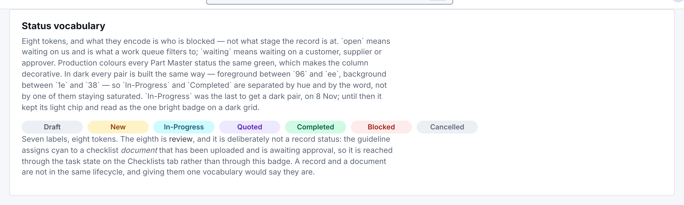


| Token | Giá trị | Phân giải ra | Dark |
|---|---|---|---|
| `--vy-status-draft-fg` | `var(--vy-grey-600)` | `#4d5766` | `#aab4c3` |
| `--vy-status-draft-bg` | `var(--vy-grey-100)` | `#eceff3` | `#2a323f` |
| `--vy-status-open-fg` | `#92400e` | — | `#eeb796` |
| `--vy-status-open-bg` | `#fef3c7` | — | `#38281e` |
| `--vy-status-progress-fg` | `#155e75` | — | `#96e4ee` |
| `--vy-status-progress-bg` | `#cffafe` | — | `#1e3838` |
| `--vy-status-done-fg` | `#065f46` | — | `#96eed5` |
| `--vy-status-done-bg` | `#d1fae5` | — | `#1e3831` |
| `--vy-status-waiting-fg` | `#5b21b6` | — | `#b896ee` |
| `--vy-status-waiting-bg` | `#ede9fe` | — | `#281e38` |
| `--vy-status-review-fg` | `#0e7490` | — | `#96dbee` |
| `--vy-status-review-bg` | `#ecfeff` | — | `#1e3338` |
| `--vy-status-blocked-fg` | `var(--vy-red-700)` | `#9e231d` | `#ee9a96` |
| `--vy-status-blocked-bg` | `var(--vy-red-50)` | `#fdeceb` | `#38201e` |
| `--vy-status-cancelled-fg` | `var(--vy-grey-500)` | `#626d7e` | `#aab4c3` |
| `--vy-status-cancelled-bg` | `var(--vy-grey-100)` | `#eceff3` | `#2a323f` |
| `--vy-chart-cancelled` | `var(--vy-grey-700)` | `#363e4b` | `#5d6878` |
| `--vy-status-slot-w` | `104px` | — | *(same)* |

> **Một mảng màu không mang chữ thì lấy nửa `-fg`, không phải nửa `-bg`.**
> Biểu đồ ở Home vẽ từng series bằng chính bộ từ vựng này, mà một mảng biểu đồ
> không phải một chip: `-bg` nhạt là có chủ đích, vì chữ nằm lên nó. Đo ngày
> 9/11, series In-Progress đang đọc `--vy-status-progress-bg` và ra **1.12:1**
> trên card light, **1.37:1** trên card dark. Năm mảng màu của biểu đồ giờ nằm
> trong `contrast:check` đúng vì lý do đó — trước nay chưa phép đo nào chạm tới
> một hình khối không có chữ.
>
> `--vy-chart-cancelled` là giá trị duy nhất chỉ dùng cho biểu đồ. Ở dạng
> badge, New và Cancelled nằm hai dòng khác nhau nên xám gần giống nhau không
> tốn gì; trong một cột xếp chồng thì chúng chạm nhau, mà hai màu xám badge chỉ
> cách nhau 1.35:1 ở light và **giống hệt** ở dark. Bộ token badge là đặc tả
> của khách, giữ nguyên. Xem [Dashboard](patterns/dashboard.md).


### B1.7 Tone dòng và màu nhấn

Tone là **trạng thái của một dòng trong báo giá**, không phải mức độ nghiêm
trọng. Ba tone tô phần lớn lưới BoM, và chú giải dưới lưới gọi tên đủ cả ba.

**Màu hổ phách làm ba việc, và được phép nhờ hai luật.** Cùng một `#fef3c7`
vừa là status `open`, vừa là tone dòng `short`, vừa là tone `known-mfg`. Phản
đối thì tự nó hiện ra — *vàng phải có nghĩa cảnh báo, không gì khác* — nên
đây là câu trả lời **đo được**, không phải khẳng định suông:

1. **Chúng không bao giờ gặp nhau.** `short` tô lưới Quoting và Quote Result,
   `known-mfg` tô Review BoM, và **không lưới nào trong số đó có cột status**
   — đã kiểm chứ không đoán: zero cột `role: 'status'` ở cả hai. Một pill hổ
   phách và một dòng hổ phách không thể cùng xuất hiện trên một màn.
2. **Mọi lưới hổ phách đều có chú giải** gọi tên nghĩa của nó, trên chính màn
   đó. Một màu chỉ tác giả giải mã được là một màu không có nghĩa gì; một màu
   có chú giải bên cạnh là một màu có đúng một nghĩa.

Thứ mà cả ba cùng mang là **cần để ý, chưa có gì hỏng** — đó là lý do
`blocked` và `missing` dùng đỏ chứ không phải một sắc hổ phách đậm hơn.

**Chọn sắc hổ phách nào.** `--vy-accent-warning` `#b45309` là mặc định, có
mười hai chỗ dùng; `--vy-accent-caution` `#d97706` có **một**, là viền
composer ở chế độ email. Hai màu cách nhau 17.9 ΔE nên phân biệt được thật —
đây không phải một cặp trùng lặp — nhưng hệ thống chưa bao giờ nói nên lấy
cái nào, và đã hai lần một comment trong code phải quyết hộ. Giờ ghi rõ:
**`warning` cho mọi thứ người dùng cần xử lý, `caution` chỉ khi hai mức hổ
phách xuất hiện cùng nhau và mức thấp hơn cần lùi lại.** Hôm nay đúng một chỗ
như vậy. Một token có một chỗ dùng và không có luật là cách một bảng màu trôi.


| Token | Giá trị | Phân giải ra | Dark |
|---|---|---|---|
| `--vy-tone-excluded-bg` | `var(--vy-grey-100)` | `#eceff3` | `#2a323f` |
| `--vy-tone-excluded-fg` | `var(--vy-grey-500)` | `#626d7e` | `#aab4c3` |
| `--vy-tone-missing-bg` | `var(--vy-red-50)` | `#fdeceb` | `#38201e` |
| `--vy-tone-missing-fg` | `var(--vy-red-700)` | `#9e231d` | `#ee9a96` |
| `--vy-tone-short-bg` | `var(--vy-status-open-bg)` | `#fef3c7` | *(same)* |
| `--vy-tone-covered-bg` | `var(--vy-status-done-bg)` | `#d1fae5` | *(same)* |
| `--vy-tone-known-mfg-bg` | `var(--vy-status-open-bg)` | `#fef3c7` | *(same)* |
| `--vy-tone-pending-bg` | `var(--vy-surface-sunken)` | `#eceff3` | *(same)* |


| Token | Giá trị | Phân giải ra | Dark |
|---|---|---|---|
| `--vy-accent-positive` | `#047857` | — | `#75f0cd` |
| `--vy-accent-caution` | `#d97706` | — | `#f0b775` |
| `--vy-accent-warning` | `#b45309` | — | `#f0aa75` |
| `--vy-accent-waiting` | `#6d28d9` | — | `#a679ec` |
| `--vy-accent-neutral` | `#4d5766` | — | `#aab4c3` |
| `--vy-accent-bar-w` | `3px` | — | *(same)* |


### B1.8 Dark mode được nối như thế nào

Ba khối, và **một token phải có mặt ở cả ba**, nếu không thì hai cách chọn
dark sẽ nói khác nhau:

| Khối | Phục vụ ai |
|---|---|
| `:root { … }` | Sáng — mặc định |
| `:root[data-theme="dark"] { … }` | Người **tự chọn** dark trong menu người dùng |
| `@media (prefers-color-scheme: dark) { :root:not([data-theme="light"]) { … } }` | Người có **hệ điều hành** đang ở dark |

> Lỗi này đã xảy ra một lần: bốn token chỉ tồn tại trong bản media, nên người
> tự chọn dark trong menu nhận viền grey-400 và một chấm priority gần trắng
> trên nền gần đen. **Thêm một token màu nghĩa là sửa ba chỗ.**

Vẫn hai khối đó ở theme tối. Mỗi vai trò **giữ nguyên nhiệm vụ** và đổi giá
trị — và các cặp status vẫn đọc được chứ không bị đảo một cách máy móc:

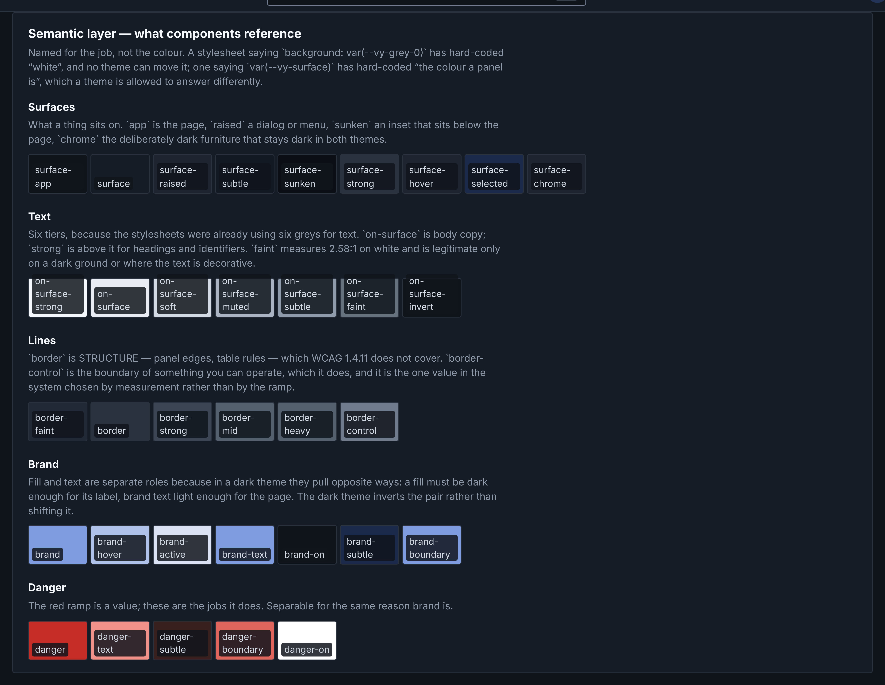

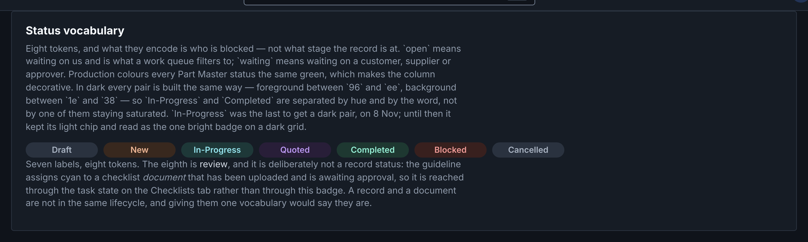

---

## B2 · Chữ

**Một bộ chữ duy nhất.** Inter Variable, ở mọi nơi, tự host — không gọi sang
Google và không nháy chữ dự phòng.

Từng có bộ thứ hai. **JetBrains Mono** dùng cho mã định danh: part number,
MPN, số RFQ và số assembly. Buổi review **13/10** kết thúc việc đó — *"do not
use monotext, hard to read"* — `.vy-ident` được viết lại ngay hôm đó, và chỗ
sót cuối cùng là các lưới MiniTable trong Run Quotation thì xong ngày
**22/10**. Cũng ngày 22/10 khách nói rõ mono vốn để **làm gì**: một giá trị
duy nhất thì không nên trông giống một trường bình thường. Vậy yêu cầu thật là
**sự nổi bật, không phải một bộ chữ** — và nổi bật thì rẻ hơn một font thứ
hai. Mã định danh giờ dùng semibold, mực đậm, kèm `tabular-nums` — thứ vẫn
luôn là cái giữ các chữ số thẳng cột. Người thuộc catalogue đọc part number
như một **từ**; ở 12–13px trong lưới dày, chính mặt chữ mono mới là thứ làm họ
chậm lại. Token và webfont được gỡ ngày **7/11**.

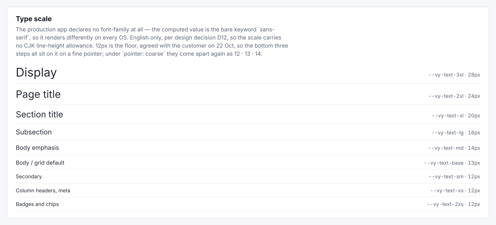


| Token | Giá trị |
|---|---|
| `--vy-font-sans` | `"Inter Variable", "Inter", system-ui, -apple-system, "Segoe UI", Arial, sans-serif` |
| `--vy-text-2xs` | `12px` |
| `--vy-text-xs` | `12px` |
| `--vy-text-sm` | `12px` |
| `--vy-text-base` | `13px` |
| `--vy-text-md` | `14px` |
| `--vy-text-lg` | `16px` |
| `--vy-text-xl` | `20px` |
| `--vy-text-2xl` | `24px` |
| `--vy-text-3xl` | `28px` |
| `--vy-weight-regular` | `400` |
| `--vy-weight-medium` | `500` |
| `--vy-weight-semibold` | `600` |
| `--vy-weight-bold` | `650` |
| `--vy-weight-heavy` | `700` |


**Năm độ đậm, và ba cái trên cùng cách nhau rất sát — có chủ đích, và đã đo.**
"650 với 700 quá gần 600" là phản đối hiển nhiên, nên nó được **đo** chứ
không tranh luận: cùng một chuỗi chữ ở 13px, Inter Variable, đo bề rộng và
lượng mực.

| | 400 | 500 | 600 | 650 | 700 |
|---|---|---|---|---|---|
| bề rộng | 234.30 | 237.03 | 239.76 | 241.12 | 242.48 |
| mực | 111k | 128k | 146k | 154k | 162k |
| bước | — | +15.7% | +13.4% | **+5.6%** | **+5.5%** |

Cả năm đều khác nhau thật — Inter Variable chạy 100–900, không có bậc nào bị
làm tròn về bậc khác — nhưng hai bước trên cùng chỉ bằng **khoảng một phần
ba** các bước dưới. Nên luật trung thực không phải "năm độ đậm thay nhau":

| Độ đậm | Việc | Số chỗ dùng |
|---|---|---|
| `regular` 400 | Chữ thân bài | 22 |
| `medium` 500 | Nhãn, nút, link cần giữ dòng | 59 |
| `semibold` 600 | **Mức nhấn mặc định.** Mã định danh, tiêu đề nhóm, tổng | 112 |
| `bold` 650 | Tiêu đề trang hoặc tiêu đề record, khi 600 đã dùng ngay cạnh | 42 |
| `heavy` 700 | Con số **là** lý do tồn tại của ô đó — KPI, số đếm hàng chờ | 12 |

Mặc định lấy 600. Chỉ dùng 650 và 700 khi có thứ ở 600 nằm **ngay cạnh** và
phải lùi lại; ở bước 5% chúng không tự mình đọc ra là nhấn mạnh.


**12px là sàn**, thống nhất với khách ngày 22/10. Trước đó là 11px; small-text
check của mình vốn đã cảnh báo mọi thứ dưới 12 từ lâu. Cái sàn này làm **đáy
thang bị gộp** — `2xs`, `xs` và `sm` cùng nằm trên nó, ba cái tên mang một cỡ.
Giữ cả ba tên vì chúng mang nghĩa khác nhau: badge, nhãn, và chữ phụ.

**Ngón tay làm đáy thang tách ra lại.** Dưới `@media (pointer: coarse)`, ba bậc
đáy tách thành 12, 13, 14, và mọi bậc trên đó tăng +2 — thành 15, 16, 18. Các
cỡ tiêu đề (`xl` trở lên) **không đổi**: chúng vốn đã thoải mái, và phóng to
tiêu đề trên màn 375px không được gì mà còn tốn một dòng xuống hàng. Sàn 12px
không bị vượt qua theo chiều nào.

### Viết hoa — ba cấp, vẽ khác nhau có chủ đích

Nút, link, tab, tiêu đề form và hộp thoại, tiêu đề section và card, **nhãn
trường**, tiêu đề cột, nhãn bộ lọc, mục menu và status pill đều dùng **Title
Case**, với giới từ (for, to, of, by, as, in, on, at, from, with, via, per,
into) viết thường trừ khi đứng đầu. Văn xuôi thì sentence case.

| Cấp | Kiểu chữ | Cỡ / độ đậm | Ví dụ |
|---|---|---|---|
| Tiêu đề card | Title Case | 14px / 600 | `Select Action` · `Continue from Drafts` |
| Divider trong card | **VIẾT HOA**, giãn .05em | 12px / 600 | `QUOTE STRATEGY` · `BOM OPTIONS` |
| Nhãn trường | Title Case | 12px / 600 | `Customer` · `Qty to Quote` · `Markup (%)` |

---

## B3 · Khoảng cách

### B3.1 Thang khoảng cách


| Token | Giá trị |
|---|---|
| `--vy-space-1` | `2px` |
| `--vy-space-2` | `4px` |
| `--vy-space-3` | `6px` |
| `--vy-space-4` | `8px` |
| `--vy-space-5` | `10px` |
| `--vy-space-6` | `12px` |
| `--vy-space-7` | `14px` |
| `--vy-space-8` | `16px` |
| `--vy-space-9` | `20px` |
| `--vy-space-10` | `24px` |
| `--vy-space-11` | `28px` |
| `--vy-space-12` | `32px` |
| `--vy-space-14` | `40px` |


### B3.2 Khoảng cách nào giữa hai control

Thang không nói giúp nên chọn bậc nào, nên hệ thống nói thẳng. Các bậc chính
là thứ chở **ý nghĩa nhóm**, nên **không** gom về một giá trị duy nhất:

| Khoảng | Giữa | Ví dụ |
|---|---|---|
| **2px** | Các nút trong một cụm mà mắt đọc thành **một** control | thanh tiêu đề hộp thoại, mũi tên phân trang |
| **4px** | Nút icon gắn vào chính control nó tác động | một Select kèm Preview và Download |
| **8px** | **Hai hành động cạnh nhau** — mặc định | `.vy-page-actions`, `.vy-run-nav-actions`, `.vy-cost-actions` |
| **12px** | Các mục mà **bản thân mỗi mục** đã có control **và** nhãn | checkbox lọc, vốn đã cách chữ của chính nó 8px |
| **16px** | Giữa các **nhóm** trên cùng một hàng | bộ lọc / ô tìm kiếm / nút Columns trên toolbar |

Hai nút cạnh nhau thì ở đâu cũng 8px. Khoảng cách to hơn nghĩa là một ranh
giới thật, không phải một người viết khác tay.

---

## B4 · Hình khối và độ nổi

Bốn bán kính bo, ba đổ bóng. Độ nổi dành cho thứ **nổi lên khỏi trang** — hộp
thoại, menu, toast. Một card nằm trên trang thì dùng **viền**, không dùng
bóng.

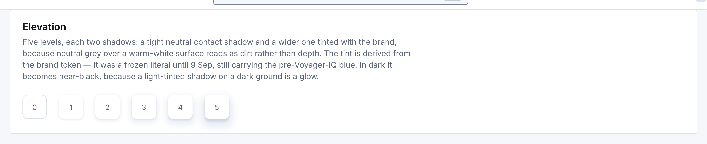


| Token | Giá trị | Dark |
|---|---|---|
| `--vy-radius-sm` | `3px` | *(same)* |
| `--vy-radius-md` | `4px` | *(same)* |
| `--vy-radius-lg` | `6px` | *(same)* |
| `--vy-radius-pill` | `999px` | *(same)* |
| `--vy-shadow-sm` | `0 1px 2px rgba(19, 24, 32, .06)` | *(same)* |
| `--vy-shadow-md` | `0 2px 8px rgba(19, 24, 32, .10)` | *(same)* |
| `--vy-shadow-lg` | `0 8px 28px rgba(19, 24, 32, .14)` | *(same)* |
| `--vy-overlay-scrim` | `rgba(19, 24, 32, .45)` | `rgba(0, 0, 0, .62)` |


### Z-index — một danh sách phẳng, để hai lớp phủ không bao giờ cãi nhau


| Token | Giá trị |
|---|---|
| `--vy-shell-sidebar-w` | `248px` |
| `--vy-shell-sidebar-w-collapsed` | `56px` |
| `--vy-shell-topbar-h` | `52px` |
| `--vy-z-drawer` | `10020` |
| `--vy-z-dialog` | `10040` |
| `--vy-z-menu` | `10070` |
| `--vy-z-palette` | `10075` |
| `--vy-z-toast` | `12500` |
| `--vy-z-skip` | `12600` |
| `--vy-dialog-md` | `640px` |
| `--vy-dialog-lg` | `960px` |
| `--vy-dialog-xl` | `1180px` |


---

## B5 · Kích thước

### B5.1 Chiều cao control

Mọi control nằm trên **thang kích thước của chính Kendo**, được **cấu hình**
chứ không ghi đè — `_kendo-size.scss` đặt biến và các component kế thừa. Ép
chiều cao lên một control Kendo là cách một ô select 29px đứng cạnh một ô
input 34px.


| Token | Giá trị |
|---|---|
| `--vy-row-h-compact` | `28px` |
| `--vy-row-h-comfortable` | `40px` |
| `--vy-row-h-relaxed` | `48px` |
| `--vy-target-min` | `44px` |
| `--vy-control-sm` | `28px` |
| `--vy-control-row` | `26px` |
| `--vy-control-md` | `34px` |
| `--vy-control-dense` | `32px` |
| `--vy-icon-sm` | `16px` |


| Token | Dùng ở đâu |
|---|---|
| `--vy-control-md` **34px** | Ô nhập, select, nút — mặc định |
| `--vy-control-dense` **32px** | Control trên toolbar: ô tìm kiếm, nút `size="sm"` |
| `--vy-control-sm` **28px** | Mật độ Compact |
| `--vy-control-row` **26px** | Nút icon **trong một dòng lưới** — đúng bậc `xs` của Kendo |
| `--vy-target-min` **44px** | Sàn, **chỉ** dưới `pointer: coarse` |

> **44px là luật cho cảm ứng, không phải cho desktop.** WCAG 2.5.5 nói về
> vùng chạm; áp nó lên một form 27 trường điều khiển bằng chuột là cộng thêm
> ~270px cuộn mà không được gì.

### B5.2 Mật độ dòng — là tuỳ chọn của người dùng

| Token | Chiều cao | Thiết lập |
|---|---|---|
| `--vy-row-h-compact` | 28px | Compact |
| `--vy-row-h-comfortable` | 40px | Comfortable *(mặc định)* |
| `--vy-row-h-relaxed` | 48px | Relaxed |

### B5.3 Role cột — bề rộng chọn một lần, theo vai trò

Một cột lưới khai báo **role**, không khai báo số pixel.

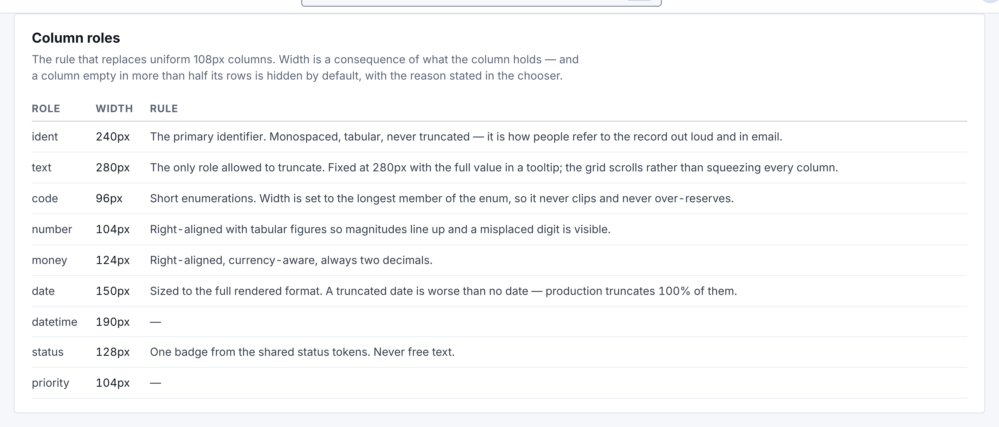

| Role | Bề rộng | Chứa gì |
|---|---|---|
| `ident` | 240px | Part number, MPN — không được cắt chữ |
| `text` | 280px | Mô tả và văn xuôi khác |
| `code` | 96px | Mã ngắn, revision |
| `number` | 104px | Số lượng |
| `money` | 124px | Giá và thành tiền |
| `date` | 150px | Một ngày |
| `datetime` | 190px | Một thời điểm — `09/09/2026 16:35:29` |
| `status` | 128px | Một status pill |
| `priority` | 104px | Một chấm và một chữ |

### B5.4 Hộp thoại và khung ứng dụng

| Cỡ | Bề rộng | Mở ra có full màn không? | Dùng cho |
|---|---|---|---|
| `md` | 640px | Không | Một câu hỏi: xác nhận, form ngắn |
| `lg` | 960px | Có *(ghi đè được)* | Hai khối cạnh nhau và một bảng ngắn |
| `xl` | 1180px | Có | Một mặt bàn làm việc: lưới 21 cột, wizard 4 bước |

| Token khung | Giá trị |
|---|---|
| `--vy-shell-sidebar-w` | 248px |
| `--vy-shell-sidebar-w-collapsed` | 56px |
| `--vy-shell-topbar-h` | 52px |

---

## B6 · Chuyển động

Bốn đường cong và ba thời lượng, không hơn. **Cố ý không có token độ dài
vòng lặp**: một custom property không ai đọc là một token sẽ mục.

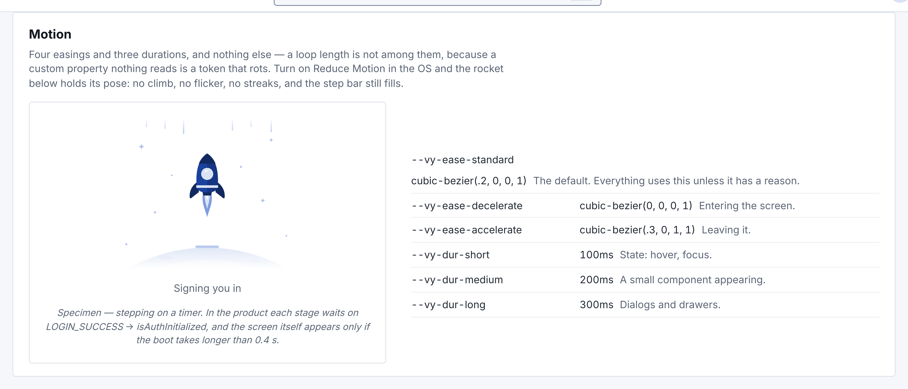

| Token | Giá trị | Dùng khi |
|---|---|---|
| `--vy-ease-standard` | `cubic-bezier(.2, 0, 0, 1)` | Mặc định. Mọi thứ, trừ khi có lý do riêng |
| `--vy-ease-emphasised` | `cubic-bezier(.2, 0, 0, 1)` | Khoảnh khắc cần được chú ý. **Hiện đang giống hệt `standard`** — tách tên để sau này đổi đường cong mà không phải sửa nơi gọi |
| `--vy-ease-decelerate` | `cubic-bezier(0, 0, 0, 1)` | Thứ gì đó **đang tới** |
| `--vy-ease-accelerate` | `cubic-bezier(.3, 0, 1, 1)` | Thứ gì đó **đang rời đi** |
| `--vy-dur-short` | **100ms** | Đổi trạng thái: hover, focus |
| `--vy-dur-medium` | **200ms** | Component nhỏ xuất hiện |
| `--vy-dur-long` | **300ms** | Hộp thoại, ngăn kéo |

### Đồng hồ của màn chờ

| Luật | Giá trị |
|---|---|
| Chỉ hiện màn boot nếu boot lâu hơn | **400ms** |
| Thoát — tên lửa bay khỏi mép trên | **400ms** |
| "Still climbing…" hiện sau | **5 giây** |
| Thời gian hiển thị tối thiểu sau khi đã hiện | **không có** |

Giữ một màn chờ lại cho nó khỏi loé là tiêu thời gian của người dùng để
indicator của mình trông đẹp hơn. **Không hiện gì cả** với một lần boot nhanh
hơn mốc thì không tốn của họ gì. Hai luật này là hai nửa của cùng một câu trả
lời.

### Giảm chuyển động là một trạng thái, không phải một cái công tắc

Dưới `prefers-reduced-motion: reduce`, tên lửa **giữ nguyên tư thế** — không
leo, không nhấp nháy, không vệt sao — và thanh 5 đoạn vẫn chạy. Một cánh tay
hàn bị gỡ animation là một cánh tay **không có tia lửa và checklist rỗng**,
tức là nó nói một điều khác với ý nghĩa của trạng thái. Nên những thứ
*hiện dần lên* thì được giữ lại.

---

## B7 · Responsive

Breakpoint viết bằng pixel thô vì `@media` không đọc được custom property —
một ngoại lệ có ghi chép của luật "không dùng số ma thuật".

**Ba cái là của shell**, nằm trong `responsive.css`, và là ba cái đáng thuộc:

| Bề rộng | Đổi gì |
|---|---|
| ≤ **1180px** | Sidebar 248px thu thành thanh icon 56px |
| ≤ **980px** | Các vùng hai cột xếp chồng |
| ≤ **820px** | Sidebar rời khỏi dòng chảy; một nút menu gọi nó ra |
| `pointer: coarse` | Đáy thang chữ giãn ra lại; sàn vùng chạm 44px |

**Tám cái còn lại là breakpoint của component** — con số thật là **mười
một**, không phải ba. Component nào cần thì tự đo và mang theo số đo của nó —
luật 4 của [A3](#a3--năm-luật-trước-khi-dựng) — thay vì bị bẻ cho vừa một bề
rộng shell mà nó không liên quan:

| Bề rộng | Ở đâu | Trả lời cho việc gì |
|---|---|---|
| ≤ **1100px** | top bar, dải tab | Bỏ bộ chọn múi giờ; đồng hồ vẫn ghi rõ múi |
| ≤ **900px** | top bar, tóm tắt chi phí, thanh submit | Bỏ đồng hồ; khối tiền 2fr/1fr xếp chồng trước khi các con số thôi thẳng cột |
| ≤ **860px** | header record | |
| ≤ **840px** | stepper wizard | Bốn bước có nhãn cần ~760px; dưới ngưỡng đó nhãn bị cắt, mà một tên bước bị cắt còn tệ hơn không có |
| ≤ **720px** | thân trang | Điện thoại thật, hoặc một cửa sổ thấp thật |
| ≤ **700px** | stepper, cột link | Chỉ bước hiện tại giữ nhãn; các bước khác còn lại cái marker, vẫn thấy vị trí và vẫn bấm được |
| ≤ **620px** | header record | |
| ≤ **560px** | dải filter | Một dải neo phải ở bề rộng này sẽ đọc ra như bị cắt mất |

Hai cái — 860 và 620 — chưa có ghi chú, mà luật 4 nói là phải có.

Hệ thống chạy trên terminal ngoài xưởng, thường 1366×768 hoặc hẹp hơn. Dưới
khoảng 1100px thì một sidebar 248px thôi làm nhiệm vụ định hướng và bắt đầu
làm vật cản — **đo ở 543px thì nó chiếm 46% khung nhìn**.

Cùng một màn ở ba bề rộng đáng quan tâm. Thanh đầy đủ, thanh icon, và không
còn thanh nào với một nút menu trên top bar — và ở cả ba, **lưới giữ nguyên
cột** chứ không bóp chúng lại:

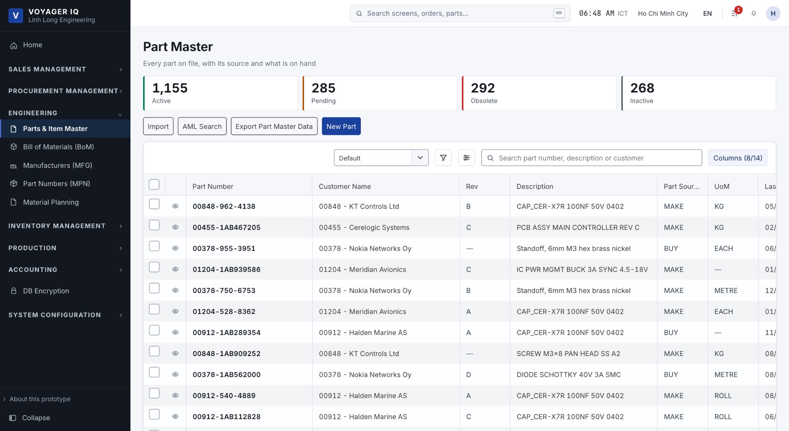

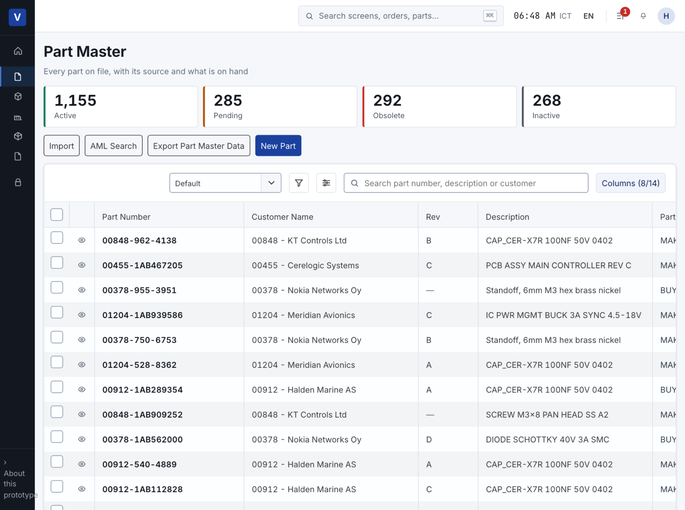

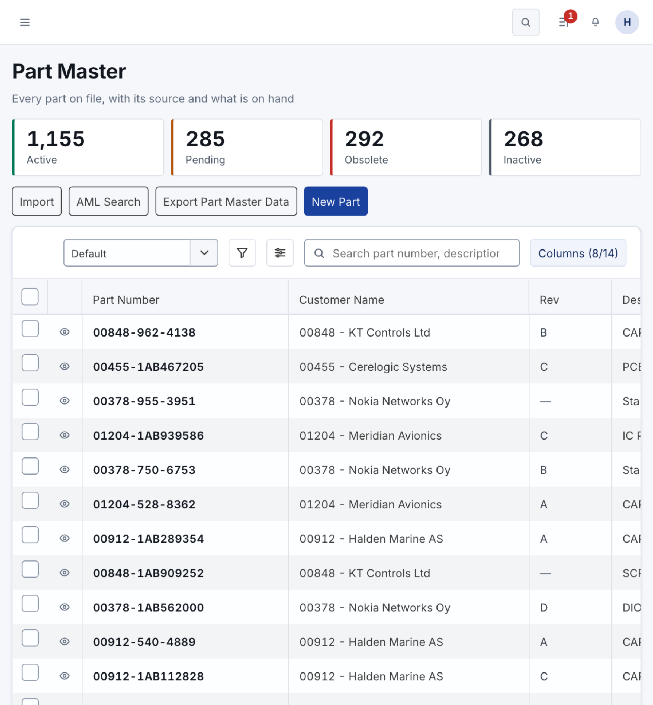


---

## B8 · Lưới layout

Một trang trong app này, theo chiều ngang, là ba thứ: sidebar, hai máng, và
hộp nội dung. [B7](#b7--responsive) nói sidebar đổi cỡ lúc nào; mục này nói
hộp nội dung làm gì với điều đó, và nó được phép to tới đâu.

Viết ngày **9/11/2026**, và đây là mục cấu trúc cuối cùng hệ thống còn thiếu.
Mọi thứ dưới đây là **đo**, không phải chọn: `grid:check` quét **6 route × 12
bề rộng** và các con số trong mục này là kết quả của nó.

### B8.1 Cái gì ăn bề rộng trước khi tới nội dung

Đo dưới dạng một đẳng thức chứ không phải một công thức, để dời breakpoint
cũng không làm mục này sai:

> **rail + máng + nội dung = viewport.** Không thứ gì khác được lấy phần.

| Viewport | Rail | Máng | Nội dung |
|---|---|---|---|
| ≤ 820px | 0 — sidebar là `fixed`, nằm ngoài màn hình | 2 × 14 | vw − 28 |
| 821–1180px | 56 — rail chỉ còn icon | 2 × 14 | vw − 84 |
| ≥ 1181px | 248 — có nhãn | 2 × 24 | vw − 296, tới trần |

Hộp nội dung, đo trên từng dạng trang:

| vw | 375 | 600 | 768 | 820 | 900 | 980 | 1100 | 1180 | 1280 | 1366 | 1440 | 1920 |
|---|---|---|---|---|---|---|---|---|---|---|---|---|
| **danh sách** | 347 | 572 | 740 | 792 | 816 | 896 | 1016 | 1096 | 984 | 1070 | 1144 | **1624** |
| **mọi dạng khác** | 347 | 572 | 740 | 792 | 816 | 896 | 1016 | 1096 | 984 | 1070 | 1132 | **1132** |

### B8.2 Bậc ở 1180 là một bậc **âm**, và nó là bậc duy nhất

Đọc lại hàng trên ở hai bề rộng kẹp quanh nó.

> Ở **1180px** hộp nội dung rộng **1096px**. Ở **1280px** nó còn **984px**.
> Cửa sổ rộng thêm 100px và trang **mất 112px**.

Vượt 1180 đi lên, rail từ 56 → 248 và máng từ 14 → 24: **lấy đi 212px, cho
lại 100px**. Hệ quả không phải lý thuyết — một laptop 1366, loại máy sản phẩm
này chạy trên đó nhiều nhất, hiển thị **1070px** nội dung, trong khi một
terminal 1180 được **1096px**.

**Đây là một đánh đổi, không phải một lỗi.** Rail có nhãn chính là phần định
hướng mà quyết định D1 mua, và là thứ buổi review 25/8 yêu cầu; phương án
ngược lại là mọi laptop trong công ty chỉ còn rail icon. Và người dùng có một
lối thoát đáng **192px** — nút thu gọn, chỉ xuất hiện trên 1180 vì dưới mức đó
rail vốn đã thu gọn sẵn.

Breakpoint xoá hẳn được bậc này là **1392px**, không phải 1180: trên breakpoint
nội dung là `vw − 296`, nên cửa sổ phải tới 1392 thì rail mở mới "trả đủ tiền"
cho chỗ nó chiếm. Dời tới đó nghĩa là mọi màn 1366 mất rail có nhãn — tức là
chọn nhầm nửa của đánh đổi.

Thay vào đó hệ thống **khai báo** bậc này, và `grid:check` sẽ đỏ nếu xuất hiện
một bậc thứ hai ở bất kỳ đâu.

### B8.3 Bốn dạng trang, và tới 9/11 mới chỉ hai dạng có bề rộng

| Dạng | Dùng ở | Trần |
|---|---|---|
| `.vy-page--grid` | Mọi màn danh sách | **không có, cố ý** |
| `.vy-page--record` | Bản ghi RFQ | `--vy-record-max-w` |
| `.vy-page--doc` | Design system, Audit, Sitemap | `--vy-doc-max-w` |
| `.vy-page` | Home, My Queues, Placeholder | **trước là không có — giờ là `--vy-page-max`** |

Cả ba trần đều là **1180px**, và hai token có tên giờ trỏ về `--vy-page-max`,
nên chỉ còn một giá trị chứ không phải ba giá trị tình cờ bằng nhau.

**Dạng danh sách không có trần, và điều đó phải giữ nguyên tư cách một quyết
định.** Lưới rộng nhất trong sản phẩm này là **1806px** ở view mặc định —
Project Requirements, 12 cột theo bề rộng role của
[B5.3](#b53-role-cột--bề-rộng-chọn-một-lần-theo-vai-trò) — và **2106px** khi bật hết
cột, là Part Master với 16 cột. Bất kỳ trần nào thấp hơn hai con số đó đều tạo
ra cuộn ngang trên một cửa sổ vốn đủ rộng để không phải cuộn. Bản thân bề rộng
role thì đúng ở mọi width: đo ở 2560px, bảng vẫn là 1806px và mỗi cột vẫn đúng
bề rộng đã khai, nên màn 2560 hiện trọn lưới và phần khung còn lại để trống.

**Mọi dạng khác đều có trần, và luật gốc là chỗ mang nó** — nên một trang
không khai báo gì giờ nhận bề rộng dè dặt thay vì bề rộng vô hạn. Chính phép
đảo đó mới là điểm chính: trước đây mặc định là vô hạn.

Cái giá của việc không có trần thì đo được, trên hai màn dashboard:

| Ở viewport 1920 | Không trần | Có trần |
|---|---|---|
| Cột biểu đồ | 127px, chứa một thanh 28px — **99px khoảng không giữa hai thanh** | 85px, cách nhau 57px |
| Ô hàng đợi | **397px** cho một con số một chữ và hai dòng ngắn | 274px |

Một trang không có lưới để lấp thì không có gì để tiêu bề rộng, và mười hai
thanh rải trên 1600px thôi đọc ra thành một chuỗi.

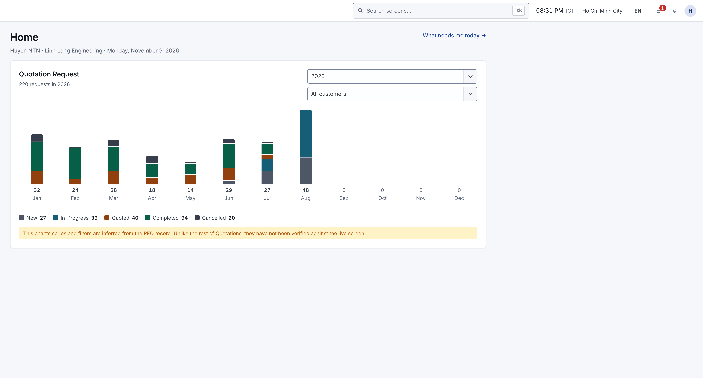

**Canh trái, không canh giữa.** Màn danh sách tràn hết bề ngang, nên nếu canh
giữa dashboard thì tiêu đề trang sẽ nhảy sang phải mỗi khi đi từ một lưới về
Home. Tiêu đề bắt đầu ở cùng một toạ độ x trên mọi màn; phần bề rộng không
dùng thì cứ để đó.

### B8.4 Cột — một lối viết, mười sáu giá trị tối thiểu

Ở đây **không có lưới 12 cột**, và đó là chủ đích. Một số cột cố định giả định
hộp nội dung có bề rộng ổn định; hộp này đổi 640px trong dải trên, mất 112px ở
một bậc, và bị chặn trần ở bốn trên năm dạng. **Mười sáu lưới layout, tất cả
cùng một lối viết:**

```css
grid-template-columns: repeat(auto-fit, minmax(var(--some-min), 1fr));
```

Các track bằng nhau, chúng lấp kín hàng ở mọi số lượng và mọi bề rộng, và cái
sàn mới là thứ quyết định khi nào hàng xuống dòng. Nên con số duy nhất mà một
lưới layout phải chọn là **bề rộng mà dưới đó nội dung của nó thôi đọc được** —
và đó là tính chất của **nội dung**, không phải của lưới. Một ô đếm và một
nhóm trường form không cùng ngưỡng không-đọc-được, nên chúng không dùng chung
một con số.

| Lưới | Token tối thiểu | Tối thiểu | Máng cột | Nó chứa gì |
|---|---|---|---|---|
| `.vy-kpi-row` | `--vy-kpi-min-w` | 140px | 8px | Ô đếm trên một danh sách |
| `.vy-bom-summary` | `--vy-stat-min-w` | 150px | 10px | Số liệu trên một BoM |
| `.vy-run-ref .vy-quote-config-grid` | `--vy-quote-ref-field-min` | 150px | kế thừa | Trường tham chiếu, khung hẹp |
| `.vy-stat-row` | `--vy-stat-min-w` | 150px | 10px | Số liệu trong dải tóm tắt |
| `.vy-assy-grid` | `--vy-assy-field-min` | 170px | kế thừa | Trường của assembly |
| `.vy-contact-fields` | `--vy-contact-field-min` | 180px | 10px | Trường liên hệ |
| `.vy-filter-fields` | `--vy-filter-field-min` | 190px | 12px | Trường lọc |
| `.vy-quote-context-fields` | `--vy-quote-fact-w` | 190px | 10px | Thông tin ngữ cảnh báo giá |
| `.vy-record-fields` | `--vy-header-field-min` | 190px | 16px | Thông tin ở đầu bản ghi |
| `.vy-assignees` | `--vy-card-min-w` | 200px | kế thừa | Thẻ người phụ trách, khi xếp dọc |
| `.vy-queue-row` | `--vy-card-min-w` | 200px | 12px | Thẻ hàng đợi |
| `.vy-radios--tiles` | `--vy-radio-tile-min` | 230px | 10px | Ô radio dạng tile |
| `.vy-quote-config-grid` | `--vy-quote-field-min` | 240px | 16px | Trường cấu hình báo giá |
| `.vy-header-groups` | `--vy-header-group-min` | 260px | 12px | Nhóm ở đầu bản ghi |
| `.vy-field-groups` | `--vy-field-group-min` | 280px | 20px | Nhóm trường trong form |
| `.vy-notes-edit` | `--vy-note-min-w` | 320px | 16px | Hai ô soạn ghi chú cạnh nhau |

Mười một giá trị tối thiểu khác nhau và sáu máng cột khác nhau, và hệ thống
**không** ép chúng về một thang. Nó công bố danh mục: một lưới mới chọn một
dòng trong đó, hoặc tự đo và ghi lại lý do —
[A3](#a3--năm-luật-trước-khi-dựng) luật 4, đúng luật mà
[B7](#b7--responsive) áp cho breakpoint. Thứ `grid:check` bắt buộc là giá trị
tối thiểu phải là một **token**, để một giá trị thứ mười bảy không thể lọt vào
dưới dạng số trần trong một rule.

### B8.5 `grid:check` đo cái gì

`node scripts/with-server.mjs grid:check` · **72 lượt đo**, 6 route × 12 bề
rộng, nằm trong `check:visual` mỗi lần push.

| | |
|---|---|
| **Đẳng thức** | rail + máng + nội dung = viewport, ở mọi bề rộng. Không thứ gì khác được lấy phần |
| **Trần** | Một dạng có trần không bao giờ vượt `--vy-page-max` |
| **Quyền không có trần** | Dạng danh sách vẫn không bị chặn ở bề rộng lớn nhất quét được — để quyết định ở B8.3 không thoái hoá thành một chỗ bỏ sót |
| **Một bậc** | Bề rộng nội dung không bao giờ giảm khi viewport tăng, trừ khoảng 1180 → 1280 |
| **Token** | Mọi giá trị tối thiểu của `auto-fit` là một `var()`, không bao giờ là số trần |

Mỗi lần chạy có hai lỗi gài sẵn — một cái trần ép lên dạng danh sách, và một
giá trị tối thiểu viết trần — và lượt chạy sẽ hỏng nếu bỏ sót bất kỳ cái nào.

> Thứ nó **cố ý không** kiểm là tràn ngang của trang. `mobile:check` giữ việc
> đó, cùng 198 phát hiện tablet còn mở; nhân đôi chúng ở đây chỉ làm phép kiểm
> này đỏ vì một lý do chẳng liên quan gì tới lưới.

---
---

# Phần C — Tài nguyên

## C1 · Icon

Một bộ duy nhất. **viewBox 20×20, chỉ nét, không tô, một độ dày nét.** Nét
nặng hơn ở cỡ nhỏ hơn là cách một bộ icon thôi trông giống một bộ.

Một tên không có trong bộ sẽ render ra **không gì cả**, và để lại cái tên
trong DOM — thay vì rơi về một glyph tài liệu nào đó và giấu mất lỗi.

| | |
|---|---|
| Cỡ mặc định | 16px · `--vy-icon-sm` |
| Trong một dòng lưới | 15px, trong nút 26px |
| Màu | `currentColor` — icon lấy màu chữ quanh nó |
| Trang trí | `aria-hidden`, và trạng thái nó đánh dấu phải có chữ riêng |

**45 cái tên:**
`task · chat · log · quote · order · return · customer · requisition ·
supplier · factory · simulate · bom · transfer · adjust · pcb · tool ·
machine · invoice · journal · lock · people · template · job · plug · menu ·
globe · metadata · queue · doc · home · sell · buy · parts · stock · make ·
finance · insight · settings · chevron-down · chevron-right · eye · download ·
clip · trash · check`

Hai glyph chỉ hướng, mỗi cái một nhiệm vụ: **xuống** mở một menu ngay bên
dưới nó, **phải** nói "cái này mở sang chỗ khác".

---

## C2 · Hình minh hoạ

**Một bức vẽ, ba trạng thái.** Sản phẩm có đúng **một** nhân vật minh hoạ —
một con tàu — và nó xuất hiện trong ba tình huống. Đó là chủ ý: người đã gặp
con tàu này lúc đi vào không nên phải học bức thứ hai mới hiểu là nó rơi.

Component: `src/ui/RocketLaunch.tsx` · một SVG inline, `viewBox="0 0 240 180"`
· `data-state` chọn cảnh.

| | |
|---|---|
| Bề rộng khi render | `clamp(240px, 18vw, 280px)` |
| Màu | Mười token vai trò, [B1.7](#b17-tone-dòng-và-màu-nhấn) — **không bao giờ** hex |
| Chuyển động | Thuần CSS. Hình này sở hữu pixel chứ không sở hữu state, nên nó dừng được trong tab nền mà không mất gì |
| Id | Sinh bằng `useId` — hai bản trên cùng một trang nếu không sẽ dùng chung một clip path |
| Inline, không dùng `` | `` là một request thứ hai trên đúng cái màn sinh ra để che request thứ nhất; và nó là một tài liệu riêng, nơi `var(--vy-brand)` không phân giải được |

### C2.1 `launching` — màn boot

Con tàu **đứng yên giữa khung** và **thế giới chuyển động**: hành tinh chìm
xuống một nấc mỗi bước boot, vệt sao chạy xuống ngang qua nó. Bản thân một
con tàu vẽ chúc mũi lên không nói được là nó "đang leo".

| | |
|---|---|
| Ở đâu | `BootGate` sau khi đăng nhập; `Suspense` fallback của route tải chậm |
| Chuyển động | Cất cánh 0.7s · nhấp nhô 1.6s · lửa nhấp nháy 0.18s · vệt sao 0.8–1.3s |
| Khi giảm chuyển động | Không leo, không nhấp nháy, không vệt sao. **Thanh 5 đoạn vẫn chạy** |


Kèm nhãn và thanh 5 đoạn — đây mới là màn boot thật sự:

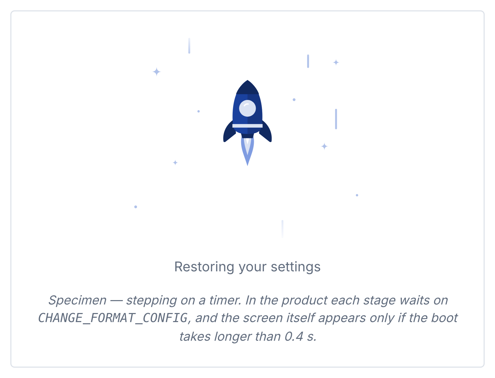

### C2.2 `error` — màn hình dừng tải

Vẫn con tàu đó, nằm lại trên bệ: nghiêng, nứt thân, rụng một cánh, bốc khói.
Cái hỏng đọc ra được **trước khi** đọc câu chữ bên dưới.

| | |
|---|---|
| Ở đâu | `ErrorState`, do `ErrorBoundary` dựng cho bất kỳ route nào ném lỗi |
| Chuyển động | Ba cụm khói, 2.4s, lệch pha nhau |
| Khi giảm chuyển động | Khói giữ ở opacity 0.6 — **khói còn, chuyển động mất** |


### C2.3 `building` — còn trên bệ phóng

Con tàu **nguyên vẹn** trên bệ, một cánh tay máy đang hàn, một bảng vẽ thiết
kế trên giá với checklist tick dần. **Đang làm dở, không phải đổ vỡ** — và sự
khác biệt đó phải thấy được trước khi đọc tiêu đề.

| | |
|---|---|
| Ở đâu | `Placeholder`, trả lời cho mọi route chưa dựng — **71 trên 82 đích đến** của menu live (`src/data/sitemap.ts`: 91 mục `path`, 82 đích phân biệt; `App.tsx` khai báo 21 route thật và một catch-all) |
| Chuyển động | Cánh tay 4s · tia lửa chỉ khi tay đang tì vào mối hàn · checklist 6s |
| Khi giảm chuyển động | Tia lửa và hai tick đầu **giữ bật**, để bức hình vẫn nói "đang được dựng" |


### C2.4 Skeleton — kiểu chờ còn lại

Skeleton trả lời câu *"cái này sắp trông như thế nào?"*. Khi người dùng **đã**
nhìn thấy dữ liệu rồi thì câu đó đã có đáp án, nên một lần tính lại giá hay
một trang tiếp theo sẽ **làm mờ cái đang có** và đặt indicator lên trên
(`BusyOverlay`).

Cả hai dùng chung một hiệu ứng loé: `--vy-surface-sunken` →
`--vy-surface-app` → `--vy-surface-sunken`, nền 200%, 1.4s.

**Skeleton lưới** — dùng đúng role cột thật, nên các thanh nằm đúng chỗ dữ
liệu sắp hiện ra:

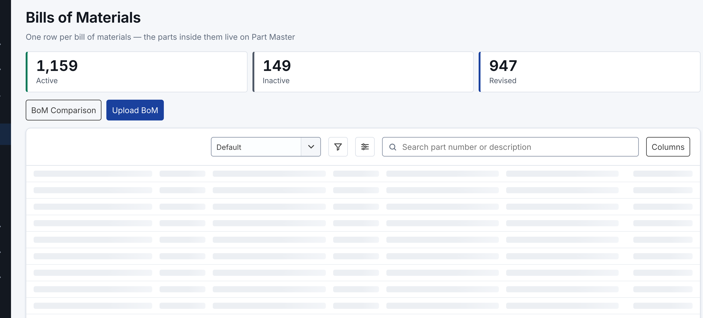

**Skeleton hồ sơ** — dùng đúng nhãn trường thật, vì nhãn đã biết trước khi dữ
liệu về. Đo tới khi màn chỉ còn nhảy 1px lúc dữ liệu tới:

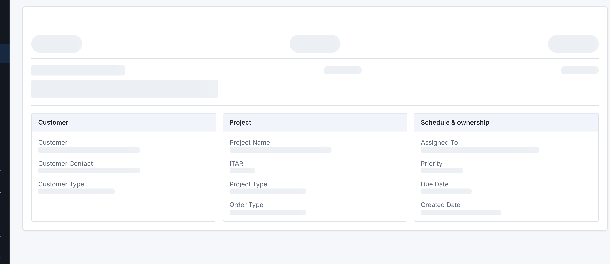

### C2.5 Trạng thái rỗng

**Cố ý không có hình.** Một màn rỗng là một câu nói và một hành động — vẽ
thêm vào đó chỉ làm chậm cả hai.

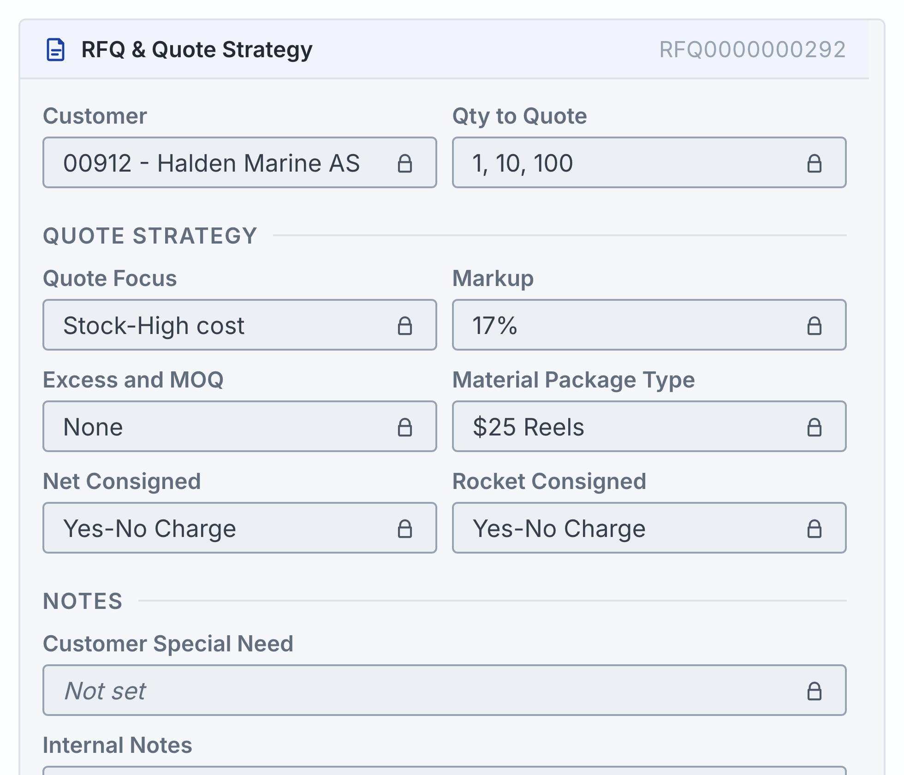

### C2.6 Xuất hình và dựng lại

| | |
|---|---|
| Nguồn sống | `src/ui/RocketLaunch.tsx` |
| SVG tĩnh | `docs/assets/rocket-journey/*.svg` — bộ **bay ngang đã nghỉ hưu**, giữ lại vì một tài liệu cũ vẫn in chúng. Không còn trong sản phẩm |
| Hình trong tài liệu này | Chụp từ app đang chạy ở 2×; script nằm trong `scripts/` |

> **Nếu cần đem hình ra khỏi codebase** — cho slide, cho PDF — hãy xuất SVG
> inline và **thay các `var(--vy-rocket-*)` bằng mã hex đã phân giải** ở
> [B1.7](#b17-tone-dòng-và-màu-nhấn). Ngoài app không có lớp token nào giải
> chúng.

---
---

# Phần D — Component và mẫu dựng

`src/ui` có 33 file: các primitive, cộng bộ icon, kho tuỳ chọn và ba hook.
Mỗi lớp bọc đều có lý do, và luật sinh ra chúng lúc nào cũng giống nhau —
**hệ thống live đã có sẵn KendoReact, nên câu hỏi không bao giờ là "cái này
nên trông thế nào" mà là "Kendo đã làm được gì, và mình phải thêm gì".**

### Trang component

Mỗi trang là một spec đầy đủ — dùng khi nào và **không** dùng khi nào, cấu
tạo, biến thể và trạng thái, chữ nghĩa, hành vi, khả năng tiếp cận, API, và
nhật ký thay đổi riêng. **Đủ cả 29.** [`button.md`](components/button.md)
là trang mẫu; phần D bên dưới là bản văn xuôi cũ và mỏng hơn mà nó thay thế.

| Trang | Trạng thái | Viết ra thì tìm thấy gì |
|---|---|---|
| [Button](components/button.md) | stable | Chỉ báo busy đo được 1.19:1 trên `filled`, đã sửa |
| [Status badge](components/badge.md) | stable | `review` có màu nhưng không có đường nào render; comment trong file ghi sáu token, thực tế bảy |
| [Chip](components/chip.md) | **trial** | Viền lúc nghỉ 1.64:1 và thiếu `aria-pressed`, đều ở trạng thái unselected — đã sửa |
| [Filter toolbar](components/filter-toolbar.md) | stable | Hai thứ nó **cố ý không làm**, giờ đã ghi ra: không có toán tử, không có luồng thêm điều kiện |
| [Column chooser](components/column-chooser.md) | stable | 6 trên 11 cột là bắt buộc — một bộ chọn mà quá nửa hàng không đổi được thì gần với danh mục hơn |
| [View picker](components/view-picker.md) | stable | Khoá theo `id` chứ không theo `name`: hai view có thể trùng tên, và bản migration suýt làm hỏng điều đó |
| [Pager](components/pager.md) | stable | Thay cuộn vô hạn trên 21.941 bản ghi — đánh đổi được ghi ra, gồm cả cái giá phải trả |
| [Priority](components/priority.md) | stable | Mã hoá bằng độ đậm và hình dạng, không bằng sắc màu: ba mức vẫn tự xếp hạng khi mất màu |
| [More menu](components/more-menu.md) | stable | Khách yêu cầu 8/10 **và** mình đo được độc lập — Cancel RFQ cách Run Quotation 69px |
| [Field](components/field.md) | stable | 91 chỗ dùng, nhiều nhất sản phẩm — kèm luật hint/error để hai dòng không cùng giành một việc |
| [Select](components/select.md) | stable | Cố ý **từ chối** giá trị ngoài danh sách: Customer là một lookup |
| [Dialog](components/dialog.md) | stable | Ba lớp chồng nhau trước đây đúng chỉ nhờ thứ tự mount — và Minimize cố ý không làm |
| [Tabs](components/tabs.md) | stable | Khoá theo value, không theo index: đảo thứ tự mảng không thể âm thầm đổi tab nào mở |
| [Data grid](components/data-grid.md) | stable | Select-all nghĩa là **trang này** — trên 2.000 dòng, một chữ "all" sẽ xuất cả bản ghi chưa ai nhìn |
| [MiniTable](components/mini-table.md) | stable | Ô lọc từng cột — khoảng hở thật duy nhất so với hệ thống live — tới dưới dạng một prop |
| [Field row](components/field-row.md) | stable | Cùng một khối 14 dòng đã bị viết lại 14 lần, mà không chỗ nào trông hỏng |
| [Radio group](components/radio-group.md) | stable | Mỗi lựa chọn một câu gợi ý, vì có một lựa chọn không bao giờ chọn được và gợi ý chung không giải thích nổi |
| [View setting](components/view-setting.md) | stable | Hai lỗi chữ trong bản live, sửa chứ không chép — chỗ duy nhất cố ý **không** theo live |
| [Toast](components/toast.md) | stable | Bốn động từ có tên thay vì một `push`, vì "loại" là một quyết định chứ không phải một kiểu dáng |
| [Checkbox](components/checkbox.md) | stable | Dùng class của Kendo chứ không phải component — `indeterminate` không có prop, và lưới đặt tên cho từng ô |
| [Loader](components/loader.md) | stable | `pulsing` bên trong control để nó không trông như đang quay; nhãn nói **cái gì** đang tải |
| [File drop](components/file-drop.md) | **trial** | Tắt `autoUpload`, cố tình không có `saveUrl` — và dòng hint nói thẳng điều đó, lần nào cũng vậy |
| [Stepper](components/stepper.md) | stable | Mỗi bước là một nút, giới hạn bởi `furthest`: quay lại tự do, không nhảy vào bước chưa có dữ liệu đầu vào |
| [Error state](components/error-state.md) | stable | Một khối chú thích khai báo trạng thái này suốt nhiều tuần mà bên dưới không có rule nào — nói mà chưa vẽ |
| [Grid skeleton](components/grid-skeleton.md) | stable | Thanh giả chia theo role của cột; bản live ghi "No records available" khi spinner của chính nó còn chạy |
| [Record skeleton](components/record-skeleton.md) | stable | Nhãn là thật, chỉ giá trị là thanh giả — và nó mượn đúng class của record, sau khi đo ra 92px nhảy |
| [People picker](components/people-picker.md) | stable | Email không phải để trang trí: danh bạ live có "Linh 4 Tran", "Linh Tran 5" và "Linh Tran 1" |
| [Rich text](components/rich-text.md) | **trial** | Dấu "?" trên bản live không phải nút trợ giúp — đó là avatar không có initials, và ta cố tình không làm |
| [Support ticket](components/support-ticket.md) | **trial** | Bốn thông tin tự đính kèm, dưới một tiêu đề nói rõ điều đó thay vì giấu đi |

> Mỗi trang đều viết dựa trên bản build đang chạy, và **mỗi trang đều tìm ra
> một thứ** — một tỉ lệ tương phản sai, một thuộc tính ARIA thiếu, một chú
> thích mô tả cái rule không tồn tại. Đó là lý do viết đủ cả 29, và đúng tới
> trang cuối: `people-picker.md` lộ ra một viền nét đứt 1.64:1 mà
> `border:check` không với tới, vì control đó chỉ hiện khi record vào chế độ
> sửa.
>
> Hôm sau, viết dòng hover cho [`field.md`](components/field.md) lộ ra nửa còn
> lại: những **trạng thái** không phép quét nào đang nhìn, trong đó có viền
> hover của chính ô input đó — 2.02:1 ở dark — và viền focus của mọi ô gõ chữ
> trong sản phẩm. Giờ cả hai phép kiểm đều đo trạng thái, và đó mới là phần
> đáng giữ — xem [`vien-state-09nov.md`](vien-state-09nov.md).

### Trang pattern

Pattern là nhiều component ghép thành một hình dạng lặp lại. **Đủ cả tám cái
đáng có**, tính đến 9/11.

| Pattern | Chốt được gì |
|---|---|
| [Record form](patterns/record-form.md) | Thứ tự các dải, hai chế độ, và luồng discard — chỗ mà ba nguồn nói ba kiểu khác nhau |
| [Destructive action](patterns/destructive-action.md) | More ▾ → mực danger → hộp xác nhận, và bỏ bất kỳ bước nào thì mất gì |
| [List screen](patterns/list-screen.md) | Bốn cách thu hẹp một danh sách — trông đều giống "lọc" nhưng không thay nhau được |
| [Wizard](patterns/wizard.md) | Mỗi bước đúng một nút filled, và hai popup manual yêu cầu mà bản này cố ý không làm |
| [Feedback](patterns/feedback.md) | Bốn loại toast — và vì sao một thất bại là một **loại** khác, không phải một chuỗi chữ khác |
| [File upload](patterns/file-upload.md) | Chọn file là thật; gửi đi thì không, và màn hình nói rõ cái nào |
| [Dashboard](patterns/dashboard.md) | Vì sao Home và My Queues vẫn là hai màn — và vì sao màu một mảng biểu đồ không phải màu một badge |
| [Search](patterns/search.md) | Bảy chỗ gõ được, ba dạng control, và ba lời hứa mà chính các ô tìm kiếm không giữ |

Mỗi trang nói rõ nó chốt được gì, bằng chứng đằng sau, và cái gì cố ý để lại.

## D1 · Nút

> **Trang đầy đủ ở [`components/button.md`](components/button.md)** — dùng
> khi nào và không dùng khi nào, cấu tạo, mọi biến thể và trạng thái, chữ
> nghĩa, hành vi bàn phím, khả năng tiếp cận và API. Đó là **trang mẫu**:
> hình dạng mà mọi component còn lại nên được viết theo, và là lý do phần D
> còn lại đọc thấy mỏng. Dưới đây là bản tóm tắt.

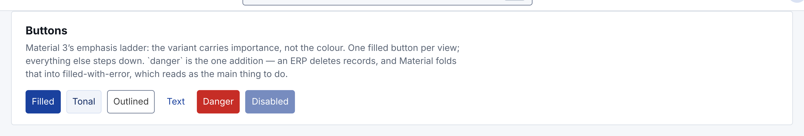

Hình trên là trang mẫu sống với bàn phím đang đặt trên đó: `Text` mang **vòng
focus** mà mọi control trong hệ thống đều dùng — 2px `--vy-brand-boundary`,
lệch ra 2px, **không bao giờ gỡ outline**.

| Biến thể | Khi nào |
|---|---|
| `filled` | **Một cái trên một màn.** Bước tiếp theo khả dĩ nhất |
| `outlined` | Mặc định cho mọi thứ còn lại |
| `tonal` | Hành động phụ nhưng vẫn cần sức nặng |
| `text` | Hạng ba, trong các dòng dày đặc |
| `danger` | Phá huỷ — và nó nằm sau **More ▾** |

**Vị trí:** mọi nút nằm **bên trái** toolbar; nhóm smart button hoặc chỉ báo
bước nằm bên phải; tối đa 4 nút hiện, phần còn lại vào `More ▾` — và nhãn
luôn là chữ *More* kèm chevron, **không bao giờ là `⋯`**.

**Cancel chỉ có trong hộp thoại.** Ở chế độ sửa, chữ là **Discard Changes**.

**`busy` không phải trang trí.** Chỉ báo nói rằng có việc đang chạy; **cái
khoá nút** mới là thứ chặn cú bấm thứ hai tiêu thêm một lượt gọi sàn.

## D2 · Trường nhập

### Hai chế độ, ba cách thể hiện

Một hồ sơ có **hai chế độ** — xem và sửa. Bên trong chế độ sửa, một trường
thuộc **một trong hai loại**, và ổ khoá sinh ra để đánh dấu điều đó. **Ổ khoá
không phải trạng thái thứ ba của một trường**; nó là dấu phân biệt hai loại,
và nó chỉ xuất hiện ở nơi sự phân biệt đó còn ý nghĩa.

| | Trường sửa được | Trường không sửa được |
|---|---|---|
| **Chế độ xem** | Hộp nền lõm, **không** ổ khoá | Hộp nền lõm, **không** ổ khoá |
| **Chế độ sửa** | Ô **trắng**, viền `--vy-border-control` | Hộp **nền lõm**, **có ổ khoá**, kèm một lý do ngắn |

**Ở chế độ xem thì không gì sửa được, nên sự phân biệt chẳng có gì để nói** —
gắn ổ khoá lên cả hai mươi bảy trường là không đánh dấu trường nào cả. Các
hộp giống hệt nhau, và mắt đọc **giá trị** chứ không đọc cái khung.

**Ở chế độ sửa, màu trắng nói cho biết chỗ nào gõ được.** Thứ gì còn nằm
trong hộp xám là giá trị màn này không sở hữu, và sau ổ khoá là **lý do, viết
bằng hai ba chữ** — vì ổ khoá nói được *rằng* trường bị khoá nhưng không nói
được *vì sao*.

**Chế độ xem — một kiểu hộp cho mọi giá trị:**

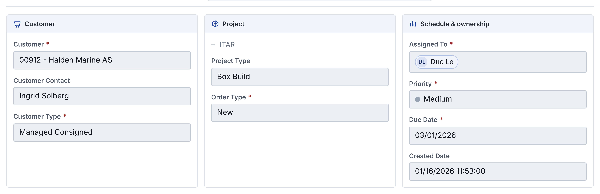

**Chế độ sửa — trắng ở chỗ gõ được; xám, có khoá và có lý do ở chỗ không gõ
được.** `Created Date` ghi *set by the system*; `ITAR` ghi *follows Customer*:

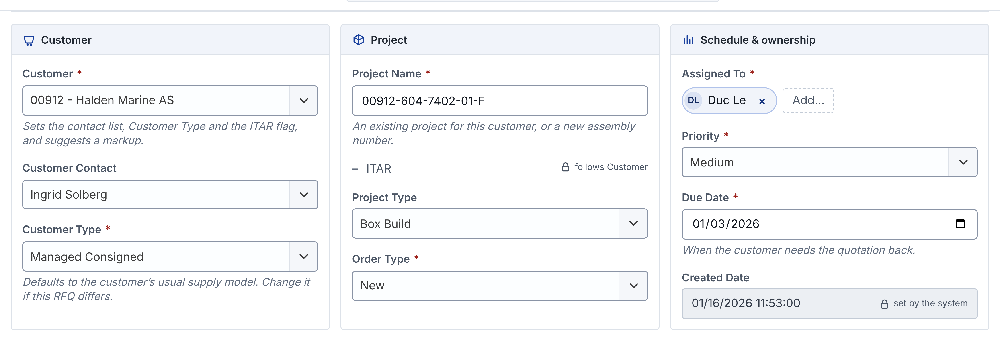

> **Một ngoại lệ, và nó vẫn là cùng một luật.** Một panel mà **không gì** sửa
> được thì giữ hộp xám và **bỏ ổ khoá** — ví dụ thanh thiết lập ở bước cuối
> của Run Quotation, khi lần chạy đã xong. Gắn ổ khoá lên cả bảy giá trị chỉ
> lặp lại điều mà cả panel đã nói.

### Phần còn lại của một trường

| Thành phần | Luật |
|---|---|
| Nhãn | **Trên** giá trị, không bao giờ nằm cạnh. Title Case, 12px, 600 |
| Bắt buộc | **Dấu sao đỏ** ngay sau nhãn, ở **cả** chế độ xem lẫn chế độ sửa |
| Không bắt buộc | Không đánh dấu gì. Không bao giờ viết "(optional)" |
| Helper | Dưới trường, in nghiêng, cỡ bằng hoặc nhỏ hơn nhãn |
| Lỗi | Chữ đỏ dưới trường, **khi rời ô** — không phải mỗi lần gõ |
| Lỗi *hoặc* hint | **Không bao giờ cả hai**: hai dòng cùng tự nhận là đang chỉ việc tiếp theo |
| Hint | Là **anh em** của nhãn, không nằm trong nhãn, nếu không nó nhập vào tên của control |

## D3 · Lưới

Lưới là nơi hệ thống này làm phần lớn công việc, và **tone dòng** là cách nó
nói. Tone là **trạng thái của dòng trong báo giá**, không phải mức nghiêm
trọng: xanh là đã có nhà cung cấp phủ đủ, vàng là thiếu số lượng, đỏ là không
ai chào giá, xám là bị loại khỏi báo giá.

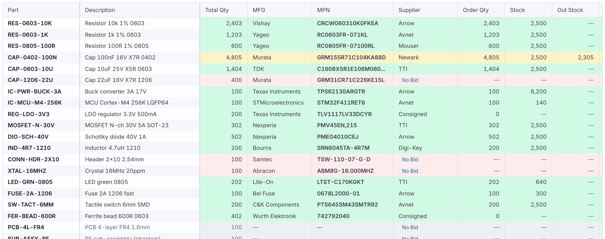

**Mọi tone đều được gọi tên ngay dưới lưới mà nó tô.** Một màu mà chỉ người
vẽ giải mã được là một màu không có nghĩa:

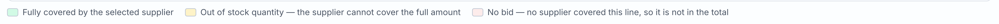

| Luật | |
|---|---|
| Bộ chọn cột | Trên **mọi** lưới có từ **3 cột** trở lên |
| Khối đóng băng | Khai báo bằng `locked`, để bộ chọn cột và phần đóng băng không thể nói khác nhau |
| Sọc vằn | Theo **record**, không theo dòng — một record trải hai dòng AML là **một** vệt |
| Tổng | Lưới nào người dùng phải tự cộng bằng mắt thì phải có dòng tổng |
| Rỗng | Một trạng thái rỗng thật, nói rõ nên làm gì — không bao giờ là "No records available" |
| Bề rộng | Theo role ([B5.3](#b53-role-cột--bề-rộng-chọn-một-lần-theo-vai-trò)); lệch thì phải có `widthNote` |

## D4 · Hộp thoại

Kích thước ở [B5.4](#b54-hộp-thoại-và-khung-ứng-dụng). Thêm ba luật:

1. **Hành động nằm góc trên trái** với một mặt bàn làm việc, nằm ở chân với
   một câu hỏi. Lối thoát luôn nằm bên trái, dù thanh nằm ở đâu.
2. **`lg` và `xl` mở ra full màn**; `md` thì không bao giờ. Hai cỡ đó là mặt
   bàn làm việc, và một lưới 21 cột trong khung 1180px là đang tiêu đúng chỗ
   màn hình được cấp — trong khi một hộp xác nhận chiếm hết màn 27 inch là câu
   trả lời tệ hơn cái nó thay thế.
3. **Escape đóng thứ trong cùng**, điều mà Select phải được dạy bằng tay —
   cách xử lý của Kendo đóng luôn cả hộp thoại khi dropdown đang mở.

## D5 · Bốn trạng thái màn hình

Đang tải, rỗng, lỗi và chưa dựng là **bốn thứ khác nhau** và phải trông khác
nhau. Làm sai mấy cái này là cách phổ biến nhất để một màn hình nói dối người
đọc nó.

| Trạng thái | Người dùng thấy gì | Hành động | Hình |
|---|---|---|---|
| **Đang tải** | Tên lửa leo, hành tinh chìm, thanh 5 đoạn | không có | [C2.1](#c21-launching--màn-boot) |
| **Rỗng** | Một câu nói thứ gì sẽ lấp đầy nó | hành động lấp đầy nó | không có |
| **Lỗi** | Tên lửa trên bệ: nghiêng, nứt, rụng cánh, bốc khói | Reload · Back to Home · Send a support ticket · Error ID + Copy | [C2.2](#c22-error--màn-hình-dừng-tải) |
| **Chưa dựng** | Tên lửa nguyên vẹn, tay máy đang hàn, bản vẽ tick dần | Back to Home. **Không có Reload — vì không có gì hỏng** | [C2.3](#c23-building--còn-trên-bệ-phóng) |

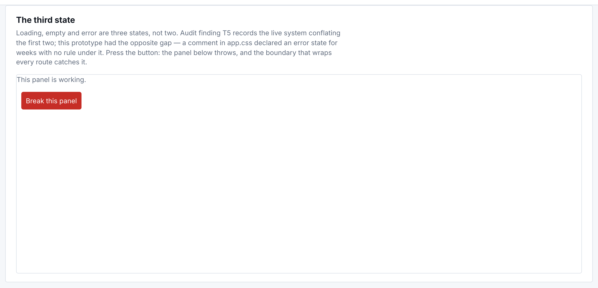

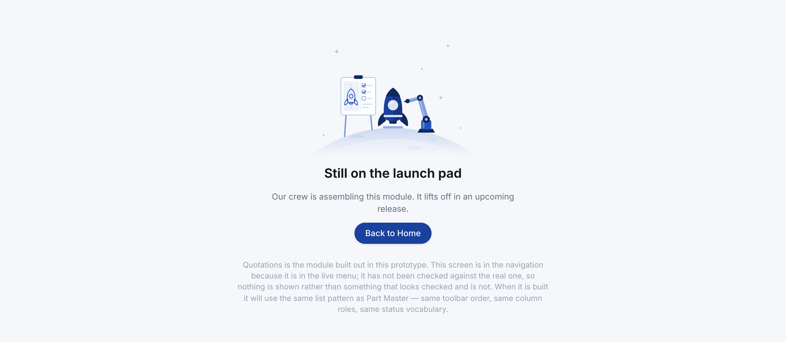

**Ba ô chữ của màn lỗi** chính là ba câu hỏi người ta thật sự có: *cái gì
hỏng · nó nghĩa là gì với tôi · giờ tôi làm được gì.* Chỉ câu đầu là dùng
chung được.

**Mã lỗi sinh ra ở nơi bắt được lỗi**, không phải nơi vẽ nó ra — sinh lúc
render thì bấm Copy xong là người dùng cầm một con số khác cho cùng một lỗi.

## D6 · Chữ nghĩa

| | |
|---|---|
| Viết hoa | [B2](#b2--chữ) — Title Case cho nhãn, sentence case cho văn xuôi |
| Nút nói đúng điều sẽ xảy ra | `Publish`, rồi toast báo `Published` |
| Thông báo lỗi nói **phải làm gì** | Không phải "Something went wrong" |
| Không có gì "chưa làm" mà im lặng | Một toast nói nó *sẽ* làm gì |
| Con số suy ra phải tự khai là suy ra | *"Derived from this run — the live system takes them from the customer's purchase history"* |
| Thay đổi chỉ trong phiên phải nói ra | *"Added in this session… nothing here is saved"* |

---
---

# Phần E — Chất lượng

## E1 · Khả năng tiếp cận

**Đo, không phải khẳng định suông** — và đo **mỗi lần push**, điều mà tới
ngày 8/11 vẫn chưa đúng. Phần bàn phím ở [`focus-order.md`](focus-order.md).

| Yêu cầu | Ngưỡng | Tình trạng | Chạy lại |
|---|---|---|---|
| Tương phản chữ — WCAG 1.4.3 | 4.5:1 chữ thường · 3:1 chữ lớn (≥24px, hoặc ≥18.66px ở độ đậm ≥700) | **184 cặp token, cả hai theme, 0 cặp dưới ngưỡng.** Cặp chữ chặt nhất 4.53:1 | `contrast:check`, mỗi lần push |
| Tương phản phi-chữ — WCAG 1.4.11 | 3:1 cho viền control **và các trạng thái của nó**, đo trên **mọi nền** control có thể nằm lên | Viền lúc nghỉ, viền lúc hover, vòng focus và viền focus đều đạt 3 trên cả tám nền; chặt nhất **3.05:1**. Ngày 8/11 có bảy control dưới ngưỡng ([`vien-control-08nov.md`](vien-control-08nov.md)); ngày 9/11 thêm hai token và năm rule ([`vien-state-09nov.md`](vien-state-09nov.md)) | `contrast:check`, mỗi lần push |
| Tương phản phi-chữ — **mảng màu không mang chữ** | 3:1 so với tấm card nó được vẽ lên | Năm series của biểu đồ, cả hai theme. Series In-Progress chỉ đạt **1.12:1** ở light và **1.37:1** ở dark cho tới 9/11, vì nó đọc màu nền của chip; giờ chặt nhất là **3.03:1** ([Dashboard](patterns/dashboard.md)) | `contrast:check`, mỗi lần push |
| Kích thước vùng chạm — WCAG 2.5.5 | 44×44 | Áp dụng dưới `pointer: coarse` | `touch:check`, mỗi lần push |
| Focus bàn phím | thấy được, nằm trong màn hình | 1305 control trên 10 route × 3 bề rộng · 0 bị che, 0 thiếu chỉ báo | `focus:check`, mỗi lần push |
| Viền control, **như đang vẽ thật**, ở ba trạng thái | 3:1 so với thứ phía sau nó, lúc nghỉ **và** lúc hover **và** lúc focus | 1122 lượt đo trên 12 route × 2 theme × 3 trạng thái · 0 dưới ngưỡng. Lúc hover có 442 control vẽ viền so với 340 lúc nghỉ — 102 cái chênh ra là những control trong suốt cho tới khi có chuột trỏ vào | `border:check`, mỗi lần push |
| Hộp nội dung | rail + máng + nội dung = viewport · dạng có trần không vượt `--vy-page-max` · dạng danh sách vẫn không trần · đúng một bậc khai báo | 72 lượt đo trên 6 route × 12 bề rộng · 2 lỗi gài, bắt được cả hai · 0 phát hiện ([B8](#b8--lưới-layout)) | `grid:check`, mỗi lần push |
| Giảm chuyển động | có tôn trọng | [B6](#b6--chuyển-động) | — |

**Hai phép đo, trả lời hai câu hỏi khác nhau.**
[`contrast-sweep.md`](contrast-sweep.md) ngày 5/9 là bản thật: một trình
duyệt, một pixel canvas cho mỗi phần tử, nền được ghép chồng ngược lên cây
cha — vì Kendo xuất `oklch()`, thứ mà không regex nào trên `getComputedStyle`
sống sót được. Chính bản quét đó tìm ra ba cái viền control. Nhưng nó cũng là
**một lần duy nhất**: chạy một lần, trên bảng màu của hôm đó, trong khi dark
theme, bộ từ vựng status và sàn 12px đều tới sau.

`contrast:check` là nửa rẻ tiền, và thành thật về việc mình là nửa rẻ tiền.
Nó đọc `tokens.css`, resolve mọi chuỗi `var()` ở cả hai theme, và kiểm đúng
những cặp hệ thống đã hứa: từng bậc chữ trên từng nền nó có thể nằm lên,
brand và danger, cả tám status pill, các row tone, và hai đường biên phi-chữ.
Không trình duyệt, không server. Nó **không** thấy được một component đặt chữ
lên nền mà hệ thống chưa bao giờ định, hay một opacity làm nền thật thành thứ
không token nào nói ra — mấy cái đó vẫn cần bản quét trình duyệt. Thứ nó bắt
được là **bảng màu trôi ra khỏi tài liệu này**, đúng chuyện đã xảy ra giữa
tháng 9 và tháng 11 — và nó bắt được một cái ngay hôm được viết: `subtle`
trên `surface-strong` ở 4.02:1. Xem [B1.3](#b13-màu-chữ--sáu-bậc).

**Vì sao bộ đo tin được.** Màu trong bản quét tháng 9 đọc qua pixel canvas
chứ không bóc từ chuỗi. Và **trước khi tin kết quả**, một phần tử `#bbbbbb`
trên nền trắng được cấy vào trang: nó bị bắt ở **1.92:1**. `contrast:check`
cấy đúng giá trị đó ở mỗi lần chạy và thoát với mã lỗi nếu không phát hiện ra
— một bản quét báo "không có lỗi" chỉ đáng đọc nếu nó chứng minh được là nó
sẽ tìm ra lỗi nếu có.

Bốn luật dễ làm sai và đã chốt ở đây:

- **Status là một chữ kèm một màu**, không bao giờ là màu không thôi.
- **Hint là anh em của nhãn**, không nằm trong nhãn.
- **`role="alert"` cho lỗi, `role="status"` cho đang tải.** Một cái cắt ngang,
  một cái thì không.
- **Glyph trang trí phải `aria-hidden`**, và trạng thái nó đánh dấu phải có
  chữ riêng — một ổ khoá kèm một chữ "read-only" chỉ dành cho trình đọc màn
  hình.

## E2 · KendoReact

Hệ thống live đã có sẵn KendoReact 16. Cầu nối gồm ba file:

| File | Nhiệm vụ |
|---|---|
| `kendo-subset.scss` | Chỉ biên dịch những component Kendo thực sự dùng |
| `_kendo-size.scss` | **Cấu hình** thang kích thước của Kendo — không ghi đè |
| `kendo-bridge.css` | Ánh xạ biến của Kendo sang biến của mình, và vá những gì không cấu hình được |

**Cái bẫy là độ ưu tiên selector.** `.k-button.k-button-solid.k-button-base.k-focus`
nặng (0,4,0), nên một rule một-class của mình thua **im lặng**. Cầu nối thêm
tiền tố `html[data-kendo-bridged]` thay vì lặp một class năm lần.

Hai hành vi của Kendo nên biết trước khi ngồi debug một component:

- **Kendo khoá control bằng CLASS `.k-disabled`, không phải thuộc tính
  `:disabled`.** Một `<input disabled class="k-radio">` trần render **y hệt**
  một ô đang bật.
- **KendoReact 16 khoá cột lưới bằng ô sticky trong MỘT bảng**
  (`position: sticky`), không phải bằng hai pane.

---
---

# Phần F — Bàn giao

## F1 · Bản đồ file

| Đường dẫn | Nội dung |
|---|---|
| `src/theme/tokens.css` | **Toàn bộ token.** Sáng, cộng hai khối dark |
| `src/theme/tokens.ts` | Những giá trị TypeScript cần: bề rộng cột, bề rộng hộp thoại |
| `src/theme/md3.css` | Chuyển động, vòng focus, phần cấu trúc Material 3 còn giữ |
| `src/theme/base.css` | Reset và mặc định của thẻ |
| `src/theme/components.css` | Rule của component |
| `src/theme/app.css` | Rule của màn hình và bố cục |
| `src/theme/responsive.css` | Toàn bộ breakpoint, trong một file |
| `src/theme/kendo-*.{css,scss}` | Cầu nối Kendo |
| `src/ui/` | Các primitive |
| `src/ui/RocketLaunch.tsx` | Hình minh hoạ, cả ba trạng thái |
| `/design-system` | Trang mẫu sống |
| `docs/assets/design-system/` | Hình trong tài liệu này |

## F2 · Muốn sửa một thứ thì làm gì

**Một token màu**
1. Thêm hoặc sửa ở **cả ba** khối trong `tokens.css` ([B1.8](#b18-dark-mode-được-nối-như-thế-nào)).
2. Nếu nó rơi lên chữ hoặc lên viền control, **chạy lại bản quét tương phản**.
3. `npm run check:fast` — lint, kiểm stylesheet, typecheck, build.

**Một component**
1. Kiểm xem Kendo đã làm được chưa ([E2](#e2--kendoreact)).
2. Dựng trong `src/ui`, **chỉ** tham chiếu token ngữ nghĩa.
3. Thêm một mẫu vào `/design-system` nếu nó có trạng thái đáng xem.
4. Phủ đủ mọi trạng thái: mặc định, hover, focus, active, disabled, busy, lỗi.

**Một màn hình mới**
1. Nó có thể rơi vào trạng thái nào trong bốn ([D5](#d5--bốn-trạng-thái-màn-hình))? Dựng hết.
2. Role cột, không phải số pixel.
3. Kiểm ở 1180, 980 và 820, ở cả hai theme.

**CI chạy gì mỗi lần push:** `contrast:check` (nằm trong `css:check`, nên nó
chặn build) · `render:check` · `touch:check` · `mobile:check` ·
`focus:check` · `hover:check` · `border:check`.

## F3 · Quản trị

| | |
|---|---|
| Nguồn chuẩn | `src/theme/` và các component trong `src/ui`. File này **mô tả** chúng, không **định nghĩa** chúng |
| Quyết định ghi ở đâu | Trong code, ngay tại luật mà nó chi phối — và trong một ghi chú có ngày dưới `docs/` khi người đọc sau này sẽ phải tự suy lại |
| Phán đoán | Được phép ở chỗ không có nguồn nào trả lời, và **phải dán nhãn là phán đoán** ngay tại chỗ dùng |
| Đánh phiên bản | `v1.0` là bản bàn giao này. Sửa một token hay một luật là minor; sửa tới mức phải dựng lại màn hình là major |

**Ba luật giữ cho tài liệu này còn đúng:**

1. **Số ma thuật phải có ghi chú** nói rõ đã đo cái gì.
2. **Comment ghi cái ĐÃ ĐO, không ghi cái định làm.** Ba lần sửa sai trong dự
   án này đến từ một comment mô tả hành vi mà code không có.
3. **Trang sống thắng tài liệu.** `/design-system` render hàng thật; nếu hai
   bên nói khác nhau thì **trang đúng, file này cũ**.

## F4 · Một bộ bàn giao cần có gì

Bố cục của tài liệu này được **đối chiếu với thực hành hiện hành** chứ không
tự nghĩ ra. Lần đối chiếu tháng 11 làm lại trực tiếp trên trang của chính các
hệ thống đã công bố, thay vì qua blog viết về họ — và nó đổi câu trả lời: bản
trước của mục này liệt kê một bộ bàn giao **cần có gì**, mà không nói trong
đó file này **đang có gì**. Dưới đây là cả hai cột.

| Các hệ thống đã công bố làm gì | Ở đây |
|---|---|
| **Token** kèm giá trị, chia tầng có tên | [A2](#a2--ba-lớp), [B1](#b1--màu)–[B6](#b6--chuyển-động). Ba tầng — ramp, role, component — cùng mô hình với Material 3 (tonal palette → role → component) và tương thích định dạng token của W3C |
| **Khả năng tiếp cận** có ghi rõ ngưỡng | [E1](#e1--khả-năng-tiếp-cận), và **đo từng cặp token** chứ không khẳng định suông. Carbon nêu đúng những ngưỡng đó nhưng không công bố giá trị từng cặp; GOV.UK nêu ngưỡng bên trong một component |
| **Responsive** có ghi breakpoint | [B7](#b7--responsive) — đủ mười một cái, shell và component, từ bản 1.2 |
| **Chuyển động** có thời lượng, đường cong, phương án giảm | [B6](#b6--chuyển-động) |
| **Quản trị** — ai giữ, đóng góp, phiên bản | [F2](#f2--muốn-sửa-một-thứ-thì-làm-gì), [F3](#f3--quản-trị) |
| **Spec component**: dùng khi nào · **không** dùng khi nào · cấu tạo · biến thể × trạng thái · nội dung · hành vi · tiếp cận · code · nên/không nên | **Đủ 29**, trong [`docs/components/`](components/button.md), theo đúng khung đó. [D1](#d1--nút)–[D4](#d4--hộp-thoại) giữ lại như phần văn xuôi cũ, mỏng hơn |
| **Pattern** — form, filter, hành động phá huỷ, thông báo, page template | **Tám**, trong [`docs/patterns/`](patterns/record-form.md) |
| **Trạng thái vòng đời** từng component — trial · stable · deprecated | **Có trên mọi trang**, ba mức của GOV.UK. Bốn cái đang `trial`, mỗi cái kèm lý do: file drop, rich text, support ticket, chip |
| **Changelog** từng component | **Có trên mọi trang**, dạng bảng *Recent changes* có ngày. [F3](#f3--quản-trị) vẫn giữ chính sách phiên bản |
| **Lưới layout** như một nền móng | [B8](#b8--lưới-layout) — thang container, một lối viết và mười sáu giá trị tối thiểu, đo bằng `grid:check` |

**Không còn mục nào trong danh sách bị bỏ trống**, tính tới 9/11.
`docs/chuan-design-system.md` giữ bản đối chiếu đầy đủ, template trang
component mà 29 trang này viết theo, và bản phân loại đã xếp thứ tự cho chúng.

> Lưới layout xếp cuối danh sách với lập luận rằng nó ít dùng nhất trong ba
> cái, cho tới khi các màn hình thôi đổi hình dạng. Viết ra thì thấy ngược
> lại: hai trong bốn dạng trang không hề khai báo bề rộng, và hộp nội dung
> **mất 112px** ở một breakpoint trong khi cửa sổ rộng thêm 100. Cả hai đã
> đúng từ lúc dựng shell, và không cái nào lộ ra nếu không đo đủ mọi bề rộng.

Mọi nguồn cũng gọi tên đúng cái lỗi mà file này dễ mắc nhất: **tài liệu trôi
xa khỏi code** khi đội ngũ đi làm việc khác. Đó là lý do
[F3](#f3--quản-trị) quy định **trang mẫu sống** mới là trọng tài chứ không
phải tài liệu này, và là lý do các con số ở trên được
[`contrast:check`](#e1--khả-năng-tiếp-cận) chứng minh lại thay vì chép lại.

Đọc trực tiếp ngày 8/11/2026:
[Carbon — Button usage](https://carbondesignsystem.com/components/button/usage/) ·
[Carbon — Accessibility: colour](https://carbondesignsystem.com/guidelines/accessibility/color/) ·
[Atlassian — Foundations](https://atlassian.design/foundations) ·
[Atlassian — Button](https://atlassian.design/components/button/examples) ·
[GOV.UK — Button](https://design-system.service.gov.uk/components/button/) ·
[GOV.UK — Component lifecycle statuses](https://design-system.service.gov.uk/community/component-lifecycle-statuses/) ·
[W3C Design Tokens format (draft)](https://www.designtokens.org/tr/drafts/format/) ·
[Material 3 — Colour roles](https://m3.material.io/styles/color/roles).
Bản W3C là draft và chính nó ghi là **chưa nên implement**; các nguồn còn lại
là thực hành của từng tổ chức, không phải tiêu chuẩn. Chúng thống nhất ở bố
cục và khác nhau ở độ sâu.

## F5 · Chỉ mục nguồn

| Tài liệu | Chốt điều gì |
|---|---|
| [`contrast-sweep.md`](contrast-sweep.md) | Mọi tỉ số tương phản đã đo, và phương pháp |
| [`vien-control-08nov.md`](vien-control-08nov.md) | Bảy viền control trỏ sai token, và bản quét tìm ra chúng |
| [`vien-state-09nov.md`](vien-state-09nov.md) | Viền hover và viền focus, và cách đo một trạng thái mà không có chuột |
| [`focus-order.md`](focus-order.md) | Thứ tự bàn phím và vòng focus |
| [`modal-patterns.md`](modal-patterns.md) | Cỡ hộp thoại, vị trí nút, cách đóng |
| [`table-patterns.md`](table-patterns.md) | Hành vi lưới, role cột, mật độ |
| [`motion-loading.md`](motion-loading.md) | Mọi quyết định về màn chờ và chuyển cảnh |
| [`kendo-control-scale-18oct.md`](kendo-control-scale-18oct.md) | Bản audit 33 luật về thang kích thước Kendo |
| [`working-agreement.md`](working-agreement.md) | Luật kỹ thuật, gồm cả các ngoại lệ của luật số ma thuật |

---

*Chụp từ bản build đang chạy ở 2× ngày 3/11/2026. Hình nằm trong
`docs/assets/design-system/` và dựng lại được từ `/design-system` cùng các màn
sản phẩm mà chúng đến từ đó.*
