# Voyager IQ — Hệ thống thiết kế

> **Phiên bản 1.0 · 3/11/2026**
> Linh Long Engineering / Rocket EMS · repository `ll-poc`
> **Nguồn chuẩn:** `src/theme/` · **Trang mẫu sống:** `/design-system`

Mọi thứ trong tài liệu này đều đọc ra từ một bản build đang chạy. Mọi con số
lấy từ source; mọi hình chụp từ ứng dụng thật ở 2× ngày 3/11/2026. Chỗ nào
con số đến từ việc **đo màn hình** chứ không phải từ một quy tắc, tài liệu nói
rõ.

> Đây là bản tiếng Việt của `design-system.md`. Tên token, đường dẫn file, tên
> component và **chữ hiển thị trên giao diện** giữ nguyên tiếng Anh — vì đó là
> chuỗi thật trong sản phẩm, dịch ra là mất khả năng tra cứu.

---

## Mục lục

**Phần A — Bắt đầu từ đây**
[A1 Tài liệu này là gì](#a1--tài-liệu-này-là-gì) ·
[A2 Ba lớp](#a2--ba-lớp) ·
[A3 Năm luật trước khi dựng](#a3--năm-luật-trước-khi-dựng)

**Phần B — Nền tảng**
[B1 Màu](#b1--màu) ·
[B2 Chữ](#b2--chữ) ·
[B3 Khoảng cách](#b3--khoảng-cách) ·
[B4 Hình khối và độ nổi](#b4--hình-khối-và-độ-nổi) ·
[B5 Kích thước](#b5--kích-thước) ·
[B6 Chuyển động](#b6--chuyển-động) ·
[B7 Responsive](#b7--responsive)

**Phần C — Tài nguyên**
[C1 Icon](#c1--icon) ·
[C2 Hình minh hoạ](#c2--hình-minh-hoạ)

**Phần D — Component và mẫu dựng**
[D1 Nút](#d1--nút) ·
[D2 Trường nhập](#d2--trường-nhập) ·
[D3 Lưới](#d3--lưới) ·
[D4 Hộp thoại](#d4--hộp-thoại) ·
[D5 Bốn trạng thái màn hình](#d5--bốn-trạng-thái-màn-hình) ·
[D6 Chữ nghĩa](#d6--chữ-nghĩa)

**Phần E — Chất lượng**
[E1 Khả năng tiếp cận](#e1--khả-năng-tiếp-cận) ·
[E2 KendoReact](#e2--kendoreact)

**Phần F — Bàn giao**
[F1 Bản đồ file](#f1--bản-đồ-file) ·
[F2 Muốn sửa một thứ thì làm gì](#f2--muốn-sửa-một-thứ-thì-làm-gì) ·
[F3 Quản trị](#f3--quản-trị) ·
[F4 Một bộ bàn giao cần có gì](#f4--một-bộ-bàn-giao-cần-có-gì) ·
[F5 Chỉ mục nguồn](#f5--chỉ-mục-nguồn)

---
---

# Phần A — Bắt đầu từ đây

## A1 · Tài liệu này là gì

Là file mà một người cần để **dựng** một màn Voyager IQ mới mà không phải hỏi
ai, và là file mà người review cần để **phân biệt một màn đúng với một màn
nhìn có vẻ đúng**.

Nó không phải style guide cho công cụ vẽ. Nó mô tả một hệ thống **đang chạy**:
token là CSS custom property, component là React, và trang mẫu render đúng
hàng thật.

## A2 · Ba lớp

| Lớp | Là gì | Ở đâu | Màn hình được dùng không? |
|---|---|---|---|
| **1 · Ramp** | Bảng màu thô. 10 xanh, 12 xám, 4 đỏ | `tokens.css` | **Không** |
| **2 · Vai trò ngữ nghĩa** | `surface`, `on-surface`, `brand`, `danger`… đặt tên theo **việc** | `tokens.css` | **Có — chỉ lớp này** |
| **3 · Component** | Button, Field, Grid, Dialog… | `src/ui`, `src/components` | Có |

Một stylesheet viết `background: var(--vy-grey-0)` là đã đóng cứng **màu
trắng**, không theme nào dời được. Viết `var(--vy-surface)` là đóng cứng
**"màu của một panel"** — và một theme được phép trả lời khác đi.

**Lớp 1 tồn tại để lớp 2 nhất quán. Nó không dùng trong component.**

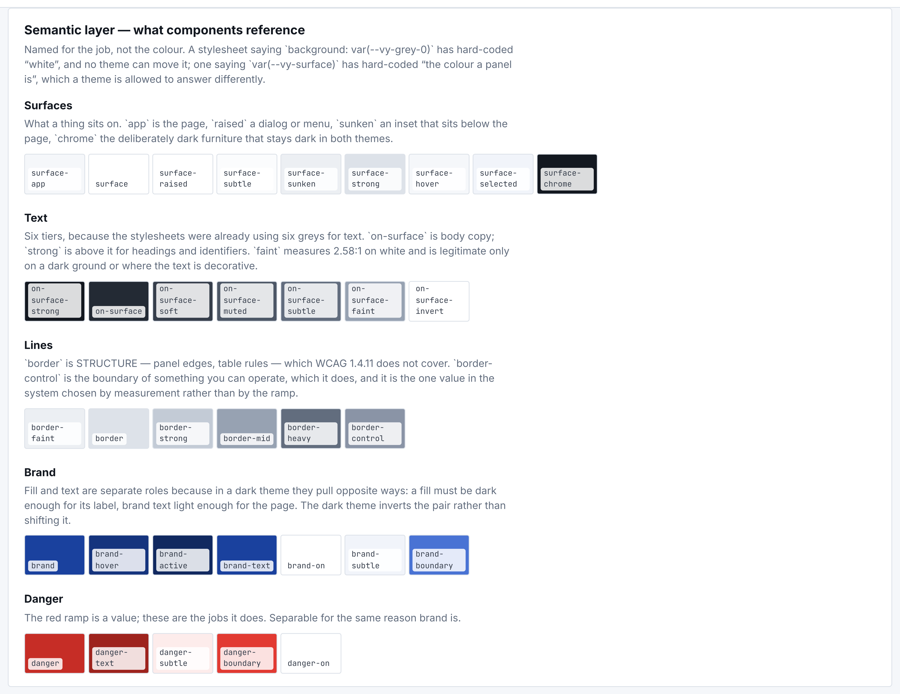

## A3 · Năm luật trước khi dựng

1. **Có token cho thứ này chưa?** Có thì dùng. Chưa thì thêm — và ghi trong
   code vì sao thang hiện tại không có nó.
2. **Không bịa nội dung.** Tên trường, danh sách lựa chọn, từ ngữ status và
   hành vi là **sự thật về nghiệp vụ**, không phải quyết định thiết kế. Tra
   cho ra trước khi vẽ.
3. **Cả hai theme, cả hai mật độ, và 820px.** Một màn chỉ mới được xem ở chế
   độ sáng trên màn 1920px là một màn mới được xem **một lần**.
4. **Số ma thuật phải có ghi chú.** Một bề rộng lệch khỏi role của nó cần
   `widthNote` nói rõ đã đo cái gì.
5. **Cái gì không thật thì phải nói ra.** Một con số suy ra, một hành động
   chưa dựng, một lần gửi giả — mỗi cái đều phải ghi ngay tại chỗ nó xuất
   hiện, không phải chỉ trong commit message.

---
---

# Phần B — Nền tảng

## B1 · Màu

### B1.1 Ramp *(lớp 1 — không dùng trong component)*

Ba ramp, không hơn. Màu thứ tư trên một màn hình là một lỗi, trừ khi đó là
status — và status nằm ở [B1.6](#b16-bộ-từ-vựng-status).

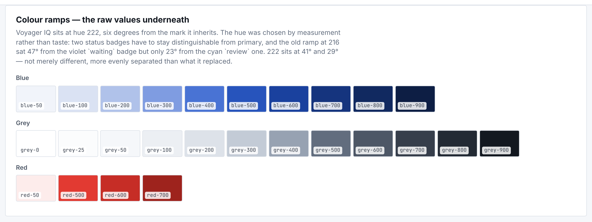

| Token | Giá trị |
|---|---|
| `--vy-blue-50` | `#f1f4fa` |
| `--vy-blue-100` | `#dae2f3` |
| `--vy-blue-200` | `#b0c2ea` |
| `--vy-blue-300` | `#7f9ce1` |
| `--vy-blue-400` | `#4973d4` |
| `--vy-blue-500` | `#2754bc` |
| `--vy-blue-600` | `#1a419e` |
| `--vy-blue-700` | `#15347e` |
| `--vy-blue-800` | `#112960` |
| `--vy-blue-900` | `#0d1e44` |
| `--vy-red-50` | `#fdeceb` |
| `--vy-red-500` | `#e23a32` |
| `--vy-red-600` | `#c62d26` |
| `--vy-red-700` | `#9e231d` |
| `--vy-grey-0` | `#ffffff` |
| `--vy-grey-25` | `#fbfcfd` |
| `--vy-grey-50` | `#f5f7fa` |
| `--vy-grey-100` | `#eceff3` |
| `--vy-grey-200` | `#dde2e9` |
| `--vy-grey-300` | `#c3cbd6` |
| `--vy-grey-400` | `#97a2b2` |
| `--vy-grey-500` | `#626d7e` |
| `--vy-grey-600` | `#4d5766` |
| `--vy-grey-700` | `#363e4b` |
| `--vy-grey-800` | `#232a34` |
| `--vy-grey-900` | `#131820` |

### B1.2 Surface — thứ mà một vật đặt lên

`app` là trang · `raised` là hộp thoại hoặc menu · `sunken` là phần lõm xuống
dưới mặt trang · `chrome` là phần khung tối **cố ý giữ tối ở cả hai theme**.

| Token | Giá trị | Phân giải ra | Dark |
|---|---|---|---|
| `--vy-surface-app` | `var(--vy-grey-50)` | `#f5f7fa` | `#0f131a` |
| `--vy-surface` | `var(--vy-grey-0)` | `#ffffff` | `#161c25` |
| `--vy-surface-raised` | `var(--vy-grey-0)` | `#ffffff` | `#1e2531` |
| `--vy-surface-subtle` | `var(--vy-grey-25)` | `#fbfcfd` | `#131922` |
| `--vy-surface-sunken` | `var(--vy-grey-100)` | `#eceff3` | `#0b0e14` |
| `--vy-surface-strong` | `var(--vy-grey-200)` | `#dde2e9` | `#2a323f` |
| `--vy-surface-hover` | `var(--vy-grey-50)` | `#f5f7fa` | `#1e2531` |
| `--vy-surface-selected` | `var(--vy-blue-50)` | `#f1f4fa` | `#1b2a4a` |
| `--vy-surface-chrome` | `var(--vy-grey-900)` | `#131820` | `#1e2531` |
| `--vy-surface-chrome-soft` | `var(--vy-grey-700)` | `#363e4b` | `#2a323f` |

### B1.3 Màu chữ — sáu bậc

`on-surface` là chữ thân bài; `strong` nằm trên nó, cho tiêu đề và mã định
danh.

> ⚠️ **`on-surface-faint` đo được 2.58:1 trên nền trắng.** Chỉ hợp lệ trên nền
> tối, hoặc khi chữ chỉ mang tính trang trí — **không bao giờ** dùng cho thứ
> người dùng phải đọc. Xem [E1](#e1--khả-năng-tiếp-cận).

| Token | Giá trị | Phân giải ra | Dark |
|---|---|---|---|
| `--vy-on-surface-strong` | `var(--vy-grey-900)` | `#131820` | `#f5f8fc` |
| `--vy-on-surface` | `var(--vy-grey-800)` | `#232a34` | `#e9edf3` |
| `--vy-on-surface-soft` | `var(--vy-grey-700)` | `#363e4b` | `#d3dae4` |
| `--vy-on-surface-muted` | `var(--vy-grey-600)` | `#4d5766` | `#aab4c3` |
| `--vy-on-surface-subtle` | `var(--vy-grey-500)` | `#626d7e` | `#8f9aaa` |
| `--vy-on-surface-faint` | `var(--vy-grey-400)` | `#97a2b2` | `#67727f` |
| `--vy-on-surface-invert` | `var(--vy-grey-0)` | `#ffffff` | `#0f131a` |
| `--vy-on-chrome-muted` | `var(--vy-grey-300)` | `#c3cbd6` | `#c3cbd6` |
| `--vy-on-dark-fg` | `#ffffff` | — | *(same)* |
| `--vy-on-dark-secondary` | `var(--vy-grey-300)` | `#c3cbd6` | *(same)* |
| `--vy-on-dark-muted` | `var(--vy-grey-400)` | `#97a2b2` | *(same)* |
| `--vy-on-dark-hairline` | `rgba(255, 255, 255, .07)` | — | *(same)* |
| `--vy-on-dark-hover` | `rgba(255, 255, 255, .05)` | — | *(same)* |
| `--vy-on-dark-active` | `rgba(43, 99, 184, .22)` | — | *(same)* |

### B1.4 Đường kẻ

`border` là **cấu trúc** — mép panel, kẻ bảng — thứ mà WCAG 1.4.11 **không**
quản. `border-control` là viền của thứ người dùng **thao tác được**, và nó thì
WCAG có quản.

Đây là giá trị duy nhất trong hệ thống được chọn bằng **đo đạc** chứ không
lấy từ ramp. Bản quét ngày 5/9 cho biết lý do: thang xám **không có bậc nào
đạt**. grey-400 `#97a2b2` được 2.58:1 trên trắng, **thiếu 0.42**; bậc kế tiếp
lại vọt lên 5.24. `--vy-border-control` `#8a94a6` được thêm vào giữa hai bậc —
**3.06:1**, giá trị nhạt nhất mà vẫn đạt. Nó chỉ quản viền: input, textarea,
combobox, checkbox, radio.

| Token | Giá trị | Phân giải ra | Dark |
|---|---|---|---|
| `--vy-border-control` | `#8a94a6` | — | `#6d7889` |
| `--vy-border-faint` | `var(--vy-grey-100)` | `#eceff3` | `#212936` |
| `--vy-border` | `var(--vy-grey-200)` | `#dde2e9` | `#2a323f` |
| `--vy-border-strong` | `var(--vy-grey-300)` | `#c3cbd6` | `#3b4553` |
| `--vy-border-mid` | `var(--vy-grey-400)` | `#97a2b2` | `#55606f` |
| `--vy-border-heavy` | `var(--vy-grey-500)` | `#626d7e` | `#55606f` |
| `--vy-border-emphasis` | `2px` | — | *(same)* |

### B1.5 Brand và danger

Màu nền và màu chữ là **hai vai trò tách biệt**, vì ở theme tối chúng kéo
ngược chiều nhau: nền phải đủ tối để chữ trên nó đọc được, còn chữ brand phải
đủ sáng để đọc trên trang. Theme tối **đảo cặp** chứ không dịch chuyển nó.

| Token | Giá trị | Phân giải ra | Dark |
|---|---|---|---|
| `--vy-brand` | `var(--vy-blue-600)` | `#1a419e` | `#7f9ce1` |
| `--vy-brand-hover` | `var(--vy-blue-700)` | `#15347e` | `#b0c2ea` |
| `--vy-brand-active` | `var(--vy-blue-800)` | `#112960` | `#dae2f3` |
| `--vy-brand-text` | `var(--vy-blue-600)` | `#1a419e` | `#7f9ce1` |
| `--vy-brand-text-hover` | `var(--vy-blue-700)` | `#15347e` | `#b0c2ea` |
| `--vy-brand-text-deep` | `var(--vy-blue-800)` | `#112960` | `#dae2f3` |
| `--vy-brand-on` | `var(--vy-grey-0)` | `#ffffff` | `#0f131a` |
| `--vy-brand-subtle` | `var(--vy-blue-50)` | `#f1f4fa` | `#1b2a4a` |
| `--vy-brand-subtle-strong` | `var(--vy-blue-100)` | `#dae2f3` | `#223357` |
| `--vy-brand-light` | `var(--vy-blue-400)` | `#4973d4` | `#7f9ce1` |
| `--vy-brand-soft` | `var(--vy-blue-500)` | `#2754bc` | `#4973d4` |
| `--vy-brand-boundary` | `var(--vy-blue-400)` | `#4973d4` | `#4973d4` |
| `--vy-brand-boundary-soft` | `var(--vy-blue-200)` | `#b0c2ea` | `#2754bc` |
| `--vy-brand-boundary-light` | `var(--vy-blue-300)` | `#7f9ce1` | `#7f9ce1` |
| `--vy-brand-boundary-strong` | `var(--vy-blue-500)` | `#2754bc` | `#4973d4` |

| Token | Giá trị | Phân giải ra | Dark |
|---|---|---|---|
| `--vy-danger` | `var(--vy-red-600)` | `#c62d26` | `#c62d26` |
| `--vy-danger-on` | `var(--vy-grey-0)` | `#ffffff` | `#ffffff` |
| `--vy-danger-text` | `var(--vy-red-700)` | `#9e231d` | `#f0918a` |
| `--vy-danger-text-deep` | `var(--vy-red-700)` | `#9e231d` | `#f5aba5` |
| `--vy-danger-subtle` | `var(--vy-red-50)` | `#fdeceb` | `#38201e` |
| `--vy-danger-boundary` | `var(--vy-red-500)` | `#e23a32` | `#e0655c` |

### B1.6 Bộ từ vựng status

Tám status, mỗi cái là một cặp chữ/nền.

> **Status là một chữ kèm một màu, không bao giờ là màu không thôi.** Chính
> cặp đó mới làm nó đọc được với người không phân biệt được sắc độ.

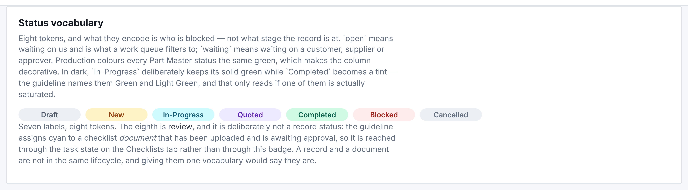

| Token | Giá trị | Phân giải ra | Dark |
|---|---|---|---|
| `--vy-status-draft-fg` | `var(--vy-grey-600)` | `#4d5766` | `#aab4c3` |
| `--vy-status-draft-bg` | `var(--vy-grey-100)` | `#eceff3` | `#2a323f` |
| `--vy-status-open-fg` | `#92400e` | — | `#eeb796` |
| `--vy-status-open-bg` | `#fef3c7` | — | `#38281e` |
| `--vy-status-progress-fg` | `#155e75` | — | *(same)* |
| `--vy-status-progress-bg` | `#cffafe` | — | *(same)* |
| `--vy-status-done-fg` | `#065f46` | — | `#96eed5` |
| `--vy-status-done-bg` | `#d1fae5` | — | `#1e3831` |
| `--vy-status-waiting-fg` | `#5b21b6` | — | `#b896ee` |
| `--vy-status-waiting-bg` | `#ede9fe` | — | `#281e38` |
| `--vy-status-review-fg` | `#0e7490` | — | `#96dbee` |
| `--vy-status-review-bg` | `#ecfeff` | — | `#1e3338` |
| `--vy-status-blocked-fg` | `var(--vy-red-700)` | `#9e231d` | `#ee9a96` |
| `--vy-status-blocked-bg` | `var(--vy-red-50)` | `#fdeceb` | `#38201e` |
| `--vy-status-cancelled-fg` | `var(--vy-grey-500)` | `#626d7e` | `#aab4c3` |
| `--vy-status-cancelled-bg` | `var(--vy-grey-100)` | `#eceff3` | `#2a323f` |
| `--vy-status-slot-w` | `104px` | — | *(same)* |

### B1.7 Tone dòng và màu nhấn

Tone là **trạng thái của một dòng trong báo giá**, không phải mức độ nghiêm
trọng. Ba tone tô phần lớn lưới BoM, và chú giải dưới lưới gọi tên đủ cả ba.

| Token | Giá trị | Phân giải ra | Dark |
|---|---|---|---|
| `--vy-tone-excluded-bg` | `var(--vy-grey-100)` | `#eceff3` | `#2a323f` |
| `--vy-tone-excluded-fg` | `var(--vy-grey-500)` | `#626d7e` | `#aab4c3` |
| `--vy-tone-missing-bg` | `var(--vy-red-50)` | `#fdeceb` | `#38201e` |
| `--vy-tone-missing-fg` | `var(--vy-red-700)` | `#9e231d` | `#ee9a96` |
| `--vy-tone-short-bg` | `var(--vy-status-open-bg)` | `#fef3c7` | *(same)* |
| `--vy-tone-covered-bg` | `var(--vy-status-done-bg)` | `#d1fae5` | *(same)* |
| `--vy-tone-known-mfg-bg` | `var(--vy-status-open-bg)` | `#fef3c7` | *(same)* |
| `--vy-tone-pending-bg` | `var(--vy-surface-sunken)` | `#eceff3` | *(same)* |

| Token | Giá trị | Phân giải ra | Dark |
|---|---|---|---|
| `--vy-accent-positive` | `#047857` | — | `#75f0cd` |
| `--vy-accent-caution` | `#d97706` | — | `#f0b775` |
| `--vy-accent-warning` | `#b45309` | — | `#f0aa75` |
| `--vy-accent-waiting` | `#6d28d9` | — | `#a679ec` |
| `--vy-accent-neutral` | `#4d5766` | — | `#aab4c3` |
| `--vy-accent-bar-w` | `3px` | — | *(same)* |

### B1.8 Dark mode được nối như thế nào

Ba khối, và **một token phải có mặt ở cả ba**, nếu không thì hai cách chọn
dark sẽ nói khác nhau:

| Khối | Phục vụ ai |
|---|---|
| `:root { … }` | Sáng — mặc định |
| `:root[data-theme="dark"] { … }` | Người **tự chọn** dark trong menu người dùng |
| `@media (prefers-color-scheme: dark) { :root:not([data-theme="light"]) { … } }` | Người có **hệ điều hành** đang ở dark |

> Lỗi này đã xảy ra một lần: bốn token chỉ tồn tại trong bản media, nên người
> tự chọn dark trong menu nhận viền grey-400 và một chấm priority gần trắng
> trên nền gần đen. **Thêm một token màu nghĩa là sửa ba chỗ.**

Vẫn hai khối đó ở theme tối. Mỗi vai trò **giữ nguyên nhiệm vụ** và đổi giá
trị — và các cặp status vẫn đọc được chứ không bị đảo một cách máy móc:

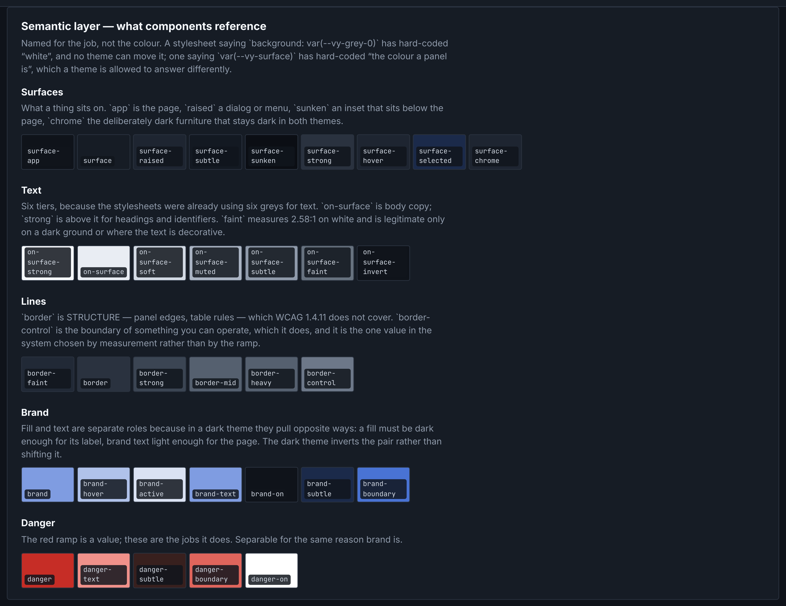

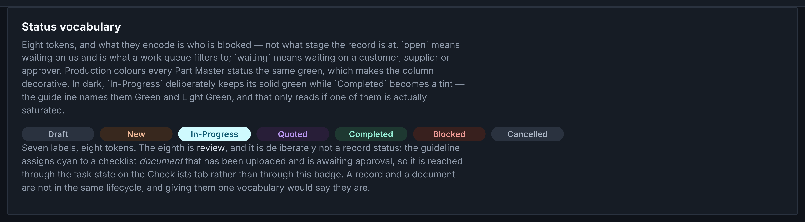

---

## B2 · Chữ

Hai bộ chữ. **Inter Variable** cho mọi thứ; **JetBrains Mono** cho mã định
danh phải đọc thành lời hoặc so từng ký tự — part number, MPN, mã lỗi. Chữ
thân bài **không bao giờ** dùng mono — ở 13px nó khó đọc hơn, và không có gì
trong một câu văn cần bề rộng ký tự cố định.

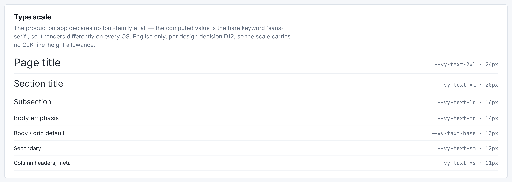

| Token | Giá trị |
|---|---|
| `--vy-font-sans` | `"Inter Variable", "Inter", system-ui, -apple-system, "Segoe UI", Arial, sans-serif` |
| `--vy-font-mono` | `"JetBrains Mono", ui-monospace, "SF Mono", "Cascadia Mono", Consolas, monospace` |
| `--vy-text-2xs` | `12px` |
| `--vy-text-xs` | `13px` |
| `--vy-text-sm` | `14px` |
| `--vy-text-base` | `15px` |
| `--vy-text-md` | `16px` |
| `--vy-text-lg` | `18px` |
| `--vy-text-xl` | `20px` |
| `--vy-text-2xl` | `24px` |
| `--vy-text-3xl` | `28px` |
| `--vy-weight-regular` | `400` |
| `--vy-weight-medium` | `500` |
| `--vy-weight-semibold` | `600` |
| `--vy-weight-bold` | `650` |
| `--vy-weight-heavy` | `700` |

**Thang chữ dịch lên trên thiết bị cảm ứng.** Dưới `@media (pointer: coarse)`,
dải chữ thân bài tăng đều **+2px** — thành 12, 13, 14, 15, 16, 18 thay vì 10,
11, 12, 13, 14, 16 — giữ nguyên mọi tương quan và nâng bậc nhỏ nhất lên mức
đọc được là 12. Các cỡ tiêu đề (`xl` trở lên) **không đổi**: chúng vốn đã thoải
mái, và phóng to tiêu đề trên màn 375px không được gì mà còn tốn một dòng
xuống hàng.

### Viết hoa — ba cấp, vẽ khác nhau có chủ đích

Nút, link, tab, tiêu đề form và hộp thoại, tiêu đề section và card, **nhãn
trường**, tiêu đề cột, nhãn bộ lọc, mục menu và status pill đều dùng **Title
Case**, với giới từ (for, to, of, by, as, in, on, at, from, with, via, per,
into) viết thường trừ khi đứng đầu. Văn xuôi thì sentence case.

| Cấp | Kiểu chữ | Cỡ / độ đậm | Ví dụ |
|---|---|---|---|
| Tiêu đề card | Title Case | 14px / 600 | `Select Action` · `Continue from Drafts` |
| Divider trong card | **VIẾT HOA**, giãn .05em | 12px / 600 | `QUOTE STRATEGY` · `BOM OPTIONS` |
| Nhãn trường | Title Case | 12px / 600 | `Customer` · `Qty to Quote` · `Markup (%)` |

---

## B3 · Khoảng cách

### B3.1 Thang khoảng cách

| Token | Giá trị |
|---|---|
| `--vy-space-1` | `2px` |
| `--vy-space-2` | `4px` |
| `--vy-space-3` | `6px` |
| `--vy-space-4` | `8px` |
| `--vy-space-5` | `10px` |
| `--vy-space-6` | `12px` |
| `--vy-space-7` | `14px` |
| `--vy-space-8` | `16px` |
| `--vy-space-9` | `20px` |
| `--vy-space-10` | `24px` |
| `--vy-space-11` | `28px` |
| `--vy-space-12` | `32px` |
| `--vy-space-14` | `40px` |

### B3.2 Khoảng cách nào giữa hai control

Thang không nói giúp nên chọn bậc nào, nên hệ thống nói thẳng. Các bậc chính
là thứ chở **ý nghĩa nhóm**, nên **không** gom về một giá trị duy nhất:

| Khoảng | Giữa | Ví dụ |
|---|---|---|
| **2px** | Các nút trong một cụm mà mắt đọc thành **một** control | thanh tiêu đề hộp thoại, mũi tên phân trang |
| **4px** | Nút icon gắn vào chính control nó tác động | một Select kèm Preview và Download |
| **8px** | **Hai hành động cạnh nhau** — mặc định | `.vy-page-actions`, `.vy-run-nav-actions`, `.vy-cost-actions` |
| **12px** | Các mục mà **bản thân mỗi mục** đã có control **và** nhãn | checkbox lọc, vốn đã cách chữ của chính nó 8px |
| **16px** | Giữa các **nhóm** trên cùng một hàng | bộ lọc / ô tìm kiếm / nút Columns trên toolbar |

Hai nút cạnh nhau thì ở đâu cũng 8px. Khoảng cách to hơn nghĩa là một ranh
giới thật, không phải một người viết khác tay.

---

## B4 · Hình khối và độ nổi

Bốn bán kính bo, ba đổ bóng. Độ nổi dành cho thứ **nổi lên khỏi trang** — hộp
thoại, menu, toast. Một card nằm trên trang thì dùng **viền**, không dùng
bóng.

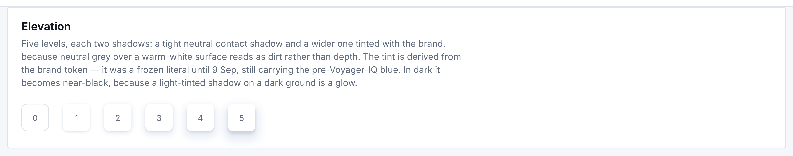

| Token | Giá trị | Dark |
|---|---|---|
| `--vy-radius-sm` | `3px` | *(same)* |
| `--vy-radius-md` | `4px` | *(same)* |
| `--vy-radius-lg` | `6px` | *(same)* |
| `--vy-radius-pill` | `999px` | *(same)* |
| `--vy-shadow-sm` | `0 1px 2px rgba(19, 24, 32, .06)` | *(same)* |
| `--vy-shadow-md` | `0 2px 8px rgba(19, 24, 32, .10)` | *(same)* |
| `--vy-shadow-lg` | `0 8px 28px rgba(19, 24, 32, .14)` | *(same)* |
| `--vy-overlay-scrim` | `rgba(19, 24, 32, .45)` | `rgba(0, 0, 0, .62)` |

### Z-index — một danh sách phẳng, để hai lớp phủ không bao giờ cãi nhau

| Token | Giá trị |
|---|---|
| `--vy-shell-sidebar-w` | `248px` |
| `--vy-shell-sidebar-w-collapsed` | `56px` |
| `--vy-shell-topbar-h` | `52px` |
| `--vy-z-drawer` | `10020` |
| `--vy-z-dialog` | `10040` |
| `--vy-z-menu` | `10070` |
| `--vy-z-palette` | `10075` |
| `--vy-z-toast` | `12500` |
| `--vy-z-skip` | `12600` |
| `--vy-dialog-md` | `640px` |
| `--vy-dialog-lg` | `960px` |
| `--vy-dialog-xl` | `1180px` |

---

## B5 · Kích thước

### B5.1 Chiều cao control

Mọi control nằm trên **thang kích thước của chính Kendo**, được **cấu hình**
chứ không ghi đè — `_kendo-size.scss` đặt biến và các component kế thừa. Ép
chiều cao lên một control Kendo là cách một ô select 29px đứng cạnh một ô
input 34px.

| Token | Giá trị |
|---|---|
| `--vy-row-h-compact` | `28px` |
| `--vy-row-h-comfortable` | `40px` |
| `--vy-row-h-relaxed` | `48px` |
| `--vy-target-min` | `44px` |
| `--vy-control-sm` | `28px` |
| `--vy-control-row` | `26px` |
| `--vy-control-md` | `34px` |
| `--vy-control-dense` | `32px` |
| `--vy-icon-sm` | `16px` |

| Token | Dùng ở đâu |
|---|---|
| `--vy-control-md` **34px** | Ô nhập, select, nút — mặc định |
| `--vy-control-dense` **32px** | Control trên toolbar: ô tìm kiếm, nút `size="sm"` |
| `--vy-control-sm` **28px** | Mật độ Compact |
| `--vy-control-row` **26px** | Nút icon **trong một dòng lưới** — đúng bậc `xs` của Kendo |
| `--vy-target-min` **44px** | Sàn, **chỉ** dưới `pointer: coarse` |

> **44px là luật cho cảm ứng, không phải cho desktop.** WCAG 2.5.5 nói về
> vùng chạm; áp nó lên một form 27 trường điều khiển bằng chuột là cộng thêm
> ~270px cuộn mà không được gì.

### B5.2 Mật độ dòng — là tuỳ chọn của người dùng

| Token | Chiều cao | Thiết lập |
|---|---|---|
| `--vy-row-h-compact` | 28px | Compact |
| `--vy-row-h-comfortable` | 40px | Comfortable *(mặc định)* |
| `--vy-row-h-relaxed` | 48px | Relaxed |

### B5.3 Role cột — bề rộng chọn một lần, theo vai trò

Một cột lưới khai báo **role**, không khai báo số pixel.

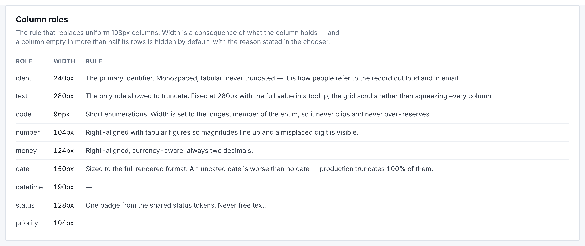

| Role | Bề rộng | Chứa gì |
|---|---|---|
| `ident` | 240px | Part number, MPN — không được cắt chữ |
| `text` | 280px | Mô tả và văn xuôi khác |
| `code` | 96px | Mã ngắn, revision |
| `number` | 104px | Số lượng |
| `money` | 124px | Giá và thành tiền |
| `date` | 150px | Một ngày |
| `datetime` | 190px | Một thời điểm — `09/09/2026 16:35:29` |
| `status` | 128px | Một status pill |
| `priority` | 104px | Một chấm và một chữ |

### B5.4 Hộp thoại và khung ứng dụng

| Cỡ | Bề rộng | Mở ra có full màn không? | Dùng cho |
|---|---|---|---|
| `md` | 640px | Không | Một câu hỏi: xác nhận, form ngắn |
| `lg` | 960px | Có *(ghi đè được)* | Hai khối cạnh nhau và một bảng ngắn |
| `xl` | 1180px | Có | Một mặt bàn làm việc: lưới 21 cột, wizard 4 bước |

| Token khung | Giá trị |
|---|---|
| `--vy-shell-sidebar-w` | 248px |
| `--vy-shell-sidebar-w-collapsed` | 56px |
| `--vy-shell-topbar-h` | 52px |

---

## B6 · Chuyển động

Bốn đường cong và ba thời lượng, không hơn. **Cố ý không có token độ dài
vòng lặp**: một custom property không ai đọc là một token sẽ mục.

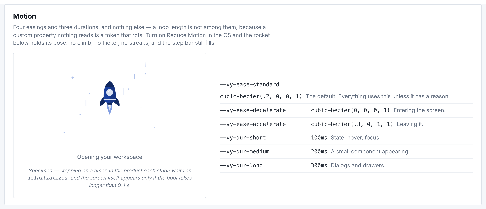

| Token | Giá trị | Dùng khi |
|---|---|---|
| `--vy-ease-standard` | `cubic-bezier(.2, 0, 0, 1)` | Mặc định. Mọi thứ, trừ khi có lý do riêng |
| `--vy-ease-emphasised` | `cubic-bezier(.2, 0, 0, 1)` | Khoảnh khắc cần được chú ý. **Hiện đang giống hệt `standard`** — tách tên để sau này đổi đường cong mà không phải sửa nơi gọi |
| `--vy-ease-decelerate` | `cubic-bezier(0, 0, 0, 1)` | Thứ gì đó **đang tới** |
| `--vy-ease-accelerate` | `cubic-bezier(.3, 0, 1, 1)` | Thứ gì đó **đang rời đi** |
| `--vy-dur-short` | **100ms** | Đổi trạng thái: hover, focus |
| `--vy-dur-medium` | **200ms** | Component nhỏ xuất hiện |
| `--vy-dur-long` | **300ms** | Hộp thoại, ngăn kéo |

### Đồng hồ của màn chờ

| Luật | Giá trị |
|---|---|
| Chỉ hiện màn boot nếu boot lâu hơn | **400ms** |
| Thoát — tên lửa bay khỏi mép trên | **400ms** |
| "Still climbing…" hiện sau | **5 giây** |
| Thời gian hiển thị tối thiểu sau khi đã hiện | **không có** |

Giữ một màn chờ lại cho nó khỏi loé là tiêu thời gian của người dùng để
indicator của mình trông đẹp hơn. **Không hiện gì cả** với một lần boot nhanh
hơn mốc thì không tốn của họ gì. Hai luật này là hai nửa của cùng một câu trả
lời.

### Giảm chuyển động là một trạng thái, không phải một cái công tắc

Dưới `prefers-reduced-motion: reduce`, tên lửa **giữ nguyên tư thế** — không
leo, không nhấp nháy, không vệt sao — và thanh 5 đoạn vẫn chạy. Một cánh tay
hàn bị gỡ animation là một cánh tay **không có tia lửa và checklist rỗng**,
tức là nó nói một điều khác với ý nghĩa của trạng thái. Nên những thứ
*hiện dần lên* thì được giữ lại.

---

## B7 · Responsive

Breakpoint viết bằng pixel thô vì `@media` không đọc được custom property —
một ngoại lệ có ghi chép của luật "không dùng số ma thuật".

| Bề rộng | Đổi gì |
|---|---|
| ≤ **1180px** | Sidebar 248px thu thành thanh icon 56px |
| ≤ **980px** | Các vùng hai cột xếp chồng |
| ≤ **820px** | Sidebar rời khỏi dòng chảy; một nút menu gọi nó ra |
| `pointer: coarse` | Thang chữ +2px ở dải thân bài; sàn vùng chạm 44px |

Hệ thống chạy trên terminal ngoài xưởng, thường 1366×768 hoặc hẹp hơn. Dưới
khoảng 1100px thì một sidebar 248px thôi làm nhiệm vụ định hướng và bắt đầu
làm vật cản — **đo ở 543px thì nó chiếm 46% khung nhìn**.

Cùng một màn ở ba bề rộng đáng quan tâm. Thanh đầy đủ, thanh icon, và không
còn thanh nào với một nút menu trên top bar — và ở cả ba, **lưới giữ nguyên
cột** chứ không bóp chúng lại:

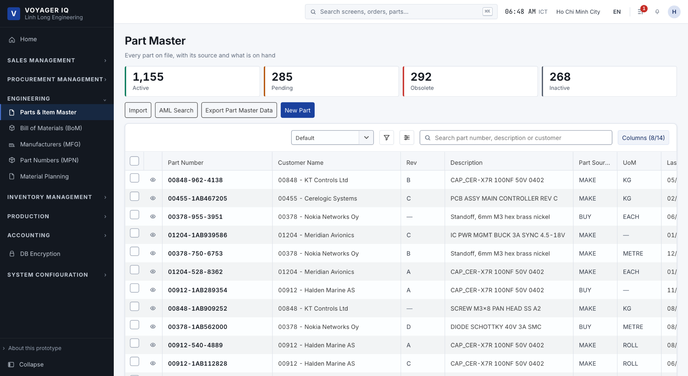

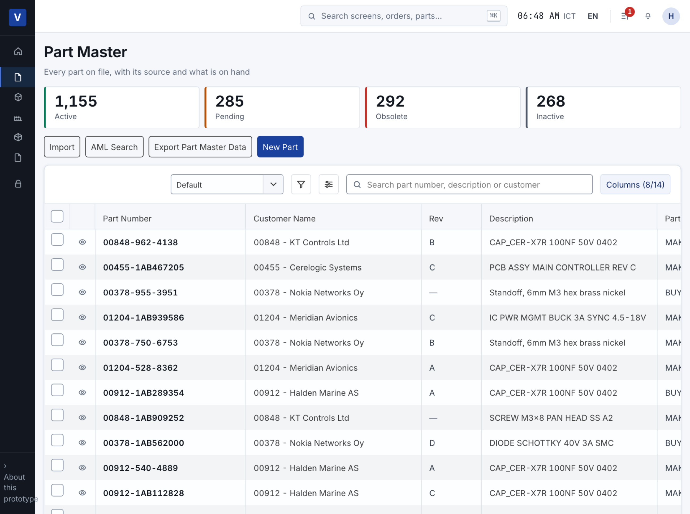

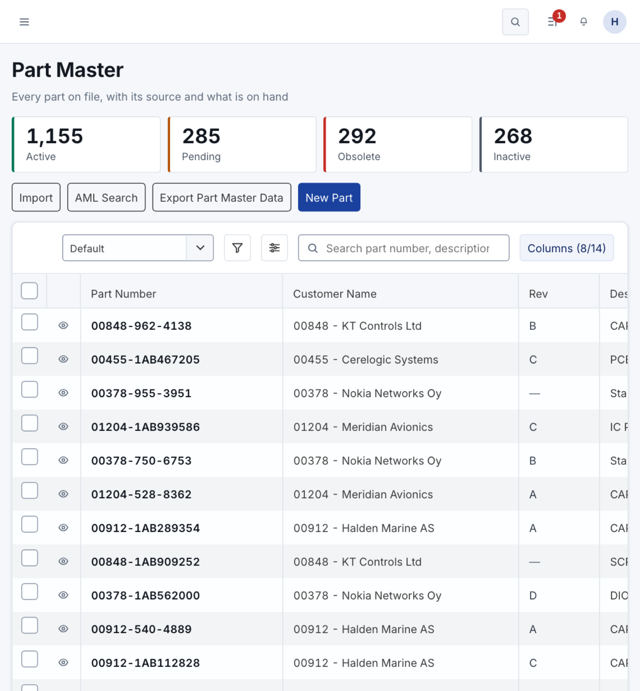

---
---

# Phần C — Tài nguyên

## C1 · Icon

Một bộ duy nhất. **viewBox 20×20, chỉ nét, không tô, một độ dày nét.** Nét
nặng hơn ở cỡ nhỏ hơn là cách một bộ icon thôi trông giống một bộ.

Một tên không có trong bộ sẽ render ra **không gì cả**, và để lại cái tên
trong DOM — thay vì rơi về một glyph tài liệu nào đó và giấu mất lỗi.

| | |
|---|---|
| Cỡ mặc định | 16px · `--vy-icon-sm` |
| Trong một dòng lưới | 15px, trong nút 26px |
| Màu | `currentColor` — icon lấy màu chữ quanh nó |
| Trang trí | `aria-hidden`, và trạng thái nó đánh dấu phải có chữ riêng |

**45 cái tên:**
`task · chat · log · quote · order · return · customer · requisition ·
supplier · factory · simulate · bom · transfer · adjust · pcb · tool ·
machine · invoice · journal · lock · people · template · job · plug · menu ·
globe · metadata · queue · doc · home · sell · buy · parts · stock · make ·
finance · insight · settings · chevron-down · chevron-right · eye · download ·
clip · trash · check`

Hai glyph chỉ hướng, mỗi cái một nhiệm vụ: **xuống** mở một menu ngay bên
dưới nó, **phải** nói "cái này mở sang chỗ khác".

---

## C2 · Hình minh hoạ

**Một bức vẽ, ba trạng thái.** Sản phẩm có đúng **một** nhân vật minh hoạ —
một con tàu — và nó xuất hiện trong ba tình huống. Đó là chủ ý: người đã gặp
con tàu này lúc đi vào không nên phải học bức thứ hai mới hiểu là nó rơi.

Component: `src/ui/RocketLaunch.tsx` · một SVG inline, `viewBox="0 0 240 180"`
· `data-state` chọn cảnh.

| | |
|---|---|
| Bề rộng khi render | `clamp(240px, 18vw, 280px)` |
| Màu | Mười token vai trò, [B1.7](#b17-tone-dòng-và-màu-nhấn) — **không bao giờ** hex |
| Chuyển động | Thuần CSS. Hình này sở hữu pixel chứ không sở hữu state, nên nó dừng được trong tab nền mà không mất gì |
| Id | Sinh bằng `useId` — hai bản trên cùng một trang nếu không sẽ dùng chung một clip path |
| Inline, không dùng `` | `` là một request thứ hai trên đúng cái màn sinh ra để che request thứ nhất; và nó là một tài liệu riêng, nơi `var(--vy-brand)` không phân giải được |

### C2.1 `launching` — màn boot

Con tàu **đứng yên giữa khung** và **thế giới chuyển động**: hành tinh chìm
xuống một nấc mỗi bước boot, vệt sao chạy xuống ngang qua nó. Bản thân một
con tàu vẽ chúc mũi lên không nói được là nó "đang leo".

| | |
|---|---|
| Ở đâu | `BootGate` sau khi đăng nhập; `Suspense` fallback của route tải chậm |
| Chuyển động | Cất cánh 0.7s · nhấp nhô 1.6s · lửa nhấp nháy 0.18s · vệt sao 0.8–1.3s |
| Khi giảm chuyển động | Không leo, không nhấp nháy, không vệt sao. **Thanh 5 đoạn vẫn chạy** |

Kèm nhãn và thanh 5 đoạn — đây mới là màn boot thật sự:

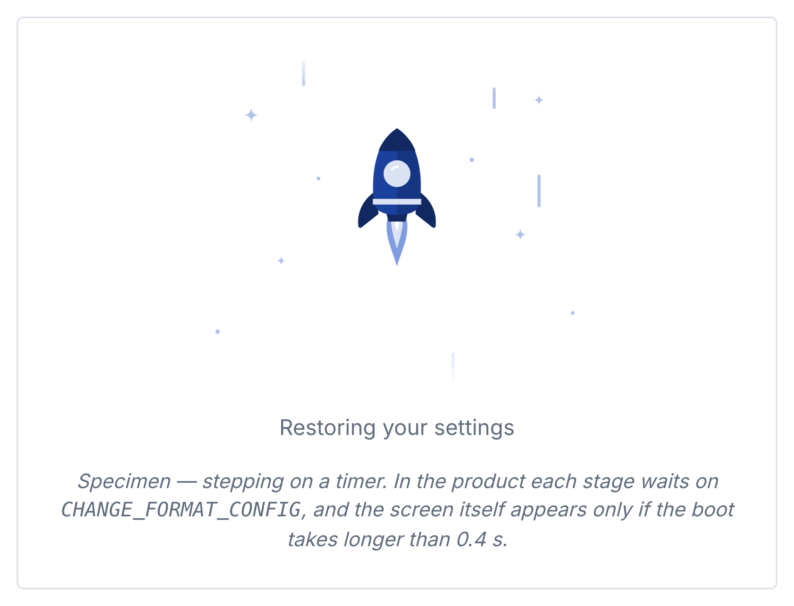

### C2.2 `error` — màn hình dừng tải

Vẫn con tàu đó, nằm lại trên bệ: nghiêng, nứt thân, rụng một cánh, bốc khói.
Cái hỏng đọc ra được **trước khi** đọc câu chữ bên dưới.

| | |
|---|---|
| Ở đâu | `ErrorState`, do `ErrorBoundary` dựng cho bất kỳ route nào ném lỗi |
| Chuyển động | Ba cụm khói, 2.4s, lệch pha nhau |
| Khi giảm chuyển động | Khói giữ ở opacity 0.6 — **khói còn, chuyển động mất** |

### C2.3 `building` — còn trên bệ phóng

Con tàu **nguyên vẹn** trên bệ, một cánh tay máy đang hàn, một bảng vẽ thiết
kế trên giá với checklist tick dần. **Đang làm dở, không phải đổ vỡ** — và sự
khác biệt đó phải thấy được trước khi đọc tiêu đề.

| | |
|---|---|
| Ở đâu | `Placeholder`, trả lời cho mọi route chưa dựng (~70 trên 91) |
| Chuyển động | Cánh tay 4s · tia lửa chỉ khi tay đang tì vào mối hàn · checklist 6s |
| Khi giảm chuyển động | Tia lửa và hai tick đầu **giữ bật**, để bức hình vẫn nói "đang được dựng" |

### C2.4 Skeleton — kiểu chờ còn lại

Skeleton trả lời câu *"cái này sắp trông như thế nào?"*. Khi người dùng **đã**
nhìn thấy dữ liệu rồi thì câu đó đã có đáp án, nên một lần tính lại giá hay
một trang tiếp theo sẽ **làm mờ cái đang có** và đặt indicator lên trên
(`BusyOverlay`).

Cả hai dùng chung một hiệu ứng loé: `--vy-surface-sunken` →
`--vy-surface-app` → `--vy-surface-sunken`, nền 200%, 1.4s.

**Skeleton lưới** — dùng đúng role cột thật, nên các thanh nằm đúng chỗ dữ
liệu sắp hiện ra:

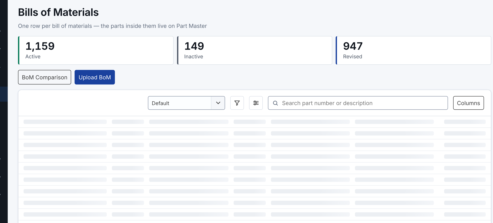

**Skeleton hồ sơ** — dùng đúng nhãn trường thật, vì nhãn đã biết trước khi dữ
liệu về. Đo tới khi màn chỉ còn nhảy 1px lúc dữ liệu tới:

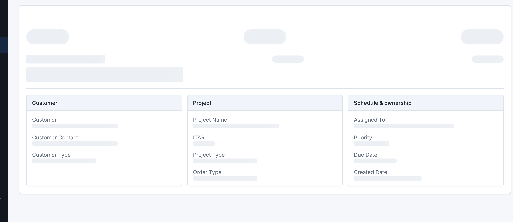

### C2.5 Trạng thái rỗng

**Cố ý không có hình.** Một màn rỗng là một câu nói và một hành động — vẽ
thêm vào đó chỉ làm chậm cả hai.

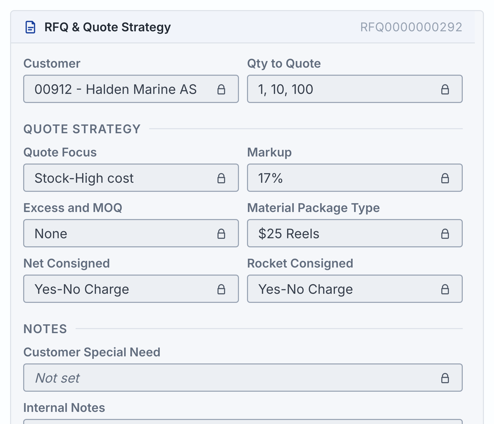

### C2.6 Xuất hình và dựng lại

| | |
|---|---|
| Nguồn sống | `src/ui/RocketLaunch.tsx` |
| SVG tĩnh | `docs/assets/rocket-journey/*.svg` — bộ **bay ngang đã nghỉ hưu**, giữ lại vì một tài liệu cũ vẫn in chúng. Không còn trong sản phẩm |
| Hình trong tài liệu này | Chụp từ app đang chạy ở 2×; script nằm trong `scripts/` |

> **Nếu cần đem hình ra khỏi codebase** — cho slide, cho PDF — hãy xuất SVG
> inline và **thay các `var(--vy-rocket-*)` bằng mã hex đã phân giải** ở
> [B1.7](#b17-tone-dòng-và-màu-nhấn). Ngoài app không có lớp token nào giải
> chúng.

---
---

# Phần D — Component và mẫu dựng

`src/ui` có 33 file: các primitive, cộng bộ icon, kho tuỳ chọn và ba hook.
Mỗi lớp bọc đều có lý do, và luật sinh ra chúng lúc nào cũng giống nhau —
**hệ thống live đã có sẵn KendoReact, nên câu hỏi không bao giờ là "cái này
nên trông thế nào" mà là "Kendo đã làm được gì, và mình phải thêm gì".**

## D1 · Nút

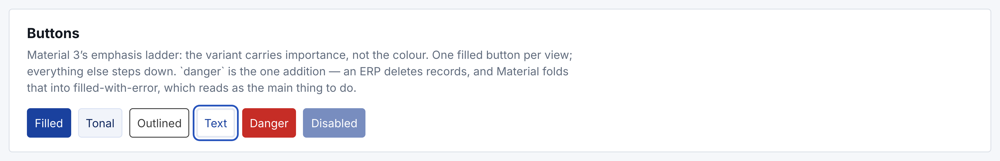

Hình trên là trang mẫu sống với bàn phím đang đặt trên đó: `Text` mang **vòng
focus** mà mọi control trong hệ thống đều dùng — 2px `--vy-brand-boundary`,
lệch ra 2px, **không bao giờ gỡ outline**.

| Biến thể | Khi nào |
|---|---|
| `filled` | **Một cái trên một màn.** Bước tiếp theo khả dĩ nhất |
| `outlined` | Mặc định cho mọi thứ còn lại |
| `tonal` | Hành động phụ nhưng vẫn cần sức nặng |
| `text` | Hạng ba, trong các dòng dày đặc |
| `danger` | Phá huỷ — và nó nằm sau **More ▾** |

**Vị trí:** mọi nút nằm **bên trái** toolbar; nhóm smart button hoặc chỉ báo
bước nằm bên phải; tối đa 4 nút hiện, phần còn lại vào `More ▾` — và nhãn
luôn là chữ *More* kèm chevron, **không bao giờ là `⋯`**.

**Cancel chỉ có trong hộp thoại.** Ở chế độ sửa, chữ là **Discard Changes**.

**`busy` không phải trang trí.** Chỉ báo nói rằng có việc đang chạy; **cái
khoá nút** mới là thứ chặn cú bấm thứ hai tiêu thêm một lượt gọi sàn.

## D2 · Trường nhập

### Hai chế độ, ba cách thể hiện

Một hồ sơ có **hai chế độ** — xem và sửa. Bên trong chế độ sửa, một trường
thuộc **một trong hai loại**, và ổ khoá sinh ra để đánh dấu điều đó. **Ổ khoá
không phải trạng thái thứ ba của một trường**; nó là dấu phân biệt hai loại,
và nó chỉ xuất hiện ở nơi sự phân biệt đó còn ý nghĩa.

| | Trường sửa được | Trường không sửa được |
|---|---|---|
| **Chế độ xem** | Hộp nền lõm, **không** ổ khoá | Hộp nền lõm, **không** ổ khoá |
| **Chế độ sửa** | Ô **trắng**, viền `--vy-border-control` | Hộp **nền lõm**, **có ổ khoá**, kèm một lý do ngắn |

**Ở chế độ xem thì không gì sửa được, nên sự phân biệt chẳng có gì để nói** —
gắn ổ khoá lên cả hai mươi bảy trường là không đánh dấu trường nào cả. Các
hộp giống hệt nhau, và mắt đọc **giá trị** chứ không đọc cái khung.

**Ở chế độ sửa, màu trắng nói cho biết chỗ nào gõ được.** Thứ gì còn nằm
trong hộp xám là giá trị màn này không sở hữu, và sau ổ khoá là **lý do, viết
bằng hai ba chữ** — vì ổ khoá nói được *rằng* trường bị khoá nhưng không nói
được *vì sao*.

**Chế độ xem — một kiểu hộp cho mọi giá trị:**

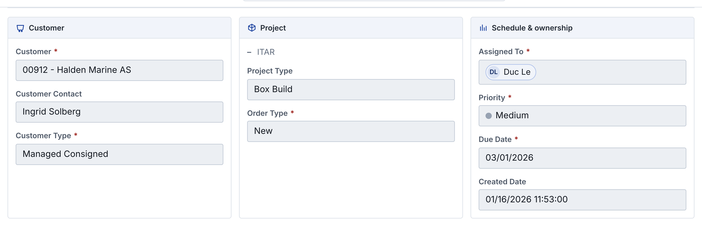

**Chế độ sửa — trắng ở chỗ gõ được; xám, có khoá và có lý do ở chỗ không gõ
được.** `Created Date` ghi *set by the system*; `ITAR` ghi *follows Customer*:

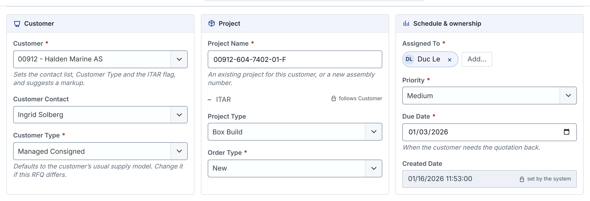

> **Một ngoại lệ, và nó vẫn là cùng một luật.** Một panel mà **không gì** sửa
> được thì giữ hộp xám và **bỏ ổ khoá** — ví dụ thanh thiết lập ở bước cuối
> của Run Quotation, khi lần chạy đã xong. Gắn ổ khoá lên cả bảy giá trị chỉ
> lặp lại điều mà cả panel đã nói.

### Phần còn lại của một trường

| Thành phần | Luật |
|---|---|
| Nhãn | **Trên** giá trị, không bao giờ nằm cạnh. Title Case, 12px, 600 |
| Bắt buộc | **Dấu sao đỏ** ngay sau nhãn, ở **cả** chế độ xem lẫn chế độ sửa |
| Không bắt buộc | Không đánh dấu gì. Không bao giờ viết "(optional)" |
| Helper | Dưới trường, in nghiêng, cỡ bằng hoặc nhỏ hơn nhãn |
| Lỗi | Chữ đỏ dưới trường, **khi rời ô** — không phải mỗi lần gõ |
| Lỗi *hoặc* hint | **Không bao giờ cả hai**: hai dòng cùng tự nhận là đang chỉ việc tiếp theo |
| Hint | Là **anh em** của nhãn, không nằm trong nhãn, nếu không nó nhập vào tên của control |

## D3 · Lưới

Lưới là nơi hệ thống này làm phần lớn công việc, và **tone dòng** là cách nó
nói. Tone là **trạng thái của dòng trong báo giá**, không phải mức nghiêm
trọng: xanh là đã có nhà cung cấp phủ đủ, vàng là thiếu số lượng, đỏ là không
ai chào giá, xám là bị loại khỏi báo giá.

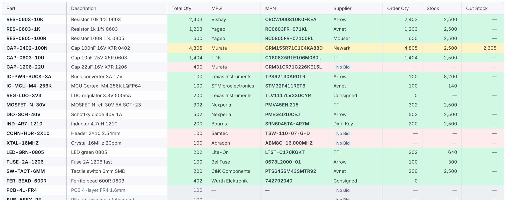

**Mọi tone đều được gọi tên ngay dưới lưới mà nó tô.** Một màu mà chỉ người
vẽ giải mã được là một màu không có nghĩa:

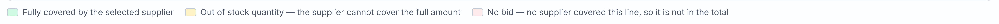

| Luật | |
|---|---|
| Bộ chọn cột | Trên **mọi** lưới có từ **3 cột** trở lên |
| Khối đóng băng | Khai báo bằng `locked`, để bộ chọn cột và phần đóng băng không thể nói khác nhau |
| Sọc vằn | Theo **record**, không theo dòng — một record trải hai dòng AML là **một** vệt |
| Tổng | Lưới nào người dùng phải tự cộng bằng mắt thì phải có dòng tổng |
| Rỗng | Một trạng thái rỗng thật, nói rõ nên làm gì — không bao giờ là "No records available" |
| Bề rộng | Theo role ([B5.3](#b53-role-cột--bề-rộng-chọn-một-lần-theo-vai-trò)); lệch thì phải có `widthNote` |

## D4 · Hộp thoại

Kích thước ở [B5.4](#b54-hộp-thoại-và-khung-ứng-dụng). Thêm ba luật:

1. **Hành động nằm góc trên trái** với một mặt bàn làm việc, nằm ở chân với
   một câu hỏi. Lối thoát luôn nằm bên trái, dù thanh nằm ở đâu.
2. **`lg` và `xl` mở ra full màn**; `md` thì không bao giờ. Hai cỡ đó là mặt
   bàn làm việc, và một lưới 21 cột trong khung 1180px là đang tiêu đúng chỗ
   màn hình được cấp — trong khi một hộp xác nhận chiếm hết màn 27 inch là câu
   trả lời tệ hơn cái nó thay thế.
3. **Escape đóng thứ trong cùng**, điều mà Select phải được dạy bằng tay —
   cách xử lý của Kendo đóng luôn cả hộp thoại khi dropdown đang mở.

## D5 · Bốn trạng thái màn hình

Đang tải, rỗng, lỗi và chưa dựng là **bốn thứ khác nhau** và phải trông khác
nhau. Làm sai mấy cái này là cách phổ biến nhất để một màn hình nói dối người
đọc nó.

| Trạng thái | Người dùng thấy gì | Hành động | Hình |
|---|---|---|---|
| **Đang tải** | Tên lửa leo, hành tinh chìm, thanh 5 đoạn | không có | [C2.1](#c21-launching--màn-boot) |
| **Rỗng** | Một câu nói thứ gì sẽ lấp đầy nó | hành động lấp đầy nó | không có |
| **Lỗi** | Tên lửa trên bệ: nghiêng, nứt, rụng cánh, bốc khói | Reload · Back to Home · Send a support ticket · Error ID + Copy | [C2.2](#c22-error--màn-hình-dừng-tải) |
| **Chưa dựng** | Tên lửa nguyên vẹn, tay máy đang hàn, bản vẽ tick dần | Back to Home. **Không có Reload — vì không có gì hỏng** | [C2.3](#c23-building--còn-trên-bệ-phóng) |

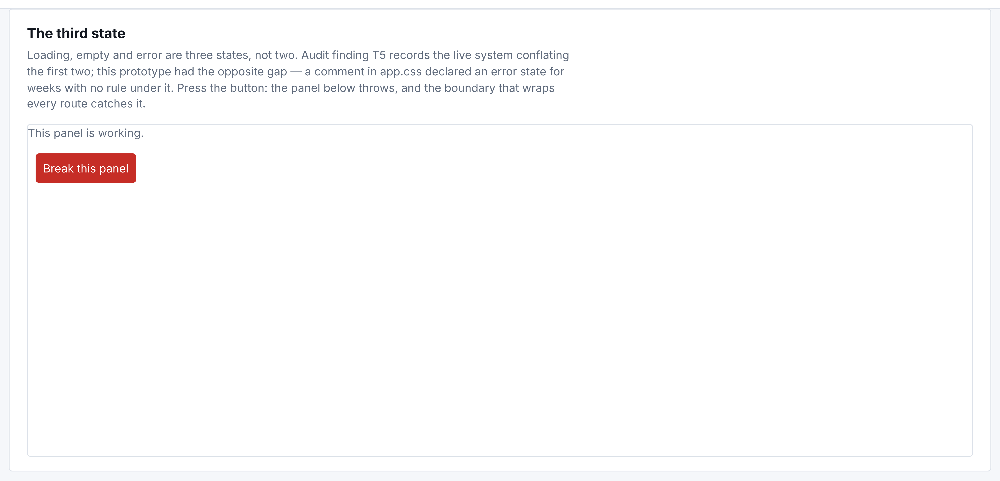

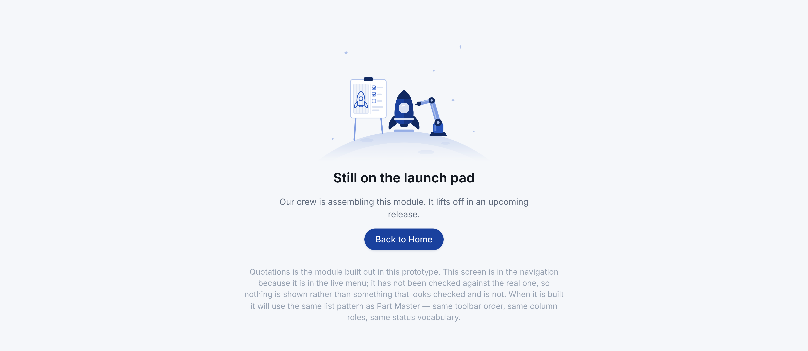

**Ba ô chữ của màn lỗi** chính là ba câu hỏi người ta thật sự có: *cái gì
hỏng · nó nghĩa là gì với tôi · giờ tôi làm được gì.* Chỉ câu đầu là dùng
chung được.

**Mã lỗi sinh ra ở nơi bắt được lỗi**, không phải nơi vẽ nó ra — sinh lúc
render thì bấm Copy xong là người dùng cầm một con số khác cho cùng một lỗi.

## D6 · Chữ nghĩa

| | |
|---|---|
| Viết hoa | [B2](#b2--chữ) — Title Case cho nhãn, sentence case cho văn xuôi |
| Nút nói đúng điều sẽ xảy ra | `Publish`, rồi toast báo `Published` |
| Thông báo lỗi nói **phải làm gì** | Không phải "Something went wrong" |
| Không có gì "chưa làm" mà im lặng | Một toast nói nó *sẽ* làm gì |
| Con số suy ra phải tự khai là suy ra | *"Derived from this run — the live system takes them from the customer's purchase history"* |
| Thay đổi chỉ trong phiên phải nói ra | *"Added in this session… nothing here is saved"* |

---
---

# Phần E — Chất lượng

## E1 · Khả năng tiếp cận

**Đo, không phải khẳng định suông.** Bản quét đầy đủ ở
[`contrast-sweep.md`](contrast-sweep.md); phần bàn phím ở
[`focus-order.md`](focus-order.md).

| Yêu cầu | Ngưỡng | Tình trạng |
|---|---|---|
| Tương phản chữ — WCAG 1.4.3 | 4.5:1 chữ thường · 3:1 chữ lớn (≥24px, hoặc ≥18.66px ở độ đậm ≥700) | **Đo 78 tổ hợp, 0 lỗi** |
| Tương phản phi-chữ — WCAG 1.4.11 | 3:1 cho viền control | Ba control hỏng ở 1.30 / 1.64 / 2.55 · đã vá bằng `--vy-border-control` ở **3.06:1** |
| Kích thước vùng chạm — WCAG 2.5.5 | 44×44 | Áp dụng dưới `pointer: coarse` |
| Giảm chuyển động | có tôn trọng | [B6](#b6--chuyển-động) |

**Vì sao bộ đo tương phản tin được:** màu được đọc qua **pixel trên canvas**
chứ không bóc từ chuỗi — vì Kendo xuất `oklch()`, thứ mà không regex nào trên
`getComputedStyle` sống sót được. Nền được ghép chồng ngược lên cây cha. Và
**trước khi tin kết quả**, một phần tử `#bbbbbb` trên nền trắng được cấy vào
trang: nó bị bắt ở **1.92:1**. Một bản quét báo "không có lỗi" chỉ đáng đọc
nếu nó chứng minh được là nó sẽ tìm ra lỗi nếu có.

Bốn luật dễ làm sai và đã chốt ở đây:

- **Status là một chữ kèm một màu**, không bao giờ là màu không thôi.
- **Hint là anh em của nhãn**, không nằm trong nhãn.
- **`role="alert"` cho lỗi, `role="status"` cho đang tải.** Một cái cắt ngang,
  một cái thì không.
- **Glyph trang trí phải `aria-hidden`**, và trạng thái nó đánh dấu phải có
  chữ riêng — một ổ khoá kèm một chữ "read-only" chỉ dành cho trình đọc màn
  hình.

## E2 · KendoReact

Hệ thống live đã có sẵn KendoReact 16. Cầu nối gồm ba file:

| File | Nhiệm vụ |
|---|---|
| `kendo-subset.scss` | Chỉ biên dịch những component Kendo thực sự dùng |
| `_kendo-size.scss` | **Cấu hình** thang kích thước của Kendo — không ghi đè |
| `kendo-bridge.css` | Ánh xạ biến của Kendo sang biến của mình, và vá những gì không cấu hình được |

**Cái bẫy là độ ưu tiên selector.** `.k-button.k-button-solid.k-button-base.k-focus`
nặng (0,4,0), nên một rule một-class của mình thua **im lặng**. Cầu nối thêm
tiền tố `html[data-kendo-bridged]` thay vì lặp một class năm lần.

Hai hành vi của Kendo nên biết trước khi ngồi debug một component:

- **Kendo khoá control bằng CLASS `.k-disabled`, không phải thuộc tính
  `:disabled`.** Một `<input disabled class="k-radio">` trần render **y hệt**
  một ô đang bật.
- **KendoReact 16 khoá cột lưới bằng ô sticky trong MỘT bảng**
  (`position: sticky`), không phải bằng hai pane.

---
---

# Phần F — Bàn giao

## F1 · Bản đồ file

| Đường dẫn | Nội dung |
|---|---|
| `src/theme/tokens.css` | **Toàn bộ token.** Sáng, cộng hai khối dark |
| `src/theme/tokens.ts` | Những giá trị TypeScript cần: bề rộng cột, bề rộng hộp thoại |
| `src/theme/md3.css` | Chuyển động, vòng focus, phần cấu trúc Material 3 còn giữ |
| `src/theme/base.css` | Reset và mặc định của thẻ |
| `src/theme/components.css` | Rule của component |
| `src/theme/app.css` | Rule của màn hình và bố cục |
| `src/theme/responsive.css` | Toàn bộ breakpoint, trong một file |
| `src/theme/kendo-*.{css,scss}` | Cầu nối Kendo |
| `src/ui/` | Các primitive |
| `src/ui/RocketLaunch.tsx` | Hình minh hoạ, cả ba trạng thái |
| `/design-system` | Trang mẫu sống |
| `docs/assets/design-system/` | Hình trong tài liệu này |

## F2 · Muốn sửa một thứ thì làm gì

**Một token màu**
1. Thêm hoặc sửa ở **cả ba** khối trong `tokens.css` ([B1.8](#b18-dark-mode-được-nối-như-thế-nào)).
2. Nếu nó rơi lên chữ hoặc lên viền control, **chạy lại bản quét tương phản**.
3. `npm run check:fast` — lint, kiểm stylesheet, typecheck, build.

**Một component**
1. Kiểm xem Kendo đã làm được chưa ([E2](#e2--kendoreact)).
2. Dựng trong `src/ui`, **chỉ** tham chiếu token ngữ nghĩa.
3. Thêm một mẫu vào `/design-system` nếu nó có trạng thái đáng xem.
4. Phủ đủ mọi trạng thái: mặc định, hover, focus, active, disabled, busy, lỗi.

**Một màn hình mới**
1. Nó có thể rơi vào trạng thái nào trong bốn ([D5](#d5--bốn-trạng-thái-màn-hình))? Dựng hết.
2. Role cột, không phải số pixel.
3. Kiểm ở 1180, 980 và 820, ở cả hai theme.

**CI chạy gì mỗi lần push:** `render:check` · `touch:check` · `mobile:check` ·
`focus:check` · `hover:check`.

## F3 · Quản trị

| | |
|---|---|
| Nguồn chuẩn | `src/theme/` và các component trong `src/ui`. File này **mô tả** chúng, không **định nghĩa** chúng |
| Quyết định ghi ở đâu | Trong code, ngay tại luật mà nó chi phối — và trong một ghi chú có ngày dưới `docs/` khi người đọc sau này sẽ phải tự suy lại |
| Phán đoán | Được phép ở chỗ không có nguồn nào trả lời, và **phải dán nhãn là phán đoán** ngay tại chỗ dùng |
| Đánh phiên bản | `v1.0` là bản bàn giao này. Sửa một token hay một luật là minor; sửa tới mức phải dựng lại màn hình là major |

**Ba luật giữ cho tài liệu này còn đúng:**

1. **Số ma thuật phải có ghi chú** nói rõ đã đo cái gì.
2. **Comment ghi cái ĐÃ ĐO, không ghi cái định làm.** Ba lần sửa sai trong dự
   án này đến từ một comment mô tả hành vi mà code không có.
3. **Trang sống thắng tài liệu.** `/design-system` render hàng thật; nếu hai
   bên nói khác nhau thì **trang đúng, file này cũ**.

## F4 · Một bộ bàn giao cần có gì

Bố cục của tài liệu này được **đối chiếu với thực hành hiện hành** chứ không
tự nghĩ ra. Danh sách lặp đi lặp lại trong các checklist đã công bố là:
**design token** kèm giá trị · **spec component** kèm đủ trạng thái và biến
thể · **luật dùng** kèm nên/không nên · **khả năng tiếp cận** có ghi rõ ngưỡng
WCAG · **ví dụ code** · **responsive** có ghi breakpoint · **chuyển động** có
thời lượng, đường cong và phương án giảm chuyển động · và **quản trị** — ai
giữ, quy trình đóng góp, đánh phiên bản.

Nhiều nguồn cũng gọi tên đúng cái lỗi mà file này dễ mắc nhất: **tài liệu
trôi xa khỏi code** khi đội ngũ đi làm việc khác. Đó là lý do
[F3](#f3--quản-trị) quy định **trang mẫu sống** mới là trọng tài, chứ không
phải tài liệu này.

Tham khảo ngày 3/11/2026:
[Magic Patterns](https://www.magicpatterns.com/blog/design-system-documentation) ·
[Figr checklist](https://figr.design/design-system-checklist) ·
[Supernova](https://www.supernova.io/blog/popular-content-blocks-document-design-system-guidelines) ·
[Docsie](https://www.docsie.io/blog/glossary/design-system/) ·
[Eleken](https://www.eleken.co/blog-posts/design-handoff-checklist) ·
[UX Planet](https://uxplanet.org/design-handoff-checklist-a9d40e9a7704).
Đây là blog của nhà cung cấp và checklist cộng đồng, **không phải tiêu
chuẩn**; chúng thống nhất ở phần lõi và khác nhau ở độ sâu.

## F5 · Chỉ mục nguồn

| Tài liệu | Chốt điều gì |
|---|---|
| [`contrast-sweep.md`](contrast-sweep.md) | Mọi tỉ số tương phản đã đo, và phương pháp |
| [`focus-order.md`](focus-order.md) | Thứ tự bàn phím và vòng focus |
| [`modal-patterns.md`](modal-patterns.md) | Cỡ hộp thoại, vị trí nút, cách đóng |
| [`table-patterns.md`](table-patterns.md) | Hành vi lưới, role cột, mật độ |
| [`motion-loading.md`](motion-loading.md) | Mọi quyết định về màn chờ và chuyển cảnh |
| [`kendo-control-scale-18oct.md`](kendo-control-scale-18oct.md) | Bản audit 33 luật về thang kích thước Kendo |
| [`working-agreement.md`](working-agreement.md) | Luật kỹ thuật, gồm cả các ngoại lệ của luật số ma thuật |

---

*Chụp từ bản build đang chạy ở 2× ngày 3/11/2026. Hình nằm trong
`docs/assets/design-system/` và dựng lại được từ `/design-system` cùng các màn
sản phẩm mà chúng đến từ đó.*
