# Voyager IQ — Design System

> **Version 1.2 · 8 November 2026**
> Linh Long Engineering / Rocket EMS · repository `ll-poc`
> **Source of truth:** `src/theme/` · **Living specimen:** `/design-system`

Everything in this document was read out of a working build. Every number was
taken from the source; every picture was captured from the running
application at 2×. Where a figure came from measuring the screen rather than
from a rule, it says so.

> **What changed in 1.2.** Four claims in 1.1 were checkable and did not hold
> up. The route count in [C2.3](#c23-building--still-on-the-launch-pad) now
> says where it comes from. [B7](#b7--responsive) listed three breakpoints
> where the stylesheets have eleven. [E1](#e1--accessibility)'s contrast row
> rested on a one-off sweep from 5 September; `contrast:check` now re-measures
> 114 token pairs on every push, and found a gap in the light theme the same
> day — `subtle` is a measured value now, see [B1.3](#b13-text-colour--six-tiers).
> And `progress` was the one status nobody had darkened, so a dark grid showed
> one bright cyan chip among seven dark ones ([B1.6](#b16-status-vocabulary)).
>
> 1.2 also says what this file does **not** cover yet.
> [A1](#a1--what-this-is) states the scope — foundations complete, and all 29
> component pages written as of 8 Nov — and [F4](#f4--what-a-handover-should-contain) lists the gaps
> against what the published systems do, rechecked against those systems
> rather than against blogs about them.
>
> **What changed in 1.1.** The type scale printed in 1.0 was the
> `@media (pointer: coarse)` block, not the default — six values, all in
> [B2](#b2--typography), published two sizes too large. Corrected against
> `tokens.css`. B2 also still described a second font family; mono was dropped
> for identifiers on 13 October at the customer's request, finished on 22
> October, and the token and the webfont were removed on 7 November. The one
> step still below the 12px floor, `--vy-text-2xs` at 10px, was raised. Nothing
> else in the document moved: the other 156 token values were already exact.

---

## Contents

**Part A — Start here**
[A1 What this is](#a1--what-this-is) ·
[A2 The three layers](#a2--the-three-layers) ·
[A3 Five rules before you build](#a3--five-rules-before-you-build)

**Part B — Foundations**
[B1 Colour](#b1--colour) ·
[B2 Typography](#b2--typography) ·
[B3 Spacing](#b3--spacing) ·
[B4 Shape, elevation, depth](#b4--shape-elevation-depth) ·
[B5 Sizing](#b5--sizing) ·
[B6 Motion](#b6--motion) ·
[B7 Responsive](#b7--responsive) ·
[B8 Layout](#b8--layout)

**Part C — Assets**
[C1 Icons](#c1--icons) ·
[C2 Illustrations](#c2--illustrations)

**Part D — Components and patterns**
[D1 Buttons](#d1--buttons) ·
[D2 Fields](#d2--fields) ·
[D3 Grids](#d3--grids) ·
[D4 Dialogs](#d4--dialogs) ·
[D5 The four screen states](#d5--the-four-screen-states) ·
[D6 Words](#d6--words)

**Part E — Quality**
[E1 Accessibility](#e1--accessibility) ·
[E2 KendoReact](#e2--kendoreact)

**Part F — Handover**
[F1 File map](#f1--file-map) ·
[F2 How to change something](#f2--how-to-change-something) ·
[F3 Governance](#f3--governance) ·
[F4 What a handover should contain](#f4--what-a-handover-should-contain) ·
[F5 Source index](#f5--source-index)

---
---

# Part A — Start here

## A1 · What this is

The file someone needs to **build** a new Voyager IQ screen without asking,
and the file a reviewer needs to **tell a correct screen from a plausible
one**.

It is not a style guide for a drawing tool. It describes a system that is
running: the tokens are CSS custom properties, the components are React, and
the specimen page renders the real thing.

> **How far that goes today, stated rather than implied.** The foundations —
> [Part B](#part-b--foundations) — are complete: every token in `src/theme/`
> is here at its measured value, and six checks re-prove them on every push.
> **The components are not.** [Part D](#part-d--components-and-patterns)
> covers four families — buttons, fields, grids, dialogs — out of the **29
> components in `src/ui`**, and covers them as prose rather than as the
> specification a reference system gives each component: when to use it, when
> *not* to, its anatomy, its variants against its states, and a do and a
> don't. One component, Button, has a live specimen.
>
> So: this file is enough to get the colour, type, spacing, density and
> behaviour of a new screen right, and enough to review one. It is **not yet**
> enough to pick the right control without reading `src/ui`. What is missing
> and in what order it should be filled is in
> [F4](#f4--what-a-handover-should-contain).

## A2 · The three layers

| Layer | What it is | Where | May a screen use it? |
|---|---|---|---|
| **1 · Ramps** | The raw palette. 10 blues, 12 greys, 4 reds | `tokens.css` | **No** |
| **2 · Semantic roles** | `surface`, `on-surface`, `brand`, `danger`… named for the job | `tokens.css` | **Yes — only this** |
| **3 · Components** | Button, Field, Grid, Dialog… | `src/ui`, `src/components` | Yes |

A stylesheet saying `background: var(--vy-grey-0)` has hard-coded *white*, and
no theme can move it. One saying `var(--vy-surface)` has hard-coded *"the
colour a panel is"*, which a theme is allowed to answer differently.

**Layer 1 exists so that layer 2 can be consistent. It is not for use in a
component.**

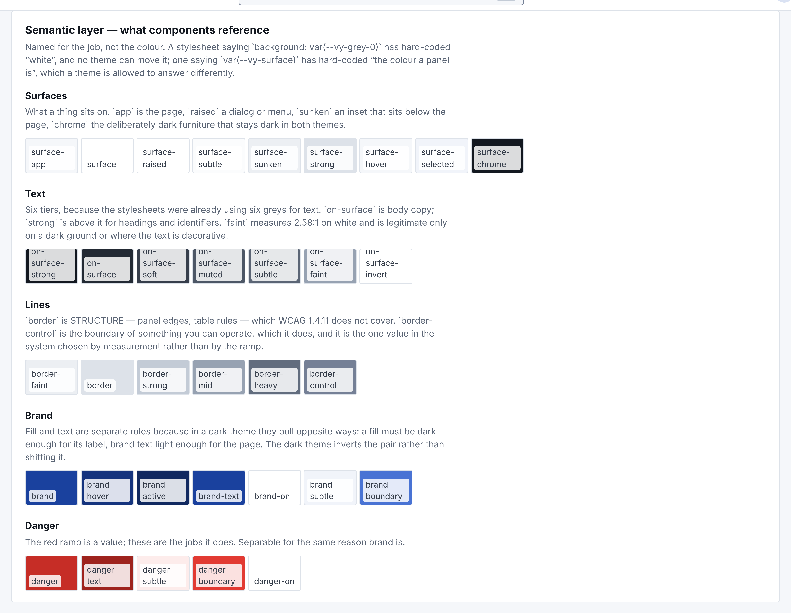

## A3 · Five rules before you build

1. **Is there a token?** If yes, use it. If no, add one — and say in the code
   why the scale did not already have it.
2. **Do not invent content.** Field names, option lists, status words and
   behaviour are facts about the business, not design decisions. Look them up
   before drawing them.
3. **Both themes, both densities, 820px.** A screen that has only been seen in
   light mode on a 1920px monitor has been seen once.
4. **A magic number carries a note.** A width that deviates from its role
   needs a `widthNote` saying what was measured.
5. **Say what is not real.** A derived figure, an unbuilt action and a fake
   send are each labelled where they appear, not only in a commit message.

---
---

# Part B — Foundations

## B1 · Colour

### B1.1 The ramps *(layer 1 — not for use in components)*

Three ramps and nothing else. A fourth colour in a screen is a bug unless it
is a status, and the statuses are in [B1.6](#b16-status-vocabulary).

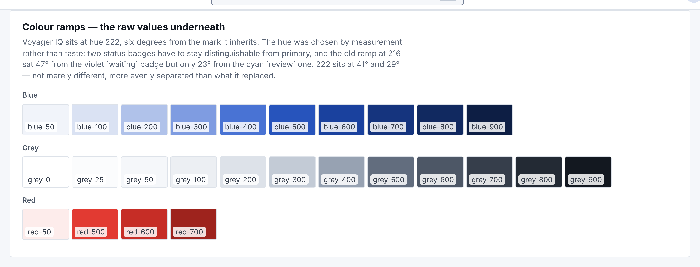


| Token | Value |
|---|---|
| `--vy-blue-50` | `#f1f4fa` |
| `--vy-blue-100` | `#dae2f3` |
| `--vy-blue-200` | `#b0c2ea` |
| `--vy-blue-300` | `#7f9ce1` |
| `--vy-blue-400` | `#4973d4` |
| `--vy-blue-500` | `#2754bc` |
| `--vy-blue-600` | `#1a419e` |
| `--vy-blue-700` | `#15347e` |
| `--vy-blue-800` | `#112960` |
| `--vy-blue-900` | `#0d1e44` |
| `--vy-red-50` | `#fdeceb` |
| `--vy-red-500` | `#e23a32` |
| `--vy-red-600` | `#c62d26` |
| `--vy-red-700` | `#9e231d` |
| `--vy-grey-0` | `#ffffff` |
| `--vy-grey-25` | `#fbfcfd` |
| `--vy-grey-50` | `#f5f7fa` |
| `--vy-grey-100` | `#eceff3` |
| `--vy-grey-200` | `#dde2e9` |
| `--vy-grey-300` | `#c3cbd6` |
| `--vy-grey-400` | `#97a2b2` |
| `--vy-grey-500` | `#626d7e` |
| `--vy-grey-600` | `#4d5766` |
| `--vy-grey-700` | `#363e4b` |
| `--vy-grey-800` | `#232a34` |
| `--vy-grey-900` | `#131820` |


### B1.2 Surfaces — what a thing sits on

`app` is the page · `raised` a dialog or menu · `sunken` an inset below the
page · `chrome` the deliberately dark furniture that stays dark in **both**
themes.


| Token | Value | Resolves to | Dark |
|---|---|---|---|
| `--vy-surface-app` | `var(--vy-grey-50)` | `#f5f7fa` | `#0f131a` |
| `--vy-surface` | `var(--vy-grey-0)` | `#ffffff` | `#161c25` |
| `--vy-surface-raised` | `var(--vy-grey-0)` | `#ffffff` | `#1e2531` |
| `--vy-surface-subtle` | `var(--vy-grey-25)` | `#fbfcfd` | `#131922` |
| `--vy-surface-sunken` | `var(--vy-grey-100)` | `#eceff3` | `#0b0e14` |
| `--vy-surface-strong` | `var(--vy-grey-200)` | `#dde2e9` | `#2a323f` |
| `--vy-surface-hover` | `var(--vy-grey-50)` | `#f5f7fa` | `#1e2531` |
| `--vy-surface-selected` | `var(--vy-blue-50)` | `#f1f4fa` | `#1b2a4a` |
| `--vy-surface-chrome` | `var(--vy-grey-900)` | `#131820` | `#1e2531` |
| `--vy-surface-chrome-soft` | `var(--vy-grey-700)` | `#363e4b` | `#2a323f` |


### B1.3 Text colour — six tiers

`on-surface` is body copy; `strong` sits above it for headings and
identifiers.

**A tier is set by its worst ground, not by the panel.** `subtle` is the
second value in the system chosen by measurement rather than taken from the
ramp — after [`--vy-border-control`](#b14-lines), and for the same reason: no
step conforms. grey-500 `#626d7e` clears 4.5 on white, the page and the sunken
panel but reaches only **4.02** on `surface-strong`; grey-600 overshoots to
5.62, where it stops being distinguishable from `muted` and the tier stops
being a tier. `#5b6575` sits on grey-500's own hue one notch darker and clears
every ground, the tightest being `surface-strong` at 4.53.

> ⚠️ **`on-surface-faint` measures 2.58:1 on white.** Legitimate only on a
> dark ground or where the text is decorative — never for anything a user has
> to read. It is the one declared exemption in
> [`contrast:check`](#e1--accessibility); everything else in the table is
> checked on every push.


| Token | Value | Resolves to | Dark |
|---|---|---|---|
| `--vy-on-surface-strong` | `var(--vy-grey-900)` | `#131820` | `#f5f8fc` |
| `--vy-on-surface` | `var(--vy-grey-800)` | `#232a34` | `#e9edf3` |
| `--vy-on-surface-soft` | `var(--vy-grey-700)` | `#363e4b` | `#d3dae4` |
| `--vy-on-surface-muted` | `var(--vy-grey-600)` | `#4d5766` | `#aab4c3` |
| `--vy-on-surface-subtle` | `#5b6575` | — | `#8f9aaa` |
| `--vy-on-surface-faint` | `var(--vy-grey-400)` | `#97a2b2` | `#67727f` |
| `--vy-on-surface-invert` | `var(--vy-grey-0)` | `#ffffff` | `#0f131a` |
| `--vy-on-chrome-muted` | `var(--vy-grey-300)` | `#c3cbd6` | `#c3cbd6` |
| `--vy-on-dark-fg` | `#ffffff` | — | *(same)* |
| `--vy-on-dark-secondary` | `var(--vy-grey-300)` | `#c3cbd6` | *(same)* |
| `--vy-on-dark-muted` | `var(--vy-grey-400)` | `#97a2b2` | *(same)* |
| `--vy-on-dark-hairline` | `rgba(255, 255, 255, .07)` | — | *(same)* |
| `--vy-on-dark-hover` | `rgba(255, 255, 255, .05)` | — | *(same)* |
| `--vy-on-dark-active` | `rgba(43, 99, 184, .22)` | — | *(same)* |


### B1.4 Lines

`border` is **structure** — panel edges, table rules — which WCAG 1.4.11 does
not cover. `border-control` is the boundary of something you can **operate**,
which it does cover.

It is one of two values in the system chosen by **measurement** rather than by
the ramp — the other is [`on-surface-subtle`](#b13-text-colour--six-tiers).
The sweep of 5 September found why: the grey ramp has **no step that
conforms**. grey-400 `#97a2b2` is 2.58:1 against white and misses by 0.42; the
next step overshoots to 5.24, where it would be indistinguishable from the
text it sits beside. A value was introduced between them. It governs
boundaries only: input, textarea, combobox, checkbox, radio, and anything
else whose edge is its shape — a chip, an outlined button, a colour swatch.

> **"The lightest value that conforms" conformed against one ground, and that
> took until 8 November to notice.** The September value, `#8a94a6`, was
> measured on white. A control also sits on the page, in a sunken strip, on a
> hover tint, on a selected row. Swept across every ground on 8 Nov it cleared
> exactly one of them:
>
> | surface | subtle | app | hover | selected | sunken | strong |
> |---|---|---|---|---|---|---|
> | 3.06 | 2.98 | 2.85 | 2.85 | 2.78 | 2.65 | 2.35 |
>
> Which is how a checkbox measured **2.85** in the control sweep while the
> Kendo bridge was already pointing it at this token: the token was right and
> the value was short. **A boundary is set by its worst ground**, the same
> rule as a text tier. `#758096` is the lightest value on the same hue and
> saturation line that clears 3 on all of them, tightest at **3.05** on
> `surface-strong`. `contrast:check` now measures every boundary against
> every ground rather than against the panel, so this cannot come back.

> **And then the same mistake, one state along — 9 November.** 1.4.11 covers a
> control's **states**, and both checks were resting-state only: one reads the
> palette, the other sweeps a page nobody is pointing at. `.vy-input:hover`
> and `.vy-sup-btn:hover` drew their edge with `--vy-border-heavy`, and the
> comment beside the rule explains itself in light mode alone — *"grey-500,
> not grey-400; the resting border is now darker than grey-400, so the old
> hover was lighter than the state it was meant to emphasise."* True on white.
> In dark the resting border is `#707c8d` and grey-500 is **darker** than it,
> so one declaration made the hover both fainter than the resting state and
> non-conforming: measured in the running build at **2.68** on the panel, 2.41
> on a raised one, **2.02** on `surface-strong`.
>
> **One value cannot do it**, for the reason [B1.5](#b15-brand-and-danger)
> already gives about fill and text: *more visible* is darker on white and
> lighter on near-black. So the hover boundary is a role of its own. Light
> takes grey-500 from the ramp — 5.24 on a panel against the resting 3.97, so
> **nothing changes in light**. Dark has no step that works: grey-500 and
> `border-mid` are darker than the resting border, and grey-400 is lighter
> than `on-surface-subtle`, which would leave a hovered edge outshining the
> quietest text on the page. `#858f9e` is one notch up `border-control`'s own
> hue and saturation line — **5.23** on a panel, **3.95** on `surface-strong`,
> within 0.07 of what light gets. Both themes now land a hovered boundary at
> about 4:1 on their worst ground.
>
> Measured on `.vy-input`, both themes, with transitions stopped:
>
> | | rest | hover, was | hover, now | focus, was | focus, now |
> |---|---|---|---|---|---|
> | light | 3.97 | 5.24 | 5.24 | 4.48 | **6.82** |
> | dark | 4.04 | **2.68** | **5.23** | 3.82 | **9.58** |
>
> `border:check` now sweeps **three states**, so the next one is not found by
> hand. The full list, and the three attribute-borne states it still cannot
> reach, is in [`vien-state-09nov.md`](vien-state-09nov.md).


| Token | Value | Resolves to | Dark |
|---|---|---|---|
| `--vy-border-control` | `#758096` | — | `#707c8d` |
| `--vy-border-control-hover` | `var(--vy-grey-500)` | `#626d7e` | `#858f9e` |
| `--vy-border-faint` | `var(--vy-grey-100)` | `#eceff3` | `#212936` |
| `--vy-border` | `var(--vy-grey-200)` | `#dde2e9` | `#2a323f` |
| `--vy-border-strong` | `var(--vy-grey-300)` | `#c3cbd6` | `#3b4553` |
| `--vy-border-mid` | `var(--vy-grey-400)` | `#97a2b2` | `#55606f` |
| `--vy-border-heavy` | `var(--vy-grey-500)` | `#626d7e` | `#55606f` |
| `--vy-border-emphasis` | `2px` | — | *(same)* |


### B1.5 Brand and danger

Fill and text are **separate roles**, because in a dark theme they pull
opposite ways: a fill must be dark enough for its label, brand text light
enough for the page. The dark theme inverts the pair rather than shifting it.

**So do the boundaries, and one of them was left behind.** `boundary-strong`
means one step *more* emphatic than `boundary` — darker in light, lighter in
dark. It is the focus **edge** of every text input, the rich-text surface and
every editable cell. When the focus **ring** moved off blue-400 on 8 Nov for
measuring 2.88 on `surface-strong`, the edge kept it: in dark, "strong" was
darker than plain `boundary`, and therefore weaker than it. Both tokens had
been measured in the same pass and only one moved. blue-200 restores the
relationship — tightest **7.22** — and 9 Nov.

`boundary-soft` and `boundary-light` stay below 3:1 on purpose: they draw
banner edges, the verdict panel and a horizontal rule, which 1.4.11 does not
cover. Two controls were pointing at them anyway, and the state pass found
both.


| Token | Value | Resolves to | Dark |
|---|---|---|---|
| `--vy-brand` | `var(--vy-blue-600)` | `#1a419e` | `#7f9ce1` |
| `--vy-brand-hover` | `var(--vy-blue-700)` | `#15347e` | `#b0c2ea` |
| `--vy-brand-active` | `var(--vy-blue-800)` | `#112960` | `#dae2f3` |
| `--vy-brand-text` | `var(--vy-blue-600)` | `#1a419e` | `#7f9ce1` |
| `--vy-brand-text-hover` | `var(--vy-blue-700)` | `#15347e` | `#b0c2ea` |
| `--vy-brand-text-deep` | `var(--vy-blue-800)` | `#112960` | `#dae2f3` |
| `--vy-brand-on` | `var(--vy-grey-0)` | `#ffffff` | `#0f131a` |
| `--vy-brand-subtle` | `var(--vy-blue-50)` | `#f1f4fa` | `#1b2a4a` |
| `--vy-brand-subtle-strong` | `var(--vy-blue-100)` | `#dae2f3` | `#223357` |
| `--vy-brand-light` | `var(--vy-blue-400)` | `#4973d4` | `#7f9ce1` |
| `--vy-brand-soft` | `var(--vy-blue-500)` | `#2754bc` | `#4973d4` |
| `--vy-brand-boundary` | `var(--vy-blue-400)` | `#4973d4` | `#7f9ce1` |
| `--vy-brand-boundary-soft` | `var(--vy-blue-200)` | `#b0c2ea` | `#2754bc` |
| `--vy-brand-boundary-light` | `var(--vy-blue-300)` | `#7f9ce1` | `#7f9ce1` |
| `--vy-brand-boundary-strong` | `var(--vy-blue-500)` | `#2754bc` | `#b0c2ea` |


| Token | Value | Resolves to | Dark |
|---|---|---|---|
| `--vy-danger` | `var(--vy-red-600)` | `#c62d26` | `#c62d26` |
| `--vy-danger-on` | `var(--vy-grey-0)` | `#ffffff` | `#ffffff` |
| `--vy-danger-text` | `var(--vy-red-700)` | `#9e231d` | `#f0918a` |
| `--vy-danger-text-deep` | `var(--vy-red-700)` | `#9e231d` | `#f5aba5` |
| `--vy-danger-subtle` | `var(--vy-red-50)` | `#fdeceb` | `#38201e` |
| `--vy-danger-boundary` | `var(--vy-red-500)` | `#e23a32` | `#e0655c` |


### B1.6 Status vocabulary

Eight statuses, each a foreground/background pair.

> **A status is a word and a colour, never a colour alone.** The pair is what
> makes it legible to someone who cannot separate the hues.

The dark pairs are constructed, not picked: the foreground runs between `96`
and `ee`, the background between `1e` and `38`, and the middle channel carries
the hue. Every pair lands between 6.16:1 and 9.30:1.

> **`progress` only joined them on 8 November.** Seven statuses inverted for
> dark and that one kept its light pair, so a dark grid showed a single bright
> cyan chip among seven dark ones. Worth knowing because it is still the
> closest pair in the vocabulary: `progress` and `review` are 1.5° apart in
> hue in light and 6° in dark, and the word is what separates them. If the two
> are ever confused on screen the answer is a different hue for one of them,
> not a darker cyan.

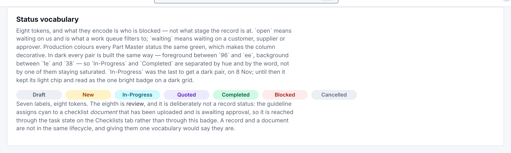


| Token | Value | Resolves to | Dark |
|---|---|---|---|
| `--vy-status-draft-fg` | `var(--vy-grey-600)` | `#4d5766` | `#aab4c3` |
| `--vy-status-draft-bg` | `var(--vy-grey-100)` | `#eceff3` | `#2a323f` |
| `--vy-status-open-fg` | `#92400e` | — | `#eeb796` |
| `--vy-status-open-bg` | `#fef3c7` | — | `#38281e` |
| `--vy-status-progress-fg` | `#155e75` | — | `#96e4ee` |
| `--vy-status-progress-bg` | `#cffafe` | — | `#1e3838` |
| `--vy-status-done-fg` | `#065f46` | — | `#96eed5` |
| `--vy-status-done-bg` | `#d1fae5` | — | `#1e3831` |
| `--vy-status-waiting-fg` | `#5b21b6` | — | `#b896ee` |
| `--vy-status-waiting-bg` | `#ede9fe` | — | `#281e38` |
| `--vy-status-review-fg` | `#0e7490` | — | `#96dbee` |
| `--vy-status-review-bg` | `#ecfeff` | — | `#1e3338` |
| `--vy-status-blocked-fg` | `var(--vy-red-700)` | `#9e231d` | `#ee9a96` |
| `--vy-status-blocked-bg` | `var(--vy-red-50)` | `#fdeceb` | `#38201e` |
| `--vy-status-cancelled-fg` | `var(--vy-grey-500)` | `#626d7e` | `#aab4c3` |
| `--vy-status-cancelled-bg` | `var(--vy-grey-100)` | `#eceff3` | `#2a323f` |
| `--vy-chart-cancelled` | `var(--vy-grey-700)` | `#363e4b` | `#5d6878` |
| `--vy-status-slot-w` | `104px` | — | *(same)* |

> **A fill that carries no text takes the `-fg` half, not the `-bg` one.** The
> Home chart draws each series from this vocabulary, and a segment is not a
> chip: `-bg` is pale by design, because text sits on it. Measured on 9
> November, the In-Progress series read `--vy-status-progress-bg` and came to
> **1.12:1** against the light card and **1.37:1** against the dark one. The
> five chart fills are now in `contrast:check` for exactly that reason —
> nothing had ever measured a shape with no text on it.
>
> `--vy-chart-cancelled` is the one chart-only value. As badges, New and
> Cancelled sit on separate rows and a near-identical grey costs nothing; in a
> stacked bar they touch, and the badge greys are 1.35:1 apart in light and
> **identical** in dark. The badge tokens are the customer's specification and
> stay as they are. See [Dashboard](patterns/dashboard.md).


### B1.7 Row tones and accents

A tone is a row's **state in the quote**, not a severity. Three of them paint
most of a BoM grid, and the legend under the grid names all three.

**Amber does three jobs, and that is allowed because of two rules.** The same
`#fef3c7` is the `open` status, the `short` row tone and the `known-mfg` row
tone. The objection writes itself — *yellow should mean warning and nothing
else* — so here is the measured answer rather than an assertion:

1. **They never meet.** `short` paints the Quoting and Quote Result grids,
   `known-mfg` paints Review BoM, and **neither of those grids has a status
   column** — checked, not assumed: zero columns with `role: 'status'` in
   either. An amber pill and an amber row cannot appear on one screen.
2. **Every amber grid carries a legend** that names what its amber means, on
   that screen. A colour only the author can decode is a colour that means
   nothing; a colour with a key beside it is a colour with one meaning.

What amber consistently means across all three is **needs attention, nothing
is broken** — which is why `blocked` and `missing` are red and not a darker
amber.

**Which of the two ambers.** `--vy-accent-warning` `#b45309` is the default
and has twelve call sites; `--vy-accent-caution` `#d97706` has **one**, the
email-mode composer border. They are 17.9 ΔE apart, so they are genuinely
distinguishable — this is not a duplicate pair — but the system never said
which to reach for, and twice a comment in the code had to decide it in
passing. Stated now: **`warning` for anything the user should act on,
`caution` only where two amber levels appear together and the lower one needs
to recede.** One place does that today. A second token with one call site and
no rule is how a palette drifts.


| Token | Value | Resolves to | Dark |
|---|---|---|---|
| `--vy-tone-excluded-bg` | `var(--vy-grey-100)` | `#eceff3` | `#2a323f` |
| `--vy-tone-excluded-fg` | `var(--vy-grey-500)` | `#626d7e` | `#aab4c3` |
| `--vy-tone-missing-bg` | `var(--vy-red-50)` | `#fdeceb` | `#38201e` |
| `--vy-tone-missing-fg` | `var(--vy-red-700)` | `#9e231d` | `#ee9a96` |
| `--vy-tone-short-bg` | `var(--vy-status-open-bg)` | `#fef3c7` | *(same)* |
| `--vy-tone-covered-bg` | `var(--vy-status-done-bg)` | `#d1fae5` | *(same)* |
| `--vy-tone-known-mfg-bg` | `var(--vy-status-open-bg)` | `#fef3c7` | *(same)* |
| `--vy-tone-pending-bg` | `var(--vy-surface-sunken)` | `#eceff3` | *(same)* |


| Token | Value | Resolves to | Dark |
|---|---|---|---|
| `--vy-accent-positive` | `#047857` | — | `#75f0cd` |
| `--vy-accent-caution` | `#d97706` | — | `#f0b775` |
| `--vy-accent-warning` | `#b45309` | — | `#f0aa75` |
| `--vy-accent-waiting` | `#6d28d9` | — | `#a679ec` |
| `--vy-accent-neutral` | `#4d5766` | — | `#aab4c3` |
| `--vy-accent-bar-w` | `3px` | — | *(same)* |


### B1.8 How dark mode is wired

Three blocks, and **a token must appear in all three** or the two ways of
choosing dark disagree:

| Block | Who it serves |
|---|---|
| `:root { … }` | Light — the default |
| `:root[data-theme="dark"] { … }` | A user who **picked** dark in the user menu |
| `@media (prefers-color-scheme: dark) { :root:not([data-theme="light"]) { … } }` | A user whose **OS** is dark |

> This has already failed once: four tokens existed only in the media copy, so
> a user who picked dark in the menu got grey-400 borders and a near-white
> priority dot on a near-black ground. **Adding a colour token means editing
> three places.**

The same two blocks in the dark theme. Every role keeps its job and changes
its value — and the status pairs stay legible rather than being inverted
mechanically:

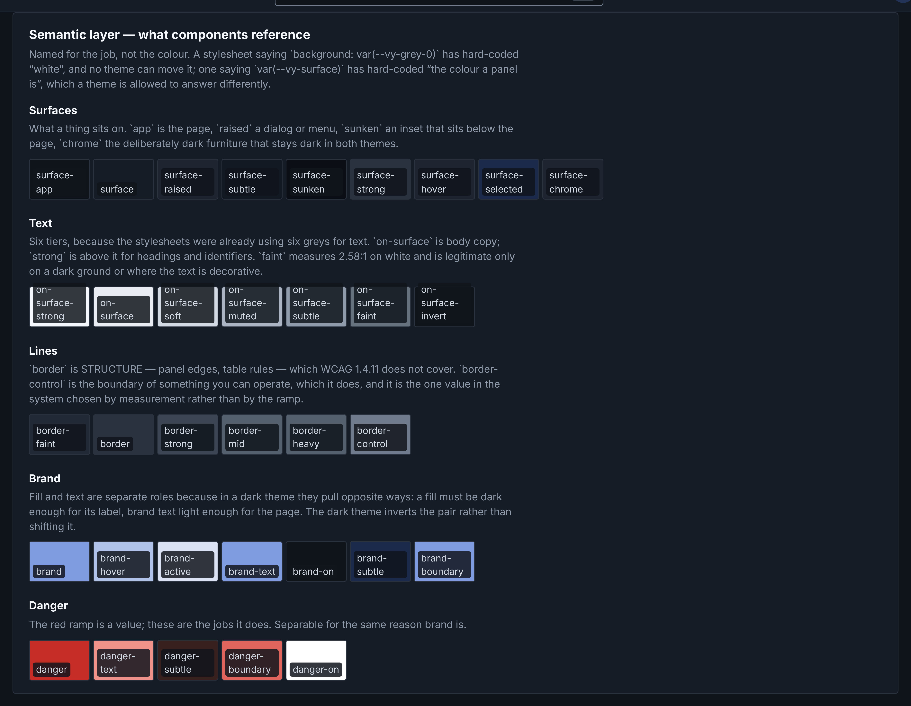

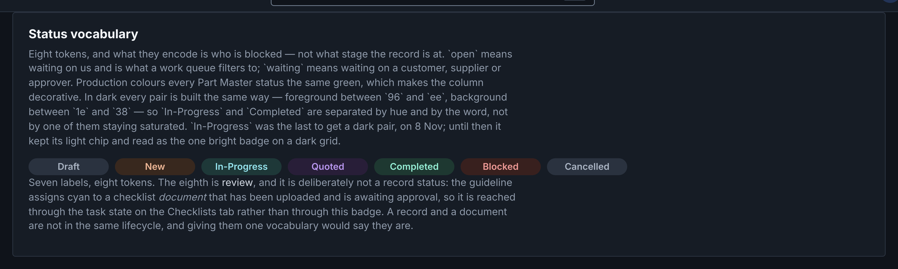

---

## B2 · Typography

**One family.** Inter Variable, everywhere, self-hosted — no request to Google
and no flash of fallback text.

There was a second. **JetBrains Mono** set the identifiers: part numbers, MPNs,
RFQ and assembly numbers. The review of **13 October** ended it — *"do not use
monotext, hard to read"* — `.vy-ident` was rewritten the same day, and the last
holdout, the MiniTable grids in Run Quotation, went on **22 October**. On 22
October the customer also said what mono had been *for*: a unique value should
not look like an ordinary field. So the requirement is **prominence, not a
typeface** — and prominence is cheaper than a second font. An identifier is
semibold, in the strong ink, with `tabular-nums`, which is what held the digits
in columns all along. A part number is read as a *word* by people who know
their catalogue; at 12–13px in a dense grid the mono face was the thing slowing
them down. The token and the webfont were removed on **7 November**.

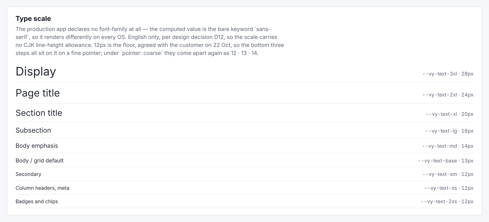


| Token | Value |
|---|---|
| `--vy-font-sans` | `"Inter Variable", "Inter", system-ui, -apple-system, "Segoe UI", Arial, sans-serif` |
| `--vy-text-2xs` | `12px` |
| `--vy-text-xs` | `12px` |
| `--vy-text-sm` | `12px` |
| `--vy-text-base` | `13px` |
| `--vy-text-md` | `14px` |
| `--vy-text-lg` | `16px` |
| `--vy-text-xl` | `20px` |
| `--vy-text-2xl` | `24px` |
| `--vy-text-3xl` | `28px` |
| `--vy-weight-regular` | `400` |
| `--vy-weight-medium` | `500` |
| `--vy-weight-semibold` | `600` |
| `--vy-weight-bold` | `650` |
| `--vy-weight-heavy` | `700` |


**Five weights, and the top three are finely spaced on purpose — measured.**
"650 and 700 are too close to 600" is the obvious objection, so it was
measured rather than argued: the same string rendered at 13px in Inter
Variable, by width and by ink coverage.

| | 400 | 500 | 600 | 650 | 700 |
|---|---|---|---|---|---|
| width | 234.30 | 237.03 | 239.76 | 241.12 | 242.48 |
| ink | 111k | 128k | 146k | 154k | 162k |
| step | — | +15.7% | +13.4% | **+5.6%** | **+5.5%** |

They are all distinct — Inter Variable spans 100–900, nothing snaps — but the
top two steps are **about a third** of the steps below them. So the honest
rule is not "five interchangeable weights":

| Weight | Job | Call sites |
|---|---|---|
| `regular` 400 | Body text | 22 |
| `medium` 500 | A label, a button, a link that must hold its line | 59 |
| `semibold` 600 | **The default emphasis.** Identifiers, group headings, totals | 112 |
| `bold` 650 | A page or record title, where 600 is already in use nearby | 42 |
| `heavy` 700 | A number that is the whole point of its tile — a KPI, a queue count | 12 |

Reach for 600. Use 650 and 700 only where something at 600 is **next to**
them and has to stay quieter; at a 5% step they do not read as emphasis on
their own.

**12px is the floor**, agreed with the customer on 22 October. It was 11px; our
own small-text check had flagged anything under 12 all along. The floor
collapses the bottom of the scale — `2xs`, `xs` and `sm` all sit on it, three
names carrying one size. The names stay because they mean different things: a
badge, a label, secondary text.

**A finger un-collapses it.** Under `@media (pointer: coarse)` the bottom three
come apart again — 12, 13, 14 — and every step above them moves +2, to 15, 16
and 18. Display sizes (`xl` and up) do not move: they are already comfortable,
and growing a heading on a 375px screen buys nothing and costs a wrap. The
floor is never crossed in either direction.

### Casing — three levels, drawn differently on purpose

Buttons, links, tabs, form and dialog titles, section and card titles,
**field labels**, column headers, filter labels, menu items and status pills
take **Title Case**, with prepositions (for, to, of, by, as, in, on, at, from,
with, via, per, into) lowercase unless they lead. Prose is sentence case.

| Level | Case | Size / weight | Example |
|---|---|---|---|
| Card header | Title Case | 14px / 600 | `Select Action` · `Continue from Drafts` |
| Divider inside a card | **UPPERCASE**, .05em tracking | 12px / 600 | `QUOTE STRATEGY` · `BOM OPTIONS` |
| Field label | Title Case | 12px / 600 | `Customer` · `Qty to Quote` · `Markup (%)` |

---

## B3 · Spacing

### B3.1 The scale


| Token | Value |
|---|---|
| `--vy-space-1` | `2px` |
| `--vy-space-2` | `4px` |
| `--vy-space-3` | `6px` |
| `--vy-space-4` | `8px` |
| `--vy-space-5` | `10px` |
| `--vy-space-6` | `12px` |
| `--vy-space-7` | `14px` |
| `--vy-space-8` | `16px` |
| `--vy-space-9` | `20px` |
| `--vy-space-10` | `24px` |
| `--vy-space-11` | `28px` |
| `--vy-space-12` | `32px` |
| `--vy-space-14` | `40px` |


### B3.2 Which gap goes between two controls

The scale does not say which step to pick, so the system states it. The tiers
are what carry **grouping**, which is why they are not collapsed into one
value:

| Gap | Between | Examples |
|---|---|---|
| **2px** | Buttons in a cluster that reads as **one** control | dialog titlebar, pager arrows |
| **4px** | Icon buttons attached to the control they act on | a Select with Preview and Download |
| **8px** | **Two adjacent actions** — the default | `.vy-page-actions`, `.vy-run-nav-actions`, `.vy-cost-actions` |
| **12px** | Items that each hold a control **and** a label | filter checkboxes, which are 8px from their own words |
| **16px** | **Groups** on one row | toolbar filters / search / Columns |

Two buttons side by side are 8px apart everywhere. A bigger gap means a real
boundary, not a different author.

---

## B4 · Shape, elevation, depth

Four radii, three shadows. Elevation is for things that **float** — a dialog,
a menu, a toast. A card on a page gets a border, not a shadow.

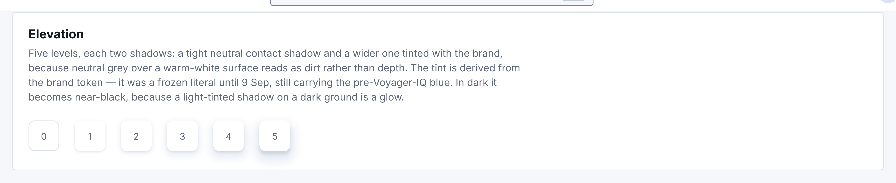


| Token | Value | Dark |
|---|---|---|
| `--vy-radius-sm` | `3px` | *(same)* |
| `--vy-radius-md` | `4px` | *(same)* |
| `--vy-radius-lg` | `6px` | *(same)* |
| `--vy-radius-pill` | `999px` | *(same)* |
| `--vy-shadow-sm` | `0 1px 2px rgba(19, 24, 32, .06)` | *(same)* |
| `--vy-shadow-md` | `0 2px 8px rgba(19, 24, 32, .10)` | *(same)* |
| `--vy-shadow-lg` | `0 8px 28px rgba(19, 24, 32, .14)` | *(same)* |
| `--vy-overlay-scrim` | `rgba(19, 24, 32, .45)` | `rgba(0, 0, 0, .62)` |


### Z-index — one flat list, so two overlays can never argue


| Token | Value |
|---|---|
| `--vy-shell-sidebar-w` | `248px` |
| `--vy-shell-sidebar-w-collapsed` | `56px` |
| `--vy-shell-topbar-h` | `52px` |
| `--vy-z-drawer` | `10020` |
| `--vy-z-dialog` | `10040` |
| `--vy-z-menu` | `10070` |
| `--vy-z-palette` | `10075` |
| `--vy-z-toast` | `12500` |
| `--vy-z-skip` | `12600` |
| `--vy-dialog-md` | `640px` |
| `--vy-dialog-lg` | `960px` |
| `--vy-dialog-xl` | `1180px` |


---

## B5 · Sizing

### B5.1 Control heights

Every control sits on **Kendo's own size scale**, configured rather than
overridden — `_kendo-size.scss` sets the variables and the components inherit
them. Forcing a height on a Kendo control instead is how a 29px select ends up
beside a 34px input.


| Token | Value |
|---|---|
| `--vy-row-h-compact` | `28px` |
| `--vy-row-h-comfortable` | `40px` |
| `--vy-row-h-relaxed` | `48px` |
| `--vy-target-min` | `44px` |
| `--vy-control-sm` | `28px` |
| `--vy-control-row` | `26px` |
| `--vy-control-md` | `34px` |
| `--vy-control-dense` | `32px` |
| `--vy-icon-sm` | `16px` |


| Token | Where it is used |
|---|---|
| `--vy-control-md` **34px** | Form inputs, selects, buttons — the default |
| `--vy-control-dense` **32px** | Toolbar controls: search, `size="sm"` buttons |
| `--vy-control-sm` **28px** | Compact density |
| `--vy-control-row` **26px** | An icon button **inside a grid row** — Kendo's `xs` step |
| `--vy-target-min` **44px** | A floor, under `pointer: coarse` **only** |

> **44px is a touch rule, not a desktop one.** WCAG 2.5.5 is about a pointer
> target; applying it to a 27-field form on a mouse-driven screen adds ~270px
> of scrolling for nothing.

### B5.2 Row density — a user preference

| Token | Height | Setting |
|---|---|---|
| `--vy-row-h-compact` | 28px | Compact |
| `--vy-row-h-comfortable` | 40px | Comfortable *(default)* |
| `--vy-row-h-relaxed` | 48px | Relaxed |

### B5.3 Column roles — a width is chosen once, by role

A grid column declares a **role**, not a pixel width.

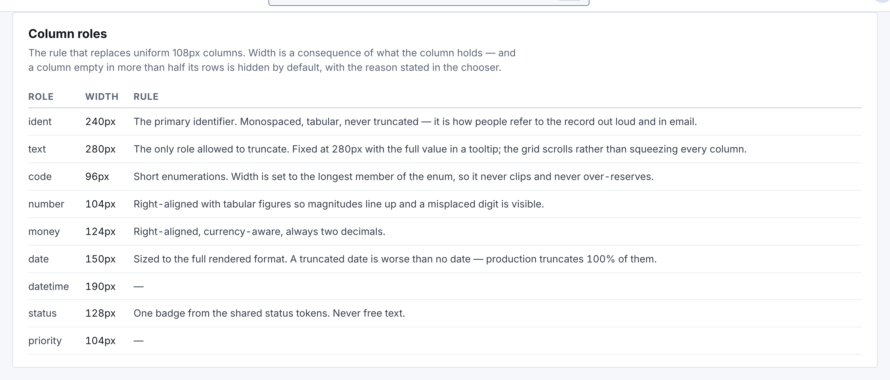

| Role | Width | What it holds |
|---|---|---|
| `ident` | 240px | Part numbers, MPNs — must not truncate |
| `text` | 280px | Descriptions and other prose |
| `code` | 96px | Short codes, revisions |
| `number` | 104px | Quantities |
| `money` | 124px | Prices and amounts |
| `date` | 150px | A day |
| `datetime` | 190px | A moment — `09/09/2026 16:35:29` |
| `status` | 128px | A status pill |
| `priority` | 104px | A dot and a word |

### B5.4 Dialogs and shell

| Size | Width | Opens maximised? | For |
|---|---|---|---|
| `md` | 640px | No | A question: a confirmation, a short form |
| `lg` | 960px | Yes *(overridable)* | Two blocks and a short table |
| `xl` | 1180px | Yes | A work surface: a 21-column grid, a 4-step wizard |

| Shell token | Value |
|---|---|
| `--vy-shell-sidebar-w` | 248px |
| `--vy-shell-sidebar-w-collapsed` | 56px |
| `--vy-shell-topbar-h` | 52px |

---

## B6 · Motion

Four easings and three durations, and nothing else. There is deliberately **no
loop-length token**: a custom property nothing reads is a token that rots.

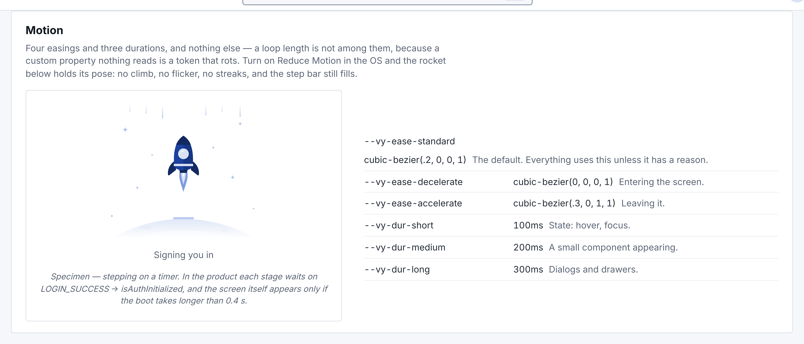

| Token | Value | Use |
|---|---|---|
| `--vy-ease-standard` | `cubic-bezier(.2, 0, 0, 1)` | The default. Everything, unless it has a reason |
| `--vy-ease-emphasised` | `cubic-bezier(.2, 0, 0, 1)` | A moment that should be noticed. **Currently identical to `standard`** — named separately so the two can diverge without touching call sites |
| `--vy-ease-decelerate` | `cubic-bezier(0, 0, 0, 1)` | Something arriving |
| `--vy-ease-accelerate` | `cubic-bezier(.3, 0, 1, 1)` | Something leaving |
| `--vy-dur-short` | **100ms** | State changes: hover, focus |
| `--vy-dur-medium` | **200ms** | Small components entering |
| `--vy-dur-long` | **300ms** | Dialogs, drawers |

### The loading clock

| Rule | Value |
|---|---|
| Show the boot screen only if the boot takes longer than | **400ms** |
| Exit — the craft leaves the top of the frame | **400ms** |
| "Still climbing…" appears after | **5s** |
| Minimum display time once shown | **none** |

Holding a loading screen so it does not flash spends the user's time to make
our indicator look better. Not showing one at all for a boot that beats the
clock costs them nothing. The two rules are the two halves of one answer.

### Reduced motion is a state, not a switch

Under `prefers-reduced-motion: reduce` the rocket **holds its pose** — no
climb, no flicker, no streaks — and the step bar still fills. A welding arm
with its animation removed is an arm with no sparks and an empty checklist,
which says something different from what the state means, so the things that
*fade in* are left on.

---

## B7 · Responsive

Breakpoints are raw pixels because `@media` cannot read custom properties — a
documented exception to the no-magic-numbers rule.

**Three of them are the shell**, in `responsive.css`, and they are the ones
worth knowing by heart:

| Width | What changes |
|---|---|
| ≤ **1180px** | The 248px sidebar becomes a 56px icon rail |
| ≤ **980px** | Two-column regions stack |
| ≤ **820px** | The sidebar leaves the flow; a menu button reveals it |
| `pointer: coarse` | The bottom of the type scale re-expands; 44px target floor |

**Eight more are component breakpoints**, and the honest count is eleven, not
three. A component that needs one measures it and carries the measurement —
rule 4 of [A3](#a3--five-rules-before-you-build) — rather than being bent to
fit a shell width it has nothing to do with:

| Width | Where | What it answers |
|---|---|---|
| ≤ **1100px** | top bar, tab strip | The timezone picker goes; the clock still states the zone |
| ≤ **900px** | top bar, cost summary, submit bar | The clock goes; a 2fr/1fr money split stacks before its figures stop lining up |
| ≤ **860px** | record header | |
| ≤ **840px** | wizard stepper | Four labelled steps need ~760px; below it they truncate, and a truncated step name is worse than none |
| ≤ **720px** | page body | A real phone, or a genuinely short window |
| ≤ **700px** | stepper, link columns | Only the current step keeps its label; the others become their marker, still positioned and still clickable |
| ≤ **620px** | record header | |
| ≤ **560px** | filter strip | A right-anchored strip would read as clipped at this width |

Two of those — 860 and 620 — carry no note, which rule 4 says they should.

The system runs on shop-floor terminals that are often 1366×768 or narrower.
Below about 1100px a 248px sidebar stops being orientation and starts being
the thing in the way — measured at 543px it was taking **46% of the
viewport**.

The same screen at the three widths that matter. Full rail, icon rail, and no
rail at all with a menu button in the top bar — and in all three the grid
keeps its columns rather than shrinking them:

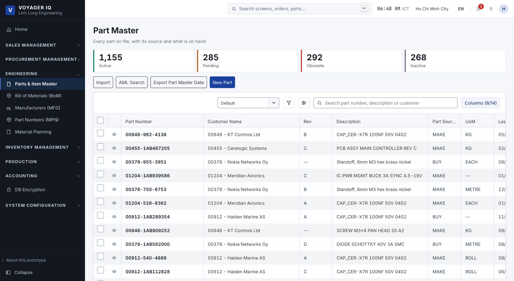

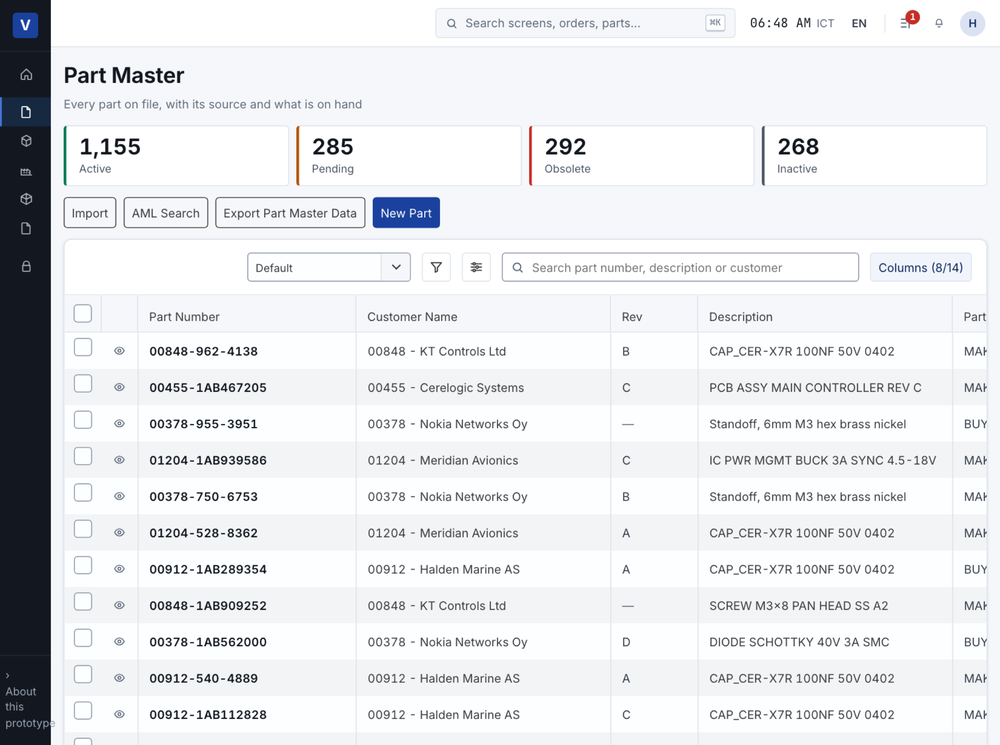

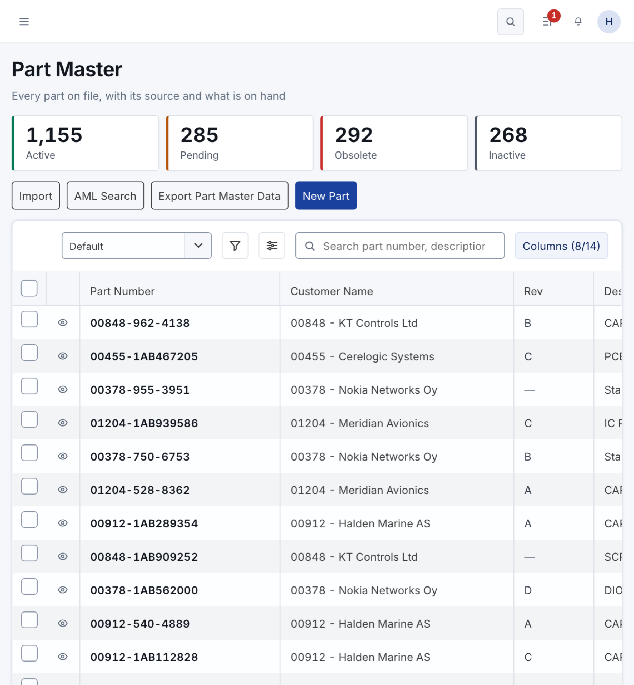


---

## B8 · Layout

A page in this app is three things across: the sidebar, two gutters and the
content box. [B7](#b7--responsive) says when the sidebar changes size; this
section says what the content box does about it, and what it is allowed to
grow to.

Written on **9 November 2026**, and it is the last structural section the
system was missing. Everything below was measured rather than decided:
`grid:check` sweeps **6 routes × 12 widths** and the numbers in this section
are its output.

### B8.1 What takes the width before the content does

Measured as an identity rather than a formula, so moving a breakpoint cannot
make this wrong:

> **rail + gutters + content = viewport.** Nothing else may take a share.

| Viewport | Rail | Gutters | Content |
|---|---|---|---|
| ≤ 820px | 0 — the sidebar is `fixed` and off-screen | 2 × 14 | vw − 28 |
| 821–1180px | 56 — icon rail | 2 × 14 | vw − 84 |
| ≥ 1181px | 248 — labelled | 2 × 24 | vw − 296, up to the cap |

The content box, measured on each page shape:

| vw | 375 | 600 | 768 | 820 | 900 | 980 | 1100 | 1180 | 1280 | 1366 | 1440 | 1920 |
|---|---|---|---|---|---|---|---|---|---|---|---|---|
| **list** | 347 | 572 | 740 | 792 | 816 | 896 | 1016 | 1096 | 984 | 1070 | 1144 | **1624** |
| **everything else** | 347 | 572 | 740 | 792 | 816 | 896 | 1016 | 1096 | 984 | 1070 | 1132 | **1132** |

### B8.2 The step at 1180 is negative, and it is the only one

Read the row again at the two widths either side of it.

> At **1180px** the content box is **1096px**. At **1280px** it is **984px**.
> The window gained 100px and the page **lost 112**.

Crossing 1180 upward the rail goes 56 → 248 and the gutters 14 → 24: **212px
taken, 100px given**. The consequence is not theoretical — a 1366 laptop, the
machine this product is mostly used on, shows **1070px** of content where an
1180 terminal shows **1096px**.

**It is a trade, not a bug.** The labelled rail is orientation, which is what
decision D1 bought and what the 25 August review asked for; the alternative is
an icon rail on every laptop in the building. And the user has an escape worth
**192px** — the collapse control, which is only offered above 1180 because
below it the rail is already collapsed.

The breakpoint that would remove the step entirely is **1392px**, not 1180:
content above it is `vw − 296`, so the window has to reach 1392 before the
expanded rail pays for itself. Moving it there would deny the labelled rail to
every 1366 screen, which is the wrong half of the trade.

What the system does instead is **declare** the step, and `grid:check` fails
if a second one appears anywhere.

### B8.3 Four page shapes, and until 9 November only two had a width

| Shape | Used by | Cap |
|---|---|---|
| `.vy-page--grid` | Every list screen | **none, on purpose** |
| `.vy-page--record` | The RFQ record | `--vy-record-max-w` |
| `.vy-page--doc` | Design system, Audit, Sitemap | `--vy-doc-max-w` |
| `.vy-page` | Home, My Queues, Placeholder | **was none — now `--vy-page-max`** |

All three caps are the same number, `1180px`, and the two named tokens now
resolve to `--vy-page-max` so there is one value rather than three that happen
to agree.

**The list shape is uncapped, and that has to stay a decision.** The widest
grid in this product is **1806px** at its default view — Project Requirements,
12 columns at their [B5.3](#b53-column-roles--a-width-is-chosen-once-by-role)
role widths — and **2106px** with every column turned on, which is Part Master
at 16. Any cap below those would create horizontal scrolling on a window that
had the width to avoid it. The role widths themselves hold at every width:
measured at 2560px the table is still 1806px and every column is still its
declared width, so a 2560 screen shows the whole grid with the remainder of
the frame empty.

**Everything else is capped, and the base rule is what carries it** — so a
page that declares nothing now gets the conservative width rather than the
unbounded one. That inversion is the point: before, the default was infinite.

The cost of not capping was measurable on the two dashboard screens:

| At a 1920 viewport | Uncapped | Capped |
|---|---|---|
| Chart column | 127px, holding a 28px bar — **99px of air between bars** | 85px, 57px of air |
| Queue tile | **397px** for a one-digit number and two short lines | 274px |

A page with no grid to fill has nothing to spend the width on, and twelve bars
spread across 1600px stop reading as a series.

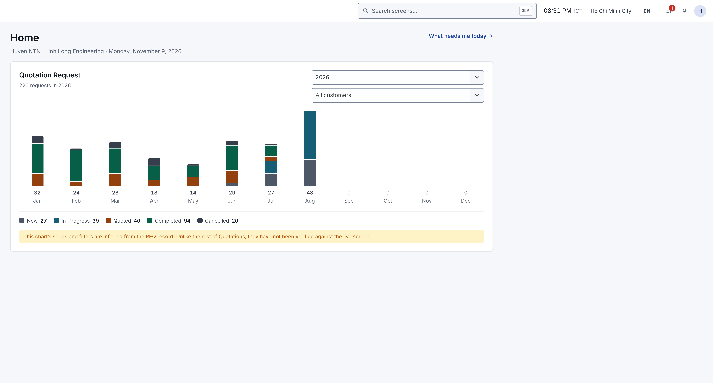

**Left-aligned, not centred.** A list screen is full-bleed, so a centred
dashboard would make the page title jump right as you navigate from a grid to
Home. The heading starts at the same x on every screen; the unused width is
left where it is.

### B8.4 Columns — one idiom, sixteen minimums

There is no 12-column grid here, and that is deliberate. A fixed column count
assumes the content box has a stable width; this one changes by 640px across
the range above, loses 112px at one step, and is capped on four shapes out of
five. **Sixteen layout grids, all of them the same idiom:**

```css
grid-template-columns: repeat(auto-fit, minmax(var(--some-min), 1fr));
```

The tracks are equal, they consume the row at any count and any width, and the
floor is what decides when a row wraps. So the only number a layout grid
chooses is **the width below which its content stops being readable** — and
that is a property of the content, not of the grid. A count tile and a form
field group do not stop being readable at the same width, so they do not share
a number.

| Grid | Minimum token | Minimum | Column gap | What it holds |
|---|---|---|---|---|
| `.vy-kpi-row` | `--vy-kpi-min-w` | 140px | 8px | Count tiles over a list |
| `.vy-bom-summary` | `--vy-stat-min-w` | 150px | 10px | Figures over a BoM |
| `.vy-run-ref .vy-quote-config-grid` | `--vy-quote-ref-field-min` | 150px | inherited | Reference fields, narrow pane |
| `.vy-stat-row` | `--vy-stat-min-w` | 150px | 10px | Figures in a summary strip |
| `.vy-assy-grid` | `--vy-assy-field-min` | 170px | inherited | Assembly fields |
| `.vy-contact-fields` | `--vy-contact-field-min` | 180px | 10px | Contact fields |
| `.vy-filter-fields` | `--vy-filter-field-min` | 190px | 12px | Filter fields |
| `.vy-quote-context-fields` | `--vy-quote-fact-w` | 190px | 10px | Quote context facts |
| `.vy-record-fields` | `--vy-header-field-min` | 190px | 16px | Record-header facts |
| `.vy-assignees` | `--vy-card-min-w` | 200px | inherited | Assignee cards, stacked |
| `.vy-queue-row` | `--vy-card-min-w` | 200px | 12px | Queue cards |
| `.vy-radios--tiles` | `--vy-radio-tile-min` | 230px | 10px | Radio tiles |
| `.vy-quote-config-grid` | `--vy-quote-field-min` | 240px | 16px | Quote configuration fields |
| `.vy-header-groups` | `--vy-header-group-min` | 260px | 12px | Record-header groups |
| `.vy-field-groups` | `--vy-field-group-min` | 280px | 20px | Form field groups |
| `.vy-notes-edit` | `--vy-note-min-w` | 320px | 16px | Note editors, side by side |

Eleven distinct minimums and six distinct gaps, and the system does **not**
flatten them onto a ladder. It states the catalogue instead: a new grid picks
a row from it, or measures its own and records why — [A3](#a3--five-rules-before-you-build)
rule 4, the same rule [B7](#b7--responsive) applies to breakpoints. What
`grid:check` enforces is that the minimum is a **token**, so a seventeenth
value cannot arrive as a literal in a rule.

### B8.5 What `grid:check` measures

`node scripts/with-server.mjs grid:check` · **72 measurements**, 6 routes × 12
widths, in `check:visual` on every push.

| | |
|---|---|
| **The identity** | rail + gutters + content = viewport, at every width. Nothing else may take a share |
| **The caps** | A capped shape never exceeds `--vy-page-max` |
| **The opt-out** | The list shape is still uncapped at the widest width swept — so the decision in B8.3 cannot decay into an omission |
| **One step** | Content width never falls as the viewport grows, except between 1180 and 1280 |
| **Tokens** | Every `auto-fit` minimum is a `var()`, never a literal |

Two faults are planted on every run — a cap forced onto the list shape, and a
literal minimum — and the run fails if either goes unseen.

> What it deliberately does **not** check is horizontal page overflow.
> `mobile:check` owns that, along with its 198 open tablet findings;
> duplicating them here would make this check red for a reason that has
> nothing to do with the grid.

---
---

# Part C — Assets

## C1 · Icons

One set. **20×20 viewBox, stroke only, no fill, one stroke weight.** A heavier
line at a smaller size is how an icon set stops looking like one set.

An unknown name renders **nothing**, with the name left in the DOM, rather
than falling back to a document glyph that hides the bug.

| | |
|---|---|
| Default size | 16px · `--vy-icon-sm` |
| In a grid row | 15px inside a 26px button |
| Colour | `currentColor` — the icon takes the text colour around it |
| Decorative | `aria-hidden`, and the state it marks gets words of its own |

**The 45 names:**
`task · chat · log · quote · order · return · customer · requisition ·
supplier · factory · simulate · bom · transfer · adjust · pcb · tool ·
machine · invoice · journal · lock · people · template · job · plug · menu ·
globe · metadata · queue · doc · home · sell · buy · parts · stock · make ·
finance · insight · settings · chevron-down · chevron-right · eye · download ·
clip · trash · check`

Two directional glyphs, each with one job: **down** opens a menu below itself,
**right** says "this opens somewhere else".

---

## C2 · Illustrations

**One drawing, three states.** The product has exactly one illustrated
character — a rocket — and it appears in three situations. That is deliberate:
a reader who has met this craft on the way in should not have to learn a
second picture to understand that it crashed.

Component: `src/ui/RocketLaunch.tsx` · one inline SVG, `viewBox="0 0 240 180"`
· `data-state` selects the scene.

| | |
|---|---|
| Rendered width | `clamp(240px, 18vw, 280px)` |
| Colour | Ten role tokens, [B1.7](#b17-row-tones-and-accents) — never hex |
| Motion | CSS only. The illustration owns pixels and no state, so it can stop in a background tab and nothing is lost |
| Ids | Generated with `useId` — two instances on one page would otherwise share a clip path |
| Inline, not `` | An `` is a second request on the one screen whose job is to cover the first one, and it is its own document, where `var(--vy-brand)` resolves against nothing |

### C2.1 `launching` — the boot screen

The craft holds still in the middle of the frame and **the world moves**: the
planet sinks a notch per boot stage, streaks run down past it. Nothing about a
rocket drawn nose-up says "climbing" on its own.

| | |
|---|---|
| Where | `BootGate` after sign-in; the `Suspense` fallback of a lazy route |
| Animation | Lift-off 0.7s · bob 1.6s · flame flicker 0.18s · streaks 0.8–1.3s |
| Reduced motion | No climb, no flicker, no streaks. The step bar still fills |


Shown with its label and five-segment bar, which is what the boot screen
actually is:

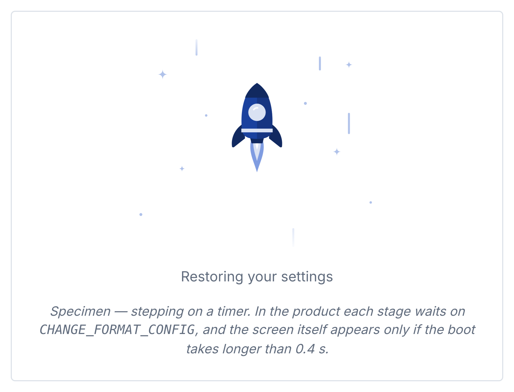

### C2.2 `error` — the screen stopped loading

The same craft, back on the pad: tilted, cracked, one fin lying beside it,
smoking. The failure is legible before the sentence under it is read.

| | |
|---|---|
| Where | `ErrorState`, which `ErrorBoundary` renders for any route that throws |
| Animation | Three smoke puffs, 2.4s, staggered |
| Reduced motion | Puffs held at 0.6 opacity — the smoke stays, the movement goes |


### C2.3 `building` — still on the launch pad

The craft **whole** on the pad, a robot arm welding it, a design doc on an
easel whose checklist ticks off. Work in progress, not wreckage — and the
difference has to be visible before the heading is read.

| | |
|---|---|
| Where | `Placeholder`, which answers every route not yet built — **71 of the 82 destinations** in the live menu (`src/data/sitemap.ts`, 91 `path` entries, 82 distinct; `App.tsx` declares 21 real routes and one catch-all) |
| Animation | Arm 4s · sparks only while the arm is holding · checklist 6s |
| Reduced motion | Sparks and the first two ticks held **on**, so the drawing still says "being built" |


### C2.4 Skeletons — the other kind of waiting

A skeleton answers *"what will this look like?"*. Once the user has already
seen rows that question is answered, so a re-price or a second page **dims
what is there** and puts an indicator over it instead (`BusyOverlay`).

One shimmer for both: `--vy-surface-sunken` → `--vy-surface-app` →
`--vy-surface-sunken`, 200% background, 1.4s.

**Grid skeleton** — the real column roles, so the bars land where the data
will:

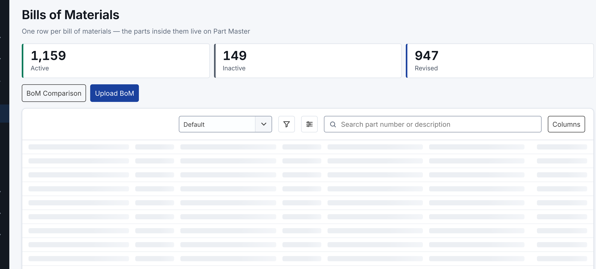

**Record skeleton** — the real field labels, because they are known before the
data is. Measured down to 1px of shift when the record arrives:

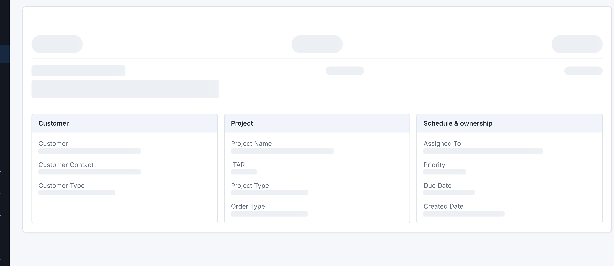

### C2.5 Empty states

No illustration, on purpose. An empty state is a sentence and an action, and a
picture there delays both.

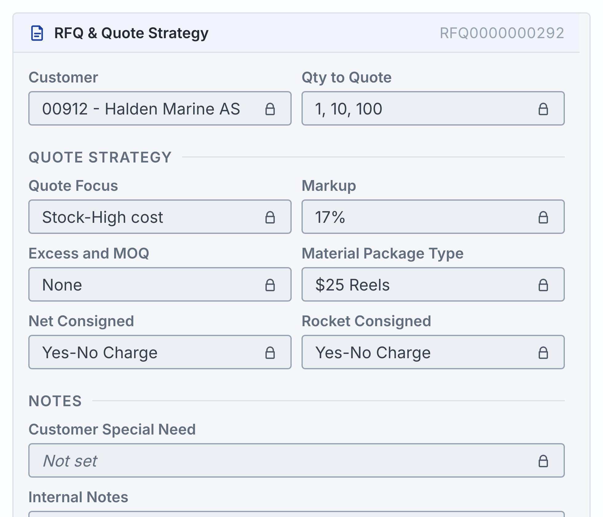

### C2.6 Exporting and regenerating

| | |
|---|---|
| Live source | `src/ui/RocketLaunch.tsx` |
| Static SVGs | `docs/assets/rocket-journey/*.svg` — the **retired** horizontal set, kept because an earlier document still prints them. Not in the product |
| These images | Captured from the running app at 2×; the scripts are in `scripts/` |

> **If an illustration needs to leave the codebase** — for a slide, a PDF —
> export the inline SVG and replace the `var(--vy-rocket-*)` references with
> the resolved hex from [B1.7](#b17-row-tones-and-accents). Outside the app
> there is no token layer to resolve them.

---
---

# Part D — Components and patterns

`src/ui` holds 33 files: the primitives, plus the icon set, the preference
store and three hooks. Each wrapper has a reason, and the rule that produced
them is the same every time — **the live system already ships KendoReact, so
the question is never "what should this look like" but "what does Kendo
already do, and what must we add".**

### Component pages

Each one is a full specification — when to use and when **not** to, anatomy,
variants and states, content, behaviour, accessibility, API, and its own
change log. **All 29.** [`button.md`](components/button.md) is the
model; the rest of Part D below is the older, thinner prose it replaces.

| Page | Status | What it added when it was written |
|---|---|---|
| [Button](components/button.md) | stable | Busy indicator measured at 1.19:1 on `filled` and fixed |
| [Status badge](components/badge.md) | stable | `review` has colours and no way to render them; the file comment said six tokens, there are seven |
| [Chip](components/chip.md) | **trial** | Resting border at 1.64:1 and a missing `aria-pressed`, both in the unselected state — fixed |
| [Filter toolbar](components/filter-toolbar.md) | stable | The two things it deliberately does not do, written down: no operators, no add-a-condition flow |
| [Column chooser](components/column-chooser.md) | stable | 6 of 11 columns are required — a chooser where most rows are fixed is closer to an inventory |
| [View picker](components/view-picker.md) | stable | Keyed by `id`, not `name`: two views may share a name, and the migration nearly broke that |
| [Pager](components/pager.md) | stable | Replaced infinite scroll over 21,941 records — the trade written down, including what it cost |
| [Priority](components/priority.md) | stable | Encodes by ink and shape, not hue: the three levels still rank themselves in greyscale |
| [More menu](components/more-menu.md) | stable | Asked for on 8 Oct **and** measured independently — Cancel RFQ sat 69px from Run Quotation |
| [Field](components/field.md) | stable | 91 call sites, the most used in the product — and the hint/error rule that stops two lines claiming the same job |
| [Select](components/select.md) | stable | It refuses a value outside the list, on purpose: Customer is a lookup |
| [Dialog](components/dialog.md) | stable | Three stacked levels were correct only by mount order — and Minimize is deliberately absent |
| [Tabs](components/tabs.md) | stable | Keyed by value, not index: a reordered array cannot silently change which tab opens |
| [Data grid](components/data-grid.md) | stable | Select-all means **this page** — across 2,000 rows a bare "all" exports records nobody has seen |
| [MiniTable](components/mini-table.md) | stable | Per-column filter cells, recorded as the one real gap against the live system — arrived as a prop |
| [Field row](components/field-row.md) | stable | The same 14-line block had been written out 14 times, and nothing looked broken |
| [Radio group](components/radio-group.md) | stable | A hint per option, because one option can never be chosen and a shared hint cannot explain it |
| [View setting](components/view-setting.md) | stable | Two copy defects in the live build, corrected rather than copied — the one place "match live" is deliberately not followed |
| [Toast](components/toast.md) | stable | Four named verbs instead of one `push`, because the kind is a decision and not a style |
| [Checkbox](components/checkbox.md) | stable | Kendo's class, not Kendo's component — `indeterminate` has no prop and the grid names every box |
| [Loader](components/loader.md) | stable | `pulsing` inside a control so it does not appear to spin; the label says **what** is loading |
| [File drop](components/file-drop.md) | **trial** | `autoUpload` off and no `saveUrl` on purpose — and the hint says so, every time |
| [Stepper](components/stepper.md) | stable | Steps are buttons, bounded by `furthest`: free movement back, no landing in a step whose inputs do not exist |
| [Error state](components/error-state.md) | stable | A comment block declared this state for weeks with no rule under it — asserted and never drawn |
| [Grid skeleton](components/grid-skeleton.md) | stable | Bars proportioned by column role; the live build says "No records available" while its own spinner turns |
| [Record skeleton](components/record-skeleton.md) | stable | The labels are real and only the values are bars — and it wears the record's own classes, after measuring 92px of jump |
| [People picker](components/people-picker.md) | stable | The email is not decoration: the live directory holds "Linh 4 Tran", "Linh Tran 5" and "Linh Tran 1" |
| [Rich text](components/rich-text.md) | **trial** | The live "?" is not a help control — it is an avatar with no initials, and it is deliberately not built |
| [Support ticket](components/support-ticket.md) | **trial** | Four facts attached unasked, under a heading that says so rather than hiding them |

> Each page was written against the running build, and **each one found
> something** — a wrong contrast ratio, a missing ARIA attribute, a comment
> describing a rule that was not there. That was the argument for writing all
> 29, and it held to the last page: `people-picker.md` turned up a dashed
> boundary at 1.64:1 that `border:check` cannot reach, because the control
> only renders once a record is in edit mode.
>
> Writing [`field.md`](components/field.md)'s hover row the next day turned up
> the other half of it: the **states** no sweep was looking at, including the
> hover edge of that same input at 2.02:1 in dark and the focus edge of every
> input in the product. Both checks now measure states, which is the part
> worth keeping — see [`vien-state-09nov.md`](vien-state-09nov.md).

### Pattern pages

A pattern is several components in a shape that repeats. **All eight worth
having**, as of 9 November.

| Pattern | What it settles |
|---|---|
| [Record form](patterns/record-form.md) | The band order, the two modes, and the discard flow — where three sources had said three different things |
| [Destructive action](patterns/destructive-action.md) | More ▾ → danger ink → confirmation, and why removing any one of the three costs something |
| [List screen](patterns/list-screen.md) | The four ways to narrow a list, which all look like filtering and are not interchangeable |
| [Wizard](patterns/wizard.md) | One filled button per step, and two popups the manual asks for that this build deliberately does not have |
| [Feedback](patterns/feedback.md) | Four kinds of toast — and why a failure is a different kind, not a different string |
| [File upload](patterns/file-upload.md) | Choosing a file is real; sending it is not, and the screen says which |
| [Dashboard](patterns/dashboard.md) | Why Home and My Queues stayed two screens — and why a chart fill is not a badge colour |
| [Search](patterns/search.md) | Seven places you can type, three shapes of control, and three promises the search boxes were not keeping |

Each page names what it settles, the evidence behind it, and what it
deliberately leaves undone.

## D1 · Buttons

> **The full page is [`components/button.md`](components/button.md)** — when
> to use and when not to, anatomy, every variant and state, content, keyboard
> behaviour, accessibility and the API. It is the **model page**: the shape
> every other component should be written in, and the reason the rest of
> Part D reads thin by comparison. What follows here is the summary.

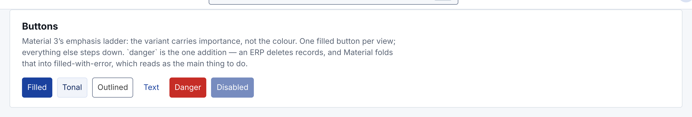

The picture above is the live specimen with the keyboard on it: `Text` carries
the focus ring every control in the system uses — 2px of `--vy-brand-boundary`
offset by 2px, never a removed outline.

| Variant | When |
|---|---|
| `filled` | **One per view.** The most likely next step |
| `outlined` | The default for everything else |
| `tonal` | A secondary action that still needs weight |
| `text` | Tertiary, inside dense rows |
| `danger` | Destructive — and it goes behind **More ▾** |

**Placement:** all buttons on the **left** of a toolbar; a smart-button group
or step indicator on the right; at most four visible, the rest behind
`More ▾` — and the label is always the word *More* with a chevron, never `⋯`.

**Cancel only in dialogs.** In edit mode the word is **Discard Changes**.

**`busy` is not decoration.** The indicator says something is happening; the
**disable** is what stops a second click spending a second marketplace
request.

## D2 · Fields

### Two modes, three presentations

A record has **two modes** — view and edit. Inside edit mode a field is one of
**two kinds**, and that is what the padlock is for. It is not a third state of
a field; it is the mark that separates the two kinds, and it exists only where
the distinction is live.

| | Field the user can change | Field the user cannot |
|---|---|---|
| **View mode** | Sunken box, no padlock | Sunken box, no padlock |
| **Edit mode** | **White** input, `--vy-border-control` | **Sunken** box, **padlock**, and a short reason |

**In view mode nothing is editable, so the distinction has nothing to say** —
a padlock on all twenty-seven fields marks none of them. The boxes are
identical and the eye reads the values, not the chrome.

**In edit mode the white tells you where you may type.** Everything still in a
grey box is a value this screen does not own, and the padlock is followed by
the reason in two or three words, because a padlock says *that* a field is
locked and cannot say *why*.

**View mode — one box for every value:**

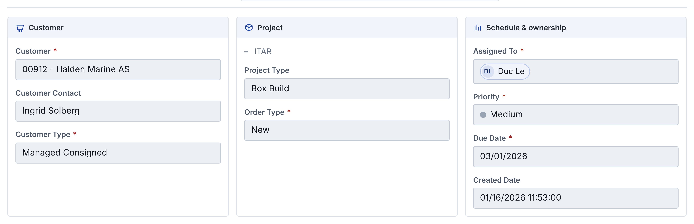

**Edit mode — white where you may type; grey, padlocked and explained where
you may not.** `Created Date` reads *set by the system*; `ITAR` reads *follows
Customer*:

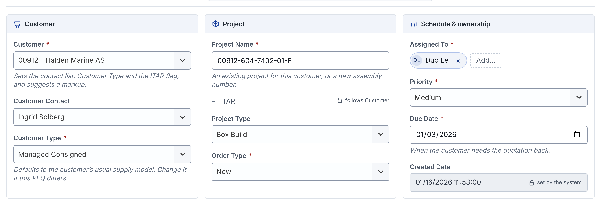

> **One exception, and it is the same rule.** A panel where *nothing* is
> editable keeps the grey box and drops the padlock — Run Quotation's setup
> strip on the last step, where the run is finished. A padlock on each of
> seven values says only what the panel already says.

### The rest of a field

| Part | Rule |
|---|---|
| Label | **Above** the value, never beside it. Title Case, 12px, 600 |
| Required | A **red asterisk** right after the label, in view **and** edit mode |
| Optional | No mark. Never the word "(optional)" |
| Helper | Below the field, italic, at or below the label's size |
| Error | Red text below the field, **on blur** — not on every keystroke |
| Error *or* hint | Never both: two lines, each claiming to say what to do next |
| Hint | A **sibling** of the label, never inside it, or it joins the accessible name |

## D3 · Grids

A grid is where this system does most of its work, and the **row tone** is how
it talks. A tone is a row's state in the quote, not a severity: green is
covered by the chosen supplier, amber is short of the quantity, red is no bid,
grey is excluded from the quote entirely.

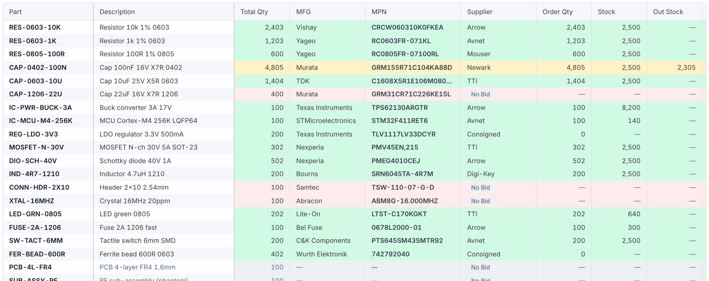

**Every tone is named under the grid it paints.** A colour that only the
author can decode is a colour that means nothing:

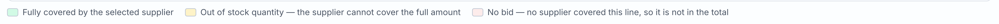

| Rule | |
|---|---|
| Column chooser | On every grid with **3+ columns** |
| Frozen block | Declared as `locked`, so the chooser and the freeze cannot disagree |
| Zebra | By **record**, not by row — a record spanning two AML rows is one band |
| Totals | A grid the user sums by eye gets a totals row |
| Empty | A real empty state that says what to do, never "No records available" |
| Width | By role ([B5.3](#b53-column-roles--a-width-is-chosen-once-by-role)); a deviation carries a `widthNote` |

## D4 · Dialogs

Sizes are in [B5.4](#b54-dialogs-and-shell). Three further rules:

1. **Actions top-left** on a work surface, in a footer on a question. The way
   out goes on the left wherever the bar sits.
2. **`lg` and `xl` open maximised**; `md` never does. Those two are the work
   surfaces, and a 21-column grid in a 1180px window spends the screen it was
   given — while a confirmation filling a 27-inch screen is a worse answer
   than the one it replaced.
3. **Escape dismisses the innermost thing**, which the Select had to be taught
   by hand — Kendo's own handling closed the dialog from an open dropdown.

## D5 · The four screen states

Loading, empty, error and not-yet-built are four different things and look
it. Getting these wrong is the most common way a screen lies to its reader.

| State | What the user sees | Actions | Illustration |
|---|---|---|---|
| **Loading** | Rocket climbing, planet sinking, five-segment bar | none | [C2.1](#c21-launching--the-boot-screen) |
| **Empty** | A sentence saying what would fill it | the action that fills it | none |
| **Error** | Rocket on the pad: tilted, cracked, one fin off, smoking | Reload · Back to Home · Send a support ticket · Error ID + Copy | [C2.2](#c22-error--the-screen-stopped-loading) |
| **Under development** | Rocket whole on the pad, arm welding, plan ticking off | Back to Home. **No Reload — nothing is broken** | [C2.3](#c23-building--still-on-the-launch-pad) |

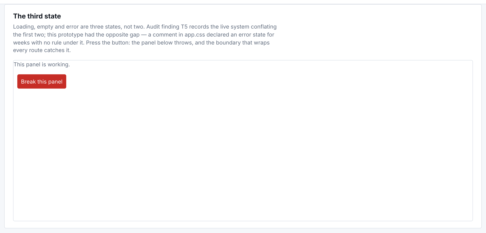

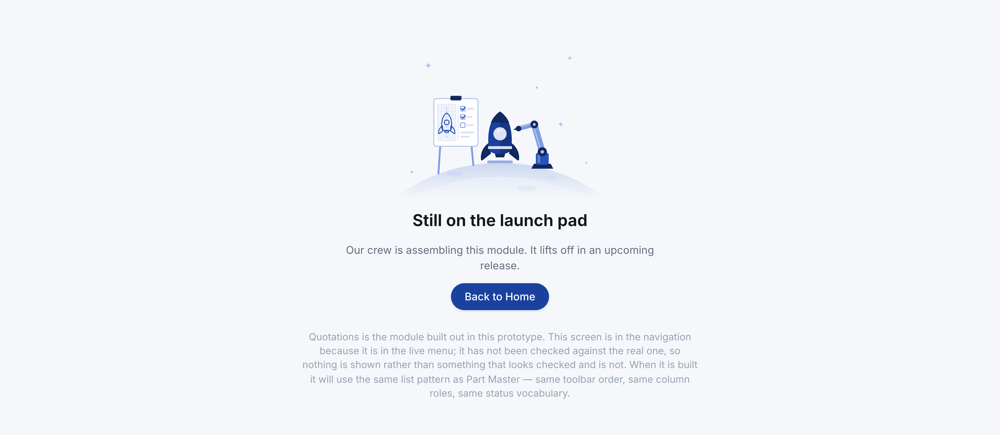

**The error state's three slots** are the three questions a person actually
has: *what failed · what it means for me · what I can do next.* Only the
first is generic.

**The error id is minted where the error is caught**, not where it is drawn —
minted in render, pressing Copy would hand the user a different number for
the same failure.

## D6 · Words

| | |
|---|---|
| Casing | [B2](#b2--typography) — Title Case for labels, sentence case for prose |
| A control says what happens | `Publish`, then a toast saying `Published` |
| An error says what to do | Not "Something went wrong" |
| Nothing is "not implemented" silently | A toast says what it *would* do |
| A derived figure says it is derived | *"Derived from this run — the live system takes them from the customer's purchase history"* |
| A session-only change says so | *"Added in this session… nothing here is saved"* |

---
---

# Part E — Quality

## E1 · Accessibility

Measured, not asserted — and measured **on every push**, which until 8
November it was not. The keyboard work is in
[`focus-order.md`](focus-order.md).

| Requirement | Threshold | Status | Re-run |
|---|---|---|---|
| Text contrast — WCAG 1.4.3 | 4.5:1 normal · 3:1 large (≥24px, or ≥18.66px at ≥700) | **184 token pairs, both themes, 0 below threshold.** Tightest text pair 4.53:1 | `contrast:check`, every push |
| Non-text contrast — WCAG 1.4.11 | 3:1 for control boundaries **and their states**, measured on **every ground** a control can sit on | Resting boundary, hovered boundary, focus ring and focus edge all clear 3 on all eight grounds; tightest **3.05:1**. Seven controls were below on 8 Nov ([`vien-control-08nov.md`](vien-control-08nov.md)); two tokens and five rules on 9 Nov ([`vien-state-09nov.md`](vien-state-09nov.md)) | `contrast:check`, every push |
| Non-text contrast — **fills that carry no text** | 3:1 against the card they are drawn on | The five chart series, both themes. In-Progress was **1.12:1** light and **1.37:1** dark until 9 Nov, because it read a chip background; tightest now **3.03:1** ([Dashboard](patterns/dashboard.md)) | `contrast:check`, every push |
| Target size — WCAG 2.5.5 | 44×44 | Enforced under `pointer: coarse` | `touch:check`, every push |
| Keyboard focus | visible, on screen | 1305 controls across 10 routes × 3 widths · 0 obscured, 0 without an indicator | `focus:check`, every push |
| Control boundaries, **as drawn**, in three states | 3:1 against what is behind them, at rest **and** on hover **and** on focus | 1122 measurements across 12 routes × 2 themes × 3 states · 0 under. 442 controls draw an edge on hover against 340 at rest — the extra 102 are transparent until you point at them | `border:check`, every push |
| The content box | rail + gutters + content = viewport · capped shapes never exceed `--vy-page-max` · the list shape stays uncapped · one declared step | 72 measurements across 6 routes × 12 widths · 2 planted faults, each caught · 0 findings ([B8](#b8--layout)) | `grid:check`, every push |
| Reduced motion | respected | [B6](#b6--motion) | — |

**Two measurements, and they answer different questions.**
[`contrast-sweep.md`](contrast-sweep.md) of 5 September is the real one: a
browser, a canvas pixel per element, backgrounds composited up the ancestor
chain, because Kendo emits `oklch()` and no regex over `getComputedStyle`
survives it. That sweep is what found the three control borders. It is also a
one-off — it ran once, against the palette of that day, and the dark theme,
the status vocabulary and the 12px floor all landed afterwards.

`contrast:check` is the cheap half, kept honest about being the cheap half. It
reads `tokens.css`, resolves every `var()` chain in both themes, and checks
the pairs the system promises: each text tier on each ground it can sit on,
brand and danger, all eight status pills, the row tones, and the two non-text
boundaries. No browser, no server. It cannot see a component that puts text on
a ground the system never intended, or an opacity that makes the real ground
something no token states — those still need the browser sweep. What it does
catch is the palette drifting out from under this document, which is what
happened between September and November, and it caught one the day it was
written: `subtle` on `surface-strong` at 4.02:1. See [B1.3](#b13-text-colour--six-tiers).

**Why the harness can be trusted.** Colours in the September sweep are read
through a canvas pixel rather than parsed from strings. Before the results
were believed, a `#bbbbbb`-on-white element was planted in the page and caught
at **1.92:1**. `contrast:check` plants the same value on every run and exits
non-zero if it fails to detect it — a sweep that reports no failures is only
worth reading if it can prove it would have found one.

Four rules that are easy to get wrong and are already settled:

- A **status is a word and a colour**, never a colour alone.
- A **hint is a sibling of the label**, never inside it.
- **`role="alert"` for an error, `role="status"` for a loading state.** One
  interrupts, the other does not.
- A **decorative glyph is `aria-hidden`** and the state it marks gets words of
  its own — a padlock plus a screen-reader-only "read-only".

## E2 · KendoReact

The live system already ships KendoReact 16. The bridge is three files:

| File | Job |
|---|---|
| `kendo-subset.scss` | Compiles only the Kendo components actually used |
| `_kendo-size.scss` | **Configures** Kendo's size scale — does not override it |
| `kendo-bridge.css` | Maps Kendo's variables onto ours, and fixes what cannot be configured |

**Specificity is the trap.** `.k-button.k-button-solid.k-button-base.k-focus`
weighs (0,4,0), so a one-class rule of ours loses silently. The bridge
prefixes with `html[data-kendo-bridged]` rather than repeating a class five
times.

Two Kendo behaviours worth knowing before debugging a component:

- **Kendo disables with a `.k-disabled` CLASS, not the `:disabled`
  attribute.** A plain `<input disabled class="k-radio">` renders identically
  to an enabled one.
- **KendoReact 16 locks grid columns with sticky cells in one table**
  (`position: sticky`), not with two panes.

---
---

# Part F — Handover

## F1 · File map

| Path | Contents |
|---|---|
| `src/theme/tokens.css` | **Every token.** Light, plus the two dark blocks |
| `src/theme/tokens.ts` | The values TypeScript needs: column widths, dialog widths |
| `src/theme/md3.css` | Motion, focus ring, the Material 3 structure we kept |
| `src/theme/base.css` | Reset and element defaults |
| `src/theme/components.css` | Component rules |
| `src/theme/app.css` | Screen and layout rules |
| `src/theme/responsive.css` | Every breakpoint, in one file |
| `src/theme/kendo-*.{css,scss}` | The Kendo bridge |
| `src/ui/` | The primitives |
| `src/ui/RocketLaunch.tsx` | The illustration, all three states |
| `/design-system` | The living specimen page |
| `docs/assets/design-system/` | The images in this document |

## F2 · How to change something

**A colour token**
1. Add or change it in **all three** blocks of `tokens.css` ([B1.8](#b18-how-dark-mode-is-wired)).
2. If it lands on text or a control boundary, re-run the contrast sweep.
3. `npm run check:fast` — lint, stylesheet check, typecheck, build.

**A component**
1. Check whether Kendo already does it ([E2](#e2--kendoreact)).
2. Build it in `src/ui`, referencing semantic tokens only.
3. Add a specimen to `/design-system` if it has states worth seeing.
4. Cover every state: default, hover, focus, active, disabled, busy, error.

**A new screen**
1. Which of the four states ([D5](#d5--the-four-screen-states)) can it be in? Build all of them.
2. Column roles, not pixel widths.
3. Check it at 1180, 980 and 820, in both themes.

**What CI runs on every push:** `contrast:check` (inside `css:check`, so it
gates the build) · `render:check` · `touch:check` · `mobile:check` ·
`focus:check` · `hover:check` · `border:check`.

## F3 · Governance

| | |
|---|---|
| Source of truth | `src/theme/` and the components in `src/ui`. This file describes them; it does not define them |
| Where a decision is recorded | In the code, at the rule it governs — and in a dated note under `docs/` when a reader would otherwise have to re-derive it |
| Judgement | Allowed where nothing else answers, and **labelled as judgement** where it is used |
| Versioning | `v1.0` is this handover. A token or rule change is a minor version; a change that requires screens to be rebuilt is a major one |

**Three rules that keep this document true:**

1. **A magic number needs a note** saying what was measured.
2. **A comment states what was measured, not what was intended.** Three
   corrections in this project came from a comment describing behaviour the
   code did not have.
3. **The living page beats the document.** `/design-system` renders the real
   components; if the two disagree, the page is right and this file is stale.

## F4 · What a handover should contain

The shape of this document was checked against current practice rather than
invented. The November check was redone against the published systems
themselves rather than against blogs about them, and it changed the answer:
the earlier version of this section listed what a handover should contain and
did not say which of it this file actually has. Both columns are below.

| What the published systems do | Here |
|---|---|
| **Tokens** with their values, in named tiers | [A2](#a2--the-three-layers), [B1](#b1--colour)–[B6](#b6--motion). Three tiers — ramp, role, component — the same model as Material 3's palette → role → component, and compatible with the W3C token format |
| **Accessibility** with the thresholds named | [E1](#e1--accessibility), and **measured** per token pair rather than asserted. Carbon names the same thresholds but publishes no per-token values; GOV.UK names them inside one component |
| **Responsive** with the breakpoints stated | [B7](#b7--responsive) — all eleven, shell and component, since 1.2 |
| **Motion** with duration, easing, reduced-motion | [B6](#b6--motion) |
| **Governance** — ownership, contribution, versioning | [F2](#f2--how-to-change-something), [F3](#f3--governance) |
| **Component specs**: when to use · when **not** to · anatomy · variants × states · content · behaviour · accessibility · code · do and don't | **All 29**, in [`docs/components/`](components/button.md), to that shape. [D1](#d1--buttons)–[D4](#d4--dialogs) remain as the older, thinner prose |
| **Patterns** — form, filter, destructive action, notification, page template | **Eight**, in [`docs/patterns/`](patterns/record-form.md) |
| **A lifecycle status** per component — trial · stable · deprecated | **On every page**, GOV.UK's three. Four are `trial`, each for a stated reason: file drop, rich text, support ticket, chip |
| **A changelog** per component | **On every page**, as a *Recent changes* table with dates. [F3](#f3--governance) still holds the versioning policy |
| **Layout grid** as a foundation | [B8](#b8--layout) — the container ladder, the one idiom and its sixteen minimums, measured by `grid:check` |

**Nothing on the checklist is left**, as of 9 November.
`docs/chuan-design-system.md` carries the comparison in full, the component
template these 29 pages were written against, and the triage that ordered
them.

> The layout grid was last on the list on the argument that it is the least
> useful of the three until the screens stop changing shape. Writing it found
> the opposite: two of the four page shapes had no declared width at all, and
> the content box **loses 112px** at one breakpoint while the window gains
> 100. Both had been true since the shell was built, and neither was visible
> without measuring every width.

Every source also names the one failure mode this file is most exposed to:
documentation drifting away from the live code once the team moves on. That is
why [F3](#f3--governance) makes the specimen page the tie-breaker rather than
this document, and why the numbers above are re-proved by
[`contrast:check`](#e1--accessibility) rather than restated.

Read directly, 8 November 2026:
[Carbon — Button usage](https://carbondesignsystem.com/components/button/usage/) ·
[Carbon — Accessibility: colour](https://carbondesignsystem.com/guidelines/accessibility/color/) ·
[Atlassian — Foundations](https://atlassian.design/foundations) ·
[Atlassian — Button](https://atlassian.design/components/button/examples) ·
[GOV.UK — Button](https://design-system.service.gov.uk/components/button/) ·
[GOV.UK — Component lifecycle statuses](https://design-system.service.gov.uk/community/component-lifecycle-statuses/) ·
[W3C Design Tokens format (draft)](https://www.designtokens.org/tr/drafts/format/) ·
[Material 3 — Colour roles](https://m3.material.io/styles/color/roles).
The W3C format is a draft that says not to implement it yet; the rest are
each one organisation's practice, not a standard. They agree on the shape and
differ on depth.

## F5 · Source index

| Document | What it settles |
|---|---|
| [`contrast-sweep.md`](contrast-sweep.md) | Every measured contrast ratio, and the method |
| [`vien-control-08nov.md`](vien-control-08nov.md) | The seven mis-picked control boundaries, and the sweep that found them |
| [`vien-state-09nov.md`](vien-state-09nov.md) | Hover and focus boundaries, and how a state is measured without a mouse |
| [`focus-order.md`](focus-order.md) | Keyboard order and the focus ring |
| [`modal-patterns.md`](modal-patterns.md) | Dialog sizes, action placement, dismissal |
| [`table-patterns.md`](table-patterns.md) | Grid behaviour, column roles, density |
| [`motion-loading.md`](motion-loading.md) | Every loading and transition decision |
| [`kendo-control-scale-18oct.md`](kendo-control-scale-18oct.md) | The 33-rule Kendo size audit |
| [`working-agreement.md`](working-agreement.md) | Engineering rules, including the magic-number exceptions |

---

*Captured from the running build at 2× on 3 November 2026. Images live in
`docs/assets/design-system/` and can be regenerated from `/design-system` and
the product screens they came from.*
