# Voyager IQ — Design System

> **Version 1.0 · 3 November 2026**
> Linh Long Engineering / Rocket EMS · repository `ll-poc`
> **Source of truth:** `src/theme/` · **Living specimen:** `/design-system`

Everything in this document was read out of a working build. Every number was
taken from the source; every picture was captured from the running
application at 2× on 3 November 2026. Where a figure came from measuring the
screen rather than from a rule, it says so.

---

## Contents

**Part A — Start here**
[A1 What this is](#a1--what-this-is) ·
[A2 The three layers](#a2--the-three-layers) ·
[A3 Five rules before you build](#a3--five-rules-before-you-build)

**Part B — Foundations**
[B1 Colour](#b1--colour) ·
[B2 Typography](#b2--typography) ·
[B3 Spacing](#b3--spacing) ·
[B4 Shape, elevation, depth](#b4--shape-elevation-depth) ·
[B5 Sizing](#b5--sizing) ·
[B6 Motion](#b6--motion) ·
[B7 Responsive](#b7--responsive)

**Part C — Assets**
[C1 Icons](#c1--icons) ·
[C2 Illustrations](#c2--illustrations)

**Part D — Components and patterns**
[D1 Buttons](#d1--buttons) ·
[D2 Fields](#d2--fields) ·
[D3 Grids](#d3--grids) ·
[D4 Dialogs](#d4--dialogs) ·
[D5 The four screen states](#d5--the-four-screen-states) ·
[D6 Words](#d6--words)

**Part E — Quality**
[E1 Accessibility](#e1--accessibility) ·
[E2 KendoReact](#e2--kendoreact)

**Part F — Handover**
[F1 File map](#f1--file-map) ·
[F2 How to change something](#f2--how-to-change-something) ·
[F3 Governance](#f3--governance) ·
[F4 Known gaps](#f4--known-gaps) ·
[F5 What a handover should contain](#f5--what-a-handover-should-contain) ·
[F6 Source index](#f6--source-index)

---
---

# Part A — Start here

## A1 · What this is

The file someone needs to **build** a new Voyager IQ screen without asking,
and the file a reviewer needs to **tell a correct screen from a plausible
one**.

It is not a style guide for a drawing tool. It describes a system that is
running: the tokens are CSS custom properties, the components are React, and
the specimen page renders the real thing.

## A2 · The three layers

| Layer | What it is | Where | May a screen use it? |
|---|---|---|---|
| **1 · Ramps** | The raw palette. 10 blues, 12 greys, 4 reds | `tokens.css` | **No** |
| **2 · Semantic roles** | `surface`, `on-surface`, `brand`, `danger`… named for the job | `tokens.css` | **Yes — only this** |
| **3 · Components** | Button, Field, Grid, Dialog… | `src/ui`, `src/components` | Yes |

A stylesheet saying `background: var(--vy-grey-0)` has hard-coded *white*, and
no theme can move it. One saying `var(--vy-surface)` has hard-coded *"the
colour a panel is"*, which a theme is allowed to answer differently.

**Layer 1 exists so that layer 2 can be consistent. It is not for use in a
component.**

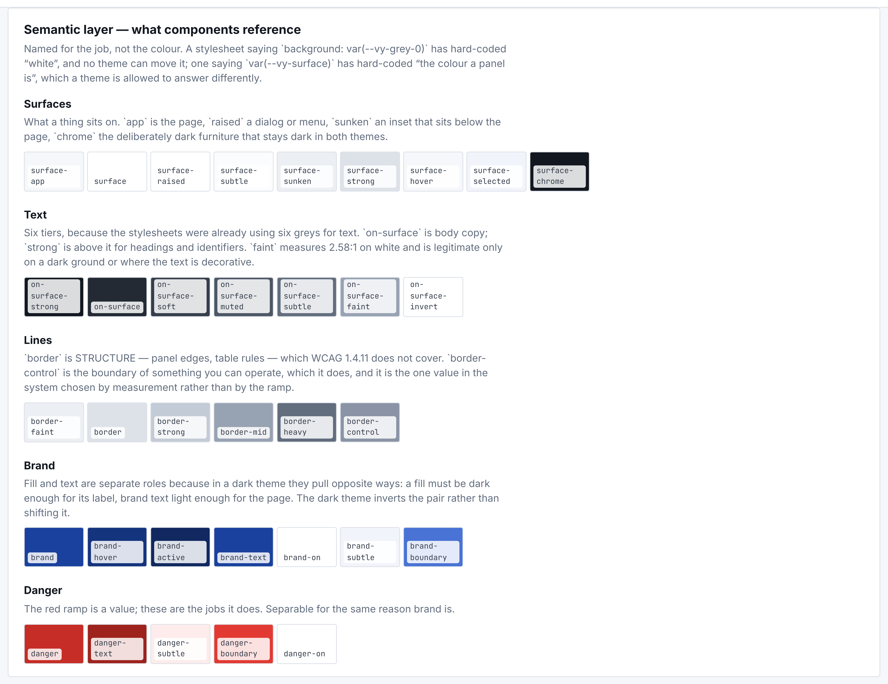

## A3 · Five rules before you build

1. **Is there a token?** If yes, use it. If no, add one — and say in the code
   why the scale did not already have it.
2. **Does the live system already answer this?** Field names, option lists and
   behaviour come from the live system unless a customer requirement overrides
   it. The order of precedence is written down in [`precedence.md`](precedence.md).
3. **Both themes, both densities, 820px.** A screen that has only been seen in
   light mode on a 1920px monitor has been seen once.
4. **A magic number carries a note.** A width that deviates from its role
   needs a `widthNote` saying what was measured.
5. **Say what is not real.** A derived figure, an unbuilt action and a fake
   send are each labelled where they appear, not only in a commit message.

---
---

# Part B — Foundations

## B1 · Colour

### B1.1 The ramps *(layer 1 — not for use in components)*

Three ramps and nothing else. A fourth colour in a screen is a bug unless it
is a status, and the statuses are in [B1.6](#b16-status-vocabulary).

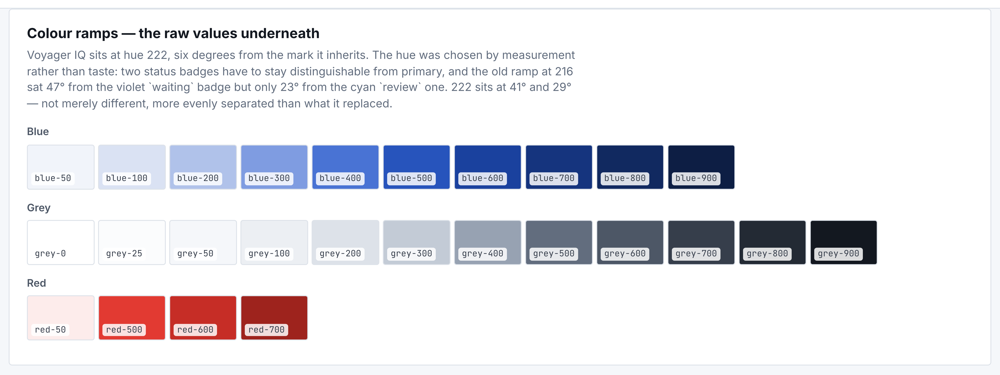

| Token | Value |
|---|---|
| `--vy-blue-50` | `#f1f4fa` |
| `--vy-blue-100` | `#dae2f3` |
| `--vy-blue-200` | `#b0c2ea` |
| `--vy-blue-300` | `#7f9ce1` |
| `--vy-blue-400` | `#4973d4` |
| `--vy-blue-500` | `#2754bc` |
| `--vy-blue-600` | `#1a419e` |
| `--vy-blue-700` | `#15347e` |
| `--vy-blue-800` | `#112960` |
| `--vy-blue-900` | `#0d1e44` |
| `--vy-red-50` | `#fdeceb` |
| `--vy-red-500` | `#e23a32` |
| `--vy-red-600` | `#c62d26` |
| `--vy-red-700` | `#9e231d` |
| `--vy-grey-0` | `#ffffff` |
| `--vy-grey-25` | `#fbfcfd` |
| `--vy-grey-50` | `#f5f7fa` |
| `--vy-grey-100` | `#eceff3` |
| `--vy-grey-200` | `#dde2e9` |
| `--vy-grey-300` | `#c3cbd6` |
| `--vy-grey-400` | `#97a2b2` |
| `--vy-grey-500` | `#626d7e` |
| `--vy-grey-600` | `#4d5766` |
| `--vy-grey-700` | `#363e4b` |
| `--vy-grey-800` | `#232a34` |
| `--vy-grey-900` | `#131820` |

### B1.2 Surfaces — what a thing sits on

`app` is the page · `raised` a dialog or menu · `sunken` an inset below the
page · `chrome` the deliberately dark furniture that stays dark in **both**
themes.

| Token | Value | Resolves to | Dark |
|---|---|---|---|
| `--vy-surface-app` | `var(--vy-grey-50)` | `#f5f7fa` | `#0f131a` |
| `--vy-surface` | `var(--vy-grey-0)` | `#ffffff` | `#161c25` |
| `--vy-surface-raised` | `var(--vy-grey-0)` | `#ffffff` | `#1e2531` |
| `--vy-surface-subtle` | `var(--vy-grey-25)` | `#fbfcfd` | `#131922` |
| `--vy-surface-sunken` | `var(--vy-grey-100)` | `#eceff3` | `#0b0e14` |
| `--vy-surface-strong` | `var(--vy-grey-200)` | `#dde2e9` | `#2a323f` |
| `--vy-surface-hover` | `var(--vy-grey-50)` | `#f5f7fa` | `#1e2531` |
| `--vy-surface-selected` | `var(--vy-blue-50)` | `#f1f4fa` | `#1b2a4a` |
| `--vy-surface-chrome` | `var(--vy-grey-900)` | `#131820` | `#1e2531` |
| `--vy-surface-chrome-soft` | `var(--vy-grey-700)` | `#363e4b` | `#2a323f` |

### B1.3 Text colour — six tiers

`on-surface` is body copy; `strong` sits above it for headings and
identifiers.

> ⚠️ **`on-surface-faint` measures 2.58:1 on white.** Legitimate only on a
> dark ground or where the text is decorative — never for anything a user has
> to read. See [E1](#e1--accessibility).

| Token | Value | Resolves to | Dark |
|---|---|---|---|
| `--vy-on-surface-strong` | `var(--vy-grey-900)` | `#131820` | `#f5f8fc` |
| `--vy-on-surface` | `var(--vy-grey-800)` | `#232a34` | `#e9edf3` |
| `--vy-on-surface-soft` | `var(--vy-grey-700)` | `#363e4b` | `#d3dae4` |
| `--vy-on-surface-muted` | `var(--vy-grey-600)` | `#4d5766` | `#aab4c3` |
| `--vy-on-surface-subtle` | `var(--vy-grey-500)` | `#626d7e` | `#8f9aaa` |
| `--vy-on-surface-faint` | `var(--vy-grey-400)` | `#97a2b2` | `#67727f` |
| `--vy-on-surface-invert` | `var(--vy-grey-0)` | `#ffffff` | `#0f131a` |
| `--vy-on-chrome-muted` | `var(--vy-grey-300)` | `#c3cbd6` | `#c3cbd6` |
| `--vy-on-dark-fg` | `#ffffff` | — | *(same)* |
| `--vy-on-dark-secondary` | `var(--vy-grey-300)` | `#c3cbd6` | *(same)* |
| `--vy-on-dark-muted` | `var(--vy-grey-400)` | `#97a2b2` | *(same)* |
| `--vy-on-dark-hairline` | `rgba(255, 255, 255, .07)` | — | *(same)* |
| `--vy-on-dark-hover` | `rgba(255, 255, 255, .05)` | — | *(same)* |
| `--vy-on-dark-active` | `rgba(43, 99, 184, .22)` | — | *(same)* |

### B1.4 Lines

`border` is **structure** — panel edges, table rules — which WCAG 1.4.11 does
not cover. `border-control` is the boundary of something you can **operate**,
which it does cover.

It is the one value in the system chosen by **measurement** rather than by the
ramp. The sweep of 5 September found why: the grey ramp has **no step that
conforms**. grey-400 `#97a2b2` is 2.58:1 against white and misses by 0.42; the
next step overshoots to 5.24. `--vy-border-control` `#8a94a6` was introduced
between them at **3.06:1** — the lightest value that conforms. It governs
boundaries only: input, textarea, combobox, checkbox, radio.

| Token | Value | Resolves to | Dark |
|---|---|---|---|
| `--vy-border-control` | `#8a94a6` | — | `#6d7889` |
| `--vy-border-faint` | `var(--vy-grey-100)` | `#eceff3` | `#212936` |
| `--vy-border` | `var(--vy-grey-200)` | `#dde2e9` | `#2a323f` |
| `--vy-border-strong` | `var(--vy-grey-300)` | `#c3cbd6` | `#3b4553` |
| `--vy-border-mid` | `var(--vy-grey-400)` | `#97a2b2` | `#55606f` |
| `--vy-border-heavy` | `var(--vy-grey-500)` | `#626d7e` | `#55606f` |
| `--vy-border-emphasis` | `2px` | — | *(same)* |

### B1.5 Brand and danger

Fill and text are **separate roles**, because in a dark theme they pull
opposite ways: a fill must be dark enough for its label, brand text light
enough for the page. The dark theme inverts the pair rather than shifting it.

| Token | Value | Resolves to | Dark |
|---|---|---|---|
| `--vy-brand` | `var(--vy-blue-600)` | `#1a419e` | `#7f9ce1` |
| `--vy-brand-hover` | `var(--vy-blue-700)` | `#15347e` | `#b0c2ea` |
| `--vy-brand-active` | `var(--vy-blue-800)` | `#112960` | `#dae2f3` |
| `--vy-brand-text` | `var(--vy-blue-600)` | `#1a419e` | `#7f9ce1` |
| `--vy-brand-text-hover` | `var(--vy-blue-700)` | `#15347e` | `#b0c2ea` |
| `--vy-brand-text-deep` | `var(--vy-blue-800)` | `#112960` | `#dae2f3` |
| `--vy-brand-on` | `var(--vy-grey-0)` | `#ffffff` | `#0f131a` |
| `--vy-brand-subtle` | `var(--vy-blue-50)` | `#f1f4fa` | `#1b2a4a` |
| `--vy-brand-subtle-strong` | `var(--vy-blue-100)` | `#dae2f3` | `#223357` |
| `--vy-brand-light` | `var(--vy-blue-400)` | `#4973d4` | `#7f9ce1` |
| `--vy-brand-soft` | `var(--vy-blue-500)` | `#2754bc` | `#4973d4` |
| `--vy-brand-boundary` | `var(--vy-blue-400)` | `#4973d4` | `#4973d4` |
| `--vy-brand-boundary-soft` | `var(--vy-blue-200)` | `#b0c2ea` | `#2754bc` |
| `--vy-brand-boundary-light` | `var(--vy-blue-300)` | `#7f9ce1` | `#7f9ce1` |
| `--vy-brand-boundary-strong` | `var(--vy-blue-500)` | `#2754bc` | `#4973d4` |

| Token | Value | Resolves to | Dark |
|---|---|---|---|
| `--vy-danger` | `var(--vy-red-600)` | `#c62d26` | `#c62d26` |
| `--vy-danger-on` | `var(--vy-grey-0)` | `#ffffff` | `#ffffff` |
| `--vy-danger-text` | `var(--vy-red-700)` | `#9e231d` | `#f0918a` |
| `--vy-danger-text-deep` | `var(--vy-red-700)` | `#9e231d` | `#f5aba5` |
| `--vy-danger-subtle` | `var(--vy-red-50)` | `#fdeceb` | `#38201e` |
| `--vy-danger-boundary` | `var(--vy-red-500)` | `#e23a32` | `#e0655c` |

### B1.6 Status vocabulary

Eight statuses, each a foreground/background pair.

> **A status is a word and a colour, never a colour alone.** The pair is what
> makes it legible to someone who cannot separate the hues.

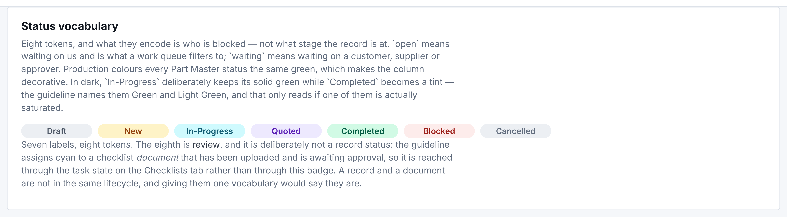

| Token | Value | Resolves to | Dark |
|---|---|---|---|
| `--vy-status-draft-fg` | `var(--vy-grey-600)` | `#4d5766` | `#aab4c3` |
| `--vy-status-draft-bg` | `var(--vy-grey-100)` | `#eceff3` | `#2a323f` |
| `--vy-status-open-fg` | `#92400e` | — | `#eeb796` |
| `--vy-status-open-bg` | `#fef3c7` | — | `#38281e` |
| `--vy-status-progress-fg` | `#155e75` | — | *(same)* |
| `--vy-status-progress-bg` | `#cffafe` | — | *(same)* |
| `--vy-status-done-fg` | `#065f46` | — | `#96eed5` |
| `--vy-status-done-bg` | `#d1fae5` | — | `#1e3831` |
| `--vy-status-waiting-fg` | `#5b21b6` | — | `#b896ee` |
| `--vy-status-waiting-bg` | `#ede9fe` | — | `#281e38` |
| `--vy-status-review-fg` | `#0e7490` | — | `#96dbee` |
| `--vy-status-review-bg` | `#ecfeff` | — | `#1e3338` |
| `--vy-status-blocked-fg` | `var(--vy-red-700)` | `#9e231d` | `#ee9a96` |
| `--vy-status-blocked-bg` | `var(--vy-red-50)` | `#fdeceb` | `#38201e` |
| `--vy-status-cancelled-fg` | `var(--vy-grey-500)` | `#626d7e` | `#aab4c3` |
| `--vy-status-cancelled-bg` | `var(--vy-grey-100)` | `#eceff3` | `#2a323f` |
| `--vy-status-slot-w` | `104px` | — | *(same)* |

### B1.7 Row tones and accents

A tone is a row's **state in the quote**, not a severity. Three of them paint
most of a BoM grid, and the legend under the grid names all three.

| Token | Value | Resolves to | Dark |
|---|---|---|---|
| `--vy-tone-excluded-bg` | `var(--vy-grey-100)` | `#eceff3` | `#2a323f` |
| `--vy-tone-excluded-fg` | `var(--vy-grey-500)` | `#626d7e` | `#aab4c3` |
| `--vy-tone-missing-bg` | `var(--vy-red-50)` | `#fdeceb` | `#38201e` |
| `--vy-tone-missing-fg` | `var(--vy-red-700)` | `#9e231d` | `#ee9a96` |
| `--vy-tone-short-bg` | `var(--vy-status-open-bg)` | `#fef3c7` | *(same)* |
| `--vy-tone-covered-bg` | `var(--vy-status-done-bg)` | `#d1fae5` | *(same)* |
| `--vy-tone-known-mfg-bg` | `var(--vy-status-open-bg)` | `#fef3c7` | *(same)* |
| `--vy-tone-pending-bg` | `var(--vy-surface-sunken)` | `#eceff3` | *(same)* |

| Token | Value | Resolves to | Dark |
|---|---|---|---|
| `--vy-accent-positive` | `#047857` | — | `#75f0cd` |
| `--vy-accent-caution` | `#d97706` | — | `#f0b775` |
| `--vy-accent-warning` | `#b45309` | — | `#f0aa75` |
| `--vy-accent-waiting` | `#6d28d9` | — | `#a679ec` |
| `--vy-accent-neutral` | `#4d5766` | — | `#aab4c3` |
| `--vy-accent-bar-w` | `3px` | — | *(same)* |

### B1.8 How dark mode is wired

Three blocks, and **a token must appear in all three** or the two ways of
choosing dark disagree:

| Block | Who it serves |
|---|---|
| `:root { … }` | Light — the default |
| `:root[data-theme="dark"] { … }` | A user who **picked** dark in the user menu |
| `@media (prefers-color-scheme: dark) { :root:not([data-theme="light"]) { … } }` | A user whose **OS** is dark |

> This has already failed once: four tokens existed only in the media copy, so
> a user who picked dark in the menu got grey-400 borders and a near-white
> priority dot on a near-black ground. **Adding a colour token means editing
> three places.**

---

## B2 · Typography

Two families. **Inter Variable** for everything; **JetBrains Mono** for
identifiers that get read aloud or compared character by character — part
numbers, MPNs, error ids. Body text is never mono: the customer's instruction
of 13 October, *"do not use monotext, hard to read"*.

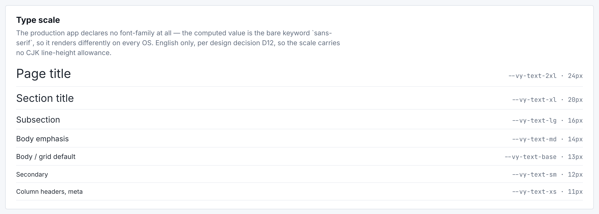

| Token | Value |
|---|---|
| `--vy-font-sans` | `"Inter Variable", "Inter", system-ui, -apple-system, "Segoe UI", Arial, sans-serif` |
| `--vy-font-mono` | `"JetBrains Mono", ui-monospace, "SF Mono", "Cascadia Mono", Consolas, monospace` |
| `--vy-text-2xs` | `12px` |
| `--vy-text-xs` | `13px` |
| `--vy-text-sm` | `14px` |
| `--vy-text-base` | `15px` |
| `--vy-text-md` | `16px` |
| `--vy-text-lg` | `18px` |
| `--vy-text-xl` | `20px` |
| `--vy-text-2xl` | `24px` |
| `--vy-text-3xl` | `28px` |
| `--vy-weight-regular` | `400` |
| `--vy-weight-medium` | `500` |
| `--vy-weight-semibold` | `600` |
| `--vy-weight-bold` | `650` |
| `--vy-weight-heavy` | `700` |

**The scale shifts on a touch device.** Under `@media (pointer: coarse)` the
body range moves up by a constant **+2px** — 12, 13, 14, 15, 16, 18 instead of
10, 11, 12, 13, 14, 16 — which keeps every relationship intact and lifts the
smallest step to a readable 12. Display sizes (`xl` and up) do not move: they
are already comfortable, and growing a heading on a 375px screen buys nothing
and costs a wrap.

### Casing — three levels, drawn differently on purpose

The customer's UI Standard of 14 October: buttons, links, tabs, form and
dialog titles, section and card titles, **field labels**, column headers,
filter labels, menu items and status pills take **Title Case**, with
prepositions (for, to, of, by, as, in, on, at, from, with, via, per, into)
lowercase unless they lead. Prose is sentence case.

| Level | Case | Size / weight | Example |
|---|---|---|---|
| Card header | Title Case | 14px / 600 | `Select Action` · `Continue from Drafts` |
| Divider inside a card | **UPPERCASE**, .05em tracking | 12px / 600 | `QUOTE STRATEGY` · `BOM OPTIONS` |
| Field label | Title Case | 12px / 600 | `Customer` · `Qty to Quote` · `Markup (%)` |

---

## B3 · Spacing

### B3.1 The scale

| Token | Value |
|---|---|
| `--vy-space-1` | `2px` |
| `--vy-space-2` | `4px` |
| `--vy-space-3` | `6px` |
| `--vy-space-4` | `8px` |
| `--vy-space-5` | `10px` |
| `--vy-space-6` | `12px` |
| `--vy-space-7` | `14px` |
| `--vy-space-8` | `16px` |
| `--vy-space-9` | `20px` |
| `--vy-space-10` | `24px` |
| `--vy-space-11` | `28px` |
| `--vy-space-12` | `32px` |
| `--vy-space-14` | `40px` |

### B3.2 Which gap goes between two controls

The scale does not say which step to pick, so the system states it. The tiers
are what carry **grouping**, which is why they are not collapsed into one
value:

| Gap | Between | Examples |
|---|---|---|
| **2px** | Buttons in a cluster that reads as **one** control | dialog titlebar, pager arrows |
| **4px** | Icon buttons attached to the control they act on | a Select with Preview and Download |
| **8px** | **Two adjacent actions** — the default | `.vy-page-actions`, `.vy-run-nav-actions`, `.vy-cost-actions` |
| **12px** | Items that each hold a control **and** a label | filter checkboxes, which are 8px from their own words |
| **16px** | **Groups** on one row | toolbar filters / search / Columns |

Two buttons side by side are 8px apart everywhere. A bigger gap means a real
boundary, not a different author.

---

## B4 · Shape, elevation, depth

Four radii, three shadows. Elevation is for things that **float** — a dialog,
a menu, a toast. A card on a page gets a border, not a shadow.

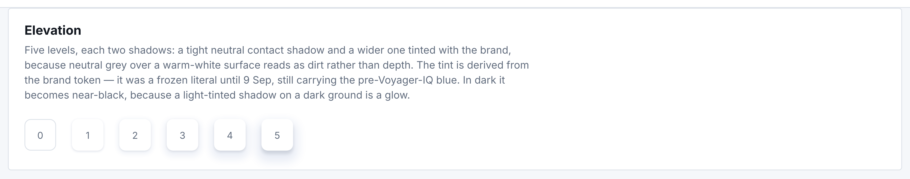

| Token | Value | Dark |
|---|---|---|
| `--vy-radius-sm` | `3px` | *(same)* |
| `--vy-radius-md` | `4px` | *(same)* |
| `--vy-radius-lg` | `6px` | *(same)* |
| `--vy-radius-pill` | `999px` | *(same)* |
| `--vy-shadow-sm` | `0 1px 2px rgba(19, 24, 32, .06)` | *(same)* |
| `--vy-shadow-md` | `0 2px 8px rgba(19, 24, 32, .10)` | *(same)* |
| `--vy-shadow-lg` | `0 8px 28px rgba(19, 24, 32, .14)` | *(same)* |
| `--vy-overlay-scrim` | `rgba(19, 24, 32, .45)` | `rgba(0, 0, 0, .62)` |

### Z-index — one flat list, so two overlays can never argue

| Token | Value |
|---|---|
| `--vy-shell-sidebar-w` | `248px` |
| `--vy-shell-sidebar-w-collapsed` | `56px` |
| `--vy-shell-topbar-h` | `52px` |
| `--vy-z-drawer` | `10020` |
| `--vy-z-dialog` | `10040` |
| `--vy-z-menu` | `10070` |
| `--vy-z-palette` | `10075` |
| `--vy-z-toast` | `12500` |
| `--vy-z-skip` | `12600` |
| `--vy-dialog-md` | `640px` |
| `--vy-dialog-lg` | `960px` |
| `--vy-dialog-xl` | `1180px` |

---

## B5 · Sizing

### B5.1 Control heights

Every control sits on **Kendo's own size scale**, configured rather than
overridden — `_kendo-size.scss` sets the variables and the components inherit
them. Forcing a height on a Kendo control instead is how a 29px select ends up
beside a 34px input.

| Token | Value |
|---|---|
| `--vy-row-h-compact` | `28px` |
| `--vy-row-h-comfortable` | `40px` |
| `--vy-row-h-relaxed` | `48px` |
| `--vy-target-min` | `44px` |
| `--vy-control-sm` | `28px` |
| `--vy-control-row` | `26px` |
| `--vy-control-md` | `34px` |
| `--vy-control-dense` | `32px` |
| `--vy-icon-sm` | `16px` |

| Token | Where it is used |
|---|---|
| `--vy-control-md` **34px** | Form inputs, selects, buttons — the default |
| `--vy-control-dense` **32px** | Toolbar controls: search, `size="sm"` buttons |
| `--vy-control-sm` **28px** | Compact density |
| `--vy-control-row` **26px** | An icon button **inside a grid row** — Kendo's `xs` step |
| `--vy-target-min` **44px** | A floor, under `pointer: coarse` **only** |

> **44px is a touch rule, not a desktop one.** WCAG 2.5.5 is about a pointer
> target; applying it to a 27-field form on a mouse-driven screen adds ~270px
> of scrolling for nothing.

### B5.2 Row density — a user preference

| Token | Height | Setting |
|---|---|---|
| `--vy-row-h-compact` | 28px | Compact |
| `--vy-row-h-comfortable` | 40px | Comfortable *(default)* |
| `--vy-row-h-relaxed` | 48px | Relaxed |

### B5.3 Column roles — a width is chosen once, by role

A grid column declares a **role**, not a pixel width.

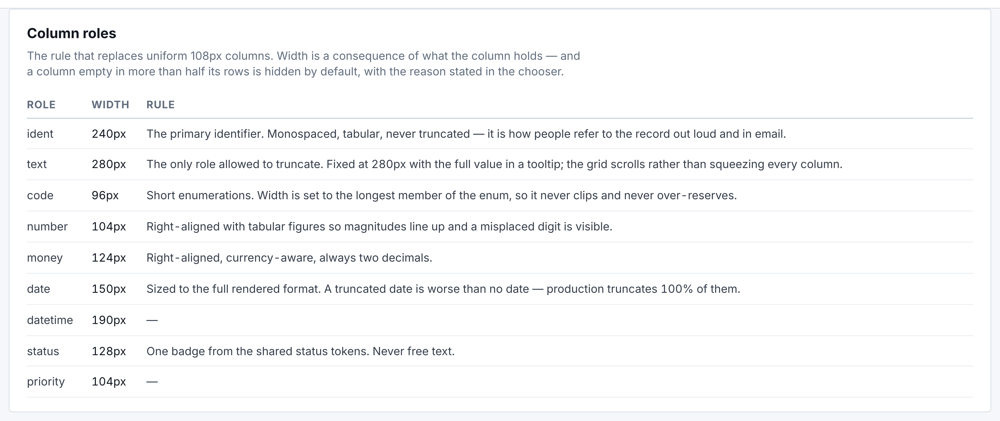

| Role | Width | What it holds |
|---|---|---|
| `ident` | 240px | Part numbers, MPNs — must not truncate |
| `text` | 280px | Descriptions and other prose |
| `code` | 96px | Short codes, revisions |
| `number` | 104px | Quantities |
| `money` | 124px | Prices and amounts |
| `date` | 150px | A day |
| `datetime` | 190px | A moment — `09/09/2026 16:35:29` |
| `status` | 128px | A status pill |
| `priority` | 104px | A dot and a word |

### B5.4 Dialogs and shell

| Size | Width | Opens maximised? | For |
|---|---|---|---|
| `md` | 640px | No | A question: a confirmation, a short form |
| `lg` | 960px | Yes *(overridable)* | Two blocks and a short table |
| `xl` | 1180px | Yes | A work surface: a 21-column grid, a 4-step wizard |

| Shell token | Value |
|---|---|
| `--vy-shell-sidebar-w` | 248px |
| `--vy-shell-sidebar-w-collapsed` | 56px |
| `--vy-shell-topbar-h` | 52px |

---

## B6 · Motion

Four easings and three durations, and nothing else. There is deliberately **no
loop-length token**: a custom property nothing reads is a token that rots.

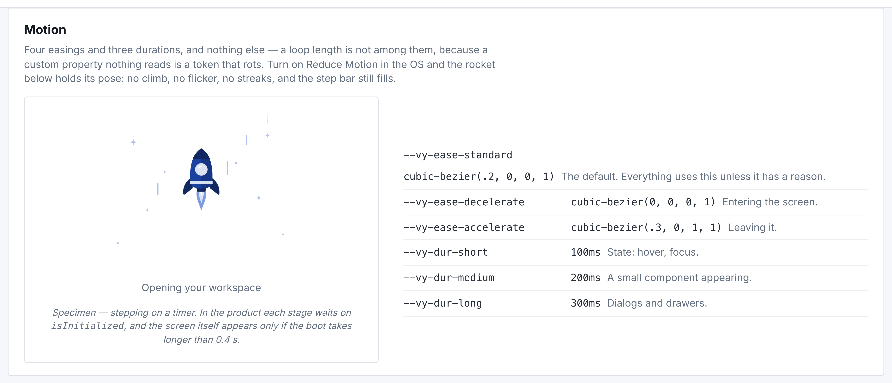

| Token | Value | Use |
|---|---|---|
| `--vy-ease-standard` | `cubic-bezier(.2, 0, 0, 1)` | The default. Everything, unless it has a reason |
| `--vy-ease-emphasised` | `cubic-bezier(.2, 0, 0, 1)` | A moment that should be noticed. **Currently identical to `standard`** — named separately so the two can diverge without touching call sites |
| `--vy-ease-decelerate` | `cubic-bezier(0, 0, 0, 1)` | Something arriving |
| `--vy-ease-accelerate` | `cubic-bezier(.3, 0, 1, 1)` | Something leaving |
| `--vy-dur-short` | **100ms** | State changes: hover, focus |
| `--vy-dur-medium` | **200ms** | Small components entering |
| `--vy-dur-long` | **300ms** | Dialogs, drawers |

### The loading clock

| Rule | Value |
|---|---|
| Show the boot screen only if the boot takes longer than | **400ms** |
| Exit — the craft leaves the top of the frame | **400ms** |
| "Still climbing…" appears after | **5s** |
| Minimum display time once shown | **none** |

Holding a loading screen so it does not flash spends the user's time to make
our indicator look better. Not showing one at all for a boot that beats the
clock costs them nothing. The two rules are the two halves of one answer.

### Reduced motion is a state, not a switch

Under `prefers-reduced-motion: reduce` the rocket **holds its pose** — no
climb, no flicker, no streaks — and the step bar still fills. A welding arm
with its animation removed is an arm with no sparks and an empty checklist,
which says something different from what the state means, so the things that
*fade in* are left on.

---

## B7 · Responsive

Breakpoints are raw pixels because `@media` cannot read custom properties — a
documented exception to the no-magic-numbers rule.

| Width | What changes |
|---|---|
| ≤ **1180px** | The 248px sidebar becomes a 56px icon rail |
| ≤ **980px** | Two-column regions stack |
| ≤ **820px** | The sidebar leaves the flow; a menu button reveals it |
| `pointer: coarse` | Type scale +2px on the body range; 44px target floor |

The system runs on shop-floor terminals that are often 1366×768 or narrower.
Below about 1100px a 248px sidebar stops being orientation and starts being
the thing in the way — measured at 543px it was taking **46% of the
viewport**.

---
---

# Part C — Assets

## C1 · Icons

One set. **20×20 viewBox, stroke only, no fill, one stroke weight.** A heavier
line at a smaller size is how an icon set stops looking like one set.

An unknown name renders **nothing**, with the name left in the DOM, rather
than falling back to a document glyph that hides the bug.

| | |
|---|---|
| Default size | 16px · `--vy-icon-sm` |
| In a grid row | 15px inside a 26px button |
| Colour | `currentColor` — the icon takes the text colour around it |
| Decorative | `aria-hidden`, and the state it marks gets words of its own |

**The 45 names:**
`task · chat · log · quote · order · return · customer · requisition ·
supplier · factory · simulate · bom · transfer · adjust · pcb · tool ·
machine · invoice · journal · lock · people · template · job · plug · menu ·
globe · metadata · queue · doc · home · sell · buy · parts · stock · make ·
finance · insight · settings · chevron-down · chevron-right · eye · download ·
clip · trash · check`

Two directional glyphs, each with one job: **down** opens a menu below itself,
**right** says "this opens somewhere else".

---

## C2 · Illustrations

**One drawing, three states.** The product has exactly one illustrated
character — a rocket — and it appears in three situations. That is deliberate:
a reader who has met this craft on the way in should not have to learn a
second picture to understand that it crashed.

Component: `src/ui/RocketLaunch.tsx` · one inline SVG, `viewBox="0 0 240 180"`
· `data-state` selects the scene.

| | |
|---|---|
| Rendered width | `clamp(240px, 18vw, 280px)` |
| Colour | Ten role tokens, [B1.7](#b17-row-tones-and-accents) — never hex |
| Motion | CSS only. The illustration owns pixels and no state, so it can stop in a background tab and nothing is lost |
| Ids | Generated with `useId` — two instances on one page would otherwise share a clip path |
| Inline, not `` | An `` is a second request on the one screen whose job is to cover the first one, and it is its own document, where `var(--vy-brand)` resolves against nothing |

### C2.1 `launching` — the boot screen

The craft holds still in the middle of the frame and **the world moves**: the
planet sinks a notch per boot stage, streaks run down past it. Nothing about a
rocket drawn nose-up says "climbing" on its own.

| | |
|---|---|
| Where | `BootGate` after sign-in; the `Suspense` fallback of a lazy route |
| Animation | Lift-off 0.7s · bob 1.6s · flame flicker 0.18s · streaks 0.8–1.3s |
| Reduced motion | No climb, no flicker, no streaks. The step bar still fills |

Shown with its label and five-segment bar, which is what the boot screen
actually is:

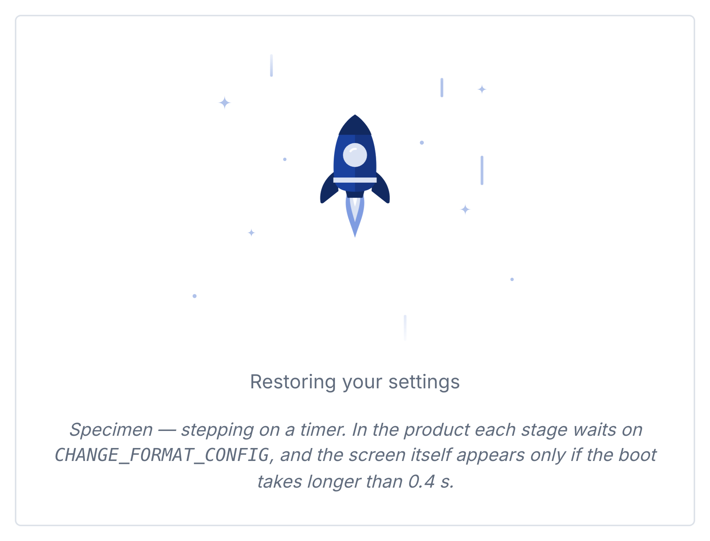

### C2.2 `error` — the screen stopped loading

The same craft, back on the pad: tilted, cracked, one fin lying beside it,
smoking. The failure is legible before the sentence under it is read.

| | |
|---|---|
| Where | `ErrorState`, which `ErrorBoundary` renders for any route that throws |
| Animation | Three smoke puffs, 2.4s, staggered |
| Reduced motion | Puffs held at 0.6 opacity — the smoke stays, the movement goes |

### C2.3 `building` — still on the launch pad

The craft **whole** on the pad, a robot arm welding it, a design doc on an
easel whose checklist ticks off. Work in progress, not wreckage — and the
difference has to be visible before the heading is read.

| | |
|---|---|
| Where | `Placeholder`, which answers every route not yet built (~70 of 91) |
| Animation | Arm 4s · sparks only while the arm is holding · checklist 6s |
| Reduced motion | Sparks and the first two ticks held **on**, so the drawing still says "being built" |

### C2.4 Skeletons — the other kind of waiting

A skeleton answers *"what will this look like?"*. Once the user has already
seen rows that question is answered, so a re-price or a second page **dims
what is there** and puts an indicator over it instead (`BusyOverlay`).

One shimmer for both: `--vy-surface-sunken` → `--vy-surface-app` →
`--vy-surface-sunken`, 200% background, 1.4s.

**Grid skeleton** — the real column roles, so the bars land where the data
will:

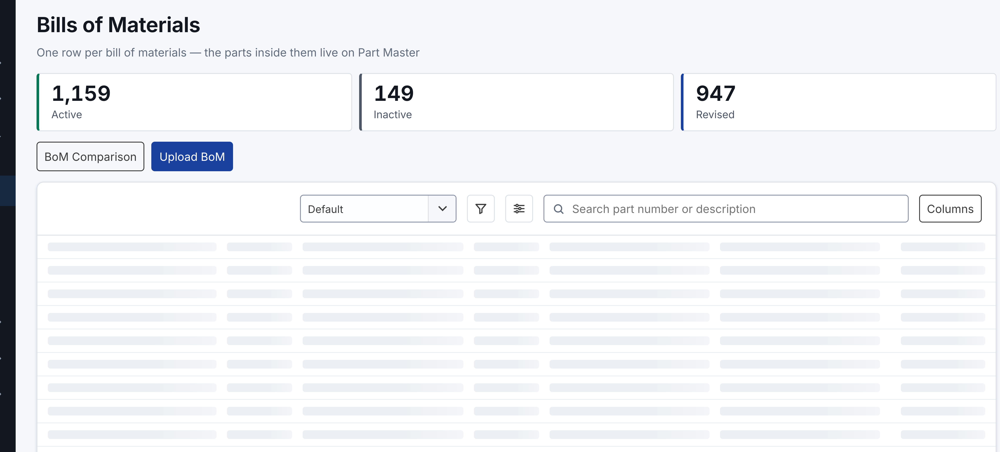

**Record skeleton** — the real field labels, because they are known before the
data is. Measured down to 1px of shift when the record arrives:

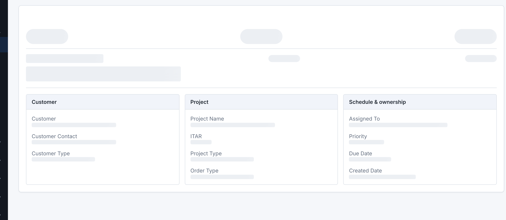

### C2.5 Empty states

No illustration, on purpose. An empty state is a sentence and an action, and a
picture there delays both.

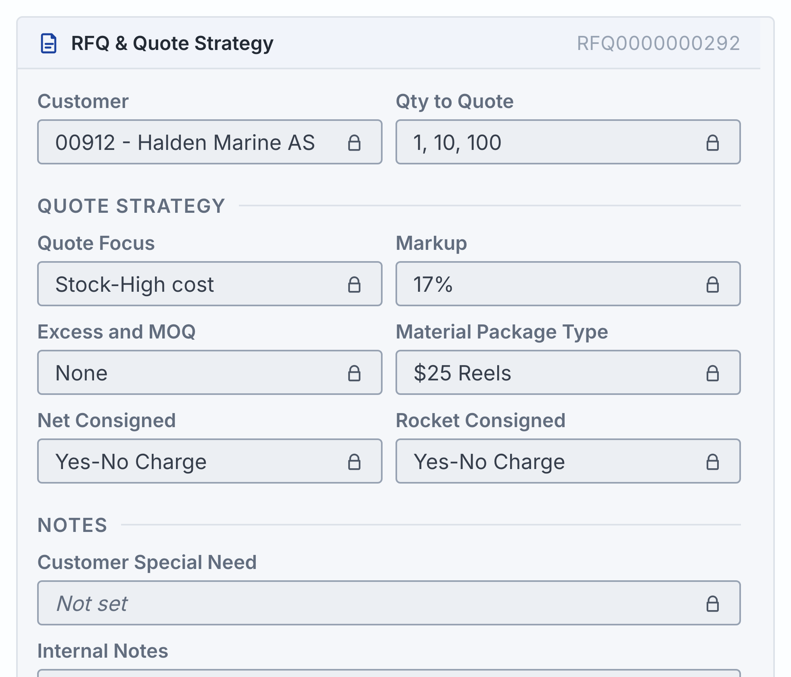

### C2.6 Exporting and regenerating

| | |
|---|---|
| Live source | `src/ui/RocketLaunch.tsx` |
| Static SVGs | `docs/assets/rocket-journey/*.svg` — the **retired** horizontal set, kept because the 16 Oct comparison document uses them. Not in the product |
| These images | Captured from the running app at 2×; the scripts are in `scripts/` |

> **If an illustration needs to leave the codebase** — for a slide, a PDF —
> export the inline SVG and replace the `var(--vy-rocket-*)` references with
> the resolved hex from [B1.7](#b17-row-tones-and-accents). Outside the app
> there is no token layer to resolve them.

---
---

# Part D — Components and patterns

`src/ui` holds 33 files: the primitives, plus the icon set, the preference
store and three hooks. Each wrapper has a reason, and the rule that produced
them is the same every time — **the live system already ships KendoReact, so
the question is never "what should this look like" but "what does Kendo
already do, and what must we add".**

## D1 · Buttons

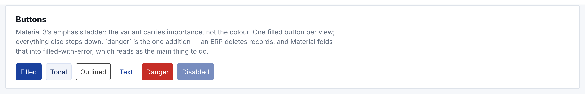

| Variant | When |
|---|---|
| `filled` | **One per view.** The most likely next step |
| `outlined` | The default for everything else |
| `tonal` | A secondary action that still needs weight |
| `text` | Tertiary, inside dense rows |
| `danger` | Destructive — and it goes behind **More ▾** |

**Placement:** all buttons on the **left** of a toolbar; a smart-button group
or step indicator on the right; at most four visible, the rest behind
`More ▾` — and the label is always the word *More* with a chevron, never `⋯`.

**Cancel only in dialogs.** In edit mode the word is **Discard Changes**.

**`busy` is not decoration.** The indicator says something is happening; the
**disable** is what stops a second click spending a second marketplace
request.

## D2 · Fields

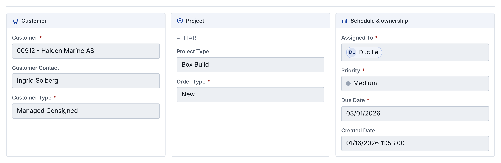

**Two backgrounds, not three** — the 14 October instruction: *white means you
can type in it.* A read-only value is a box with a sunken fill, a 1px border
and a padlock, so read and edit modes are the same shape and the layout does
not move between them.

| Part | Rule |
|---|---|
| Label | **Above** the value, never beside it (13 Oct). Title Case, 12px, 600 |
| Required | A **red asterisk** right after the label, in view **and** edit mode |
| Optional | No mark. Never the word "(optional)" |
| Helper | Below the field, italic, ≤ the label's size (22 Oct) |
| Error | Red text below the field, **on blur** — not on every keystroke |
| Hint | A **sibling** of the label, never inside it, or it joins the accessible name |

## D3 · Grids

| Rule | |
|---|---|
| Column chooser | On every grid with **3+ columns** |
| Frozen block | Declared as `locked`, so the chooser and the freeze cannot disagree |
| Zebra | By **record**, not by row — a record spanning two AML rows is one band |
| Totals | A grid the user sums by eye gets a totals row |
| Empty | A real empty state that says what to do, never "No records available" |
| Width | By role ([B5.3](#b53-column-roles--a-width-is-chosen-once-by-role)); a deviation carries a `widthNote` |

## D4 · Dialogs

Sizes are in [B5.4](#b54-dialogs-and-shell). Three further rules:

1. **Actions top-left** on a work surface, in a footer on a question. The way
   out goes on the left wherever the bar sits.
2. **`lg` and `xl` open maximised** — asked for at the 13 October review. `md`
   never does: a confirmation filling a 27-inch screen is a worse answer than
   the one it replaced.
3. **Escape dismisses the innermost thing**, which the Select had to be taught
   by hand — Kendo's own handling closed the dialog from an open dropdown.

## D5 · The four screen states

Loading, empty, error and not-yet-built are four different things and look
it. Getting these wrong is the most common way a screen lies to its reader.

| State | What the user sees | Actions | Illustration |
|---|---|---|---|
| **Loading** | Rocket climbing, planet sinking, five-segment bar | none | [C2.1](#c21-launching--the-boot-screen) |
| **Empty** | A sentence saying what would fill it | the action that fills it | none |
| **Error** | Rocket on the pad: tilted, cracked, one fin off, smoking | Reload · Back to Home · Send a support ticket · Error ID + Copy | [C2.2](#c22-error--the-screen-stopped-loading) |
| **Under development** | Rocket whole on the pad, arm welding, plan ticking off | Back to Home. **No Reload — nothing is broken** | [C2.3](#c23-building--still-on-the-launch-pad) |

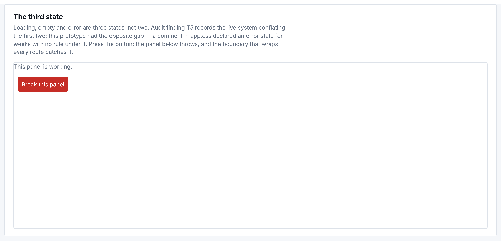

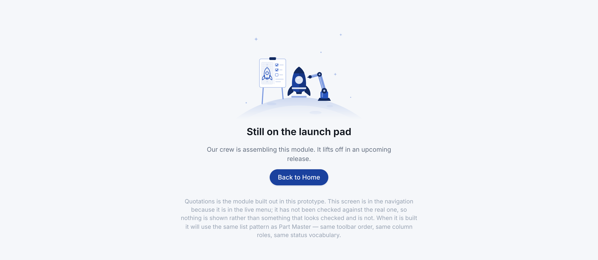

**The error state's three slots** are the three questions a person actually
has: *what failed · what it means for me · what I can do next.* Only the
first is generic.

**The error id is minted where the error is caught**, not where it is drawn —
minted in render, pressing Copy would hand the user a different number for
the same failure.

## D6 · Words

| | |
|---|---|
| Casing | [B2](#b2--typography) — Title Case for labels, sentence case for prose |
| A control says what happens | `Publish`, then a toast saying `Published` |
| An error says what to do | Not "Something went wrong" |
| Nothing is "not implemented" silently | A toast says what it *would* do |
| A derived figure says it is derived | *"Derived from this run — the live system takes them from the customer's purchase history"* |
| A session-only change says so | *"Added in this session… nothing here is saved"* |

---
---

# Part E — Quality

## E1 · Accessibility

Measured, not asserted. The full sweep is in
[`contrast-sweep.md`](contrast-sweep.md); the keyboard work is in
[`focus-order.md`](focus-order.md).

| Requirement | Threshold | Status |
|---|---|---|
| Text contrast — WCAG 1.4.3 | 4.5:1 normal · 3:1 large (≥24px, or ≥18.66px at ≥700) | **78 combinations measured, 0 failures** |
| Non-text contrast — WCAG 1.4.11 | 3:1 for control boundaries | Three controls failed at 1.30 / 1.64 / 2.55 · fixed by `--vy-border-control` at **3.06:1** |
| Target size — WCAG 2.5.5 | 44×44 | Enforced under `pointer: coarse` |
| Reduced motion | respected | [B6](#b6--motion) |

**Why the contrast harness can be trusted:** colours are read through a
**canvas pixel** rather than parsed from strings, because Kendo emits
`oklch()`, which no regex over `getComputedStyle` survives. Backgrounds are
composited up the ancestor chain. Before the results were believed, a
`#bbbbbb`-on-white element was planted in the page and caught at **1.92:1** —
a sweep that reports no failures is only worth reading if it can prove it
would have found one.

Four rules that are easy to get wrong and are already settled:

- A **status is a word and a colour**, never a colour alone.
- A **hint is a sibling of the label**, never inside it.
- **`role="alert"` for an error, `role="status"` for a loading state.** One
  interrupts, the other does not.
- A **decorative glyph is `aria-hidden`** and the state it marks gets words of
  its own — a padlock plus a screen-reader-only "read-only".

## E2 · KendoReact

The live system already ships KendoReact 16. The bridge is three files:

| File | Job |
|---|---|
| `kendo-subset.scss` | Compiles only the Kendo components actually used |
| `_kendo-size.scss` | **Configures** Kendo's size scale — does not override it |
| `kendo-bridge.css` | Maps Kendo's variables onto ours, and fixes what cannot be configured |

**Specificity is the trap.** `.k-button.k-button-solid.k-button-base.k-focus`
weighs (0,4,0), so a one-class rule of ours loses silently. The bridge
prefixes with `html[data-kendo-bridged]` rather than repeating a class five
times.

Two Kendo behaviours worth knowing before debugging a component:

- **Kendo disables with a `.k-disabled` CLASS, not the `:disabled`
  attribute.** A plain `<input disabled class="k-radio">` renders identically
  to an enabled one.
- **KendoReact 16 locks grid columns with sticky cells in one table**
  (`position: sticky`), not with two panes.

---
---

# Part F — Handover

## F1 · File map

| Path | Contents |
|---|---|
| `src/theme/tokens.css` | **Every token.** Light, plus the two dark blocks |
| `src/theme/tokens.ts` | The values TypeScript needs: column widths, dialog widths |
| `src/theme/md3.css` | Motion, focus ring, the Material 3 structure we kept |
| `src/theme/base.css` | Reset and element defaults |
| `src/theme/components.css` | Component rules |
| `src/theme/app.css` | Screen and layout rules |
| `src/theme/responsive.css` | Every breakpoint, in one file |
| `src/theme/kendo-*.{css,scss}` | The Kendo bridge |
| `src/ui/` | The primitives |
| `src/ui/RocketLaunch.tsx` | The illustration, all three states |
| `/design-system` | The living specimen page |
| `docs/assets/design-system/` | The images in this document |

## F2 · How to change something

**A colour token**
1. Add or change it in **all three** blocks of `tokens.css` ([B1.8](#b18-how-dark-mode-is-wired)).
2. If it lands on text or a control boundary, re-run the contrast sweep.
3. `npm run check:fast` — lint, stylesheet check, typecheck, build.

**A component**
1. Check whether Kendo already does it ([E2](#e2--kendoreact)).
2. Build it in `src/ui`, referencing semantic tokens only.
3. Add a specimen to `/design-system` if it has states worth seeing.
4. Cover every state: default, hover, focus, active, disabled, busy, error.

**A new screen**
1. Which of the four states ([D5](#d5--the-four-screen-states)) can it be in? Build all of them.
2. Column roles, not pixel widths.
3. Check it at 1180, 980 and 820, in both themes.

**What CI runs on every push:** `render:check` · `touch:check` ·
`mobile:check` · `focus:check` · `hover:check`.

## F3 · Governance

| | |
|---|---|
| Owner | The UX revamp working copy, `ll-poc` |
| Where decisions are recorded | A commit message, and a dated note in `docs/` for anything a reader would otherwise have to re-derive |
| Precedence when two sources disagree | [`precedence.md`](precedence.md) — customer requirement, then the live system, then judgement, and judgement must be labelled |
| Versioning | `v1.0` is this handover. A token or rule change is a minor version; a change that requires screens to be rebuilt is a major one |

**Three rules that keep this document true:**

1. **A magic number needs a note** saying what was measured.
2. **A comment states what was measured, not what was intended.** Three
   corrections in this project came from a comment describing behaviour the
   code did not have.
3. **The living page beats the document.** `/design-system` renders the real
   components; if the two disagree, the page is right and this file is stale.

## F4 · Known gaps

An honest list, because a handover claiming completeness is one nobody
checks.

| | Status |
|---|---|
| **Label text casing** (`Reload this screen` → `Reload This Screen`) | Half done. Uppercase is gone from labels; rewriting the **words** collides with the customer's own prototypes, which use sentence case. Awaiting her answer |
| **Sale Type list** on Other Quoted Cost | Eight values: two hers, six ours. Awaiting the metadata list |
| **Support ticket destination** | The dialog is complete; the send is faked. One POST away |
| **Row merging on step 3** | Her prototype merges cells; ours bands by record. Trade-off documented, awaiting a decision |
| **Select Action order** | Her prototype and her UI Standard disagree |
| **`Customer Special Need`** vs `Customer specific needs` | Her prototype and the live system disagree |
| **`--vy-ease-emphasised`** | Identical to `standard`. Either give it its own curve or retire it |

## F5 · What a handover should contain

The shape of this document was checked against current practice rather than
invented. The recurring list across published checklists is: **design tokens**
with their values · **component specs** with every state and variant ·
**usage rules** with do and don't · **accessibility** with the WCAG thresholds
named · **code examples** · **responsive** behaviour with the breakpoints
stated · **motion** with duration, easing and a reduced-motion alternative ·
and **governance** — ownership, a contribution process, versioning.

Several sources also name the one failure mode this file is most exposed to:
documentation drifting away from the live code once the team moves on. That
is why [F3](#f3--governance) makes the specimen page the tie-breaker rather
than this document.

Consulted 3 November 2026:
[Magic Patterns](https://www.magicpatterns.com/blog/design-system-documentation) ·
[Figr checklist](https://figr.design/design-system-checklist) ·
[Supernova](https://www.supernova.io/blog/popular-content-blocks-document-design-system-guidelines) ·
[Docsie](https://www.docsie.io/blog/glossary/design-system/) ·
[Eleken](https://www.eleken.co/blog-posts/design-handoff-checklist) ·
[UX Planet](https://uxplanet.org/design-handoff-checklist-a9d40e9a7704).
These are vendor blogs and community checklists, not a standard; they agree
on the core set and differ on depth.

## F6 · Source index

| Document | What it settles |
|---|---|
| [`precedence.md`](precedence.md) | Which source wins when two disagree |
| [`contrast-sweep.md`](contrast-sweep.md) | Every measured contrast ratio, and the method |
| [`focus-order.md`](focus-order.md) | Keyboard order and the focus ring |
| [`modal-patterns.md`](modal-patterns.md) | Dialog sizes, action placement, dismissal |
| [`table-patterns.md`](table-patterns.md) | Grid behaviour, column roles, density |
| [`motion-loading.md`](motion-loading.md) | Every loading and transition decision |
| [`kendo-control-scale-18oct.md`](kendo-control-scale-18oct.md) | The 33-rule Kendo size audit |
| [`ui-standard-review-16oct.md`](ui-standard-review-16oct.md) | Our review of the customer's UI Standard |
| [`working-agreement.md`](working-agreement.md) | Engineering rules, including the magic-number exceptions |
| [`con-thieu-01nov.md`](con-thieu-01nov.md) | What is still outstanding against the customer's own material |

---

*Captured from the running build at 2× on 3 November 2026. Images live in
`docs/assets/design-system/` and can be regenerated from `/design-system` and
the product screens they came from.*
