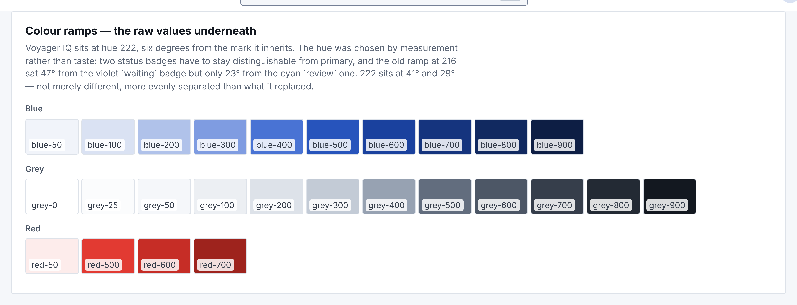

# Color palette

Three ramps and nothing else. A fourth colour in a screen is a bug unless it
is a status, and the statuses are in [Status vocabulary](status-vocabulary.md).

| Token | Value |
|---|---|
| `--vy-blue-50` | `#f1f4fa` |
| `--vy-blue-100` | `#dae2f3` |
| `--vy-blue-200` | `#b0c2ea` |
| `--vy-blue-300` | `#7f9ce1` |
| `--vy-blue-400` | `#4973d4` |
| `--vy-blue-500` | `#2754bc` |
| `--vy-blue-600` | `#1a419e` |
| `--vy-blue-700` | `#15347e` |
| `--vy-blue-800` | `#112960` |
| `--vy-blue-900` | `#0d1e44` |
| `--vy-red-50` | `#fdeceb` |
| `--vy-red-500` | `#e23a32` |
| `--vy-red-600` | `#c62d26` |
| `--vy-red-700` | `#9e231d` |
| `--vy-grey-0` | `#ffffff` |
| `--vy-grey-25` | `#fbfcfd` |
| `--vy-grey-50` | `#f5f7fa` |
| `--vy-grey-100` | `#eceff3` |
| `--vy-grey-200` | `#dde2e9` |
| `--vy-grey-300` | `#c3cbd6` |
| `--vy-grey-400` | `#97a2b2` |
| `--vy-grey-500` | `#626d7e` |
| `--vy-grey-600` | `#4d5766` |
| `--vy-grey-700` | `#363e4b` |
| `--vy-grey-800` | `#232a34` |
| `--vy-grey-900` | `#131820` |

