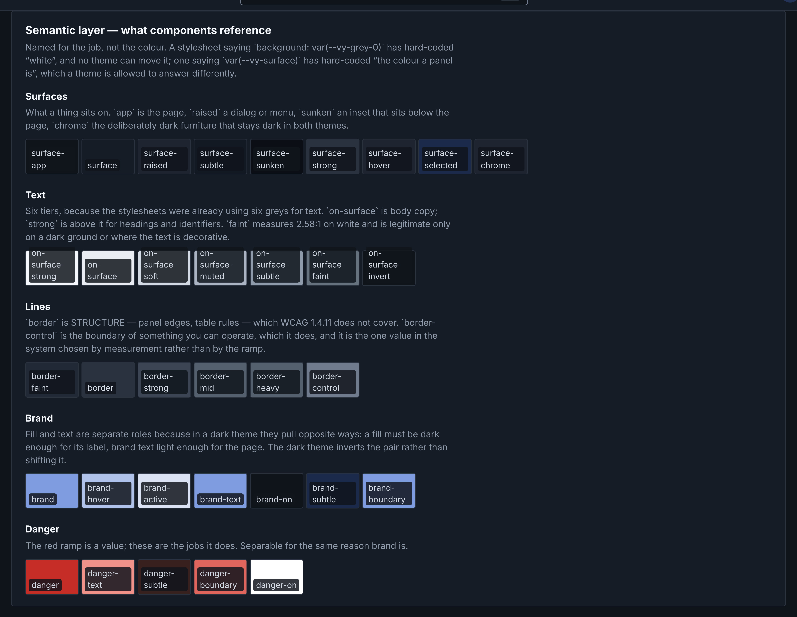
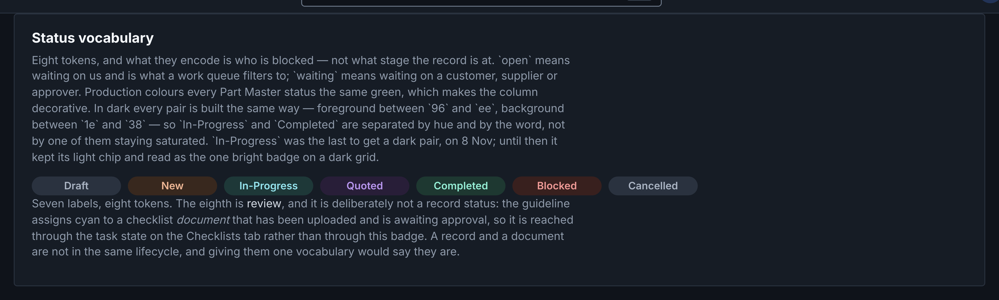

# Color

## Surfaces — what a thing sits on

`app` is the page · `raised` a dialog or menu · `sunken` an inset below the
page · `chrome` the deliberately dark furniture that stays dark in **both**
themes.

| Token | Value | Resolves to | Dark |
|---|---|---|---|
| `--vy-surface-app` | `var(--vy-grey-50)` | `#f5f7fa` | `#0f131a` |
| `--vy-surface` | `var(--vy-grey-0)` | `#ffffff` | `#161c25` |
| `--vy-surface-raised` | `var(--vy-grey-0)` | `#ffffff` | `#1e2531` |
| `--vy-surface-subtle` | `var(--vy-grey-25)` | `#fbfcfd` | `#131922` |
| `--vy-surface-sunken` | `var(--vy-grey-100)` | `#eceff3` | `#0b0e14` |
| `--vy-surface-strong` | `var(--vy-grey-200)` | `#dde2e9` | `#2a323f` |
| `--vy-surface-hover` | `var(--vy-grey-50)` | `#f5f7fa` | `#1e2531` |
| `--vy-surface-selected` | `var(--vy-blue-50)` | `#f1f4fa` | `#1b2a4a` |
| `--vy-surface-chrome` | `var(--vy-grey-900)` | `#131820` | `#1e2531` |
| `--vy-surface-chrome-soft` | `var(--vy-grey-700)` | `#363e4b` | `#2a323f` |

## Text colour — six tiers

`on-surface` is body copy; `strong` sits above it for headings and
identifiers.

**A tier is set by its worst ground, not by the panel.** `subtle` is the
second value in the system chosen by measurement rather than taken from the
ramp — after [`--vy-border-control`](../border.md), and for the same reason: no
step conforms. grey-500 `#626d7e` clears 4.5 on white, the page and the sunken
panel but reaches only **4.02** on `surface-strong`; grey-600 overshoots to
5.62, where it stops being distinguishable from `muted` and the tier stops
being a tier. `#5b6575` sits on grey-500's own hue one notch darker and clears
every ground, the tightest being `surface-strong` at 4.53.

> ⚠️ **`on-surface-faint` measures 2.58:1 on white.** Legitimate only on a
> dark ground or where the text is decorative — never for anything a user has
> to read. It is the one declared exemption in
> [`contrast:check`](../accessibility.md); everything else in the table is
> checked on every push.

| Token | Value | Resolves to | Dark |
|---|---|---|---|
| `--vy-on-surface-strong` | `var(--vy-grey-900)` | `#131820` | `#f5f8fc` |
| `--vy-on-surface` | `var(--vy-grey-800)` | `#232a34` | `#e9edf3` |
| `--vy-on-surface-soft` | `var(--vy-grey-700)` | `#363e4b` | `#d3dae4` |
| `--vy-on-surface-muted` | `var(--vy-grey-600)` | `#4d5766` | `#aab4c3` |
| `--vy-on-surface-subtle` | `#5b6575` | — | `#8f9aaa` |
| `--vy-on-surface-faint` | `var(--vy-grey-400)` | `#97a2b2` | `#67727f` |
| `--vy-on-surface-invert` | `var(--vy-grey-0)` | `#ffffff` | `#0f131a` |
| `--vy-on-chrome-muted` | `var(--vy-grey-300)` | `#c3cbd6` | `#c3cbd6` |
| `--vy-on-dark-fg` | `#ffffff` | — | *(same)* |
| `--vy-on-dark-secondary` | `var(--vy-grey-300)` | `#c3cbd6` | *(same)* |
| `--vy-on-dark-muted` | `var(--vy-grey-400)` | `#97a2b2` | *(same)* |
| `--vy-on-dark-hairline` | `rgba(255, 255, 255, .07)` | — | *(same)* |
| `--vy-on-dark-hover` | `rgba(255, 255, 255, .05)` | — | *(same)* |
| `--vy-on-dark-active` | `rgba(43, 99, 184, .22)` | — | *(same)* |

## Brand and danger

Fill and text are **separate roles**, because in a dark theme they pull
opposite ways: a fill must be dark enough for its label, brand text light
enough for the page. The dark theme inverts the pair rather than shifting it.

**So do the boundaries, and one of them was left behind.** `boundary-strong`
means one step *more* emphatic than `boundary` — darker in light, lighter in
dark. It is the focus **edge** of every text input, the rich-text surface and
every editable cell. When the focus **ring** moved off blue-400 on 8 Nov for
measuring 2.88 on `surface-strong`, the edge kept it: in dark, "strong" was
darker than plain `boundary`, and therefore weaker than it. Both tokens had
been measured in the same pass and only one moved. blue-200 restores the
relationship — tightest **7.22** — and 9 Nov.

`boundary-soft` and `boundary-light` stay below 3:1 on purpose: they draw
banner edges, the verdict panel and a horizontal rule, which 1.4.11 does not
cover. Two controls were pointing at them anyway, and the state pass found
both.

| Token | Value | Resolves to | Dark |
|---|---|---|---|
| `--vy-brand` | `var(--vy-blue-600)` | `#1a419e` | `#7f9ce1` |
| `--vy-brand-hover` | `var(--vy-blue-700)` | `#15347e` | `#b0c2ea` |
| `--vy-brand-active` | `var(--vy-blue-800)` | `#112960` | `#dae2f3` |
| `--vy-brand-text` | `var(--vy-blue-600)` | `#1a419e` | `#7f9ce1` |
| `--vy-brand-text-hover` | `var(--vy-blue-700)` | `#15347e` | `#b0c2ea` |
| `--vy-brand-text-deep` | `var(--vy-blue-800)` | `#112960` | `#dae2f3` |
| `--vy-brand-on` | `var(--vy-grey-0)` | `#ffffff` | `#0f131a` |
| `--vy-brand-subtle` | `var(--vy-blue-50)` | `#f1f4fa` | `#1b2a4a` |
| `--vy-brand-subtle-strong` | `var(--vy-blue-100)` | `#dae2f3` | `#223357` |
| `--vy-brand-light` | `var(--vy-blue-400)` | `#4973d4` | `#7f9ce1` |
| `--vy-brand-soft` | `var(--vy-blue-500)` | `#2754bc` | `#4973d4` |
| `--vy-brand-boundary` | `var(--vy-blue-400)` | `#4973d4` | `#7f9ce1` |
| `--vy-brand-boundary-soft` | `var(--vy-blue-200)` | `#b0c2ea` | `#2754bc` |
| `--vy-brand-boundary-light` | `var(--vy-blue-300)` | `#7f9ce1` | `#7f9ce1` |
| `--vy-brand-boundary-strong` | `var(--vy-blue-500)` | `#2754bc` | `#b0c2ea` |

| Token | Value | Resolves to | Dark |
|---|---|---|---|
| `--vy-danger` | `var(--vy-red-600)` | `#c62d26` | `#c62d26` |
| `--vy-danger-on` | `var(--vy-grey-0)` | `#ffffff` | `#ffffff` |
| `--vy-danger-text` | `var(--vy-red-700)` | `#9e231d` | `#f0918a` |
| `--vy-danger-text-deep` | `var(--vy-red-700)` | `#9e231d` | `#f5aba5` |
| `--vy-danger-subtle` | `var(--vy-red-50)` | `#fdeceb` | `#38201e` |
| `--vy-danger-boundary` | `var(--vy-red-500)` | `#e23a32` | `#e0655c` |

## How dark mode is wired

Three blocks, and **a token must appear in all three** or the two ways of
choosing dark disagree:

| Block | Who it serves |
|---|---|
| `:root { … }` | Light — the default |
| `:root[data-theme="dark"] { … }` | A user who **picked** dark in the user menu |
| `@media (prefers-color-scheme: dark) { :root:not([data-theme="light"]) { … } }` | A user whose **OS** is dark |

> This has already failed once: four tokens existed only in the media copy, so
> a user who picked dark in the menu got grey-400 borders and a near-white
> priority dot on a near-black ground. **Adding a colour token means editing
> three places.**

The same two blocks in the dark theme. Every role keeps its job and changes
its value — and the status pairs stay legible rather than being inverted
mechanically:

