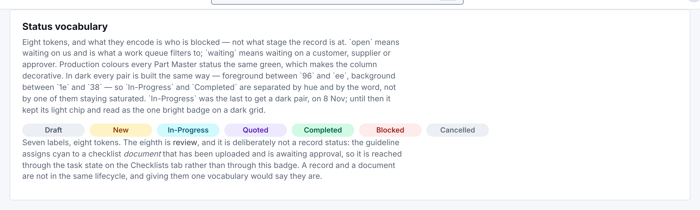

# Status vocabulary

Eight statuses, each a foreground/background pair.

> **A status is a word and a colour, never a colour alone.** The pair is what
> makes it legible to someone who cannot separate the hues.

The dark pairs are constructed, not picked: the foreground runs between `96`
and `ee`, the background between `1e` and `38`, and the middle channel carries
the hue. Every pair lands between 6.16:1 and 9.30:1.

> **`progress` only joined them on 8 November.** Seven statuses inverted for
> dark and that one kept its light pair, so a dark grid showed a single bright
> cyan chip among seven dark ones. Worth knowing because it is still the
> closest pair in the vocabulary: `progress` and `review` are 1.5° apart in
> hue in light and 6° in dark, and the word is what separates them. If the two
> are ever confused on screen the answer is a different hue for one of them,
> not a darker cyan.

| Token | Value | Resolves to | Dark |
|---|---|---|---|
| `--vy-status-draft-fg` | `var(--vy-grey-600)` | `#4d5766` | `#aab4c3` |
| `--vy-status-draft-bg` | `var(--vy-grey-100)` | `#eceff3` | `#2a323f` |
| `--vy-status-open-fg` | `#92400e` | — | `#eeb796` |
| `--vy-status-open-bg` | `#fef3c7` | — | `#38281e` |
| `--vy-status-progress-fg` | `#155e75` | — | `#96e4ee` |
| `--vy-status-progress-bg` | `#cffafe` | — | `#1e3838` |
| `--vy-status-done-fg` | `#065f46` | — | `#96eed5` |
| `--vy-status-done-bg` | `#d1fae5` | — | `#1e3831` |
| `--vy-status-waiting-fg` | `#5b21b6` | — | `#b896ee` |
| `--vy-status-waiting-bg` | `#ede9fe` | — | `#281e38` |
| `--vy-status-review-fg` | `#0e7490` | — | `#96dbee` |
| `--vy-status-review-bg` | `#ecfeff` | — | `#1e3338` |
| `--vy-status-blocked-fg` | `var(--vy-red-700)` | `#9e231d` | `#ee9a96` |
| `--vy-status-blocked-bg` | `var(--vy-red-50)` | `#fdeceb` | `#38201e` |
| `--vy-status-cancelled-fg` | `var(--vy-grey-500)` | `#626d7e` | `#aab4c3` |
| `--vy-status-cancelled-bg` | `var(--vy-grey-100)` | `#eceff3` | `#2a323f` |
| `--vy-status-slot-w` | `104px` | — | *(same)* |
