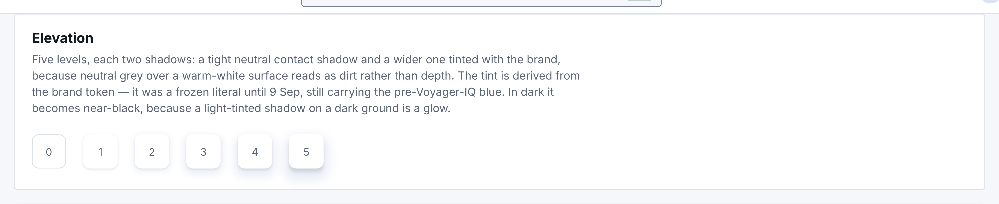

# Elevation

Three shadows. Elevation is for things that **float** — a dialog,
a menu, a toast. A card on a page gets a border, not a shadow.

| Token | Value | Dark |
|---|---|---|
| `--vy-shadow-sm` | `0 1px 2px rgba(19, 24, 32, .06)` | *(same)* |
| `--vy-shadow-md` | `0 2px 8px rgba(19, 24, 32, .10)` | *(same)* |
| `--vy-shadow-lg` | `0 8px 28px rgba(19, 24, 32, .14)` | *(same)* |
| `--vy-overlay-scrim` | `rgba(19, 24, 32, .45)` | `rgba(0, 0, 0, .62)` |

## Z-index — one flat list, so two overlays can never argue

| Token | Value |
|---|---|
| `--vy-shell-sidebar-w` | `248px` |
| `--vy-shell-sidebar-w-collapsed` | `56px` |
| `--vy-shell-topbar-h` | `52px` |
| `--vy-z-drawer` | `10020` |
| `--vy-z-dialog` | `10040` |
| `--vy-z-menu` | `10070` |
| `--vy-z-palette` | `10075` |
| `--vy-z-toast` | `12500` |
| `--vy-z-skip` | `12600` |
| `--vy-dialog-md` | `640px` |
| `--vy-dialog-lg` | `960px` |
| `--vy-dialog-xl` | `1180px` |
