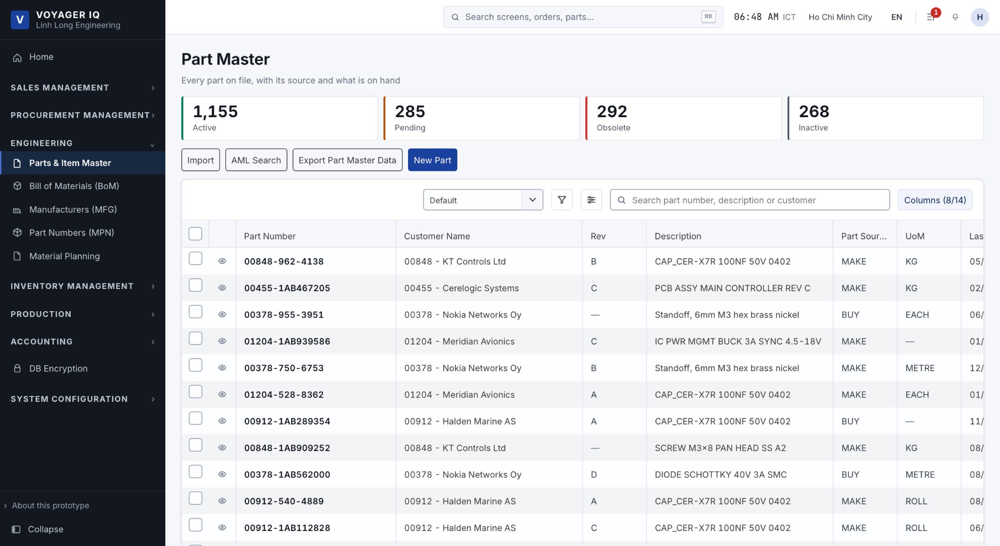
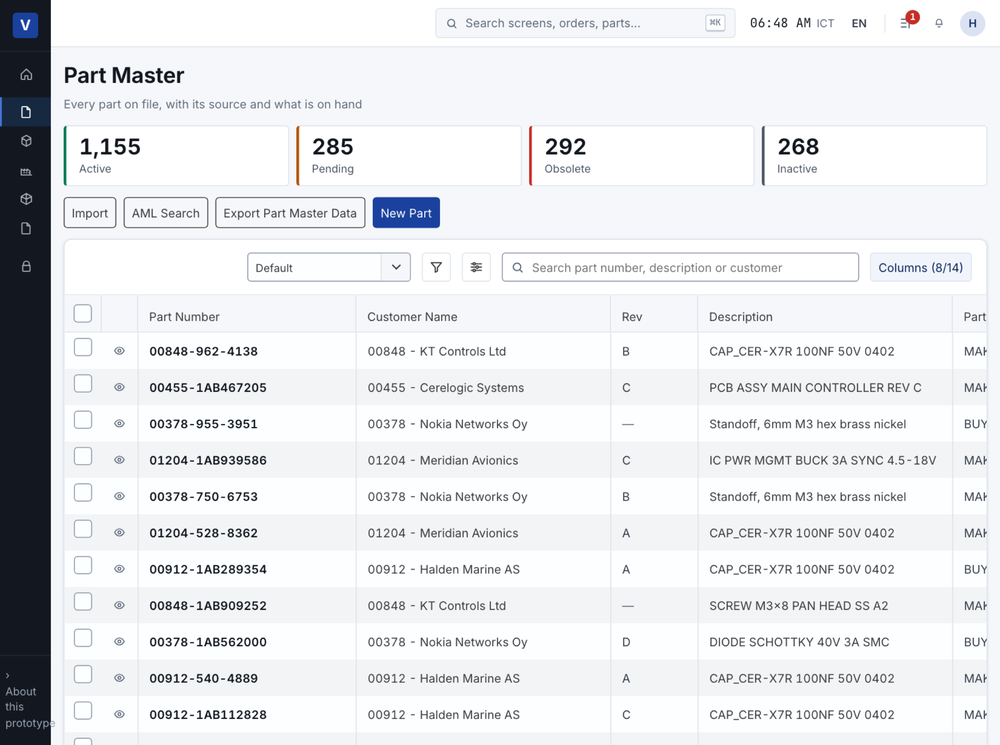
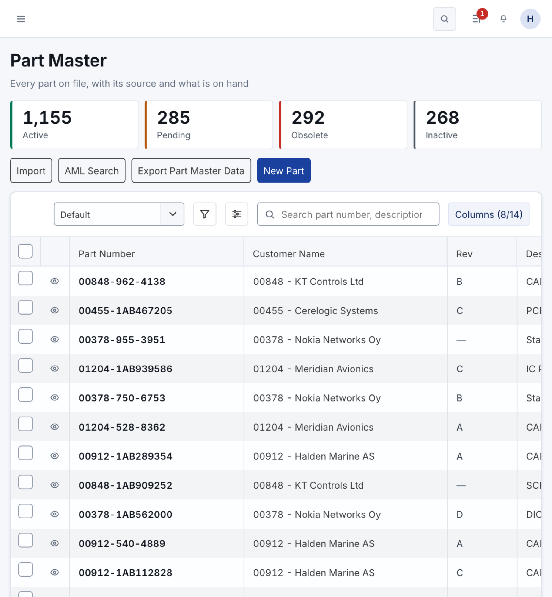
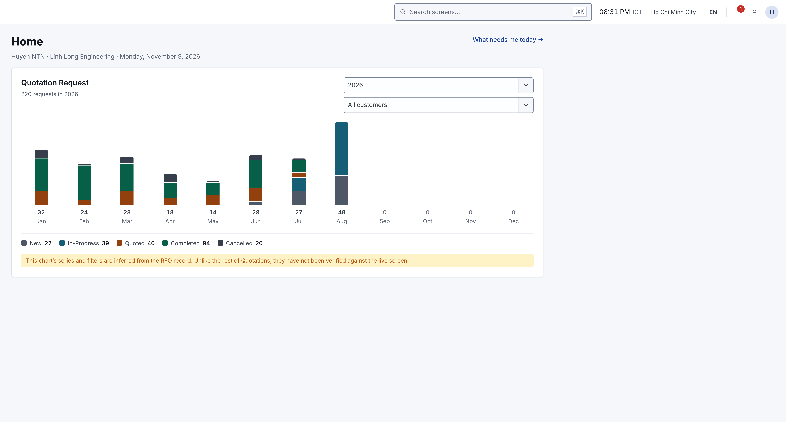

# Grid

## Responsive

Breakpoints are raw pixels because `@media` cannot read custom properties — a
documented exception to the no-magic-numbers rule.

**Three of them are the shell**, in `responsive.css`, and they are the ones
worth knowing by heart:

| Width | What changes |
|---|---|
| ≤ **1180px** | The 248px sidebar becomes a 56px icon rail |
| ≤ **980px** | Two-column regions stack |
| ≤ **820px** | The sidebar leaves the flow; a menu button reveals it |
| `pointer: coarse` | The bottom of the type scale re-expands; 44px target floor |

**Eight more are component breakpoints**, and the honest count is eleven, not
three. A component that needs one measures it and carries the measurement —
rule 4 of [Five rules before you build](../get-started/develop.md) — rather than being bent to
fit a shell width it has nothing to do with:

| Width | Where | What it answers |
|---|---|---|
| ≤ **1100px** | top bar, tab strip | The timezone picker goes; the clock still states the zone |
| ≤ **900px** | top bar, cost summary, submit bar | The clock goes; a 2fr/1fr money split stacks before its figures stop lining up |
| ≤ **860px** | record header | |
| ≤ **840px** | wizard stepper | Four labelled steps need ~760px; below it they truncate, and a truncated step name is worse than none |
| ≤ **720px** | page body | A real phone, or a genuinely short window |
| ≤ **700px** | stepper, link columns | Only the current step keeps its label; the others become their marker, still positioned and still clickable |
| ≤ **620px** | record header | |
| ≤ **560px** | filter strip | A right-anchored strip would read as clipped at this width |

Two of those — 860 and 620 — carry no note, which rule 4 says they should.

The system runs on shop-floor terminals that are often 1366×768 or narrower.
Below about 1100px a 248px sidebar stops being orientation and starts being
the thing in the way — measured at 543px it was taking **46% of the
viewport**.

The same screen at the three widths that matter. Full rail, icon rail, and no
rail at all with a menu button in the top bar — and in all three the grid
keeps its columns rather than shrinking them:







## Layout

A page in this app is three things across: the sidebar, two gutters and the
content box. [Responsive](#responsive) says when the sidebar changes size; this
section says what the content box does about it, and what it is allowed to
grow to.

Written on **9 November 2026**, and it is the last structural section the
system was missing. Everything below was measured rather than decided:
`grid:check` sweeps **6 routes × 12 widths** and the numbers in this section
are its output.

## What takes the width before the content does

Measured as an identity rather than a formula, so moving a breakpoint cannot
make this wrong:

> **rail + gutters + content = viewport.** Nothing else may take a share.

| Viewport | Rail | Gutters | Content |
|---|---|---|---|
| ≤ 820px | 0 — the sidebar is `fixed` and off-screen | 2 × 14 | vw − 28 |
| 821–1180px | 56 — icon rail | 2 × 14 | vw − 84 |
| ≥ 1181px | 248 — labelled | 2 × 24 | vw − 296, up to the cap |

The content box, measured on each page shape:

| vw | 375 | 600 | 768 | 820 | 900 | 980 | 1100 | 1180 | 1280 | 1366 | 1440 | 1920 |
|---|---|---|---|---|---|---|---|---|---|---|---|---|
| **list** | 347 | 572 | 740 | 792 | 816 | 896 | 1016 | 1096 | 984 | 1070 | 1144 | **1624** |
| **everything else** | 347 | 572 | 740 | 792 | 816 | 896 | 1016 | 1096 | 984 | 1070 | 1132 | **1132** |

## The step at 1180 is negative, and it is the only one

Read the row again at the two widths either side of it.

> At **1180px** the content box is **1096px**. At **1280px** it is **984px**.
> The window gained 100px and the page **lost 112**.

Crossing 1180 upward the rail goes 56 → 248 and the gutters 14 → 24: **212px
taken, 100px given**. The consequence is not theoretical — a 1366 laptop, the
machine this product is mostly used on, shows **1070px** of content where an
1180 terminal shows **1096px**.

**It is a trade, not a bug.** The labelled rail is orientation, which is what
decision D1 bought and what the 25 August review asked for; the alternative is
an icon rail on every laptop in the building. And the user has an escape worth
**192px** — the collapse control, which is only offered above 1180 because
below it the rail is already collapsed.

The breakpoint that would remove the step entirely is **1392px**, not 1180:
content above it is `vw − 296`, so the window has to reach 1392 before the
expanded rail pays for itself. Moving it there would deny the labelled rail to
every 1366 screen, which is the wrong half of the trade.

What the system does instead is **declare** the step, and `grid:check` fails
if a second one appears anywhere.

## Four page shapes, and until 9 November only two had a width

| Shape | Used by | Cap |
|---|---|---|
| `.vy-page--grid` | Every list screen | **none, on purpose** |
| `.vy-page--record` | The RFQ record | `--vy-record-max-w` |
| `.vy-page--doc` | Design system, Audit, Sitemap | `--vy-doc-max-w` |
| `.vy-page` | Home, My Queues, Placeholder | **was none — now `--vy-page-max`** |

All three caps are the same number, `1180px`, and the two named tokens now
resolve to `--vy-page-max` so there is one value rather than three that happen
to agree.

**The list shape is uncapped, and that has to stay a decision.** The widest
grid in this product is **1806px** at its default view — Project Requirements,
12 columns at their [Column roles — a width is chosen once, by role](sizing.md#column-roles--a-width-is-chosen-once-by-role)
role widths — and **2106px** with every column turned on, which is Part Master
at 16. Any cap below those would create horizontal scrolling on a window that
had the width to avoid it. The role widths themselves hold at every width:
measured at 2560px the table is still 1806px and every column is still its
declared width, so a 2560 screen shows the whole grid with the remainder of
the frame empty.

**Everything else is capped, and the base rule is what carries it** — so a
page that declares nothing now gets the conservative width rather than the
unbounded one. That inversion is the point: before, the default was infinite.

The cost of not capping was measurable on the two dashboard screens:

| At a 1920 viewport | Uncapped | Capped |
|---|---|---|
| Chart column | 127px, holding a 28px bar — **99px of air between bars** | 85px, 57px of air |
| Queue tile | **397px** for a one-digit number and two short lines | 274px |

A page with no grid to fill has nothing to spend the width on, and twelve bars
spread across 1600px stop reading as a series.



**Left-aligned, not centred.** A list screen is full-bleed, so a centred
dashboard would make the page title jump right as you navigate from a grid to
Home. The heading starts at the same x on every screen; the unused width is
left where it is.

## Columns — one idiom, sixteen minimums

There is no 12-column grid here, and that is deliberate. A fixed column count
assumes the content box has a stable width; this one changes by 640px across
the range above, loses 112px at one step, and is capped on four shapes out of
five. **Sixteen layout grids, all of them the same idiom:**

```css
grid-template-columns: repeat(auto-fit, minmax(var(--some-min), 1fr));
```

The tracks are equal, they consume the row at any count and any width, and the
floor is what decides when a row wraps. So the only number a layout grid
chooses is **the width below which its content stops being readable** — and
that is a property of the content, not of the grid. A count tile and a form
field group do not stop being readable at the same width, so they do not share
a number.

| Grid | Minimum token | Minimum | Column gap | What it holds |
|---|---|---|---|---|
| `.vy-kpi-row` | `--vy-kpi-min-w` | 140px | 8px | Count tiles over a list |
| `.vy-bom-summary` | `--vy-stat-min-w` | 150px | 10px | Figures over a BoM |
| `.vy-run-ref .vy-quote-config-grid` | `--vy-quote-ref-field-min` | 150px | inherited | Reference fields, narrow pane |
| `.vy-stat-row` | `--vy-stat-min-w` | 150px | 10px | Figures in a summary strip |
| `.vy-assy-grid` | `--vy-assy-field-min` | 170px | inherited | Assembly fields |
| `.vy-contact-fields` | `--vy-contact-field-min` | 180px | 10px | Contact fields |
| `.vy-filter-fields` | `--vy-filter-field-min` | 190px | 12px | Filter fields |
| `.vy-quote-context-fields` | `--vy-quote-fact-w` | 190px | 10px | Quote context facts |
| `.vy-record-fields` | `--vy-header-field-min` | 190px | 16px | Record-header facts |
| `.vy-assignees` | `--vy-card-min-w` | 200px | inherited | Assignee cards, stacked |
| `.vy-queue-row` | `--vy-card-min-w` | 200px | 12px | Queue cards |
| `.vy-radios--tiles` | `--vy-radio-tile-min` | 230px | 10px | Radio tiles |
| `.vy-quote-config-grid` | `--vy-quote-field-min` | 240px | 16px | Quote configuration fields |
| `.vy-header-groups` | `--vy-header-group-min` | 260px | 12px | Record-header groups |
| `.vy-field-groups` | `--vy-field-group-min` | 280px | 20px | Form field groups |
| `.vy-notes-edit` | `--vy-note-min-w` | 320px | 16px | Note editors, side by side |

Eleven distinct minimums and six distinct gaps, and the system does **not**
flatten them onto a ladder. It states the catalogue instead: a new grid picks
a row from it, or measures its own and records why — [Five rules before you build](../get-started/develop.md)
rule 4, the same rule [Responsive](#responsive) applies to breakpoints. What
`grid:check` enforces is that the minimum is a **token**, so a seventeenth
value cannot arrive as a literal in a rule.

## What `grid:check` measures

`node scripts/with-server.mjs grid:check` · **72 measurements**, 6 routes × 12
widths, in `check:visual` on every push.

| | |
|---|---|
| **The identity** | rail + gutters + content = viewport, at every width. Nothing else may take a share |
| **The caps** | A capped shape never exceeds `--vy-page-max` |
| **The opt-out** | The list shape is still uncapped at the widest width swept — so the decision in B8.3 cannot decay into an omission |
| **One step** | Content width never falls as the viewport grows, except between 1180 and 1280 |
| **Tokens** | Every `auto-fit` minimum is a `var()`, never a literal |

Two faults are planted on every run — a cap forced onto the list shape, and a
literal minimum — and the run fails if either goes unseen.

> What it deliberately does **not** check is horizontal page overflow.
> `mobile:check` owns that, along with its 198 open tablet findings;
> duplicating them here would make this check red for a reason that has
> nothing to do with the grid.
