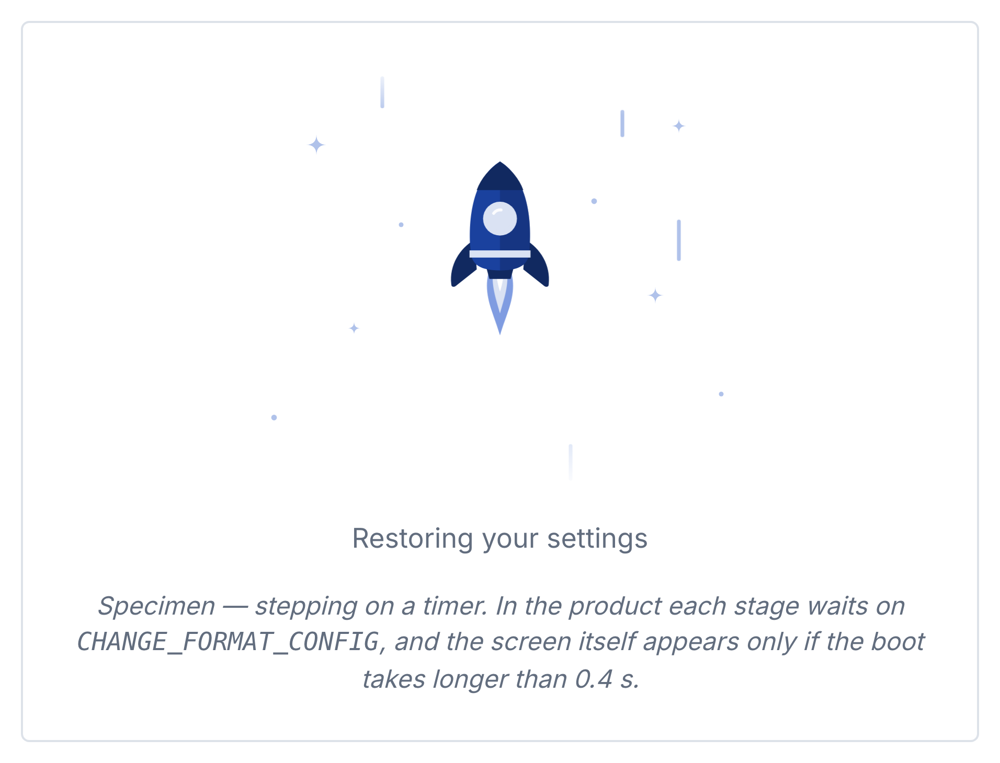
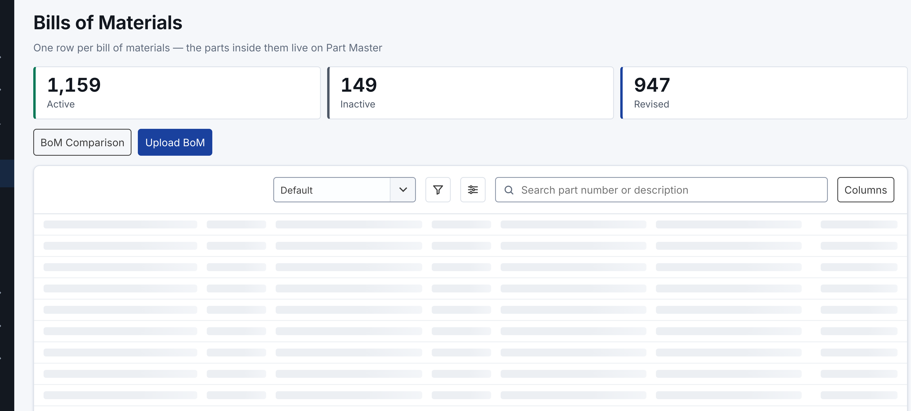
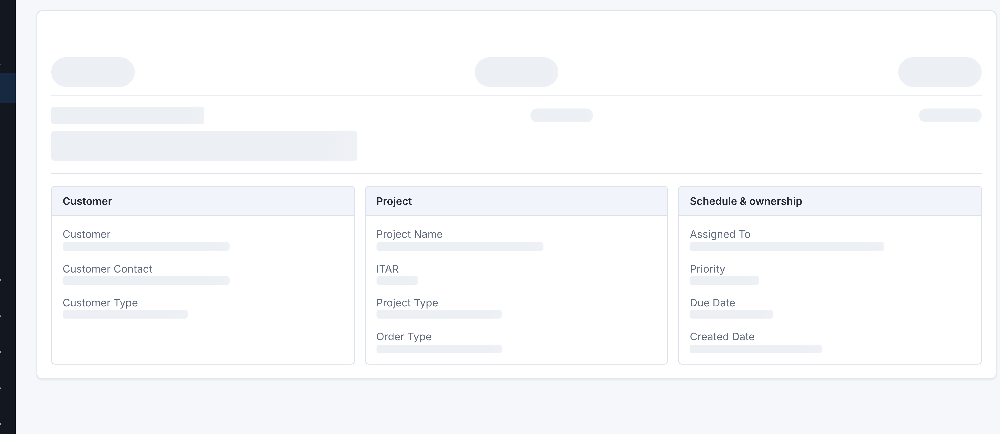
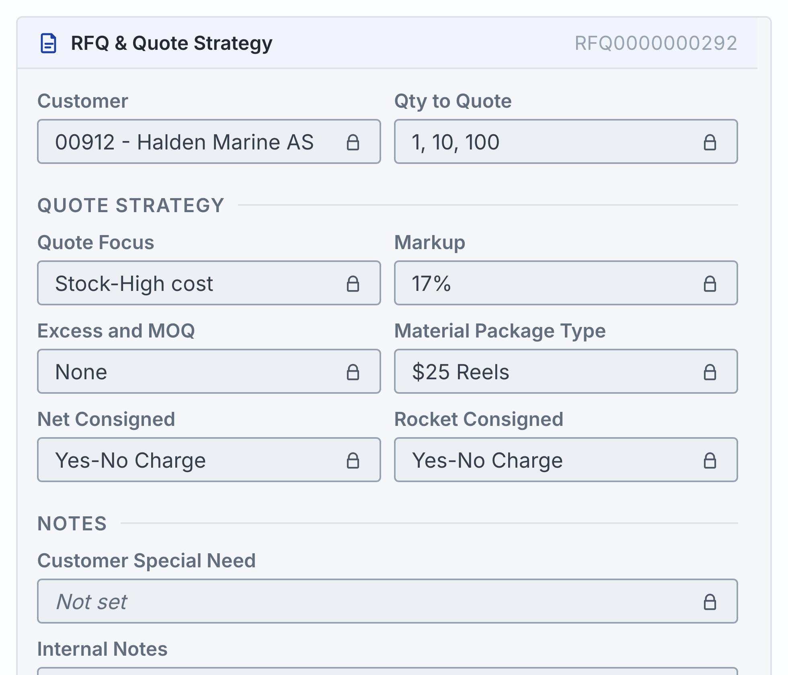

# Illustrations

**One drawing, three states.** The product has exactly one illustrated
character — a rocket — and it appears in three situations. That is deliberate:
a reader who has met this craft on the way in should not have to learn a
second picture to understand that it crashed.

Component: `src/ui/RocketLaunch.tsx` · one inline SVG, `viewBox="0 0 240 180"`
· `data-state` selects the scene.

| | |
|---|---|
| Rendered width | `clamp(240px, 18vw, 280px)` |
| Colour | Ten role tokens, [Accents and row tones](color/accents.md) — never hex |
| Motion | CSS only. The illustration owns pixels and no state, so it can stop in a background tab and nothing is lost |
| Ids | Generated with `useId` — two instances on one page would otherwise share a clip path |
| Inline, not `` | An `` is a second request on the one screen whose job is to cover the first one, and it is its own document, where `var(--vy-brand)` resolves against nothing |

## `launching` — the boot screen

The craft holds still in the middle of the frame and **the world moves**: the
planet sinks a notch per boot stage, streaks run down past it. Nothing about a
rocket drawn nose-up says "climbing" on its own.

| | |
|---|---|
| Where | `BootGate` after sign-in; the `Suspense` fallback of a lazy route |
| Animation | Lift-off 0.7s · bob 1.6s · flame flicker 0.18s · streaks 0.8–1.3s |
| Reduced motion | No climb, no flicker, no streaks. The step bar still fills |

Shown with its label and five-segment bar, which is what the boot screen
actually is:

## `error` — the screen stopped loading

The same craft, back on the pad: tilted, cracked, one fin lying beside it,
smoking. The failure is legible before the sentence under it is read.

| | |
|---|---|
| Where | `ErrorState`, which `ErrorBoundary` renders for any route that throws |
| Animation | Three smoke puffs, 2.4s, staggered |
| Reduced motion | Puffs held at 0.6 opacity — the smoke stays, the movement goes |

## `building` — still on the launch pad

The craft **whole** on the pad, a robot arm welding it, a design doc on an
easel whose checklist ticks off. Work in progress, not wreckage — and the
difference has to be visible before the heading is read.

| | |
|---|---|
| Where | `Placeholder`, which answers every route not yet built — **71 of the 82 destinations** in the live menu (`src/data/sitemap.ts`, 91 `path` entries, 82 distinct; `App.tsx` declares 21 real routes and one catch-all) |
| Animation | Arm 4s · sparks only while the arm is holding · checklist 6s |
| Reduced motion | Sparks and the first two ticks held **on**, so the drawing still says "being built" |

## Skeletons — the other kind of waiting

A skeleton answers *"what will this look like?"*. Once the user has already
seen rows that question is answered, so a re-price or a second page **dims
what is there** and puts an indicator over it instead (`BusyOverlay`).

One shimmer for both: `--vy-surface-sunken` → `--vy-surface-app` →
`--vy-surface-sunken`, 200% background, 1.4s.

**Grid skeleton** — the real column roles, so the bars land where the data
will:

**Record skeleton** — the real field labels, because they are known before the
data is. Measured down to 1px of shift when the record arrives:

## Empty states

No illustration, on purpose. An empty state is a sentence and an action, and a
picture there delays both.

## Exporting and regenerating

| | |
|---|---|
| Live source | `src/ui/RocketLaunch.tsx` |
| Static SVGs | `docs/assets/rocket-journey/*.svg` — the **retired** horizontal set, kept because an earlier document still prints them. Not in the product |
| These images | Captured from the running app at 2×; the scripts are in `scripts/` |

> **If an illustration needs to leave the codebase** — for a slide, a PDF —
> export the inline SVG and replace the `var(--vy-rocket-*)` references with
> the resolved hex from [Accents and row tones](color/accents.md). Outside the app
> there is no token layer to resolve them.
