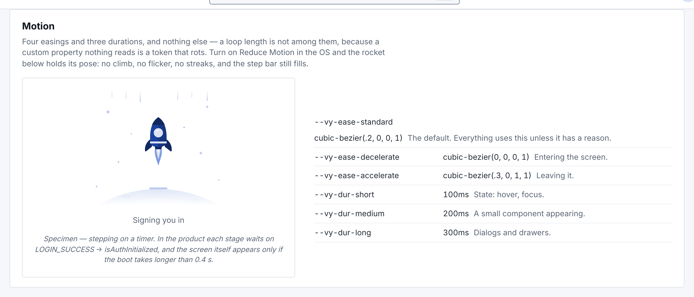

# Motion

Four easings and three durations, and nothing else. There is deliberately **no
loop-length token**: a custom property nothing reads is a token that rots.

| Token | Value | Use |
|---|---|---|
| `--vy-ease-standard` | `cubic-bezier(.2, 0, 0, 1)` | The default. Everything, unless it has a reason |
| `--vy-ease-emphasised` | `cubic-bezier(.2, 0, 0, 1)` | A moment that should be noticed. **Currently identical to `standard`** — named separately so the two can diverge without touching call sites |
| `--vy-ease-decelerate` | `cubic-bezier(0, 0, 0, 1)` | Something arriving |
| `--vy-ease-accelerate` | `cubic-bezier(.3, 0, 1, 1)` | Something leaving |
| `--vy-dur-short` | **100ms** | State changes: hover, focus |
| `--vy-dur-medium` | **200ms** | Small components entering |
| `--vy-dur-long` | **300ms** | Dialogs, drawers |

## The loading clock

| Rule | Value |
|---|---|
| Show the boot screen only if the boot takes longer than | **400ms** |
| Exit — the craft leaves the top of the frame | **400ms** |
| "Still climbing…" appears after | **5s** |
| Minimum display time once shown | **none** |

Holding a loading screen so it does not flash spends the user's time to make
our indicator look better. Not showing one at all for a boot that beats the
clock costs them nothing. The two rules are the two halves of one answer.

## Reduced motion is a state, not a switch

Under `prefers-reduced-motion: reduce` the rocket **holds its pose** — no
climb, no flicker, no streaks — and the step bar still fills. A welding arm
with its animation removed is an arm with no sparks and an empty checklist,
which says something different from what the state means, so the things that
*fade in* are left on.
