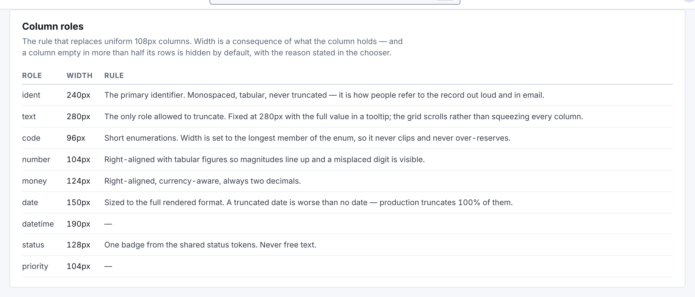

# Sizing

## Control heights

Every control sits on **Kendo's own size scale**, configured rather than
overridden — `_kendo-size.scss` sets the variables and the components inherit
them. Forcing a height on a Kendo control instead is how a 29px select ends up
beside a 34px input.

| Token | Value |
|---|---|
| `--vy-row-h-compact` | `28px` |
| `--vy-row-h-comfortable` | `40px` |
| `--vy-row-h-relaxed` | `48px` |
| `--vy-target-min` | `44px` |
| `--vy-control-sm` | `28px` |
| `--vy-control-row` | `26px` |
| `--vy-control-md` | `34px` |
| `--vy-control-dense` | `32px` |
| `--vy-icon-sm` | `16px` |

| Token | Where it is used |
|---|---|
| `--vy-control-md` **34px** | Form inputs, selects, buttons — the default |
| `--vy-control-dense` **32px** | Toolbar controls: search, `size="sm"` buttons |
| `--vy-control-sm` **28px** | Compact density |
| `--vy-control-row` **26px** | An icon button **inside a grid row** — Kendo's `xs` step |
| `--vy-target-min` **44px** | A floor, under `pointer: coarse` **only** |

> **44px is a touch rule, not a desktop one.** WCAG 2.5.5 is about a pointer
> target; applying it to a 27-field form on a mouse-driven screen adds ~270px
> of scrolling for nothing.

## Row density — a user preference

| Token | Height | Setting |
|---|---|---|
| `--vy-row-h-compact` | 28px | Compact |
| `--vy-row-h-comfortable` | 40px | Comfortable *(default)* |
| `--vy-row-h-relaxed` | 48px | Relaxed |

## Column roles — a width is chosen once, by role

A grid column declares a **role**, not a pixel width.

| Role | Width | What it holds |
|---|---|---|
| `ident` | 240px | Part numbers, MPNs — must not truncate |
| `text` | 280px | Descriptions and other prose |
| `code` | 96px | Short codes, revisions |
| `number` | 104px | Quantities |
| `money` | 124px | Prices and amounts |
| `date` | 150px | A day |
| `datetime` | 190px | A moment — `09/09/2026 16:35:29` |
| `status` | 128px | A status pill |
| `priority` | 104px | A dot and a word |

## Dialogs and shell

| Size | Width | Opens maximised? | For |
|---|---|---|---|
| `md` | 640px | No | A question: a confirmation, a short form |
| `lg` | 960px | Yes *(overridable)* | Two blocks and a short table |
| `xl` | 1180px | Yes | A work surface: a 21-column grid, a 4-step wizard |

| Shell token | Value |
|---|---|
| `--vy-shell-sidebar-w` | 248px |
| `--vy-shell-sidebar-w-collapsed` | 56px |
| `--vy-shell-topbar-h` | 52px |
