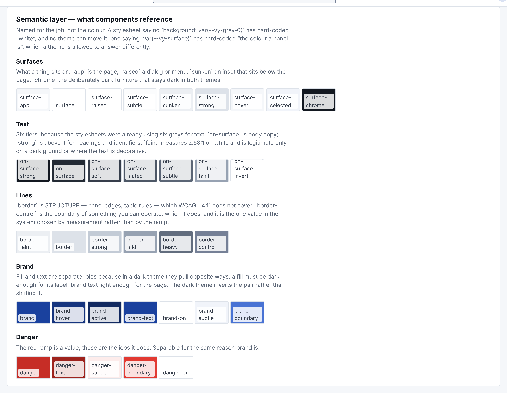

# Tokens

| Layer | What it is | Where | May a screen use it? |
|---|---|---|---|
| **1 · Ramps** | The raw palette. 10 blues, 12 greys, 4 reds | `tokens.css` | **No** |
| **2 · Semantic roles** | `surface`, `on-surface`, `brand`, `danger`… named for the job | `tokens.css` | **Yes — only this** |
| **3 · Components** | Button, Field, Grid, Dialog… | `src/ui`, `src/components` | Yes |

A stylesheet saying `background: var(--vy-grey-0)` has hard-coded *white*, and
no theme can move it. One saying `var(--vy-surface)` has hard-coded *"the
colour a panel is"*, which a theme is allowed to answer differently.

**Layer 1 exists so that layer 2 can be consistent. It is not for use in a
component.**

