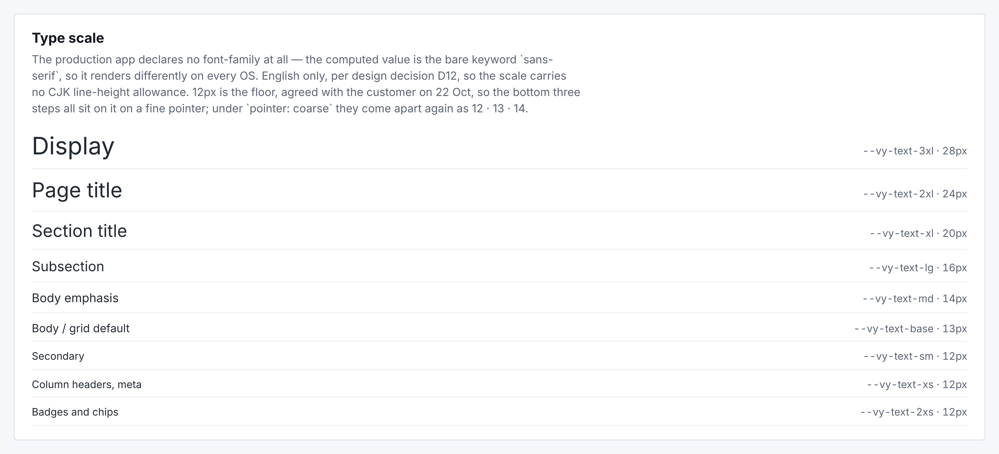

# Typography

**One family.** Inter Variable, everywhere, self-hosted — no request to Google
and no flash of fallback text.

There was a second. **JetBrains Mono** set the identifiers: part numbers, MPNs,
RFQ and assembly numbers. The review of **13 October** ended it — *"do not use
monotext, hard to read"* — `.vy-ident` was rewritten the same day, and the last
holdout, the MiniTable grids in Run Quotation, went on **22 October**. On 22
October the customer also said what mono had been *for*: a unique value should
not look like an ordinary field. So the requirement is **prominence, not a
typeface** — and prominence is cheaper than a second font. An identifier is
semibold, in the strong ink, with `tabular-nums`, which is what held the digits
in columns all along. A part number is read as a *word* by people who know
their catalogue; at 12–13px in a dense grid the mono face was the thing slowing
them down. The token and the webfont were removed on **7 November**.

| Token | Value |
|---|---|
| `--vy-font-sans` | `"Inter Variable", "Inter", system-ui, -apple-system, "Segoe UI", Arial, sans-serif` |
| `--vy-text-2xs` | `12px` |
| `--vy-text-xs` | `12px` |
| `--vy-text-sm` | `12px` |
| `--vy-text-base` | `13px` |
| `--vy-text-md` | `14px` |
| `--vy-text-lg` | `16px` |
| `--vy-text-xl` | `20px` |
| `--vy-text-2xl` | `24px` |
| `--vy-text-3xl` | `28px` |
| `--vy-weight-regular` | `400` |
| `--vy-weight-medium` | `500` |
| `--vy-weight-semibold` | `600` |
| `--vy-weight-bold` | `650` |
| `--vy-weight-heavy` | `700` |

**Five weights, and the top three are finely spaced on purpose — measured.**
"650 and 700 are too close to 600" is the obvious objection, so it was
measured rather than argued: the same string rendered at 13px in Inter
Variable, by width and by ink coverage.

| | 400 | 500 | 600 | 650 | 700 |
|---|---|---|---|---|---|
| width | 234.30 | 237.03 | 239.76 | 241.12 | 242.48 |
| ink | 111k | 128k | 146k | 154k | 162k |
| step | — | +15.7% | +13.4% | **+5.6%** | **+5.5%** |

They are all distinct — Inter Variable spans 100–900, nothing snaps — but the
top two steps are **about a third** of the steps below them. So the honest
rule is not "five interchangeable weights":

| Weight | Job | Call sites |
|---|---|---|
| `regular` 400 | Body text | 22 |
| `medium` 500 | A label, a button, a link that must hold its line | 59 |
| `semibold` 600 | **The default emphasis.** Identifiers, group headings, totals | 112 |
| `bold` 650 | A page or record title, where 600 is already in use nearby | 42 |
| `heavy` 700 | A number that is the whole point of its tile — a KPI, a queue count | 12 |

Reach for 600. Use 650 and 700 only where something at 600 is **next to**
them and has to stay quieter; at a 5% step they do not read as emphasis on
their own.

**12px is the floor**, agreed with the customer on 22 October. It was 11px; our
own small-text check had flagged anything under 12 all along. The floor
collapses the bottom of the scale — `2xs`, `xs` and `sm` all sit on it, three
names carrying one size. The names stay because they mean different things: a
badge, a label, secondary text.

**A finger un-collapses it.** Under `@media (pointer: coarse)` the bottom three
come apart again — 12, 13, 14 — and every step above them moves +2, to 15, 16
and 18. Display sizes (`xl` and up) do not move: they are already comfortable,
and growing a heading on a 375px screen buys nothing and costs a wrap. The
floor is never crossed in either direction.

## Casing — three levels, drawn differently on purpose

Buttons, links, tabs, form and dialog titles, section and card titles,
**field labels**, column headers, filter labels, menu items and status pills
take **Title Case**, with prepositions (for, to, of, by, as, in, on, at, from,
with, via, per, into) lowercase unless they lead. Prose is sentence case.

| Level | Case | Size / weight | Example |
|---|---|---|---|
| Card header | Title Case | 14px / 600 | `Select Action` · `Continue from Drafts` |
| Divider inside a card | **UPPERCASE**, .05em tracking | 12px / 600 | `QUOTE STRATEGY` · `BOM OPTIONS` |
| Field label | Title Case | 12px / 600 | `Customer` · `Qty to Quote` · `Markup (%)` |
