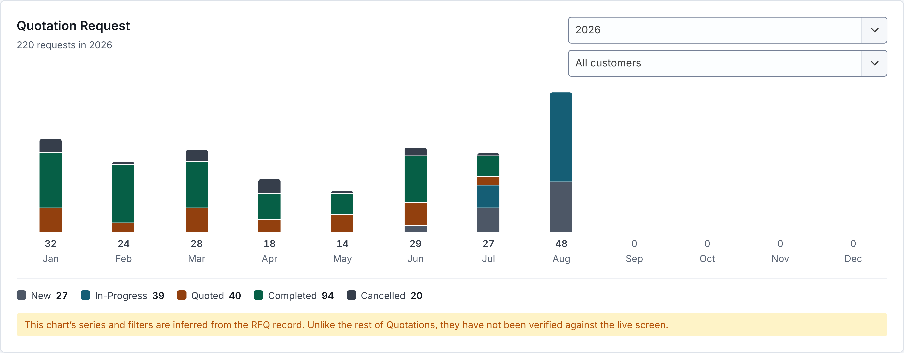
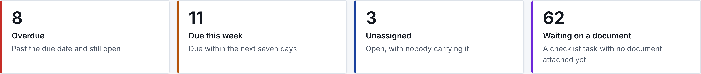

# Pattern · Dashboard

> Numbers on a landing screen. Two of them in this product, and they answer
> different questions — which is why they are two screens and not one.
> **Components:** [Badge](../components/badge.md) ·
> [Button](../components/button.md) · [Select](../components/select.md) ·
> [Error state](../components/error-state.md) ·
> [Grid skeleton](../components/grid-skeleton.md)

---

## Two screens, and the reason they stayed apart

| | Asks | Lives at |
|---|---|---|
| **Home** | *How much work came in, and when* | `/` — `sequence 1` in the live menu |
| **My Queues** | *Is there something here for me* | `/my-queues`, its own nav entry |

An earlier version of this build replaced Home with the work queue. Decision
D6 reversed it.

> Home is the one screen every user has already learned. Spending it to add a
> screen they have not is a trade that looks free and is not.

So the queues got their own entry, and Home does what the live Home does.
What was **removed** from it is the stock Kendo demo chart the production
screen still carries — *World Population by Broad Age Groups*, sample data,
shipped.

---

## Home — one chart, and it says what it does not know

Twelve stacked bars, five series, two filters. Drawn in CSS: a chart
dependency buys axes and tooltips this screen does not use, and costs a second
colour system that no longer answers to the tokens.

| Rule | Why |
|---|---|
| **A month with no requests keeps its column** | A gap in a time series is information. Dropping empty months makes an eight-month year look like a busy one |
| **The total is a sentence, not a caption** | *220 requests in 2026* — and when a filter empties it, *Nothing was raised in 2026 for …*, naming the filter rather than drawing an empty axis |
| **Every count is printed** | Under its own bar, and again in the legend. A bar you have to measure against a gridline is a bar you will misread |
| **Zero is dimmed, not hidden** | `data-zero` drops it to the subtle tier, so the twelve months still read as twelve |
| **The series order is the lifecycle** | New → In-Progress → Quoted → Completed → Cancelled, so a stack reads bottom-to-top as work progressing |

**The one inline style this repo allows** is here. Every bar's height is a
share of the peak month, which no stylesheet can know, so the component sets a
custom property — `--seg-h` — and the rule that uses it stays in `app.css`.
Inline styling is banned because it hides design decisions from the token
layer; a data value handed to a rule that lives in the stylesheet does not.

> **And the page says the chart is inferred.** The live chart renders from an
> API response, so its exact series and filter set are not in the shipped
> bundle the way the Run Quotation strings are. The shape here is read off the
> RFQ record. It is the one thing in this prototype resting on inference
> rather than evidence, and it carries a note saying so —
> [A3 rule 5](../design-system.md#a3--five-rules-before-you-build).

---

## Colour in a chart is not colour in a badge

This is the part that went wrong twice, and the second time it went wrong
*because of the first fix*.

The status tokens come in pairs: `-fg` is ink, `-bg` is the pale chip behind
it. A chart segment is neither — it is a shape with no text on it, and it
needs to be visible against the card.

| | What happened |
|---|---|
| **First** | The chart read `-fg` for all five. `--vy-status-progress-fg` was `#ffffff` at the time, so **In-Progress was drawn white on a white card** — 39 records, invisible, and the legend key beside it blank |
| **The fix** | That one series switched to `--vy-status-progress-bg` |
| **Then the tokens moved** | The pairs were restructured to the convention above. `progress-fg` became `#155e75` — the saturated half, like its four siblings — and the exception was never revisited |
| **Measured, 9 Nov** | `#cffafe` on the light card is **1.12:1**. In dark it is `#1e3838` on `#161c25`: **1.37:1** |

Same series, same invisibility, opposite cause. It survived nine weeks because
**nothing measured a fill that carries no text** — every pair in
`contrast:check` was ink on a ground or an edge on a ground.

> A fix that outlives the bug it fixed is worse than no fix: it reads as a
> decision, so nobody re-opens it.

Every series now reads its own `-fg`, so there is no exception left to go
stale, and the five fills are in `contrast:check` as non-text pairs — **184**
now, up from 174.

| Series on the card | Light | Dark |
|---|---|---|
| New | 7.32 | 8.17 |
| In-Progress | **7.27** *(was 1.12)* | **11.92** *(was 1.37)* |
| Quoted | 7.09 | 9.66 |
| Completed | 7.68 | 12.62 |
| Cancelled | 10.78 | **3.03** — the tightest pair in the whole palette |

### And a drawn boundary, because two fills are not one

Contrast is a **luminance** ratio, and these five separate by **hue** at
near-equal lightness. Measured against each other, the closest pair is 1.01:1
in light and 1.06:1 in dark. That is deliberate — a series that is much darker
than its neighbours dominates a stack it should not — but it means a greyscale
print, or a reader with no colour vision, sees one block where the legend
names three states.

So the segments carry a **1px separator in the card colour**, and the boundary
is drawn rather than inferred from the two fills either side.

> It is not enough to check the four neighbouring pairs. A month with no
> In-Progress work makes New touch Quoted; a month with only two states makes
> any pair adjacent. **All ten pairs are possible**, so the answer has to be
> structural, not a palette tweak.

Cancelled also keeps a chart-only token, `--vy-chart-cancelled`. As badges,
New and Cancelled sit on separate rows and a near-identical grey costs
nothing; in a stacked bar they touch — and measured, the badge greys are
1.35:1 apart in light and *identical* in dark.

---

## My Queues — a count you can act on

Four measures, each a link into the Quotations list **already filtered**.

| Tile | Means |
|---|---|
| **Overdue** | Past the due date and still open |
| **Due this week** | Due within the next seven days |
| **Unassigned** | Open, with nobody carrying it |
| **Waiting on a document** | A checklist task with no document attached yet |

### One predicate, imported twice

The four tests live in `data/queues.ts`. Both this page and the Quotations
list import them.

> A tile that reads *8 overdue*, clicked, opening a list of six is the bug
> this prevents — with nothing on screen to say which number is wrong.

Measured on the seeded set: the Overdue tile reads **8**, and the list it
opens reads **1 - 8 of 8 items**. They cannot disagree, because there is only
one rule.

**The tile's own sentence travels with the link.** The list arrives carrying
*From My Queues · Overdue · Team · Past the due date and still open*, and a
Clear. A filtered list that does not say why it is filtered is a list that
looks short.

> Which is also why the sentence has to keep up with the test. *Waiting on a
> document* read **"a checklist task is started but its document has not
> arrived"** until 9 November — a description of the predicate it used to have
> and no longer does. The test had been corrected months earlier, because the
> old one leaned on a status the guideline had stopped deriving; its sentence
> stayed behind, and then travelled to the list banner as well. **One
> predicate in one place is only half the rule — the words beside it have to
> move with it.**

### Mine and Team is a scope, not a role

Two states, both always available, so nobody has to work out which one they
are entitled to see. First visit defaults to **Mine** (decision D4) — the
narrower scope is the one that is always safe to show — and the choice
persists per browser.

Team adds one thing Mine cannot have: **who is carrying the most**, as bars.
The question a manager opens this page to ask is comparative, and reading five
numbers and ranking them is work the page should do.

---

## The four states, and why zeros are not one of them

| State | What the screen shows |
|---|---|
| **Loading** | Four skeleton tiles, in the real tile shape |
| **Error** | *Your queues could not be loaded* · what it means · **Try again** |
| **Empty** | One sentence — *Nothing outstanding* — and a link onward |
| **Ready** | The counts |

Two of these exist because of the same mistake:

> **Rendering `0` while the counts load says "nothing needs you" at the exact
> moment it does not yet know.** It is not a neutral placeholder; it is a
> confident wrong answer, and it arrives first.

And when the answer really is nothing, that is a sentence too — not four
zeros. Four zeros make the reader check each one to work out that the total is
nothing. The sentence says it once, and names the scope: *Switch to Team to
see everyone else's.*

The header bell follows the same rule from the other end. It counts what is
**late and mine**, not everything outstanding.

> A badge showing total workload is permanently lit, and a permanently lit
> badge stops being read.

---

## What is deliberately not here

**Per-module queues.** `data/moduleQueues.ts` groups queues by the module they
belong to, so *Overdue* under Procurement is a late purchase order and
*Overdue* under Sales is a late RFQ, with the heading saying which. It is
written, and **nothing imports it**.

Customer decision, 25 Aug 2026: *"My Queue is low priority — for now just note
that we will have it in the future."* It is kept rather than deleted because
it is most of the way done; what it still needs is the role from a JWT rather
than a local preference, and real record types behind the four modules whose
counts are currently illustrative. The file says so at the top, which is the
difference between parked and abandoned.

---

## Accessibility

| | |
|---|---|
| The chart | `role="img"` with a label naming the year and the total, so the shape is not the only way to get the figure |
| Every bar | Carries its count as text under it **and** in the legend — the picture is a second reading, never the only one |
| Series colour | Never alone: each has a legend entry naming the status, and the segments are separated by a drawn line, not by hue |
| Zero | Dimmed to `--vy-on-surface-subtle`, which is a text tier that still clears 4.5:1 — not hidden, and not faint |
| Tiles | Real links, so middle-click and open-in-new-tab work; the count, the label and its meaning are all text |
| Scope toggle | `role="group"` with a name, `aria-pressed` on each button |
| Loading | `aria-busy` on the row, and each skeleton tile names the measure it is standing in for |
| Error | `role="alert"`, with the retry as a real button |

---

## Related

[List screen](list-screen.md) ·
[B1.6 · Status vocabulary](../design-system.md#b16-status-vocabulary) ·
[D5 · The four screen states](../design-system.md#d5--the-four-screen-states) ·
[C2.4 · Skeletons](../design-system.md#c24-skeletons--the-other-kind-of-waiting) ·
[E1 · Accessibility](../design-system.md#e1--accessibility)

## Recent changes

| Date | Change |
|---|---|
| 9 Nov 2026 | This page |
| 9 Nov 2026 | Chart series read their own `-fg`; In-Progress was 1.12:1 light / 1.37:1 dark against the card |
| 9 Nov 2026 | A 1px separator between stacked segments, so a boundary is drawn rather than inferred from two fills |
| 9 Nov 2026 | The five series added to `contrast:check` — 174 → 184 pairs |
| 9 Nov 2026 | *Waiting on a document* now describes the test it actually runs |
