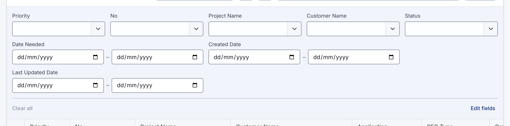

# Pattern · List screen

> A grid and the four controls around it. Every module's landing screen is
> this shape.
> **Components:** [View picker](../components/view-picker.md) ·
> [Filter toolbar](../components/filter-toolbar.md) ·
> [Column chooser](../components/column-chooser.md) ·
> [Pager](../components/pager.md) · [Priority](../components/priority.md) ·
> [Status badge](../components/badge.md)

---

## The shape

| | Band | Holds |
|---|---|---|
| 1 | **Title** | The module name — **and not the record count**, which moved to the pager |
| 2 | **KPI row** | The counts worth filtering to, each a button |
| 3 | **Toolbar** | [View picker](../components/view-picker.md) · funnel · search · [Columns](../components/column-chooser.md), with page actions on the left |
| 4 | **Filter panel** | [Collapsed by default](../components/filter-toolbar.md); not in the DOM until opened |
| 5 | **Grid** | Column roles, row tones, a legend when tones are used |
| 6 | **Pager** | Count, page size, first/prev/numbers/next/last |

---

## Four ways to narrow a list, and they are not interchangeable

This is the part that gets built wrong, because all four look like "filtering".

| | What it is | Lives for | Who sees it |
|---|---|---|---|
| **View** | A saved definition: which columns, which filter fields, which sort | Until someone edits it | Everyone |
| **Filter** | Values in the View's fields | This visit | You |
| **Search** | One value you already know | This visit | You |
| **Columns** | Which of the View's columns you personally show | Your browser | You |

**A filter is for a set you are describing; search is for a record you can
name.** If a user is typing a part number into a filter, the search box is in
the wrong place.

**The filter cannot invent a field.** Which fields appear is a property of the
View — which is why the filter panel carries an *Edit fields* link straight to
View Setting. Two screens are both called "Filter", and without that link a
user who wants a field that is not there has no way to guess the answer lives
behind a button called *Setup View Template* at the other end of the toolbar.

---

## Rules in the grid

| | |
|---|---|
| **Column width** | From its [role](../design-system.md#b53-column-roles--a-width-is-chosen-once-by-role), never a pixel guess. A deviation carries a `widthNote` |
| **Column chooser** | On every grid with **three or more** columns |
| **Frozen block** | Declared as `locked`, so the chooser and the freeze cannot disagree |
| **Zebra** | **By record, not by row** — a record spanning two AML rows is one band |
| **Row tone** | A row's **state in the quote**, not a severity. Every tone is named in a legend under the grid |
| **Totals** | A grid the user sums by eye gets a totals row |
| **Empty** | A real empty state saying what to do — never *No records available* |

**A colour only the author can decode is a colour that means nothing.** That
is why the legend is not optional, and it is also what lets the same amber
mean *short of quantity* on one grid and *manufacturer already known* on
another: never on the same screen, always with a key.

---

## States

| State | What the screen shows |
|---|---|
| **Loading, first time** | Skeleton rows in the **real column roles**, so the bars land where the data will |
| **Recalculating** | The data stays, dimmed, with a working note over it — a skeleton answers *what will this look like*, and that question is already answered |
| **Empty, no filter** | A sentence and the button that fills it |
| **Empty, filtered** | Say that it is the filter, and offer *Clear all* |
| **Error** | What broke · what it means for you · what you can do, plus an Error ID |

## Accessibility

| | |
|---|---|
| Pager | `<nav aria-label="Pagination">`, `aria-current="page"` on the current number |
| Date range | Two inputs under one visible label, each with its own `aria-label` |
| Column chooser | Required columns are ticked **and disabled**, with *always shown* beside them |
| Row tone | Never the only carrier of meaning — the legend names it, and the row's own cells say it |
| Status, priority | A word and a colour, never a colour alone |

---

## Related

[D3 · Grids](../design-system.md#d3--grids) ·
[D5 · The four screen states](../design-system.md#d5--the-four-screen-states) ·
[B5.3 · Column roles](../design-system.md#b53-column-roles--a-width-is-chosen-once-by-role) ·
[Record form](record-form.md)

## Recent changes

| Date | Change |
|---|---|
| 8 Nov 2026 | This page |
