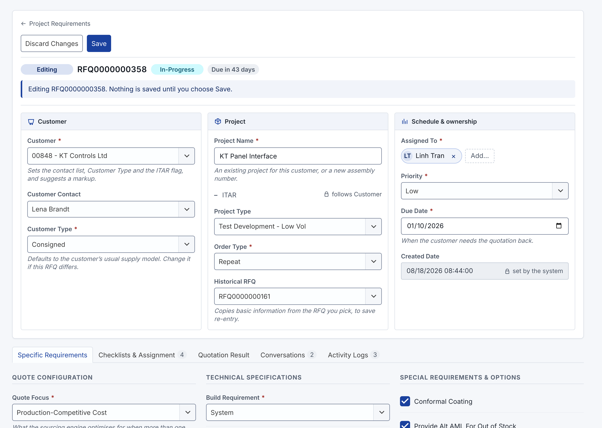

# Pattern · Record form

> One record, two modes. Every detail screen in Voyager IQ is this shape, so
> getting it right once is worth more than getting any single component right.
> **Components:** [Button](../components/button.md) ·
> [More menu](../components/more-menu.md) ·
> [Status badge](../components/badge.md) · Field · Dialog

---

## The shape

Top to bottom, and **in this order**:

| | Band | Rule |
|---|---|---|
| 1 | **Back link** | The list this record came from, named |
| 2 | **Toolbar** | Actions on the left, smart buttons on the right. At most four visible; the rest behind [More ▾](../components/more-menu.md) |
| 3 | **Banner** | Only when there is something to say — editing, a credit limit, a validation summary |
| 4 | **Identity** | Record number, [status](../components/badge.md), and a due pill. The audit line sits under it |
| 5 | **Tabs** | Directly under the identity, **inside the same panel** |
| 6 | **Body** | Three column groups, then the lines grid, then totals |

**Tabs sit under the identity, not above it.** Switching tab must not cost you
the record number — that is the one thing you need on every tab. It also keeps
the tab content inside the same surface as the record, so the two do not read
as separate pages.

**One panel, one border.** The groups inside it have no borders of their own;
they are separated by their heading and by `28px` of gap. A border per group
turns one record into five cards.

---

## The two modes

| | View | Edit |
|---|---|---|
| Field you can change | Sunken box, no padlock | **White input**, `--vy-border-control` |
| Field you cannot | Sunken box, no padlock | **Sunken box, padlock, and a short reason** |
| Toolbar | The record's actions | **Discard Changes · Save** |
| Banner | Only if there is a condition | **"Editing RFQ…. Nothing is saved until you choose Save."** |
| Identity | Record number and status | Plus an **Editing** badge |

**In view mode nothing is editable, so the distinction has nothing to say.**
A padlock on all twenty-seven fields marks none of them. The boxes are
identical and the eye reads the values, not the chrome.

**In edit mode the white tells you where you may type.** Everything still in a
grey box is a value this screen does not own, and the padlock is followed by
the reason in two or three words — *follows Customer*, *set by the system* —
because a padlock says *that* a field is locked and cannot say *why*.

> **One exception, and it is the same rule.** A panel where *nothing* is
> editable keeps the grey box and drops the padlock. Run Quotation's setup
> strip on the last step is the case: a padlock on each of seven values says
> only what the panel already says.

---

## Entering and leaving

| Step | What happens |
|---|---|
| **Edit** | Toolbar swaps, banner appears, editable fields turn white |
| **Save** | Writes, returns to view mode |
| **Discard Changes, nothing changed** | Returns to view mode **with no dialog** — there is nothing to confirm |
| **Discard Changes, n changed** | A confirmation, below |

### The discard confirmation

It is not a generic "are you sure". It answers three questions in the order
they are asked:

| | |
|---|---|
| **Title** | `Discard changes to RFQ0000000358?` — **the record number**, because on a screen this deep that is the fastest way to know which record you are about to throw away |
| **Subtitle** | *This cannot be recovered once you leave the record.* |
| **Body** | `3 fields were changed:` **and the list of them** |
| **Actions** | `Keep Editing` (text) · `Discard Changes` (danger) |

> **Three sources described this differently, and the code is the most
> generous of the three.** The Standard says the popup never lists the changed
> fields. The 16 Oct review argued for a count — *"a count is not a list: it
> answers 'did I actually change anything?'"*. The build does **both**: the
> count answers that question, and the list answers the one that comes next.
> Worth settling in words, because the next person to touch it will find three
> instructions.

---

## Rules that are easy to get wrong

1. **The safe button names what you keep.** `Keep Editing`, not `Cancel` — on
   a dialog whose other button is *Discard Changes*, a bare Cancel is a coin
   toss. In the toolbar the word is **Discard Changes**, never Cancel;
   [Cancel belongs only in dialogs](../design-system.md#d1--buttons).
2. **Errors arrive on blur, not on every keystroke** — and whichever side of
   the label they sit on, that timing does not change.
3. **A required field keeps its red asterisk in both modes.** Required is a
   property of the field, not of the mode.
4. **Helper text and an error never appear together.** Two lines each claiming
   to say what to do next is one line too many.
5. **Nothing is saved until Save.** The banner says so, in those words, every
   time the mode is entered.

## Accessibility

| | |
|---|---|
| Mode change | The banner is the announcement; it carries `role="status"`, so it does not interrupt |
| Validation summary | `role="alert"` — that one does interrupt |
| Padlock | `aria-hidden`; the reason beside it is real text |
| Tabs | A real tablist; the record identity is outside it, so it is not re-announced per tab |
| Focus | Entering edit mode does not steal focus; leaving the dialog returns it to the button that opened it |

## What varies between records

The **groups** and the **tabs**. Everything else — the band order, the two
modes, the discard flow, the toolbar rules — does not.

---

## Related

[D2 · Fields](../design-system.md#d2--fields) ·
[D4 · Dialogs](../design-system.md#d4--dialogs) ·
[D6 · Words](../design-system.md#d6--words) ·
[Destructive action](destructive-action.md) ·
[List screen](list-screen.md)

## Recent changes

| Date | Change |
|---|---|
| 8 Nov 2026 | This page |
