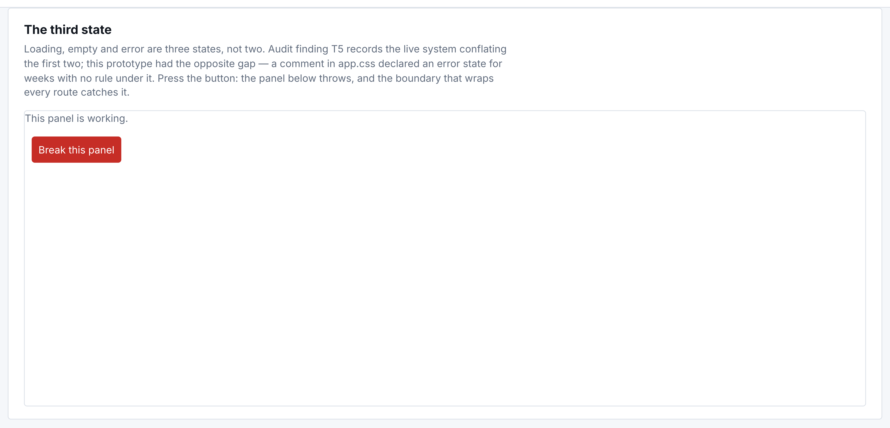
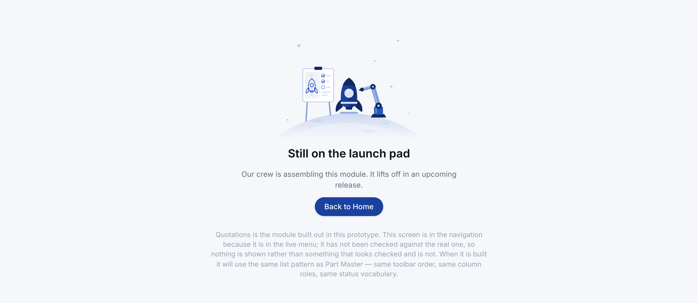

# The four screen states

Loading, empty, error and not-yet-built are four different things and look
it. Getting these wrong is the most common way a screen lies to its reader.

| State | What the user sees | Actions | Illustration |
|---|---|---|---|
| **Loading** | Rocket climbing, planet sinking, five-segment bar | none | [Launching](../foundations/illustrations.md#launching--the-boot-screen) |
| **Empty** | A sentence saying what would fill it | the action that fills it | none |
| **Error** | Rocket on the pad: tilted, cracked, one fin off, smoking | Reload · Back to Home · Send a support ticket · Error ID + Copy | [Error](../foundations/illustrations.md#error--the-screen-stopped-loading) |
| **Under development** | Rocket whole on the pad, arm welding, plan ticking off | Back to Home. **No Reload — nothing is broken** | [Building](../foundations/illustrations.md#building--still-on-the-launch-pad) |

**The error state's three slots** are the three questions a person actually
has: *what failed · what it means for me · what I can do next.* Only the
first is generic.

**The error id is minted where the error is caught**, not where it is drawn —
minted in render, pressing Copy would hand the user a different number for
the same failure.
