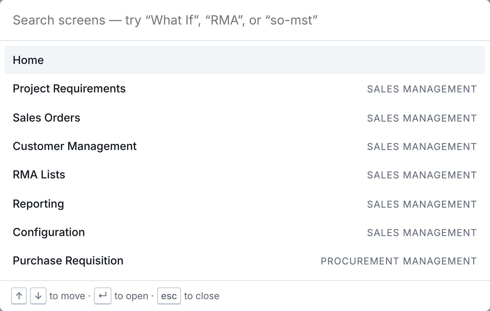

# Pattern · Search

> Seven places in this product where you type to narrow something down. They
> are not one control used seven times, and the differences are the pattern.
> **Components:** [Field](../components/field.md) ·
> [Dialog](../components/dialog.md) ·
> [Mini table](../components/mini-table.md) ·
> [Column chooser](../components/column-chooser.md) ·
> [People picker](../components/people-picker.md) ·
> [Error state](../components/error-state.md)

---

## Where you can type, and what each one is for

| | Searches | Over | Control |
|---|---|---|---|
| **⌘K palette** | Screens | 47 nav destinations | Its own input |
| **List toolbar** | Records in this list | the `searchable` columns | [`SearchField`](../components/field.md) |
| **AML Search** | Approved manufacturer parts, across all parts | MPN · manufacturer · description | A labelled `TextField` |
| **Where Part Number Used** | Parent assemblies of one part | top assembly · description | `SearchField` |
| **Preferred Suppliers** | Suppliers on this quote | supplier name | `SearchField` |
| **Run Quotation toolbar** | Lines in the step you are on | set by the step | `SearchField` |
| **People picker** | Options in an open menu | name · email | A bare input with `aria-label` |

Three shapes, and the rule behind them was never written down until now:

| Shape | When | Why |
|---|---|---|
| **`SearchField`** — icon, no label, `type="search"` | A box **beside** other things: a toolbar, a dialog that also shows a grid | It has to be recognisable before it is read, and it is the single most-used control on every list screen |
| **A labelled field** | A dialog whose whole body **is** the query — AML Search | The label survives after you type. A placeholder is gone exactly when you want to check what you asked |
| **A bare filter input** | Inside an open menu — People picker | It narrows options you can already see. Calling it search would promise a reach it does not have |

---

## Search is not filter, and the list screen already draws that line

[List screen](list-screen.md#four-ways-to-narrow-a-list-and-they-are-not-interchangeable)
settles the four ways to narrow a list. The half that belongs here:

> **A filter is for a set you are describing; search is for a record you can
> name.** If a user is typing a part number into a filter, the search box is
> in the wrong place.

Which is why the toolbar order is filters → search → columns, and why the
empty state has to say **which** of them emptied the list.

---

## ⌘K — the palette

The live menu holds 51 nodes, **47 of them destinations**, behind a collapsed
hamburger — so a new user must remember which of eight groups owns a screen
before they can reach it. Search removes
that requirement. Four scoring tiers, best first: a title that **starts with**
the query, a title that **contains** it, the **route**, then the old name and
the hint.

### Three things it promised and did not do

All three were in the shipped build on 9 November, and all three are the same
mistake: a search box describing a reach it does not have.

| | Measured | |
|---|---|---|
| The code comment said it matched the **old** label, so a user trained on the live system would find a renamed screen | **0 of 47** live destinations carry `wasCalled`. **0** carry `hint`. Both fields are populated only on `proposedNav` — the renaming proposal decision D1 declined | Two of the four tiers could never fire |
| Its own placeholder says *try "What If", "RMA", or **"so-mst"*** | `so-mst` returned **nothing**. It is a route, and the palette did not read routes | A control inviting a query it cannot answer |
| The header button said *Search screens, **orders, parts**…* | The index is 47 nav destinations. No order, no part | [A3 rule 5](../design-system.md#a3--five-rules-before-you-build) — *say what is not real* — broken by the search box itself |

> **A tier that matches nothing looks exactly like a query with no answer.**
> That is why it lasted: every failure was indistinguishable from the user
> having typed something that does not exist.

### The route is the third name, and it was the one missing

Finding **C1** records that every screen here has three names: the nav says
*Project Requirements*, the browser title says *Request for Quotation*, and
the route says `quotation`. C1 declines to pick one, on the grounds that
choosing breaks the two that users already search for.

The answer to that is not to pick. It is to **match all of them** — so the
path is a scoring tier, below both title tiers so a route match never outranks
the name on screen.

| Typed | Before | After |
|---|---|---|
| `so-mst` | — | Sales Orders |
| `quotation` | — | Project Requirements |
| `part-mst` | — | Parts & Item Master |
| `cust-mst` · `po-mst` · `mpn` | — | the screen each route belongs to |
| `management` | 6 titles | the same 6 titles first, then route matches |

**`rfq` still finds nothing, and that is left alone.** Neither *RFQ* nor
*Request for Quotation* appears in any nav label or any route. Making them
match would mean inventing a fourth name for 47 screens, which is the thing
C1 refused.

### One left edge

The group led each row, in a column set to a 66px **minimum** — which is a
column that aligns nothing. Measured, the eight live group labels run from
88px to 199px, so the eight visible titles started at **five different x
positions**, and *Home* — a leaf group with no label at all — started at a
sixth.

Widening the column to 199px was the other way out, and it spends a third of a
620px palette on a qualifier that matters for the eight rows where a label
repeats: *Configuration* appears 5 times in this menu and *Reporting* 3.

So the group moved to the end of the row and right-aligns. All eight titles
now begin at one x.

> A list you scan by name has one job for the eye: run down a single left
> edge.

---

## The list toolbar — what a grid search actually reads

A column opts in with `searchable: true`. **18 columns** across the six list
screens do; the rest are dates, statuses and numbers, where a filter is the
right control and a substring match is not.

Search runs **before** sort and paging, because sorting a page rather than a
set would sort twenty rows out of two thousand.

### Hiding a column used to hide the record

The search read the **visible** columns, so unticking one in the
[Column chooser](../components/column-chooser.md) silently narrowed what the
list could find. Measured on Manufacturers:

| | Rows for `SEMCO` |
|---|---|
| Aliases column shown | **1 of 18** — Samsung Electro-Mechanics, whose only match is in Aliases |
| Aliases column hidden | **0**, under *Nothing matches "SEMCO"* |

The record was still in the list. The box was still captioned *Search name,
website or alias*.

Two reasons that is wrong, and not a trade-off:

- [List screen](list-screen.md) defines **Columns** as which of the view's
  columns *you personally show*, held in your browser. **A display preference
  must not change the answer to a question.**
- `searchPlaceholder` is a fixed string the page author wrote, naming the
  fields. It cannot know what you hid, so it goes on promising a field the
  search has stopped reading.

Search now reads the whole column set. **The cost, stated:** a row can match
on a column you cannot see. That is the smaller harm — a hit you have to widen
the view to explain, against a record the list told you does not exist.

---

## Nothing until it is worth something

The two searches that reach across a whole record set wait before they answer.

| | |
|---|---|
| **AML Search** | *Type at least two characters.* A dialog that opens showing 600 rows invites scrolling; this one asks a question and waits |
| | Caps at **60**, and says which it is: *First 60 matches* or *12 matches* |
| **Where Part Number Used** | Zero is an **answer**, not an absence — *nothing else consumes this part* is the most useful thing the popup can say, and it says it rather than showing an empty table |

---

## Saying which emptiness this is

An empty result has to name its cause, because the user cannot see which of
the three narrowings is doing the work.

| Situation | What the screen says |
|---|---|
| Search found nothing | *Nothing matches "xyz"* · **Clear search** |
| Search **and** a filter are both on | *Both a search and a filter are narrowing this list.* |
| Filters only | Say so, and offer **Clear all** |
| Nothing on file at all | What this list is for, and the button that fills it |

> The earlier version offered to *"clear the search to see all 0 records"*
> when the search was empty and the filters were doing the work. An empty
> state that misnames the cause sends the user to undo the wrong thing.

---

## Accessibility

| | |
|---|---|
| Every box is named | `aria-label` carrying the same words as the placeholder, so the field is announced even once it holds text |
| `type="search"` | Gives the native clear control and the right keyboard on touch |
| Palette keys | ↑ ↓ to move, ↵ to open, esc to close — printed in the footer, not left to be guessed |
| Palette focus | `autoFocus` on open, and the query resets each time it opens, during render rather than in an effect — so it never paints one frame of the previous search |
| Results | A real list; the highlight follows the pointer as well as the arrows, so the two inputs cannot disagree |
| No match | A sentence naming what was typed, never a blank panel |
| The group chip | A qualifier after the name, never the only way to tell two results apart — the title is read first |

---

## Related

[List screen](list-screen.md) ·
[Field](../components/field.md) ·
[Column chooser](../components/column-chooser.md) ·
[D5 · The four screen states](../design-system.md#d5--the-four-screen-states) ·
[D6 · Words](../design-system.md#d6--words)

## Recent changes

| Date | Change |
|---|---|
| 9 Nov 2026 | This page |
| 9 Nov 2026 | ⌘K scores on the route, so `so-mst` and `quotation` resolve; the placeholder's own suggestion worked for the first time |
| 9 Nov 2026 | The header button no longer offers orders and parts |
| 9 Nov 2026 | Grid search reads the whole column set, so hiding a column stops hiding records |
| 9 Nov 2026 | Palette titles align on one left edge; the group moved to the end of the row |
