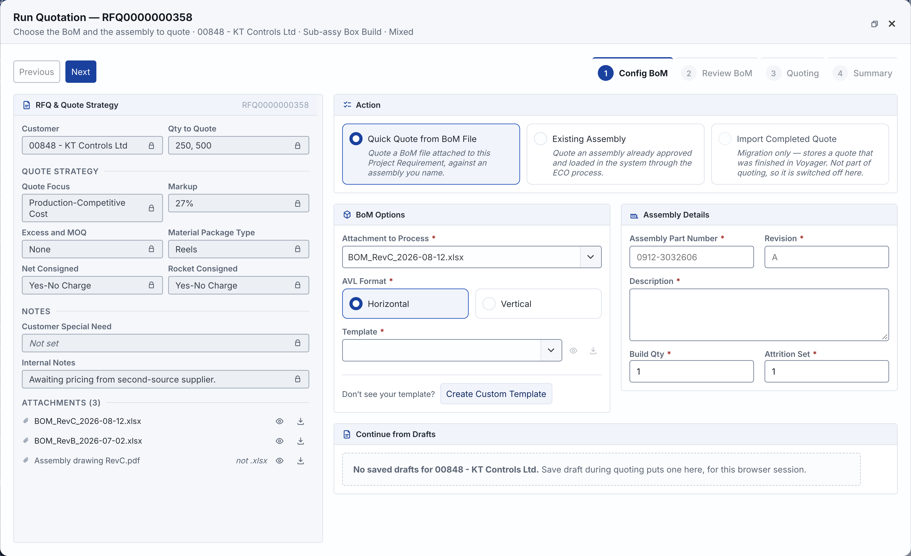

# Pattern · Wizard

> A long job split into steps you can walk back through. Run Quotation is the
> only one in the product, and it is four steps deep.
> **Components:** Stepper · [Button](../components/button.md) · Dialog ·
> FileDrop

---

## The shape

| | Band | Rule |
|---|---|---|
| 1 | **Title** | The job **and the record**: `Run Quotation — RFQ0000000358` |
| 2 | **Subtitle** | What this step is for, plus the facts that do not change between steps |
| 3 | **Nav + stepper** | `Previous` · the step's own button on the left; the stepper on the right |
| 4 | **Step body** | Whatever this step is |

The dialog is `xl` and opens maximised: a 21-column grid in a 1180px window
spends the screen it was given.

---

## The steps are buttons

Not decoration. Someone who realises on step 3 that they mis-mapped a column
on step 1 should go **straight back to it**, not press Back twice and lose
their place.

**Forward movement is bounded by `furthest`** — the highest step reached so
far. You can move freely across work you have already done; you cannot skip
ahead into a step whose inputs do not exist yet.

> A stepper that lets you land on *Summary* before a BoM is uploaded is
> offering a dead end.

---

## One filled button per step

Before this rule, step 3 showed two — *Get Prices* in its toolbar and
*Generate Quotation* in the nav — so the screen offered **two answers to
"what now"**.

The rule, from the Standard, stated exactly:

> *If the step's main action is not done yet, that action is primary and Next
> turns secondary but stays enabled.*

**Stays enabled** is the load-bearing half. A quote with no prices in it is a
legitimate thing to carry forward, and the reason not to is better said by a
tooltip than by a dead control — *"Get prices first, or continue with a quote
that has none"*.

**No Cancel.** The dialog's own close button is the way out, as in the
customer's mockup. A second one in a row of four would be the only control
here that does not move the wizard forward or back.

---

## The button is named after its result

Step 3's button says **Next**, not *Generate Quotation*.

> The press that actually writes is this one: it sets **NO BID** on the
> supplier-less lines and moves to step 4. A button that generates nothing
> should not be named after generating something — the rule is that a button
> names its **result**, and the result here is step 4. The quotation is
> created by **Submit**, on the last step, which is what it is called.

---

## Two popups deliberately not built

The user manual of 29 October describes two confirmations this build does not
have. Both omissions are decisions, recorded on 29 Oct so they can be revisited.

| | The manual | Here | Why |
|---|---|---|---|
| **Step 2 → Next** | A *Review Excluded Parts* popup listing excluded parts, with tick boxes to put them back | No popup. Excluding and restoring happens **on the step-2 grid**, and an *Excluded Only* filter — now with a count — opens that exact list at any time | The popup's content is **a list the screen behind it is already showing**, and the fix lives on the grid. The popup only adds a press between the user and the place they edit |
| **Step 3 → Next** | A *Confirm Importing BoM* popup listing supplier-less and excess parts with a Total Excess Amount | No popup. Those numbers print **on the bar beside Next** | A modal asking "are you sure" about four numbers is a modal that should have printed the four numbers. The user still reads the consequence before pressing — without losing a beat |

> **The fourth number was missing, and holding the two side by side found it.**
> The line beside Next was printing three of the popup's four facts; Total
> Excess Amount was added on 30 Oct.
>
> **What would change this decision:** a real user pressing Next without
> reading that line — somebody submitting a quote containing NO BID without
> knowing. Then the argument is wrong and the popup comes back. Worth watching
> in a session with real users.

---

## Responsive

The stepper is where this pattern meets the layout, and the breakpoints were
measured rather than guessed:

| Width | What changes | Why |
|---|---|---|
| ≤ **840px** | Step descriptions go | Four labelled steps need about 760px of stepper; below that the labels truncate, and a truncated *"1 - Confi…"* is worse than no description — **the step name is what you navigate by** |
| ≤ **700px** | Only the current step keeps its label; the rest become their marker | `"2 - Review BoM"` needs 98px of label and a step costs about 146px with its marker, gap and padding — four of those is 584px. The markers still show position and stay clickable |

## Accessibility

| | |
|---|---|
| Steps | Each states **its own status** to a screen reader, so *where am I and what is left* does not depend on seeing the ticks |
| Unreachable steps | Disabled, not hidden — the shape of the job stays visible |
| Numbering | `numbered={false}` where the labels already carry numbers, or every step reads *"① 1 - …"*, which looks like a rendering fault |
| Busy | Submit disables while writing; a second press would submit twice |

---

## Related

[Record form](record-form.md) · [File upload](file-upload.md) ·
[Feedback and toasts](feedback.md) ·
[B5.4 · Dialogs and shell](../design-system.md#b54-dialogs-and-shell) ·
[B7 · Responsive](../design-system.md#b7--responsive)

## Recent changes

| Date | Change |
|---|---|
| 8 Nov 2026 | This page |
